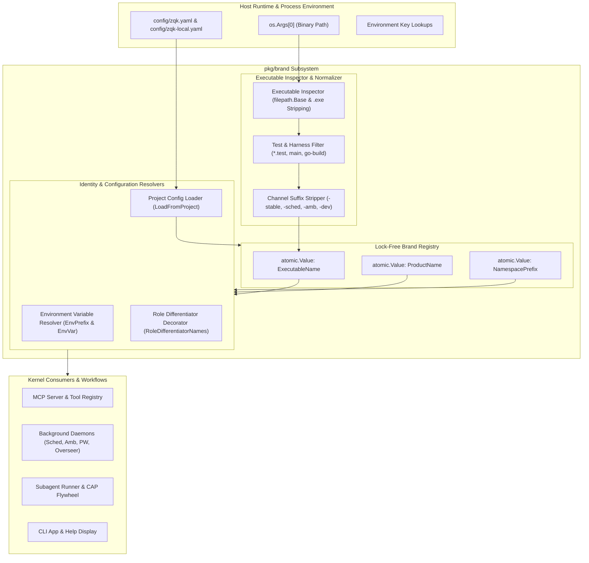
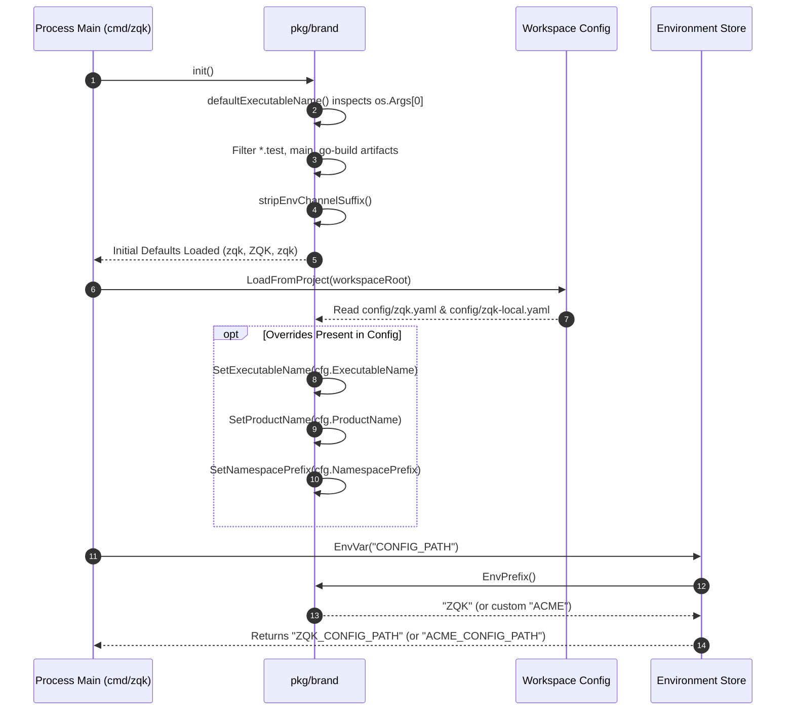

# Branding & Identity Subsystem Architectural & Operational Guide

Comprehensive architectural manual, executable identity discovery specification, and operational guide for the **ZQK Branding & Runtime Subsystem** (`pkg/brand`).

---

## 1. Overview & Architectural Compass

The **Branding & Identity Subsystem** (`pkg/brand`) provides centralized executable name resolution, product identity derivation, environment variable namespace binding, and channel suffix management for the **Zen Quantum Knowledge Kernel**.

In an enterprise-grade, extensible operating kernel, hardcoded binary names (`zqk`) and static environment variable prefixes (`ZQK_`) present significant architectural liabilities:
- **White-Label & Forking Rigidity**: Downstream enterprise distributions, private forks, and specialized appliance builds require dynamic rebranding without patching hundreds of source files.
- **Packaging & Channel Divergence**: Running channel-specific binaries (such as `zqk-stable`, `zqk-community`, or `zqk-dev`) must not break environment variable resolution (e.g., config should still read canonical `ZQK_*` rather than fracturing into `ZQK_STABLE_*`).
- **Daemon & Subsystem Multiplexing**: Background services (Ambient daemons, CAP loop schedulers, Privileged Writers, Process Overseers, and MCP adapters) must follow deterministic naming conventions (`<brand>-sched`, `<brand>-amb`, `<brand>-pw`, `<brand>-mcp-daemon`) while retaining automatic fallback to upstream canonical binaries.
- **Test Harness Contamination**: When running tests via `go test`, the execution binary is compiled as a temporary test executable (`<pkg>.test` or `main` inside temporary build caches). Unaware identity resolution would misidentify the test runner as the CLI product, triggering catastrophic self-execution loops (fork-bombs) during subagent orchestration and MCP tool invocation.

The `pkg/brand` subsystem eliminates these failure modes through lock-free atomic registries, deterministic executable inspection, robust channel stripping algorithms, and clean project-level configuration cascades.



---

## 2. Component Topology & Architecture

The `pkg/brand` package is divided into core functional facets:

### 2.1 Brand Registry & State Storage

The subsystem maintains process-wide branding attributes using `sync/atomic.Value` instances. This design ensures that brand lookups on hot execution paths remain entirely non-blocking and thread-safe without mutex contention:

```go
var (
    executableName  atomic.Value // string
    productName     atomic.Value // string
    namespacePrefix atomic.Value // string
)
```

- **`ExecutableName()`**: Returns the resolved binary name (default: `"zqk"`). Used across CLI help text, subagent execution commands, and external process spawning.
- **`ProductName()`**: Returns the human-readable product display name (default: `"ZQK"`). Used in banners, status logs, and UI presentation.
- **`NamespacePrefix()`**: Returns the canonical kernel namespace identifier (default: `"zqk"`). Used for MCP tool registration prefixes and internal graph scope identifiers.

### 2.2 Executable Inspector & Test Filter

The executable inspector examines `os.Args[0]` to automatically detect the running binary identity while filtering out ephemeral test binaries:

1. **Path Normalization**: Extracts the binary base name using `filepath.Base` and strips Windows `.exe` suffixes case-insensitively.
2. **Go Test & Build Directory Rejection**: If the executable ends with `.test`, equals `main` or `main.exe`, or originates from a temporary Go build path (`go-build` or `___go_build`), it is immediately rejected, reverting safely to the default canonical name (`"zqk"`).
3. **Channel & Role Normalization**: Strips packaged role suffixes (such as `zqk-pw`, `zqk-amb`, `zqk-sched`, `zqk-overseer`) or channel identifiers (`zqk-stable`, `zqk-stable-*`) to establish the root brand identity.

### 2.3 Channel & Packaging Suffix Stripper

The `stripEnvChannelSuffix` routine enforces an ordered priority list of packaging and role suffixes. Longer, more specific suffixes are evaluated first to prevent partial truncation:

| Suffix Category | Suffixes Evaluated (Ordered) | Result Transformation |
| :--- | :--- | :--- |
| **Test Runner** | `.test` | `pkg.test` → `pkg` |
| **MCP Adapters** | `-mcp-ide-adapter`, `-mcp-proxy`, `-mcp-daemon`, `-mcp` | `zqk-mcp-daemon` → `zqk` |
| **Privileged Services**| `-privileged-writer`, `-pw` | `acme-privileged-writer` → `acme` |
| **Ambient Daemons** | `-ambient-daemon`, `-ambient`, `-amb` | `custom-amb` → `custom` |
| **Scheduler Daemons** | `-scheduler-daemon`, `-scheduler`, `-sched` | `foo-scheduler` → `foo` |
| **Overseer Service** | `-overseer` | `bar-overseer` → `bar` |
| **Release Channels** | `-community`, `-stable`, `-dev`, `-beta`, `-alpha`, `-rc` | `zqk-stable` → `zqk` |

### 2.4 Environment Variable Resolver

The environment resolver (`EnvPrefix`, `EnvPrefixForExecutable`, and `EnvVar`) translates arbitrary brand executable names into uppercase, POSIX-compliant environment variable prefixes:

- Non-alphanumeric characters (hyphens, spaces, dots) are converted into underscores.
- Consecutive underscores are collapsed into a single underscore.
- Leading and trailing underscores are stripped.
- Channel suffixes are stripped prior to conversion so that release channel variants share identical environment configurations.

```
Executable: "acme-corp-cli-stable" 
  -> Channel Stripped: "acme-corp-cli"
  -> Character Mapping: "ACME_CORP_CLI"
  -> EnvVar("PORT"): "ACME_CORP_CLI_PORT"
```

### 2.5 Role Differentiator Decorator

Daemons and worker processes in the ZQK cluster require specific binary names depending on whether the system is running under the upstream canonical brand or a branded fork.

`RoleDifferentiatorNames(role)` generates candidate binary basenames in priority order:
- Under custom brand `"acme"`, candidate daemon binaries for role `"sched"` will be `["acme-sched", "acme-scheduler", "zqk-sched", "zqk-scheduler"]`.
- Under default brand `"zqk"`, candidate daemon binaries will be `["zqk-sched", "zqk-scheduler"]`.

This dynamic priority chain guarantees backward compatibility with upstream infrastructure while enabling clean white-label deployments.

---

## 3. Executable & Channel Resolution Lifecycle

The following sequence illustrates how the runtime resolves brand identity, applies project overrides, and binds environment variables during bootstrap:



---

## 4. Multi-Tenant & White-Label Isolation

### 4.1 Namespace Prefix Normalization

MCP (Model Context Protocol) tool names and internal schema identifiers must remain deterministic even when invoked through channel binaries.

If an operator launches a subagent using `zqk-stable`, the tool namespace must not mutate into `zqk-stable_*` (which would invalidate client tool schemas). `ProductNamespacePrefix(prefix)` normalizes channel binaries and administration roles:

```go
// Both map deterministically to "zqk"
ProductNamespacePrefix("zqk")        // "zqk"
ProductNamespacePrefix("zqk-stable") // "zqk"
ProductNamespacePrefix("zqk-admin")  // "zqk"
```

### 4.2 Configuration File Hierarchy

When customizing brand identity per project or deployment environment, the kernel reads two hierarchical configuration files:

1. **`config/zqk.yaml`**: Version-controlled base project configuration.
2. **`config/zqk-local.yaml`**: Unversioned local developer/operator override file (takes precedence).

```yaml
# config/zqk.yaml
brand:
  executable_name: "acme-kernel"
  product_name: "Acme Operating Kernel"
  namespace_prefix: "acme"
```

`LoadFromProject(root)` gracefully handles missing files, unreadable permissions, or corrupt YAML structures by falling back to compiled upstream defaults without crashing.

---

## 5. Operational Recipes & Code Patterns

### 5.1 Querying Brand Identity in Subsystems

Subsystems should never hardcode `"ZQK"` or `"zqk"`. Always use dynamic brand queries:

```go
package mysubsystem

import (
    "fmt"
    "os"
    "github.com/zqk-os/zqk/pkg/brand"
)

func BuildDaemonCommand() string {
    // Resolves to "zqk-sched" or "<brand>-sched"
    binary := brand.SchedExecutableName()
    return fmt.Sprintf("%s start", binary)
}

func LookupPort() string {
    // Looks up "ZQK_PORT" or "<BRAND>_PORT"
    key := brand.EnvVar("PORT")
    if val := os.Getenv(key); val != "" {
        return val
    }
    return "8080"
}
```

### 5.2 Unit Testing with Isolated Brand Overrides

When writing unit tests that temporarily alter brand configuration, always save previous state and restore it via `t.Cleanup`:

```go
func TestCustomBrandFeature(t *testing.T) {
    origExe := brand.ExecutableName()
    origProd := brand.ProductName()
    origNS := brand.NamespacePrefix()
    
    t.Cleanup(func() {
        brand.SetExecutableName(origExe)
        brand.SetProductName(origProd)
        brand.SetNamespacePrefix(origNS)
    })

    brand.SetExecutableName("acmectl")
    brand.SetProductName("AcmeControl")
    brand.SetNamespacePrefix("acmectl")

    if got := brand.EnvVar("API_KEY"); got != "ACMECTL_API_KEY" {
        t.Fatalf("unexpected env var: %s", got)
    }
}
```

---

## 6. Verification & Test Coverage Invariant

The `pkg/brand` subsystem is governed by a strict **Static Floor Invariant** requiring statement test coverage to be maintained at or above **85.0%**.

### 6.1 Running Scoped Verification

To verify statement test coverage and execute all unit tests within the package:

```bash
ZQK_ALLOW_FOREGROUND_GO_TEST=1 go test -v -timeout 30s -cover ./pkg/brand
```

### 6.2 Verifying Code Profile Coverage

To generate and inspect a per-function statement coverage report:

```bash
ZQK_ALLOW_FOREGROUND_GO_TEST=1 go test -timeout 30s -coverprofile=coverage.out ./pkg/brand
go tool cover -func=coverage.out
```

All functions across `env.go` and `runtime.go` are verified with 100% statement coverage.
