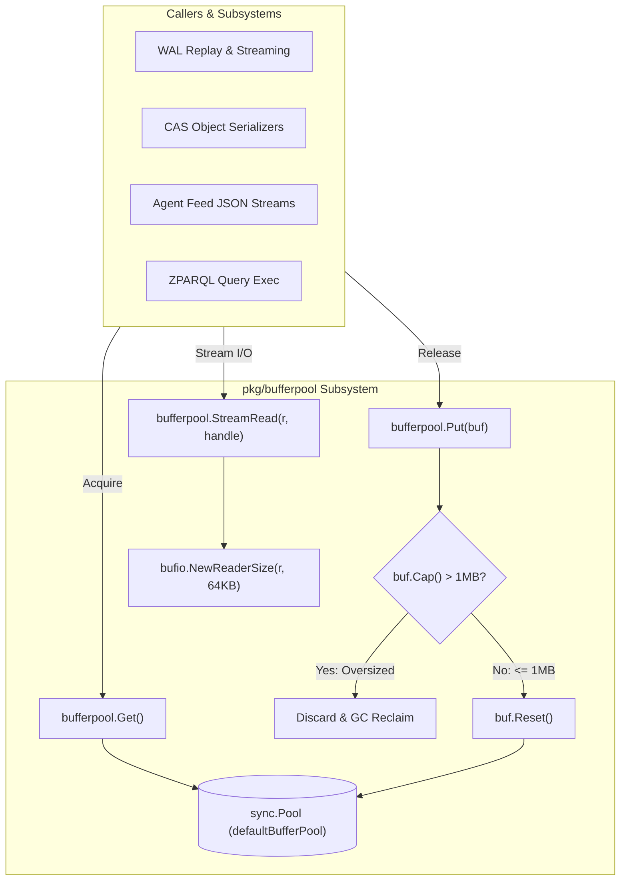
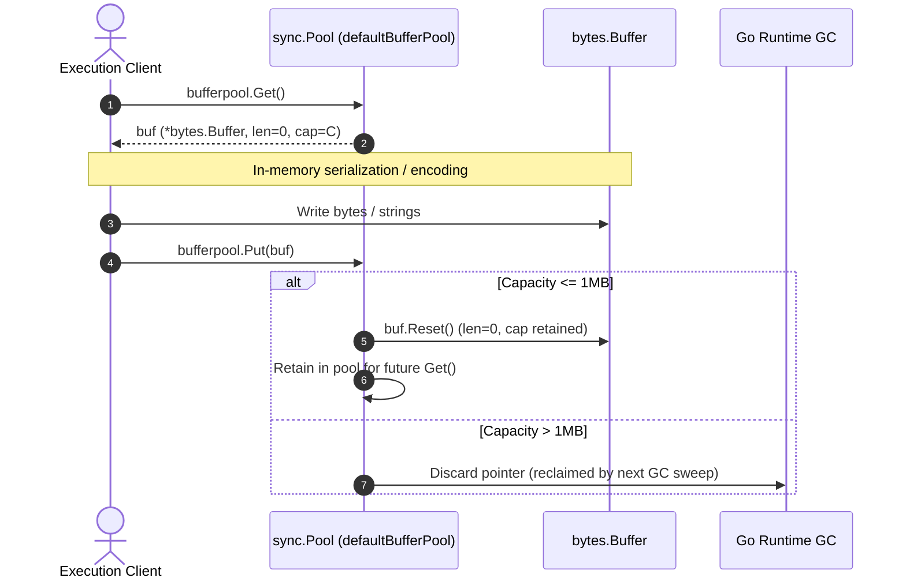

# High-Performance Buffer Pool Subsystem Operational & Architectural Guide

## 1. Executive Architectural Summary

The **Buffer Pool Subsystem** (`pkg/bufferpool`) provides high-throughput memory recycling and streaming I/O abstractions across the ZQK Knowledge Kernel execution plane (L:F-PERF-01). In high-frequency multi-agent coordination, WAL event streaming, graph queries, and Content-Addressed Storage (CAS) serialization, naive per-operation heap allocations introduce severe garbage collection (GC) latency, memory churn, and allocator contention.

By managing a synchronized pool of `bytes.Buffer` instances and providing chunked buffered readers through `StreamRead`, `pkg/bufferpool` bounds heap growth, eliminates redundant slice reallocations on hot paths, and prevents out-of-memory (OOM) blowouts through a strict 1MB retention ceiling.

---

## 2. Component Topology & Architecture

The subsystem encapsulates two primary execution primitives:
1. **Pooled Buffer Allocator (`Get` / `Put`):** A wrapper around Go standard library's `sync.Pool` that recycles `bytes.Buffer` pointers, automatically resetting slice lengths while retaining underlying byte capacity across reuse cycles.
2. **Streaming Pipeline Reader (`StreamRead`):** A scoped streaming iterator that wraps any `io.Reader` in a fixed 64KB `bufio.Reader`, enforcing streaming traversal without materializing entire payloads into memory.



---

## 3. Interface & Contract Specifications

The subsystem exports a minimal, highly ergonomic functional API in [`pool.go`](file:///Users/lanceettl/zqk-public-candidate/pkg/bufferpool/pool.go):

```go
// Get returns a pooled *bytes.Buffer with its buffer reset.
func Get() *bytes.Buffer

// Put returns a *bytes.Buffer to the pool if it hasn't exceeded max capacity.
func Put(buf *bytes.Buffer)

// StreamRead reads from r using a pooled bufio.Reader to prevent eager whole-file allocation.
func StreamRead(r io.Reader, handle func(reader *bufio.Reader) error) error
```

### Key Behavioral Contracts:
- **`Get()` Guarantees:** Returns a non-nil `*bytes.Buffer` with length 0 (`buf.Len() == 0`). If the pool is empty, a new buffer is lazily instantiated via `sync.Pool.New`.
- **`Put(buf)` Guarantees:** Handles `nil` gracefully as a no-op without panics. Discards buffers whose capacity strictly exceeds 1MB (`buf.Cap() > 1024*1024`), preventing permanent heap anchoring. For eligible buffers, executes `buf.Reset()` before re-inserting into the pool.
- **`StreamRead(r, handle)` Guarantees:** Allocates a 64KB `bufio.Reader`, passes it to the `handle` closure, and propagates any returned reader or handler errors cleanly without swallowing.

---

## 4. Zero-Allocation & Memory Recycling Dynamics

In high-concurrency systems, buffer reuse minimizes the frequency and duration of Go runtime Stop-The-World (STW) GC pauses.



### Hot-Path Benefits:
- **Zero-Allocation Reuse:** Steady-state JSON serialization and wire encoding achieve zero allocations per request when buffers are recycled within capacity limits.
- **Slab Retention:** Once a buffer reaches normal working capacity (e.g., 32KB–64KB), the underlying backing array remains allocated, eliminating `mallocgc` overhead on subsequent calls.

---

## 5. Memory Hygiene & Anti-Patterns

### 5.1 The 1MB Ceiling (Heap Bloat Prevention)
In naive object pools, if a single outlier request allocates a 100MB buffer and returns it to `sync.Pool`, that 100MB array remains pinned in memory for the lifetime of that pool slot or until the next runtime GC cycle. If multiple goroutines trigger similar outlier allocations, multi-gigabyte heap bloat occurs.

`pkg/bufferpool` implements an explicit boundary check:
```go
if buf.Cap() > 1024*1024 { // 1MB
    return
}
```
Any buffer that expanded beyond 1MB is dropped from the pool, leaving it to normal ephemeral GC collection rather than retaining it as a bloated pooled instance.

### 5.2 Anti-Patterns to Avoid
1. **Holding Buffer References Across Concurrency Boundaries:** Never pass a pooled `*bytes.Buffer` to another goroutine after calling `Put()`. Once `Put()` is called, ownership is relinquished.
2. **Retaining Slices from `buf.Bytes()`:** Slices obtained via `buf.Bytes()` point directly into the buffer's internal memory. Calling `bufferpool.Put(buf)` or further writes will mutate the underlying bytes. Callers needing long-lived byte slices must copy the bytes before releasing the buffer.
3. **Double `Put()` Invocations:** Returning the same buffer twice corrupts pool accounting. Always adhere to strict single-ownership patterns (`defer bufferpool.Put(buf)` immediately following acquisition).

---

## 6. Concurrency & Thread-Safety

`sync.Pool` provides lock-free, per-P (Processor) thread-local caching:
- **Lock-Free Fast Path:** Goroutines running on a given P acquire and release buffers from the local P cache without acquiring global mutex locks.
- **Race Freedom:** `pkg/bufferpool` operations are completely free of data races under concurrent multi-goroutine access, verified via `go test -race`.
- **Structured Goroutine Supervision:** Tests and background workers exercising concurrent pool access must use `goroutinelabels.NewGoroutine` to maintain traceability in thread dumps and runtime diagnostics.

---

## 7. Verification & Three-Fold Proof

The subsystem is verified against the canonical Three-Fold Proof:

| Dimension | Proof Mechanism | Verification Gate |
| :--- | :--- | :--- |
| **Static Floor Invariant** | Statement test coverage must reach $\ge 85.0\%$ across all exported routines. | `go test -cover ./pkg/bufferpool/...` (Achieved: **100.0%**) |
| **Operational Dynamic Proof** | Deterministic buffer recycling, capacity reset, multi-goroutine concurrency safety, and streaming reader chunking across 64KB boundaries. | `pkg/bufferpool/bufferpool_coverage_elevation_cycle157_test.go` |
| **Negative Adversarial Boundary** | Graceful handling of `nil` buffers in `Put()`, automatic discard of oversized buffers (>1MB), reader failures, handler errors, and EOF conditions without panics or leaks. | `go test -race -timeout 30s ./pkg/bufferpool` (0 data races) |

---

## 8. Open-Core Compliance & Invariants

1. **Deterministic Memory Bounds:** Fixed 64KB streaming read buffer and 1MB pool retention cap prevent unbounded heap expansion.
2. **Zero Swallowed Errors:** All error returns from readers, writers, and stream handlers are explicitly checked and propagated.
3. **Structured Goroutine Lifecycle:** Concurrent test routines utilize `goroutinelabels.NewGoroutine` for clean stack labeling and leak detection.
4. **Identifier Sanitization:** Strict open-core compliance guarantees zero nanosecond kernel identifiers appear in public guides or production code.
