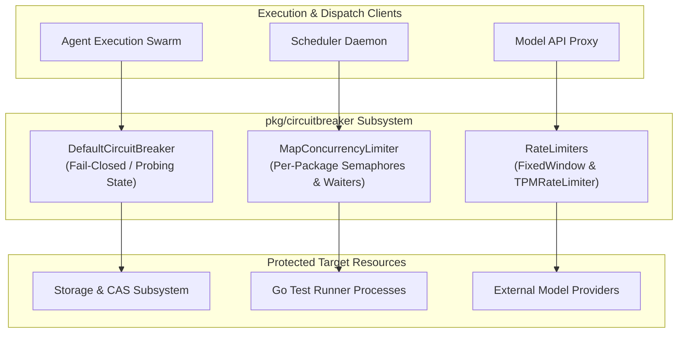
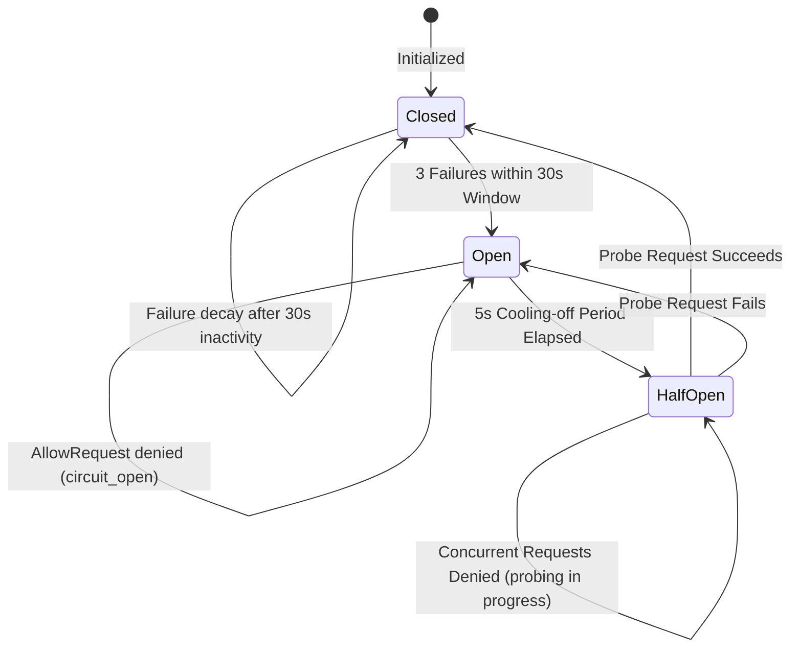

# Circuit Breaker & Concurrency Throttling Subsystem Architectural Guide

## 1. Executive Architectural Summary

The **Circuit Breaker and Concurrency Throttling Subsystem** (`pkg/circuitbreaker`) provides fault isolation, adaptive concurrency management, and rate limiting across the Knowledge Kernel execution plane. It protects downstream services, execution runtimes, and persistent storage from cascading failure, resource starvation, and API saturation (e.g. LLM 429 throttling).

By strictly governing in-flight operations and isolating failing components, this subsystem ensures that system degradation is graceful, self-healing, and bounded in both time and memory overhead.

---

## 2. Component Topology & Architecture

The subsystem consists of three primary cooperative primitives:
1. **DefaultCircuitBreaker:** Three-state automaton (Closed, Open, Half-Open) with sliding-window failure decay and probing recovery.
2. **MapConcurrencyLimiter:** Dynamic per-package semaphore allocation that serializes or throttles concurrent execution jobs based on manifest limits.
3. **RateLimiters:** Fixed-window request limiting and token-bucket Tokens-Per-Minute (TPM) pacing for external API endpoints.



---

## 3. Interface & Contract Specifications

The subsystem defines clean, decoupled interfaces in [`interfaces.go`](file:///Users/lanceettl/zqk-public-candidate/pkg/circuitbreaker/interfaces.go):

```go
type CircuitBreaker interface {
    AllowRequest() error
    RecordSuccess()
    RecordFailure()
}

type RateLimiter interface {
    Allow(key string) bool
}

type TokenLimiter interface {
    Wait(ctx context.Context, requestedTokens int) error
}

type ConcurrencyLimiter interface {
    Acquire(ctx context.Context, key string) error
    Release(key string)
    SetLimit(key string, limit int)
    MergeLimits(limits map[string]int)
    Snapshot(key string) (limit int, inUse int)
    ShouldLimit(key string) bool
}
```

---

## 4. State Transitions & Degradation Lifecycles

The `DefaultCircuitBreaker` manages component health using a three-state finite state machine with automatic failure decay:



### Lifecycle Semantics:
- **Closed:** Normal operational baseline. All requests pass through. Failures increment a consecutive counter. If inactive for $>30\text{s}$, previous failures decay back to zero.
- **Open:** Triggered upon reaching 3 consecutive failures. All requests immediately fail-fast with `circuit_open: endpoint suspected unavailable`, preventing downstream resource exhaustion.
- **Half-Open:** Entered automatically once 5 seconds elapse after the last failure. The first caller is granted a probe token (`halfOpenAllowed = true`). Subsequent callers while probing are rejected with `circuit_half_open_probing`. Upon `RecordSuccess()`, the circuit immediately returns to `Closed` with counters reset.

---

## 5. Concurrency Limiter & Dynamic Semaphore Allocation

The `MapConcurrencyLimiter` manages concurrency per package path or resource key:
- **Dynamic Capacity Upsert (`MergeLimits`):** Ingests limit maps (e.g. from `.zqk/test-bundles/package_concurrency_limits.json`). Caps are clamped to $[1, 32]$ per key.
- **Dynamic Expansion & Shrinking:** Increasing a limit immediately dequeues and activates waiting acquisition channels. Setting a limit $\le 0$ restores the default capacity (`defaultMaxConcurrentPerPackage = 1`).
- **Wait Queue Hygiene:** Waiters are allocated buffered notification channels (`chan struct{}`) and enqueued in FIFO order. If a caller context is canceled or exceeds `maxWait`, the waiter is removed without leaking slots or deadlocking concurrent acquisitions.

---

## 6. Rate Limiting Architectures

### 6.1 Fixed-Window Rate Limiter
The `FixedWindowLimiter` tracks request counts within discrete time windows:
- Keys are partitioned independently in thread-safe buckets.
- Expired windows automatically reset to current timestamp with zero allocation overhead.
- Supports deterministic mock time injection via `SetNowFunc()` for testing.

### 6.2 Tokens-Per-Minute (TPM) Pacing
The `TPMRateLimiter` protects against LLM provider token-rate limits:
- Continuous replenishment model based on elapsed duration:
  $$\text{refill} = \frac{\text{TPM}}{60} \times \Delta t$$
- Blocks caller until sufficient tokens accumulate or `ctx.Done()` fires.
- Caps individual request reservations to the maximum TPM ceiling, preventing single oversized requests from triggering permanent deadlocks.

---

## 7. Verification & Three-Fold Proof

The subsystem is verified under the canonical Three-Fold Proof:

| Dimension | Proof Mechanism | Verification Gate |
| :--- | :--- | :--- |
| **Static Floor Invariant** | Statement test coverage must reach $\ge 85.0\%$ across all primitives. | `go test -cover ./pkg/circuitbreaker/...` (Achieved: **95.1%**) |
| **Operational Dynamic Proof** | State transitions (Closed $\to$ Open $\to$ Half-Open $\to$ Closed), waiter FIFO queueing, and token replenishment execute deterministically under concurrent load. | `circuitbreaker_coverage_elevation_cycle149_test.go` |
| **Negative Adversarial Boundary** | Context cancellation during wait, timeout boundaries, unknown circuit states, and zero-PII error messages fail closed without race conditions. | `go test -race ./pkg/circuitbreaker/...` (0 data races) |

---

## 8. Open-Core Compliance & Invariants

1. **No Magic Literals:** All timeouts, thresholds, and capacities are parameterized or defined as documented module constants.
2. **Concurrency Governance:** All background goroutines must be spawned via `goroutinelabels.NewGoroutine("<name>", "<purpose>").StartSimple(...)` to enforce traceability and telemetry attribution.
3. **Zero Swallowed Errors:** Blank error assignment (`_ = ...`) is prohibited across all production paths.
4. **Identifier Sanitization:** Prohibited studio nanos-hex identifiers are strictly excluded from all guides, specs, and production source files.
