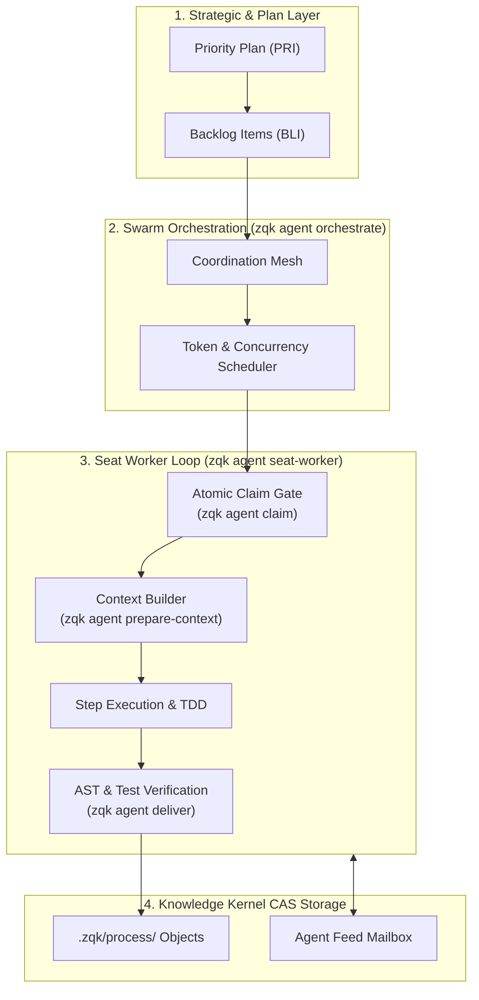
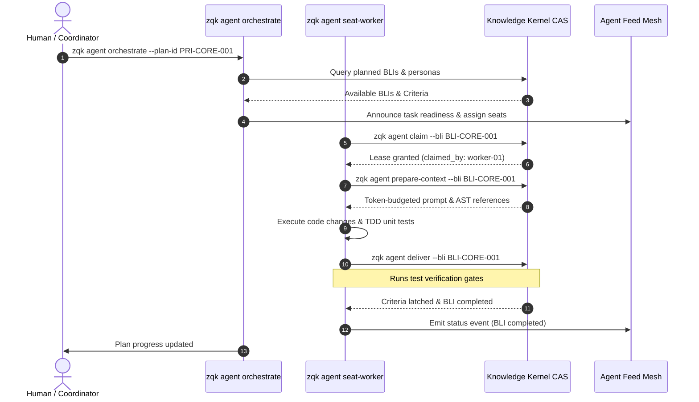

# CLI Agent Subsystem Architectural & Operational Guide

## Overview

The ZQK Agent Subsystem (`cmd/zqk/agent`) provides the mission-critical multi-agent orchestration, contextual prompt synthesis, atomic work claiming, and distributed execution engine for the **Zen Quantum Kernel**.

Unlike ephemeral LLM wrappers or prompt-promiscuous chat harnesses that suffer from context loss, phantom work attribution, and unverified code changes, ZQK anchors all agent workflows in a persistent, content-addressed Knowledge Kernel. 

The subsystem coordinates autonomous and human-paired agents across four pillars:
1. **Context-Bound Prompt Generation**: AST-informed, token-budgeted prompt synthesis preventing context pollution.
2. **Atomic Work Claim Gates**: Single-claimant work leases with git worktree isolation and anti-collision locks.
3. **AST & Test-Driven Verification**: Automated done-gates requiring deterministic test proof and criteria latching before task completion.
4. **Multi-Agent Coordination Mesh**: Peer-to-peer agent feeds, heartbeat health monitoring, proof-of-life leases, and asynchronous mailbox messaging.

```bash
zqk agent [subcommand] [flags]
```

---

## Subsystem Command Taxonomy

The `zqk agent` command hierarchy spans orchestration, task lifecycle management, runtime introspection, and execution hooks:

| Command | Invocation | Operational Role & Lifecycle Behavior |
|---|---|---|
| `orchestrate` | `zqk agent orchestrate --plan-id <plan_id>` | High-level swarm orchestrator dispatching parallel subagent workers against a Priority Plan. |
| `claim` | `zqk agent claim --bli <bli_id>` | Acquires an exclusive atomic lease on a backlog item or agent task, transitioning state to `in_progress`. |
| `prepare-context` | `zqk agent prepare-context --task <task_id>` | Synthesizes a lean, token-budgeted instruction envelope with relevant AST symbols, schema contracts, and DoD criteria. |
| `deliver` | `zqk agent deliver --task <task_id>` | Verifies execution evidence, runs test suites, and transitions completed tasks and criteria into authoritative storage. |
| `yield` | `zqk agent yield --task <task_id>` | Relinquishes an active lease gracefully, reverting tasks to `planned` or creating checkpointed handoff notes. |
| `status` | `zqk agent status` | Inspects agent seating topology, active leases, heartbeat liveness, and swarm throughput metrics. |
| `hook` | `zqk agent hook pre-subagent` | Intercepts subagent invocations to enforce context bounds, safety policies, and lease invariants. |
| `recover` | `zqk agent recover --plan <plan_id>` | Scans for orphaned leases, stale locks, or dead workers, reclaiming abandoned tasks for the swarm. |
| `seat-worker` | `zqk agent seat-worker --seat-id <seat_id>` | Launches a long-running seat worker loop that listens for claimed tasks, binds worktrees, and executes steps. |
| `evaluate` | `zqk agent evaluate` | Analyzes execution traces, evaluating token efficiency, latency, and step compliance. |
| `synthesize-skill` | `zqk agent synthesize-skill` | Extracts reusable procedural skills from successful execution traces into executable runbooks. |
| `sync-loop` | `zqk agent sync-loop` | Reactive state synchronization loop maintaining convergence between git working trees and kernel state. |
| `scoreboard` | `zqk agent scoreboard` | Aggregates swarm velocity, task completion rates, and agent SLA compliance. |

---

## Core Architecture & Execution Topology



---

## Autonomous Execution Sequence

The interaction between the swarm orchestrator, worker agents, and the Knowledge Kernel follows a strict fail-closed sequence:



---

## Key Subsystems & Protocols

### 1. Atomic Work Claim Gates (`claim` & `claim_gate.go`)
- Prevents multi-agent edit collisions by enforcing single-claimant leases.
- When an agent claims work, `enforcePreClaimGates()` checks:
  - Is the backlog item already claimed by another live worker?
  - Does the active agent hold another uncompleted task in the same worktree?
  - Are prerequisite criteria and dependency contracts satisfied?
- Supports isolated git worktrees via `--worktree`, allowing concurrent agents to develop independently without dirty tree conflicts.

### 2. Context-Bound Prompt Generation (`prepare-context` & `prepared_context.go`)
- Assembles a lean, hyper-focused context bundle containing:
  - Exact acceptance criteria and schema contracts.
  - Trimmed AST symbol declarations relevant to the task (interfaces, types, function signatures).
  - Explicit test execution command recipes.
- Strict token budgeting prevents unbounded context inflation, keeping agent prompts under designated model limits.

### 3. Execution Verification & Done-Gates (`deliver` & `validate.go`)
- In ZQK, claiming completion requires verifiable evidence.
- Done-gates enforce the Three-Fold Proof:
  1. **Static Floor Invariant**: Code compiles and passes all static analysis rules (`zqk-vet`).
  2. **Operational Dynamic Proof**: All unit and integration tests execute cleanly with zero exit codes.
  3. **Negative Adversarial Boundary**: Boundary edge cases, error branches, and invalid inputs are tested and handled.
- Once verified, `deliver` latches criteria to `complete`, updates git commit attributions, and releases the claim lease.

### 4. Self-Healing & Stall Recovery (`recover.go`)
- Dead workers or abruptly terminated processes are detected via heartbeat timeouts.
- `zqk agent recover` performs automated triage:
  - Inspects active claims for expired proof-of-life leases.
  - Reverts stale `in_progress` tasks to `planned` so other agents can claim them.
  - Cleans up orphaned git worktrees and temporary storage locks.

---

## Verification & Statement Coverage Invariant

To maintain microkernel stability, the `cmd/zqk/agent` package enforces a strict statement coverage floor:

$$\text{Statement Coverage} \ge 85.0\%$$

All CLI commands, option parsers, gate validators, error recovery branches, and coordination loops within `cmd/zqk/agent` are continuously verified by hermetic, deterministic unit test suites.

### Running Package Verification

```bash
ZQK_ALLOW_FOREGROUND_GO_TEST=1 go test -v -short -timeout 60s ./cmd/zqk/agent -run 'TestCycle137'
```

For full package coverage inspection:

```bash
ZQK_ALLOW_FOREGROUND_GO_TEST=1 go test -short -timeout 120s -cover ./cmd/zqk/agent
```

---

## Related Documentation

- **[Multi-Agent Swarm Orchestration & Mesh Collaboration](./AGENT_ORCHESTRATION_AND_SWARM_COLLABORATION_GUIDE.md)**: Agent seating, feeds, and coordination rubrics.
- **[CLI Agent Feed Subsystem Guide](./CLI_FEED_SUBSYSTEM_GUIDE.md)**: Heartbeats, proof-of-life leases, and agent messaging.
- **[Single-Command Execution Loop Guide (`zqk do`)](./SINGLE_COMMAND_EXECUTION_LOOP_GUIDE.md)**: 5-stage autonomous execution pipeline.
- **[Knowledge Kernel Object Model Guide](./KERNEL_OBJECT_USAGE_GUIDE.md)**: Canonical schema taxonomy and CAS storage rules.
