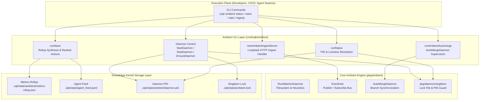

# CLI Ambient Compute Subsystem Architectural & Operational Guide

## Overview

The ZQK Ambient Compute Subsystem (`cmd/zqk/ambient`, backed by `pkg/ambient`) provides the background daemon, continuous observation, heuristics evaluation, overnight wave scheduling, automerge synchronization, and event ingestion infrastructure for the **Zen Quantum Kernel**.

In conventional AI development workflows, background maintenance tasks, health evaluations, and git synchronizations are either forgotten or executed as disruptive blocking operations. Autonomous AI swarms require non-invasive, asynchronous compute services that monitor workspace health, surface actionable telemetry, aggregate metrics, and safely synchronize integration branches without stalling human pair programmers or consuming foreground agent execution budgets.

The Ambient Compute Subsystem solves this through five foundational pillars:
1. **Singleton Daemon Lifecycle & Supervision**: Single-instance daemon supervision per project root guarded by file locks (`singleton.Guard`), stale process discovery via operating system process tables, and active watchdog monitoring.
2. **Autonomous Merge Synchronization (`automerge`)**: Background reconciliation and fast-forward merging of integration branches, ensuring clean mainline convergence.
3. **Overnight & Periodic Metrics Waves (`wave`)**: Continuous aggregation of command errors, scheduler queues, audit records, and I/O resource telemetry, generating ranked next-action insights.
4. **Loopback Event Ingestion Pipeline (`ingest`)**: High-throughput HTTP `/ingest` loopback server dispatching events directly into the in-memory and persisted `EventHub`.
5. **Fail-Safe Background Ergonomics (`start`, `stop`, `ensure`, `status`)**: Clean, idempotent process orchestration suitable for local developer workstations, long-running agent pods, and CI/CD pipelines.

---

## Subsystem Command Taxonomy

The `zqk ambient` command group provides the complete operational surface for ambient background computing:

| Command | Category | Purpose | Primary Flags & Options | Example |
|---|---|---|---|---|
| `zqk ambient status` | Lifecycle & Telemetry | Queries the runtime status and PID of the project's ambient daemon | Standard formatting flags (`-f json\|yaml\|table`) | `zqk ambient status -f json` |
| `zqk ambient daemon` | Foreground Engine | Runs the filesystem watcher, heuristics analyzer, and ambient event loop in the foreground | `--project-root <path>` | `zqk ambient daemon --project-root .` |
| `zqk ambient start` | Process Control | Launches the ambient daemon detached in the background with redirected logging | Standard project flags | `zqk ambient start` |
| `zqk ambient stop` | Process Control | Gracefully terminates any running ambient daemons for the current project root | None | `zqk ambient stop` |
| `zqk ambient ensure` | Idempotent Control | Ensures the ambient daemon is running in the background without noisy stdout | None | `zqk ambient ensure` |
| `zqk ambient wave` | Metrics & Waves | Aggregates overnight metrics, analyzes I/O resource hygiene, and posts rollup to agent feed | Standard formatting flags | `zqk ambient wave` |
| `zqk ambient automerge` | Continuous Delivery | Runs the autonomous merge supervisor daemon in the foreground | Standard context flags | `zqk ambient automerge` |
| `zqk ambient ingest` | Event Ingestion | Starts the local HTTP event ingestion endpoint bound to loopback | `--port <int>` (default `8089`) | `zqk ambient ingest --port 8089` |

---

## Subsystem Flags & Configuration

### 1. `zqk ambient daemon` Flags & Arguments

| Flag | Short | Type | Default | Description |
|---|---|---|---|---|
| `--project-root` | - | `string` | current directory | Explicit project root directory to supervise and monitor |

### 2. `zqk ambient ingest` Flags & Arguments

| Flag | Short | Type | Default | Description |
|---|---|---|---|---|
| `--port` | `-p` | `int` | `8089` | Local TCP port for the loopback HTTP ingestion server |

### 3. Common Subcommand Flags

All ambient commands inherit standard CLI formatting and context flags:

| Flag | Short | Type | Default | Description |
|---|---|---|---|---|
| `--format` | `-f` | `string` | `table` | Output format: `table`, `json`, `yaml`, `raw` |
| `--context` | - | `string` | `human` | Execution context profile: `human`, `ai-agent`, `debug` |
| `--quiet` | `-q` | `bool` | `false` | Suppress non-essential informational messages |

---

## Core Architecture



---

## Detailed Architectural Components

### 1. Singleton Daemon Supervision & Watchdog Monitoring

Ambient compute requires strictly one supervisor per workspace. Running duplicate daemons concurrently causes resource contention, duplicate file watches, and inconsistent state caching.

- **Lockfile Membrane**: When starting, `runAmbientDaemon` acquires a singleton lock via `singleton.Guard(cleanRoot, "ambient")`. If an active instance exists, it logs the existing PID and gracefully retains the running instance without exiting with an error.
- **Orphan Reaping**: Before attaching, the daemon inspects the OS process table via `ps -eo pid,args` to identify stale orphan ambient daemons previously associated with the workspace root, signaling `SIGTERM` to prevent zombie accumulation.
- **Lockfile Watchdog**: A background watchdog goroutine polls the disk lock file every 2 seconds. If a human operator or workspace cleanup script removes `.zqk/state/ambient.lock`, the daemon detects the unlink event and initiates immediate clean shutdown.
- **PID File Tracking**: Active daemon PIDs are recorded in `.zqk/state/ambient/daemon.pid`. Stale PID files containing dead process numbers are automatically cleared during status probes.

### 2. Background Wave Scheduler (`zqk ambient wave`)

The wave scheduler is executed on a periodic cron or overnight cycle to assemble comprehensive health rollups across four distinct telemetry dimensions:
1. **Command Error Density**: Scans persisted `command_metric` records to track cumulative failure counts.
2. **Scheduler Queue Liveness**: Scans `scheduler_health_metric` objects to identify stuck or failed execution queues.
3. **Audit Event Aggregation**: Counts `audit_aggregation_metric` events to monitor audit log volume and storage consumption.
4. **I/O Resource Hygiene**: Measures open file descriptors against system limits, detects stale file locks (`.zqk/state/*.lock`), and locates orphaned temporary files.

#### Rollup Persistence & Feed Broadcast
The synthesized metrics snapshot is persisted to `.zqk/state/ambient/metrics-rollup.json` and simultaneously published to the multi-agent mesh feed (`agent_feed`):
```json
{
  "command_errors": 0,
  "scheduler_stuck_count": 0,
  "audit_events_count": 42,
  "ghost_ref_count": 0,
  "system_check_issues": 0,
  "next_admin_action": "monitor: kernel healthy",
  "ranked_actions": [
    "monitor: kernel healthy"
  ],
  "measured_at": "2026-10-23T12:00:00Z",
  "test_bundle_evidence": "non-metric"
}
```

### 3. Autonomous Merge Synchronization (`zqk ambient automerge`)

The automerge daemon runs in the background of active workstreams to automate the continuous integration flywheel:
- Continuously tracks integration branches created for active priority plans.
- Monitors AST verification gates and continuous test validation suites.
- Applies clean fast-forward merges when all criteria gates pass.
- Halts immediately upon encountering git merge conflicts, notifying agents via the shared event bus.

### 4. HTTP Event Ingestion Pipeline (`zqk ambient ingest`)

The ambient ingestion server provides a lightweight, loopback-only REST endpoint for receiving external build hooks, IDE notifications, and system check alerts:
- **Default Address**: `127.0.0.1:8089` (configurable via `--port`).
- **Endpoint**: `POST /ingest`
- **Request Size Limiting**: Constrained to 1MB per request using `http.MaxBytesReader` to prevent buffer overflow attacks.
- **Payload Schema**:
  ```json
  {
    "type": "test.execution.completed",
    "payload": {
      "suite": "ambient",
      "passed": 12,
      "failed": 0
    },
    "timestamp": "2026-10-23T12:00:00Z"
  }
  ```
- **Responses**:
  - `202 Accepted` on successful dispatch into `EventHub`.
  - `400 Bad Request` on malformed JSON or excessive payload size.
  - `405 Method Not Allowed` on non-POST requests.

---

## Operating Recipes & Workflows

### Recipe 1: Developer Local Station Startup
Start ambient compute in the background when beginning a coding session:
```bash
# Ensure daemon is active without blocking the terminal
zqk ambient ensure

# Inspect runtime status
zqk ambient status
```

### Recipe 2: Triggering an Immediate Metrics Wave
Inspect system telemetry and queue health before running a large integration build:
```bash
# Run metrics wave in JSON format
zqk ambient wave -f json
```

### Recipe 3: Running Ingestion in Headless Agent Pods
Configure an isolated container or background service to collect external telemetry:
```bash
# Start ingest server on a custom port
zqk ambient ingest --port 8095
```

### Recipe 4: Clean Workspace Teardown
Terminate background daemons before running destructive workspace re-indexing or branch resets:
```bash
# Gracefully stop the ambient daemon
zqk ambient stop

# Confirm stopped state
zqk ambient status
```

---

## Troubleshooting & Diagnostics

| Symptom | Probable Cause | Remedy |
|---|---|---|
| `Ambient daemon is already running (PID: 12345)` | Another daemon instance is currently holding the workspace lock file | No action required; the existing instance is preserved. If stale, run `zqk ambient stop`. |
| `failed to spawn ambient daemon: exec: ...` | Product binary not compiled in `bin/zqk` or `bin/zqk-amb` | Run `go build -o bin/zqk ./cmd/zqk` to compile the product binary. |
| `Skipping ambient daemon spawn from test process` | Test process detected (`testing.Testing() = true`) | Daemon detachment is deliberately refused in automated test runners to avoid orphan processes. |
| Ingest returns `405 Method Not Allowed` | Non-POST HTTP method used | Send requests using `curl -X POST http://127.0.0.1:8089/ingest -d '...'`. |
| Ingest returns `400 Bad Request` | Malformed JSON or body exceeding 1MB | Validate JSON formatting and ensure payload body is <= 1MB. |

---

## Related Documentation

- **[CLI Workflow Subsystem Architectural Guide](./CLI_WORKFLOW_SUBSYSTEM_GUIDE.md)**: Dynamic next-action computation and ambient signal classification.
- **[Scheduler Subsystem Operational Guide](./SCHEDULER_SUBSYSTEM_GUIDE.md)**: Embedded CAP loop execution and cron queue scheduling.
- **[Diagnostics, Auto-Remedies & Self-Healing](./DIAGNOSTICS_SELF_HEALING_AND_REMEDY_GUIDE.md)**: Automated resolution of stale locks and orphaned temp buffers.
- **[Agent Orchestration & Swarm Collaboration Guide](./AGENT_ORCHESTRATION_AND_SWARM_COLLABORATION_GUIDE.md)**: Multi-agent seating and append-only agent feeds.
