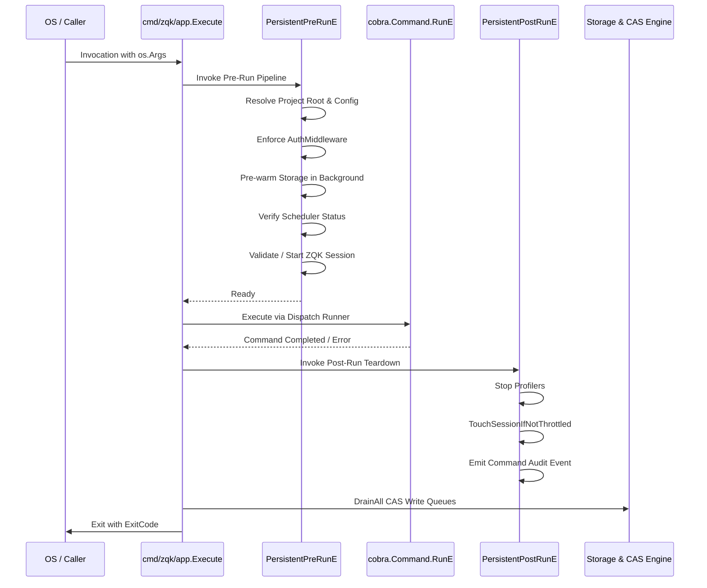
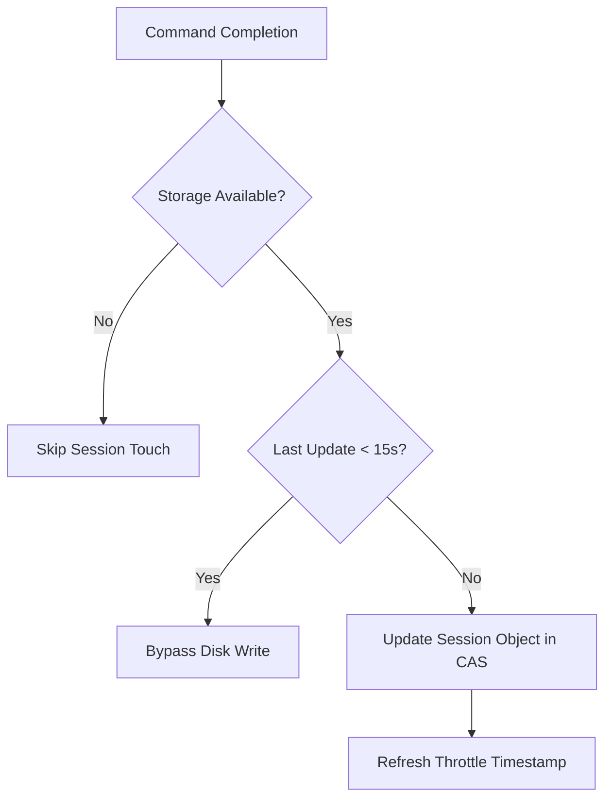

# CLI Application Subsystem Architectural & Operational Guide

## Overview

The **CLI Application Subsystem** (`cmd/zqk/app`) serves as the foundational application runner and lifecycle coordination membrane for the ZQK ecosystem. It is responsible for orchestrating process bootstrap, command tree composition, execution context propagation, runtime diagnostics, authentication middleware, session persistence, telemetry hooks, and fail-safe teardown.

Every human console invocation (`zqk <command>`), agent task execution, and headless Model Context Protocol (MCP) dispatch loop routes through this subsystem. The runner ensures zero-compromise runtime isolation, strict session validation, deterministic exit codes, and robust resource governance across all target environments.

---

## Subsystem Architecture & Execution Topology

```mermaid
flowchart TD
    User["Operator / Agent / MCP Client"] --> Entry["cmd/zqk/app.Execute()"]
    
    subgraph Bootstrap["1. Process Bootstrap & Diagnostics"]
        Threads["applyMaxOSThreads()"]
        Transport["federation.SetDefaultTransport()"]
        Tree["ensureCommandsRegistered()"]
        PprofServer["StartPprofServerIfEnabled()"]
        Watcher["startParentDeathWatcherIfSet()"]
    end
    
    subgraph PreRun["2. PersistentPreRunE Lifecycle"]
        CPUStart["CPU Profiling Initialization"]
        InitCtx["NewCliInitializationContext()"]
        AuthMid["AuthMiddleware() & SecurityContext"]
        Branding["ApplyBrandingToCommandTree()"]
        SchedCheck["checkSchedulerDaemonStatus()"]
        Tracker["NewCommandExecutionTracker()"]
        StorageInit["Pre-warmed Storage Resolution"]
        SessionCheck["Session Gate & TouchSessionIfNotThrottled"]
    end

    subgraph Exec["3. Command Dispatch & Execution"]
        TimeoutHook["clitool.TimeoutHook.WrapCommand()"]
        DispatchLoop["dispatch.Run() WorkItem"]
        CobraExec["rootCmd.ExecuteContext()"]
    end

    subgraph PostRun["4. PersistentPostRunE & Teardown"]
        ProfileStop["Stop CPU & Goroutine Profiles"]
        TouchSess["TouchSessionIfNotThrottled()"]
        AuditRecord["createCommandAuditEvent()"]
        CASFlush["DrainAll() & DrainDarwinSyncQueueContext()"]
        ExitWatchdog["Hard Exit Watchdog (8s)"]
    end

    Entry --> Bootstrap
    Bootstrap --> PreRun
    PreRun --> Exec
    Exec --> PostRun
```



---

## Command Tree Composition & Entrypoint Taxonomy

The CLI application runner initializes the Cobra command tree dynamically to support pluggable modules, dynamic kind routing, and runtime branding.

### 1. Root Command Configuration
The root command (`rootCmd`) establishes global persistent flags, version templates, memory bounds, and lifecycle hooks:
- **Global Memory Bound**: Configured via `debug.SetMemoryLimit(300 * 1024 * 1024)` to maintain memory predictability within resource-constrained agent sandboxes.
- **Brand Resolution**: Evaluates `brand.executable_name` from project configuration (`.zqk/config/zqk.yaml`), binary name (`os.Args[0]`), or system defaults. Dynamically updates help templates and subcommands.
- **Persistent Flags**:
  - `--context`: Profile selector (`ai-agent`, `human`, `debug`).
  - `--format`: Explicit output format (`json`, `yaml`, `table`, `stream`).
  - `--timeout`: Maximum wall-clock command duration before deterministic cancellation.
  - `--cpuprofile` / `--goroutine-profile`: Developer diagnostic flags (hidden from general help).

### 2. Taxonomy of Command Groups
The command registry (`ensureCommandsRegistered`) binds commands into cohesive operational categories:
- **Core Entity Lifecycle**: `object`, `new`, `create`, `update`, `delete`, `promote`, `demote`.
- **Workflow & Autonomous Loop**: `do`, `workflow`, `scheduler`, `sync`, `observer`.
- **Diagnostics & Governance**: `system`, `validate`, `explain`, `reports`.
- **Shell & Tooling Integration**: `completion`, `version`, `grep` (`zgrep`).

---

## Execution Lifecycle: Pre-Run, Run, and Post-Run Hooks

The command execution pipeline executes a deterministic, multi-stage lifecycle:



### Pre-Run Invariants (`rootPersistentPreRunE`)
1. **Parent Death Watcher**: Monitors stdin and parent process death to automatically terminate orphaned subprocesses.
2. **Security Context**: Executes `AuthMiddleware` to resolve token, actor, and RBAC permissions (`SecurityContext`), failing closed on unauthorized operations.
3. **Storage Pre-warming**: Concurrently initializes `ObjectStorageProvider` on a labeled goroutine while configuration and context checks proceed.
4. **Scheduler Invariant Guard**: Checks if the background scheduler daemon is running for mutating operations (`isMutatingCommand`). Warns if operations will be deferred to WAL.
5. **Session Gate**: For non-test and non-utility commands, guarantees a valid session exists (`TryReuseSession` or `StartZqkSession`).

### Post-Run Teardown (`rootPersistentPostRunE`)
1. **Profile Finalization**: Flushes CPU profile buffers and writes goroutine stack traces if diagnostics flags were supplied.
2. **Session Update**: Updates session metadata via `TouchSessionIfNotThrottled`.
3. **Audit Event Emission**: Builds command metric payloads (`CommandMetric`) and asynchronously dispatches audit entries without blocking execution.

---

## Session Tracking and Telemetry Integration

ZQK enforces global execution continuity through structured session tracking.

### `TouchSessionIfNotThrottled`
In high-frequency CLI workflows (such as agent loops or test runners), repeatedly updating session timestamps can create write amplification on the write-ahead log (WAL). The application runner implements a throttling governor:



- **Throttling Interval**: Default 15-second debounce window prevents WAL storms during batched tool invocations.
- **Session Attribution**: Links the current execution context, actor ID (`ACC-COMMUNITY-001`), and command path to the active session object (`ZS-SESSION-001`).

---

## Profiling & Diagnostics Architecture

The runner integrates non-intrusive runtime diagnostics for performance tuning and hang analysis.

### CPU Profiling
- **Command Flag**: `--cpuprofile <path>` or `--cpu-profile <path>`.
- **Lifecycle**: Starts in `rootPersistentPreRunE` before command dispatch, stops cleanly in `rootPersistentPostRunE` and `Execute()` deferred cleanup.
- **Signal-Triggered Diagnostic Dump**: Responds to `SIGUSR2` (`kill -USR2 <pid>`) by dumping a CPU profile to `.zqk/logs/cpu-<timestamp>.prof` without terminating the process.

### Goroutine & Hang Analysis
- **Command Flag**: `--goroutine-profile <path>` or `--goroutines-profile <path>`.
- **Capture**: Serializes full stack traces of all active goroutines via `pprof.Lookup("goroutine").WriteTo(f, 2)`.

### Memory Limits
- Enforces Go runtime GC memory limits (`debug.SetMemoryLimit`) to prevent out-of-memory crashes during large graph traversals.

---

## Dynamic Shell Completion Mechanics

The `completion` subsystem (`completion.go` and `completion_builder.go`) provides dynamic shell completion scripts generated directly from Cobra command metadata.

### Supported Shells
- **Bash**: `zqk completion bash`
- **Zsh**: `zqk completion zsh`
- **Fish**: `zqk completion fish`
- **PowerShell**: Supports native PowerShell completions via standard Cobra generators.

### Architectural Builder Pattern
The `CompletionBuilder` decouples completion command generation from shell-specific syntax:
```go
cmd := NewCompletionBuilder(paths.CLICommandName, root).
    WithShells(DefaultShells()).
    Build()
```
Each shell configuration encapsulates its installation instructions and execution callback (`GenBashCompletion`, `GenZshCompletion`, `GenFishCompletion`).

---

## Error Handling, Exit Codes & Failure Isolation

The application runner maps Go error types to deterministic process exit codes:

| Exit Code | Semantic Meaning | Description |
| :--- | :--- | :--- |
| `0` | **Success** | Command executed and all verification gates passed. |
| `1` | **Execution Error** | Unrecoverable runtime error, syntax failure, or execution fault. |
| `2` | **Misuse / Invalid Args** | Invalid flags, missing required arguments, or validation failure. |
| `3` | **Non-Blocking Warning** | Command finished with advisory notices or non-fatal findings. |

### Failure Isolation & Anti-Cascade Defenses
1. **Hard Exit Watchdog (Layer 1)**: Spawns a background timer goroutine (8 seconds). If background storage flushes or teardown routines hang indefinitely, the watchdog executes `os.Exit(exitCode)`, preventing zombie processes.
2. **Storage Drain Guard**: Flushes CAS write buffers via `DrainAll` and `DrainDarwinSyncQueueContext` before exiting, ensuring zero lost writes.
3. **MCP Mode Output Isolation**: When running under MCP (`ZQK_MCP_ACCOUNT_ID`), errors are guaranteed to be routed to `stderr` with JSON-RPC error formats, preserving `stdout` protocol purity.
