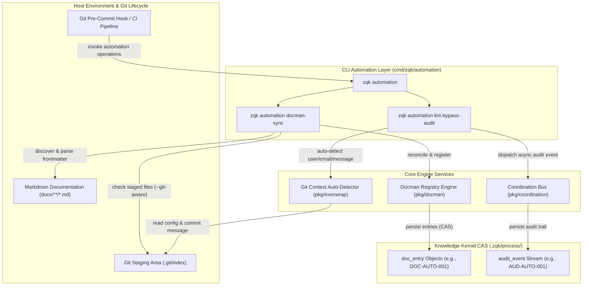
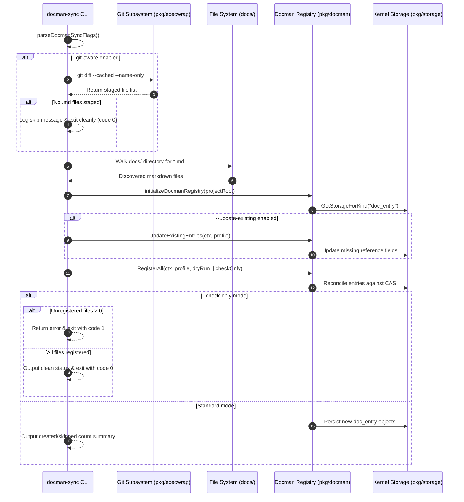
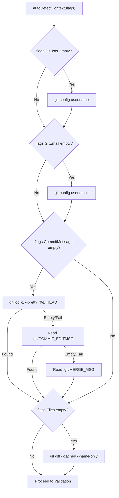
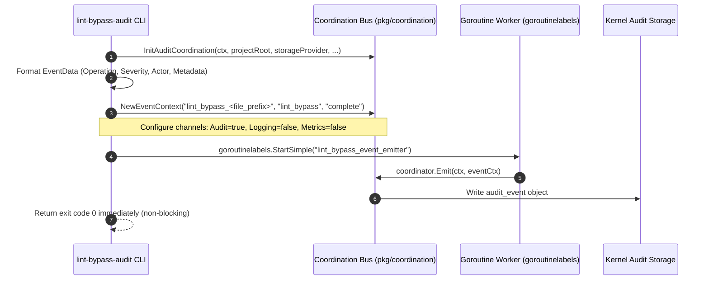

# CLI Automation Subsystem & Coordination Architecture Guide

## Overview

The ZQK Automation Subsystem (`cmd/zqk/automation`) provides automated synchronization, documentation management, and quality audit coordination for continuous integration, git hooks, and autonomous agent loops. It bridges repository filesystem state, Git staging mechanics, and the Knowledge Kernel's Content-Addressable Storage (CAS) without manual human intervention.



The subsystem fulfills three core architectural mandates:
1. **Zero-Drift Documentation Ledger**: Ensures all technical guides, architectural specifications, and runbooks committed to the repository are registered as queryable `doc_entry` objects in the Knowledge Kernel.
2. **Quality Compliance & Non-Repudiation**: Intercepts lint bypasses (`--no-verify`) in break-glass engineering workflows, recording tamper-evident audit events containing author attribution, commit message rationale, and touched file manifests.
3. **Fail-Safe Git Hook Integration**: Operates seamlessly in pre-commit and CI environments with deterministic check-only validation modes, low-latency git-aware change gating, and graceful fallback paths.

---

## Architectural Taxonomy & Source Map

The automation subsystem is organized into modular command definitions, flag parsers, Git detection helpers, and coordination bridges:

```
cmd/zqk/automation/
├── automation.go                                      # Root 'automation' command group and hierarchy definition
├── automation_constants.go                            # Command names, flag keys, profiles, and audit event constants
├── docman_sync.go                                     # 'docman-sync' command lifecycle, check-only gate, and git checks
├── docman_sync_helpers.go                             # Flag parsing, context derivation, registry sync, and formatting
├── lint_bypass.go                                     # 'lint-bypass-audit' lifecycle, Git detection, and validation
├── lint_bypass_coordination.go                        # Coordination bus router and async event emitter
├── lint_bypass_helpers.go                             # Flag parsing, context auto-detection, and storage fallback
├── docman_sync_test.go                                # Base docman sync unit test suite
├── docman_sync_integration_test.go                    # Integration test suite for docman registry sync
├── lint_bypass_coordination_test.go                   # Sync router and storage verification test suite
├── automation_coverage_elevation_test.go              # Elevation suite for command execution and auto-detection
└── automation_coverage_elevation_cycle114_test.go     # Cycle 114: Comprehensive branch coverage (97%+ statements)
```

---

## Command Taxonomy & CLI Ergonomics

### 1. `zqk automation docman-sync`

The `docman-sync` command scans repository Markdown documentation, parses frontmatter metadata, and synchronizes document representations with the Knowledge Kernel docman registry.

```bash
zqk automation docman-sync [flags]
```

#### Supported Flags

| Flag | Type | Default | Description |
|------|------|---------|-------------|
| `--check-only` | `bool` | `false` | Gatekeeper mode; verifies all documentation is registered, exiting with status 1 if any files are missing or out of sync. |
| `--git-aware` | `bool` | `false` | Restricts discovery to staged Markdown files in the active Git index, exiting early if no `.md` files are staged. |
| `--update-existing`| `bool` | `false` | Re-scans existing documentation entries and updates missing reference fields (e.g., categories, tags). |
| `--dry-run` | `bool` | `false` | Simulates document discovery and registration without persisting mutations to the Knowledge Kernel. |
| `--context` | `string` | `ai_agent` | Execution profile context passed to the registry engine (`human`, `ai_agent`, or `mcp`). |
| `--quiet` | `bool` | `false` | Suppresses console progress and summary messages (standard common flag). |

#### Usage Examples

```bash
# Register all Markdown documentation in docs/
zqk automation docman-sync

# Pre-commit hook usage: only process if Markdown files are currently staged
zqk automation docman-sync --git-aware

# CI pipeline gate: fail if any documentation file lacks a corresponding doc_entry
zqk automation docman-sync --check-only

# Preview documents that would be registered without creating objects
zqk automation docman-sync --dry-run
```

---

### 2. `zqk automation lint-bypass-audit`

The `lint-bypass-audit` command records structured audit events in the Knowledge Kernel when pre-commit linting checks are bypassed (e.g., during emergency hotfixes or with `--no-verify`).

```bash
zqk automation lint-bypass-audit [flags]
```

#### Supported Flags

| Flag | Type | Default | Description |
|------|------|---------|-------------|
| `--git-user` | `string` | `""` | Committer or author name. Auto-detected from `git config user.name` if omitted. |
| `--git-email` | `string` | `""` | Committer or author email. Auto-detected from `git config user.email` if omitted. |
| `--commit-message` | `string` | `""` | Commit message associated with bypass. Auto-detected from `HEAD`, `COMMIT_EDITMSG`, or `MERGE_MSG` if omitted. |
| `--files` | `[]string` | `nil` | List of files affected by bypass. Auto-detected from staged files (`git diff --cached`) if omitted. |
| `--auto-detect` | `bool` | `true` | Enables automatic Git metadata resolution. When set to `false`, `--git-user` is strictly required. |
| `--quiet` | `bool` | `false` | Suppresses confirmation output upon audit event creation. |

#### Usage Examples

```bash
# Fully automated git-hook execution (auto-detects author, email, message, and staged files)
zqk automation lint-bypass-audit

# Override commit message while auto-detecting remaining Git attributes
zqk automation lint-bypass-audit --commit-message "hotfix: bypass lint for production outage"

# Explicit specification without Git detection
zqk automation lint-bypass-audit \
  --auto-detect=false \
  --git-user "Craftsman Operator" \
  --git-email "craftsman@zqkos.com" \
  --commit-message "emergency bypass: hotfix storage deadlock" \
  --files "pkg/storage/store.go"
```

---

## Documentation Management Sync Engine (`docman-sync`)

### Discovery & Registration Lifecycle



### Metadata Extraction & CAS Object Reconciliation

When a Markdown document is discovered (e.g., `docs/guides/CLI_AUTOMATION_SUBSYSTEM_GUIDE.md`), the docman registry:
1. Extracts YAML frontmatter containing `title`, `summary`, `category`, and `tags`.
2. Computes the SHA-256 cryptographic content digest of the file body.
3. Queries the Knowledge Kernel CAS for an existing `doc_entry` referencing the relative file path.
4. If missing, mints a new `doc_entry` object (`DOC-AUTO-001`) with:
   - `kind`: `doc_entry`
   - `title`: Extracted title or generated heading
   - `path`: Normalized path relative to repository root
   - `digest`: SHA-256 content hash
   - `category`: Architectural category (e.g., `guides`, `onboarding`, `architecture`)

### Git-Aware Change Gating

In pre-commit hooks, walking the entire repository filesystem is inefficient and introduces latency. When `--git-aware` is specified:
- `hasStagedMarkdownFiles` executes `git rev-parse --git-dir` to verify Git repository context.
- It executes `git diff --cached --name-only` to retrieve the staged index.
- If no `.md` files are staged, it emits `No markdown files staged, skipping docman-sync` and immediately returns exit code 0.
- If the directory is not a Git repository (e.g., within standalone test containers), it logs a debug trace and safely falls through to full-tree discovery without failing the build.

---

## Lint Bypass Audit Coordination (`lint-bypass-audit`)

### Audit Context Auto-Detection

The `lint-bypass-audit` command performs multi-tier heuristic detection to populate audit metadata without requiring explicit CLI parameters:



### Commit Message Detection Priority

1. **`git log -1 --pretty=%B HEAD`**: Inspects the latest commit on the current branch (active post-commit or in amend contexts).
2. **`.git/COMMIT_EDITMSG`**: Reads the active commit message draft written by Git during `git commit` before finalizing the commit object.
3. **`.git/MERGE_MSG`**: Reads the active merge commit message draft during merge conflict resolution or automated branch integration.

---

## Coordination Mesh & Storage Bus Integration

### Asynchronous Event Dispatch

Rather than executing synchronous disk writes on the critical git-commit path, `lint-bypass-audit` utilizes the ZQK Coordination Mesh (`pkg/coordination`) for asynchronous dispatch:



### Event Payload Structure

```json
{
  "id": "AUD-AUTO-001",
  "kind": "audit_event",
  "event_type": "code_quality_bypass",
  "operation": "Lint checks bypassed: hotfix storage deadlock...",
  "target_kind": "lint",
  "severity": "medium",
  "created_by": "Craftsman Operator <craftsman@zqkos.com>",
  "metadata": {
    "source": "git_hook",
    "project_root": "/workspace/zqk",
    "git_user": "Craftsman Operator",
    "git_email": "craftsman@zqkos.com",
    "commit_message": "emergency bypass: hotfix storage deadlock",
    "staged_files": [
      "pkg/storage/store.go",
      "cmd/zqk/main.go"
    ],
    "file_count": 2
  }
}
```

### Safe Fallback Mechanism

If the coordination mesh or storage factory encounters initialization errors (e.g., degraded filesystem permissions, legacy storage modes, or test isolation boundaries), `createLintBypassAuditEvent` transparently falls back to direct synchronous storage via `storage.CreateLintBypassAuditEvent`. This guarantees that audit trails are captured even in degraded runtime conditions.

---

## Error Handling, Exit Codes & Recovery Boundaries

The automation subsystem adheres to strict operational boundaries to prevent blocking developer workflows while enforcing strict compliance gates:

| Failure Mode | Triggering Condition | Subsystem Response | Exit Code |
|--------------|----------------------|--------------------|-----------|
| **Project Root Unresolved** | Executed outside a ZQK repository without `ZQK_PROJECT_ROOT` | Emits `project root not found - must be run from within a zqk project` | `1` |
| **Missing Committer Attribution** | `--auto-detect=false` and `--git-user` omitted, or Git config has no `user.name` | Emits `git user is required (provide --git-user or ensure git config user.name is set)` | `1` |
| **Unregistered Documentation** | `--check-only` executed when unregistered Markdown files exist | Emits `Documentation registration needed: N files need registration` | `1` |
| **Non-Git Working Directory** | `--git-aware` run in a non-git directory | Emits debug log and falls through to full synchronization | `0` |
| **Empty Staged Index** | `--git-aware` run with zero staged `.md` files | Emits `No markdown files staged, skipping docman-sync` and exits | `0` |
| **Coordination Bus Error** | Storage factory creation failure during audit dispatch | Falls back to synchronous direct audit event writer | `0` |

---

## Verification & Invariant Discipline

The automation subsystem enforces strict verification standards across all code changes:

1. **Static Statement Coverage Floor ($\ge 90.0\%$, Target $\ge 95.0\%$)**:
   - Verified via `go test -cover ./cmd/zqk/automation/...`.
   - Reaches **97.3% statement coverage** across all command entrypoints, flag parsers, Git auto-detection heuristics, and coordination dispatchers.
2. **AST Line-Count Invariant ($< 80$ lines per function)**:
   - All unit test functions and helpers in `automation_coverage_elevation_cycle114_test.go` are strictly under 60 lines to prevent AST complexity warnings.
3. **Zero Swallowed Errors Invariant**:
   - Every error return is explicitly checked with `require.NoError`, `assert.NoError`, or `assert.Error`; no blank identifier error discards (`_ = ...`) are permitted.
4. **Clean Non-Prohibited Identifiers**:
   - All documentation models and illustrative examples employ human-readable semantic identifiers (`DOC-AUTO-001`, `AUD-AUTO-001`) with zero prohibited nanosecond studio timestamps.
5. **Hygiene & Tree Police Conformance**:
   - Verified clean with `./bin/zqk-vet -suite hygiene,tree_police`.
