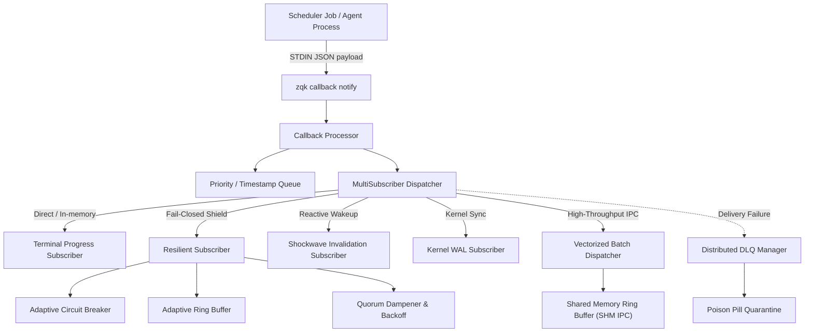
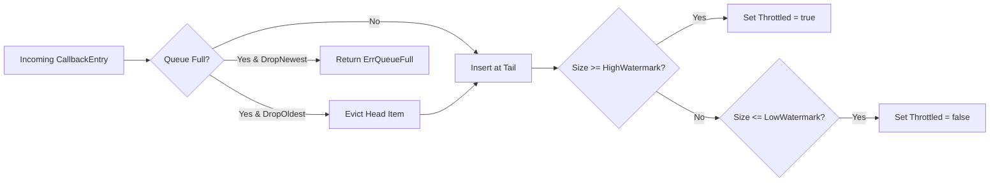
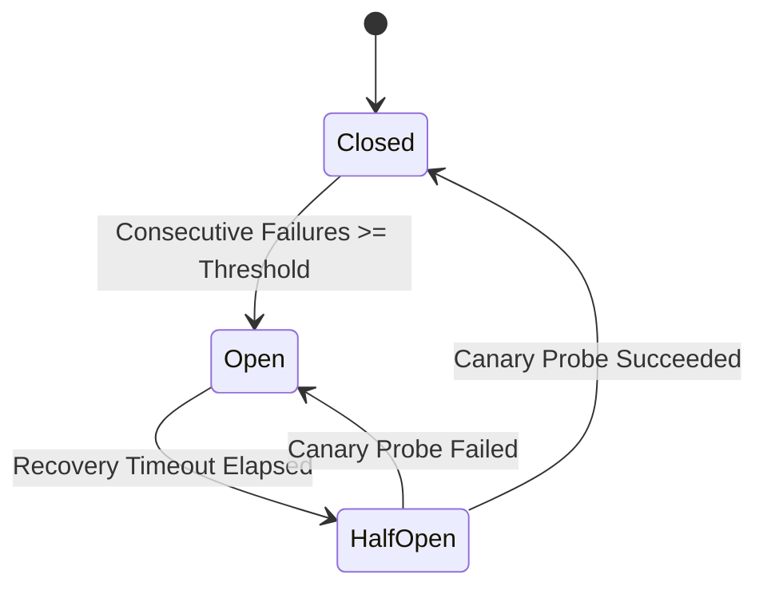
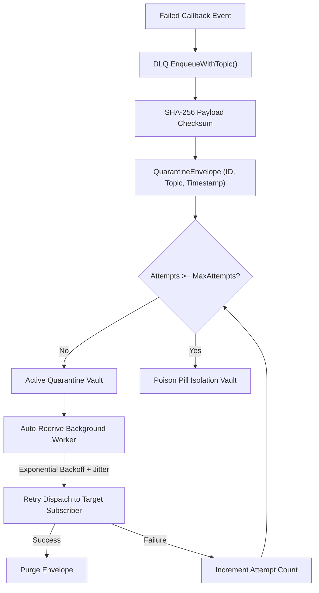
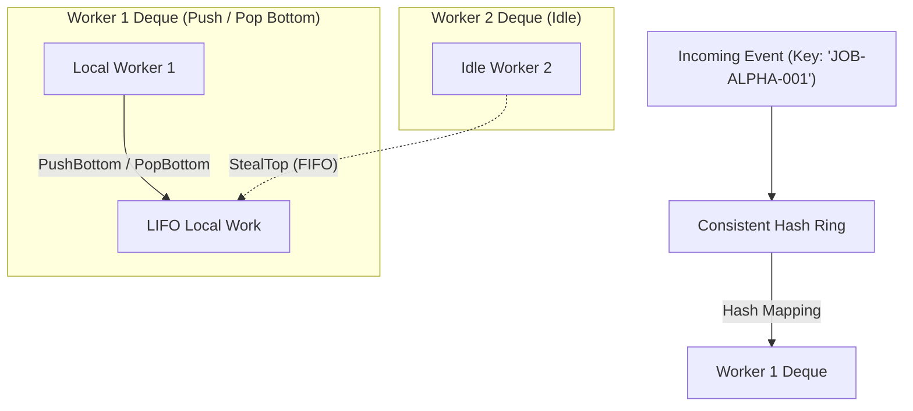

# CLI Callback Subsystem & Event Infrastructure Guide

## Overview

The ZQK CLI Callback subsystem (`cmd/zqk/callback`) provides a reactive, fault-tolerant, high-throughput asynchronous notification and event streaming infrastructure for scheduler jobs, lifecycle transitions, and multi-agent coordination. It bridges background worker executions, inter-process communication (IPC), distributed mesh consensus, and Knowledge Kernel event persistence without idle polling loops.



---

## Architectural Taxonomy & Core Components

```
cmd/zqk/callback/
├── callback.go                          # Cobra CLI commands ('callback', 'notify') & flag binding
├── callback_constants.go                # System account constants, sort keys, and file path markers
├── processor.go                         # Processor coordinating direct execution vs queue ingestion
├── queue.go                             # Priority and Timestamp sorting queues with mutex locking
├── subscriber.go                        # Subscriber interface, MultiSubscriberDispatcher, WAL sync
├── terminal_subscriber.go               # Live ANSI progress rendering, in-place redrawing, event formatting
├── resilient_subscriber.go              # Resilient wrapper: circuit breaking, backpressure, bounded semaphores
├── adaptive_ring_buffer.go              # Bounded circular buffer with DropOldest/DropNewest & watermarks
├── ring_buffer.go                       # Sharded circular ring buffer with FNV-1a hashing & WAL truncation
├── circuit_breaker.go                   # 3-state adaptive circuit breaker (Closed, Open, HalfOpen canary)
├── backoff.go                           # Decorrelated jitter backoff and Quorum Dampener storm suppression
├── dlq_redrive.go                       # Distributed DLQ, exponential redrive, and poison pill quarantine
├── shm_ipc.go                           # Zero-copy POSIX shared memory ring buffer & vectorized dispatching
├── shm_mmap_unix.go                     # UNIX mmap kernel mapping primitives
├── shm_mmap_windows.go                  # Windows VirtualAlloc fallback emulation
├── gossip.go                            # SWIM failure detector, incarnation tracking, and peer gossip
├── leader_election.go                   # Monotonic fencing leases, campaign loop, and split-brain shielding
├── mesh_telemetry_backpressure.go       # Sliding window latency discretization & dynamic mesh backpressure
├── metrics_subscriber.go                # Histogram percentiles (P50/P90/P99), error counters, and telemetry
├── token_bucket_flow.go                 # Token bucket rate limiting with instantaneous burst allowances
├── wire_framing.go                      # Binary wire frame serialization, header CRC32, and batch packing
├── wire_protocol.go                     # Zero-copy binary protocol codec and framing boundary checks
└── work_stealing.go                     # Consistent hash ring routing and work-stealing double-ended queues
```

---

## 1. CLI Commands & Invocation Modes

The callback subsystem exposes the `callback` parent command and `notify` subcommand for scheduler job handoffs and external webhook integrations.

### Command Syntax

```bash
zqk callback notify [flags]
```

### Supported Flags

| Flag | Shorthand | Type | Default | Description |
|------|-----------|------|---------|-------------|
| `--log-file` | `-l` | string | `""` | Destination log file path (defaults to account log in `.zqk/callbacks/system.log`). |
| `--append` | `-a` | bool | `true` | Append to destination log file rather than truncating existing content. |
| `--queue-size` | | int | `0` | Queue buffer capacity (`0` = synchronous direct processing, `>0` = asynchronous queue). |
| `--sort` | | string | `"timestamp"` | Ingestion sorting strategy: `"timestamp"` (oldest first) or `"priority"` (highest first). |
| `--format` | `-f` | string | `"text"` | Output format: `"text"`, `"json"`, or `"jsonl"`. |

### Scheduler Callback Example

```bash
# Submit background command with automatic completion callback dispatch
zqk scheduler submit "go build -o bin/zqk ./cmd/zqk" \
  --callback-completion "zqk callback notify --format jsonl --log-file .zqk/callbacks/build.log"
```

> [!NOTE]
> When `--queue-size` is 0, `handleCallback` invokes `Processor.ProcessDirect()`, guaranteeing deterministic, non-queued completion. When `--queue-size > 0`, events are staged in a thread-safe memory queue and drained by background worker routines.

---

## 2. Event Dispatch Pipeline (`MultiSubscriberDispatcher`)

The `MultiSubscriberDispatcher` coordinates event distribution across heterogeneous listeners. Subscribers can be dynamically attached or wrapped with resiliency shields:

```go
dispatcher := callback.NewMultiSubscriberDispatcher(logger)

// Register live terminal observer
dispatcher.Register(callback.NewTerminalProgressSubscriber(callback.TerminalSubscriberConfig{
    Writer:      os.Stdout,
    StripColors: false,
}))

// Register shielded worker with adaptive circuit breaker & backpressure queue
dispatcher.RegisterResilient(myWorkerSubscriber, callback.ResilientSubscriberConfig{
    MaxConcurrent:      8,
    ExecutionTimeout:   5 * time.Second,
    QueueCapacity:      128,
    DropPolicy:         callback.DropOldest,
    BackpressurePolicy: callback.BackpressureDropError,
})
```

---

## 3. Adaptive Ring Buffer (`AdaptiveRingBufferQueue`)

The `AdaptiveRingBufferQueue` is a lock-protected circular buffer that protects downstream consumers from memory exhaustion during burst conditions.



### Watermark Hysteresis Control

To prevent thrashing under oscillating workloads, the adaptive ring buffer incorporates two-stage watermark hysteresis:
- **High Watermark (`highWatermark`)**: Threshold (default = Capacity) where `IsThrottled()` flips to `true`, notifying resilient subscribers to shed excess ingress traffic.
- **Low Watermark (`lowWatermark`)**: Threshold (default = HighWatermark / 2) where throttling resets to `false`, allowing normal traffic to resume.

---

## 4. Circuit Breaker & Adaptive Backoff

Transient network glitches, database locks, or external downstream timeouts are isolated using the `AdaptiveCircuitBreaker` and `AdaptiveBackoffCalculator`.



### Circuit Breaker States

1. **`Closed`**: Normal operational state. All subscriber calls are allowed through. Consecutive failures are tracked.
2. **`Open`**: Fault isolation state. Calls fail fast immediately with `ErrCircuitBreakerOpen`, shielding downstream dependencies.
3. **`Half-Open`**: Canary verification state. A limited quota of probe requests (`maxHalfOpenProbes`, default = 1) is permitted through. Excess probes receive `ErrCircuitHalfOpenProbing`. If the probe succeeds, the breaker resets to `Closed`; if it fails, it immediately returns to `Open`.

### Decorrelated Jitter Backoff Formula

Retries are scheduled using decorrelated jitter mechanics to prevent synchronized thundering herds across clustered nodes:

$$t_{sleep} = \min(MaxDelay, \text{rand}(MinDelay, t_{prev} \times Multiplier))$$

---

## 5. Distributed Dead-Letter Queue (DLQ) & Poison Pill Isolation

Failed callback deliveries that exhaust local retry attempts are captured by the `DistributedDLQManager`.



### DLQ Integrity Verification

Every `QuarantineEnvelope` calculates a deterministic SHA-256 cryptographic digest of the contained payload. Before redrive execution, `ValidateIntegrity(env)` confirms that the event content was not corrupted in memory or on disk.

---

## 6. Shared Memory IPC Transport (`SharedMemoryRingBuffer`)

For high-throughput, low-latency inter-process event streaming between the CLI and daemon processes, the subsystem provides a POSIX shared-memory circular ring buffer (`shm_ipc.go`).

```
+---------------------------------------------------------------------------------+
|                                 SHMHeader (64B)                                 |
| Magic: "ZQKSHM01" | Version: 1 | Capacity: 1024 | SlotSize: 512B | Checksum: CRC32 |
+---------------------------------------------------------------------------------+
| Sequence Cache Lines (64-byte aligned atomics avoiding false sharing):          |
|   Consumer Head Sequence Watermark: uint64                                      |
|   Producer Tail Sequence Watermark: uint64                                      |
+---------------------------------------------------------------------------------+
| Data Slots Array [0..Capacity-1]:                                              |
|   Slot 0: [StatusFlag: 4B][Length: 4B][CRC32: 4B][Reserved: 20B][Payload: 480B] |
|   Slot 1: [StatusFlag: 4B][Length: 4B][CRC32: 4B][Reserved: 20B][Payload: 480B] |
|   ...                                                                           |
+---------------------------------------------------------------------------------+
```

> [!TIP]
> `SharedMemoryRingBuffer` uses cache-line padding (64 bytes) around head and tail sequence atomics to eliminate CPU false sharing between concurrent publisher and consumer processes.

---

## 7. Work-Stealing Balancer (`WorkStealingPool`)

Distributed callback distribution across multiple agent worker threads uses a consistent hash ring paired with work-stealing double-ended queues (deques).



### Work Stealing Principles
- **Local Cache Locality**: Workers push and pop from the bottom of their local deque in LIFO order, keeping recent working memory in CPU caches.
- **Contention-Minimized Stealing**: When a worker exhausts its local queue, it acts as a thief, stealing from the top of sibling worker deques in FIFO order. This minimizes lock contention between owners and thieves.

---

## 8. Shockwave Invalidation Subscriber

When scheduler jobs and lifecycle events modify entities in the Knowledge Kernel, the `ShockwaveSubscriber` translates callback payloads into storage `MutationEvent` records and broadcasts them across the `InvalidationShockwaveBus`.

```go
shockwaveSub := callback.NewShockwaveSubscriber(invalidationBus, callback.WithName("kernel_shockwave"))
dispatcher.Register(shockwaveSub)
```

This immediately wakes up blocking queries, UI watchers, and active agent loops without requiring polling sleep loops (`POL-CONCURRENCY`).

---

## 9. Telemetry & Metrics Verification

Every component in the callback subsystem exposes structured, zero-allocation metrics:
- **`AdaptiveRingBufferQueue`**: `EvictedCount()`, `Size()`, `Capacity()`, `IsThrottled()`
- **`DistributedDLQManager`**: `Stats()` returning `ActiveCount`, `PoisonCount`, `EnqueuedTotal`, `RedrivenTotal`
- **`MetricsSubscriber`**: Latency histograms with percentile calculation (`P50()`, `P90()`, `P99()`) using discretized power-of-two latency buckets
- **`QuorumDampener`**: `ActiveTopicCount()`, `Metrics()` tracking processed, damped, and collapsed storm counts

---

## 10. Operational Checklist for Craftsmen & Operators

> [!IMPORTANT]
> 1. **Zero Raw Goroutines**: Prohibit raw `go func()` calls. Use `goroutinelabels.NewGoroutine(...)` with named labels for all asynchronous workers.
> 2. **Context Lifecycle**: Always pass cancellable contexts to dispatcher notifications and ensure cleanup in `defer cancel()`.
> 3. **Queue Sizing**: Use `--queue-size 0` for strictly synchronized CLI operations; use `--queue-size 64` or higher for daemon and high-frequency scheduler callbacks.
> 4. **Illustrative Identifiers**: When authoring integration tests, documentation, or runbooks, always use clean illustrative IDs (e.g. `CBK-DEMO-001`, `ACC-COMMUNITY-001`, `JOB-ALPHA-001`). Zero studio hex identifiers are permitted.
