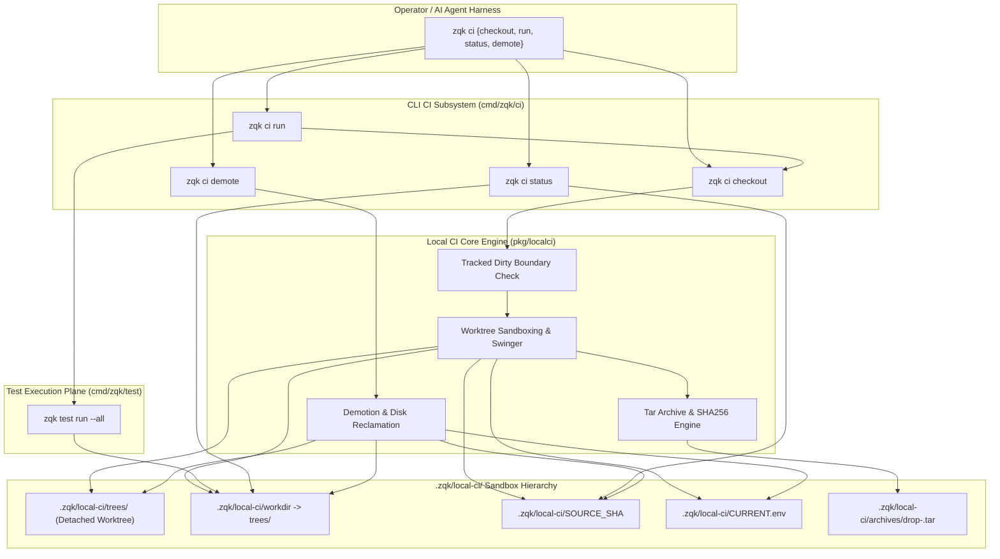
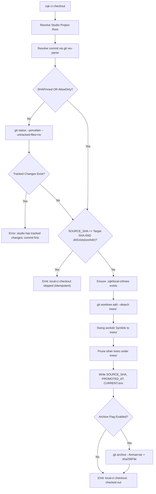
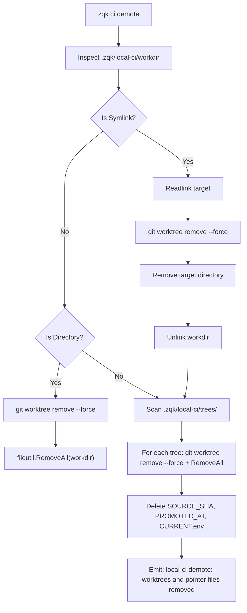

# CLI CI Subsystem & Local Sandboxing Architecture Guide

## Overview

The ZQK CLI CI subsystem (`cmd/zqk/ci` and `pkg/localci`) provides deterministic, hermetic, and offline-capable Continuous Integration sandboxing within the local developer environment. Rather than relying on fragile shell scripts or external remote CI pipelines for initial verification, ZQK uses pure-Go isolated git worktrees, pointer files, and archive caching to guarantee that tests execute against clean, pinned commit snapshots.



---

## Architectural Taxonomy & Core File Layout

The CLI CI subsystem is decomposed into command line entry points and core engine packages:

```
cmd/zqk/ci/
├── ci.go                                      # Cobra CLI command registration, flag binding, and dispatch
├── ci_test.go                                 # Base command hierarchy, lifecycle, and unset status tests
└── ci_coverage_elevation_cycle113_test.go     # Skip detection, full pipeline, directory edge-case, and context tests

pkg/localci/
├── localci.go                                 # Configuration options, base directory resolution, GitRun signatures
├── checkout.go                                # Detached worktree allocation, symlink swinging, dirty validation, archives
├── demote.go                                  # Worktree unlinking, tree removal, and pointer cleanup
├── git.go                                     # Managed git subprocess execution with context awareness
├── localci_test.go                            # Git execution and core lifecycle unit tests
└── extra_coverage_test.go                     # Archive retention, legacy workdir migration, and helper tests
```

---

## Command Taxonomy & Ergonomics

The `zqk ci` command group exposes four core operational commands:

### 1. `zqk ci checkout`

Pins and extracts a specific commit snapshot into an isolated, detached git worktree:

```bash
zqk ci checkout [flags]
```

**Supported Flags:**
- `--sha <string>`: Specific commit SHA, branch, or tag to check out (defaults to `HEAD`). When specified, pins the commit and bypasses tracked dirty checks.
- `--allow-dirty`: Permits checking out `HEAD` even when tracked uncommitted changes exist in the working tree.
- `--no-archive`: Disables creating tar archives and checksums in `.zqk/local-ci/archives/` (accelerates checkout).

**Behavior & Idempotency:**
If the requested commit SHA is already checked out at `.zqk/local-ci/workdir` and verified via `.zqk/local-ci/SOURCE_SHA`, the checkout is skipped idempotently without redundant disk operations:
```
local-ci checkout skipped: 4a3b2c1d00000000000000000000000000000000 already checked out at /path/to/.zqk/local-ci/workdir
```

### 2. `zqk ci run`

Executes the complete CI verification pipeline—promoting the checkout, validating prerequisites, and executing tests:

```bash
zqk ci run [flags]
```

**Supported Flags:**
- Inherits all `checkout` flags (`--sha`, `--allow-dirty`, `--no-archive`).
- `--checkout-only`: Prepares the sandbox worktree and pointer files without launching test execution.

**Execution Flow:**
1. Calls `runLocalCICheckout`: ensures the target tree is extracted and pointer files are updated.
2. Checks for `--checkout-only`: returns immediately if true.
3. Invokes `runTestCasesAfterCheckout`: verifies `go.mod` exists inside `.zqk/local-ci/workdir`, then orchestrates `zqk test run --all`.

### 3. `zqk ci status`

Inspects the current sandbox status, showing the active pinned `SOURCE_SHA` and workdir validity:

```bash
zqk ci status
```

**Sample Output (Configured Sandbox):**
```
Local CI status
  SOURCE_SHA=4a3b2c1d00000000000000000000000000000000
  workdir=/workspace/.zqk/local-ci/workdir
```

**Sample Output (Unset or Demoted Sandbox):**
```
Local CI status
  SOURCE_SHA=(not set — run: zqk ci checkout)
  workdir=(missing)
```

### 4. `zqk ci demote`

Tears down ephemeral worktrees, unlinks symlinks, deletes pointer files, and reclaims disk space:

```bash
zqk ci demote
```

**Action Output:**
```
local-ci demote: worktrees and pointer files removed
```

---

## Local CI Sandboxing Architecture

### Directory Structure & Pointer Files

All Local CI operations occur under `.zqk/local-ci` (or the directory pointed to by `LOCAL_CI_DIR`):

```
.zqk/local-ci/
├── CURRENT.env                                # Sourcable environment variables for subshells
├── PROMOTED_AT                                # ISO 8601 UTC timestamp of active checkout
├── SOURCE_SHA                                 # 40-character commit SHA currently pinned
├── archive-git/                               # Offline git bundle cache for rapid local diffs
├── archives/                                  # Rolling tarball drops and sha256 manifests
│   ├── drop-4a3b2c1.tar
│   └── drop-4a3b2c1.tar.sha256
├── trees/                                     # Detached git worktrees keyed by short commit SHA
│   └── 4a3b2c1/
└── workdir -> trees/4a3b2c1                   # Symlink pointing to the currently active tree
```

### Pointer File Specifications

1. **`SOURCE_SHA`**: Contains the full 40-character hexadecimal git commit SHA. Serves as the primary idempotency key for `status` and `checkout` skip evaluation.
2. **`PROMOTED_AT`**: Stores the RFC 3339 UTC timestamp recording when the snapshot was extracted into the sandbox.
3. **`CURRENT.env`**: Key-value environment declaration formatted for direct POSIX sourcing:
   ```bash
   workdir=/path/to/.zqk/local-ci/workdir
   sha=4a3b2c1d00000000000000000000000000000000
   short=4a3b2c1
   tree=/path/to/.zqk/local-ci/trees/4a3b2c1
   ```

---

## Checkout Mechanics & Validation Gates



### 1. SHA Pinning & Resolution
The target revision is verified using `git rev-parse --verify <sha>^{commit}` to guarantee that only valid commit objects (and not dangling tree or blob references) are admitted to the sandbox.

### 2. Dirty Tree Detection Gate
Unless `--allow-dirty` or an explicit `--sha <committed>` is supplied, the engine runs `git status --porcelain --untracked-files=no`. If any tracked files are modified, staged, or deleted, checkout aborts immediately. This invariant protects operators and autonomous agents from testing against uncommitted state that cannot be reproduced.

### 3. Symlink Swinging (`swingWorkdir`)
The `workdir` reference is maintained as a relative symbolic link pointing to `trees/<short_sha>`. When switching between commits, `swingWorkdir` atomically updates the link. If a legacy non-symlink directory is detected from earlier versions, the engine safely renames the legacy directory to `workdir.legacy.<pid>`, creates the symlink, and force-removes the old worktree.

### 4. Archive Caching & Retention
When archiving is enabled, `git archive --format=tar` writes a compressed snapshot to `.zqk/local-ci/archives/drop-<short_sha>.tar` accompanied by a SHA256 checksum file. Rolling retention prunes older archives to `ArchiveKeep` (default: 5 or `LOCAL_CI_ARCHIVE_KEEP`).

---

## Test Execution Lifecycle

When `zqk ci run` is executed without `--checkout-only`:

1. **Sandbox Root Assertion**: Resolves `.zqk/local-ci/workdir`.
2. **Go Module Verification**: Inspects `filepath.Join(workdir, "go.mod")`. If missing or invalid, fails with an actionable diagnostic instructing the operator to run `zqk ci checkout`.
3. **Execution Delegate**: Instantiates `testcmd.NewRunCmd()` configured with `--all` and passes output/context streams.
4. **Knowledge Kernel Test Runner**: Dispatches through `pkg/testrunner`, executing all registered `test_case` objects (e.g. `TST-CI-001`, `TST-AUTH-001`) with AST and criterion assertion tracking.

---

## Demotion Lifecycle & Disk Reclamation

Running `zqk ci demote` executes complete sandbox teardown:



Demotion is fully idempotent: running it against an already clean or uninitialized repository succeeds without error.

---

## Error Handling, Exit Codes & Boundary Conditions

| Scenario | Condition / Error Trigger | Diagnostic / Behavior |
|:---|:---|:---|
| **Missing Project Root** | Directory not inside a valid ZQK workspace | `Error: project root not found` |
| **Tracked Changes Present** | Uncommitted modifications without `--allow-dirty` | `Error: studio has tracked changes; commit first or pass --allow-dirty / --sha <committed>` |
| **Invalid Revision** | Target commit SHA does not resolve | `Error: local-ci checkout failed: exit status 128` |
| **Missing Module File** | `go.mod` missing inside checkout workdir | `Error: local-ci workdir missing go.mod at <workdir> (run checkout first)` |
| **Corrupted Workdir** | Workdir exists as unexpected special file | `Error: local-ci: refusing to clobber unexpected workdir at <workdir>` |
| **Context Abort** | Execution cancelled via SIGINT or context timeout | Aborts git operations cleanly, returns wrapped context error |
| **Unknown CLI Flags** | Unsupported argument supplied to subcommand | Cobra returns exit code 1 with usage hints |

---

## Verification & Exemplar Objects

The CLI CI subsystem anchors into the Knowledge Kernel verification plane via timeless requirements, criteria, and test cases:

```yaml
kind: requirement
id: REQ-CI-001
title: Deterministic Offline Local CI Subsystem
goal_refs:
  - GOAL-STABILITY-001
criteria_refs:
  - CRIT-CI-001   # Static Floor Invariant: cmd/zqk/ci statement coverage >= 90.0%
  - CRIT-CI-002   # Operational Dynamic Proof: Full checkout, run, status, demote cycle
  - CRIT-CI-003   # Negative Adversarial Boundary: Refuse dirty checkout without explicit override
```

```yaml
kind: test_case
id: TST-CI-001
title: Verify Local CI Command Lifecycle and Sandboxing Invariants
requirement_ref: REQ-CI-001
criteria_refs:
  - CRIT-CI-001
  - CRIT-CI-002
  - CRIT-CI-003
command: "go test -v -cover ./cmd/zqk/ci/..."
```
