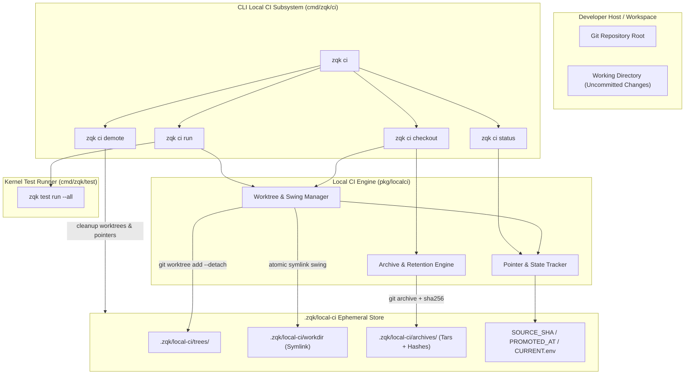
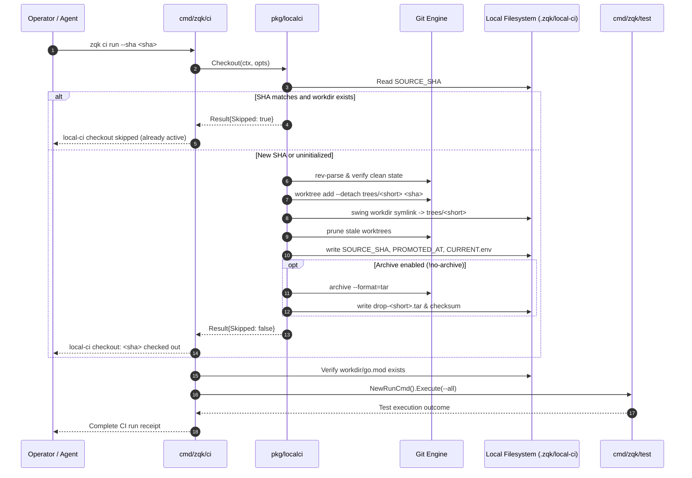
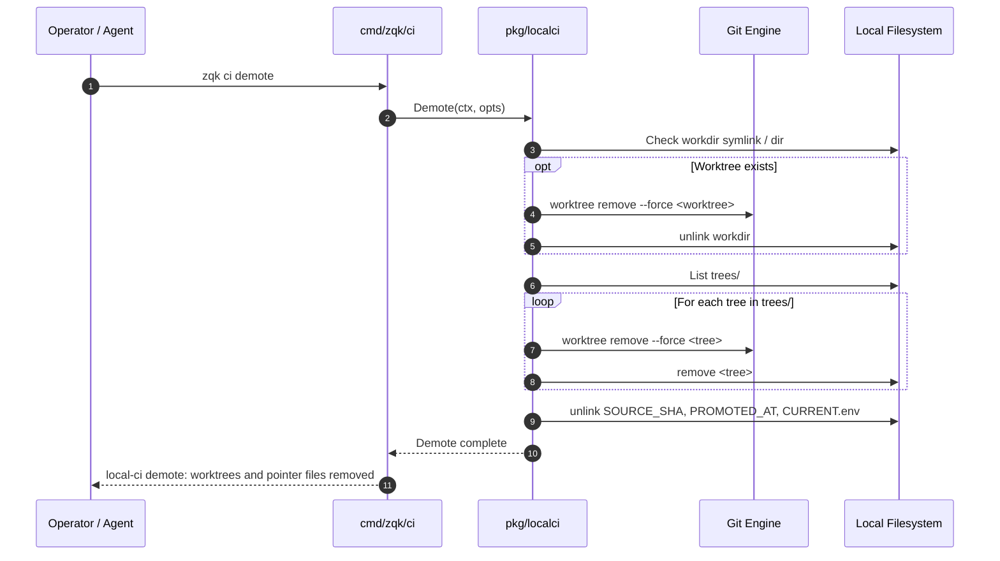

# CLI Local CI Subsystem & Ephemeral Worktree Execution Guide

## Overview

The ZQK CLI Local CI subsystem (`cmd/zqk/ci` and `pkg/localci`) provides isolated, reproducible, and deterministic test execution in ephemeral git worktrees. By decoupling test execution from the operator's active working directory, Local CI eliminates test contamination from unstaged modifications, untracked artifacts, or dirty state.

Local CI is implemented in pure Go (`pkg/localci`), completely eliminating legacy shell script dependencies (`scripts/local-ci-*.sh`) and providing cross-platform parity across macOS and Linux environments.



---

## Architectural Taxonomy & Core Components

```
cmd/zqk/ci/
├── ci.go                                      # Cobra CLI command builders, flag definitions, and execution dispatch
├── ci_test.go                                 # Core lifecycle, hierarchy, and unset status verification tests
└── ci_coverage_elevation_cycle113_test.go     # Cycle 113: Full pipeline run, skipped re-checkout, context cancellation tests

pkg/localci/
├── localci.go                                 # Local CI directory resolution, options, and archive retention logic
├── checkout.go                                # Pure-Go worktree creation, symlink swing, archive generation, and skip check
├── demote.go                                  # Worktree removal, symlink removal, and pointer file cleanup
├── git.go                                     # Managed git command execution with context cancellation
├── localci_test.go                            # Git worktree lifecycle and dirty tree rejection tests
└── extra_coverage_test.go                     # Environment variable overrides, archive pruning, and edge case coverage
```

---

## Command Taxonomy & Ergonomics

The Local CI interface exposes four primary subcommands under `zqk ci`:

### 1. `zqk ci checkout`

Checks out a specific commit or `HEAD` into an isolated git worktree under `.zqk/local-ci/trees/<short_sha>` and atomically points `.zqk/local-ci/workdir` to it:

```bash
zqk ci checkout [flags]
```

**Supported Flags:**
- `--sha <sha>`: Specific git commit SHA to check out (defaults to `HEAD`). When specified, skips the dirty working directory check.
- `--allow-dirty`: Permits checking out `HEAD` even when the active working directory contains tracked uncommitted changes.
- `--no-archive`: Skips generating a `.tar` archive and SHA-256 checksum in `.zqk/local-ci/archives/` for faster turnaround.

**Idempotent Execution Guarantee:**
If the target SHA is already checked out and `.zqk/local-ci/workdir` is valid, `zqk ci checkout` skips redundant worktree recreation and outputs:
```text
local-ci checkout skipped: <sha> already checked out at <workdir>
```

### 2. `zqk ci run`

Performs an isolated checkout (identical to `zqk ci checkout`) and immediately executes the test suite in the isolated worktree:

```bash
zqk ci run [flags]
```

**Supported Flags:**
- `--sha <sha>`: Target git commit SHA to verify.
- `--allow-dirty`: Allows running from `HEAD` with uncommitted changes in the host tree.
- `--no-archive`: Bypasses archive generation.
- `--checkout-only`: Prepares the isolated worktree without executing test cases.

**Execution Flow:**
1. Resolves repository root and options.
2. Checks out the target commit into `.zqk/local-ci/trees/<short_sha>`.
3. Swings the `.zqk/local-ci/workdir` symlink to the new tree.
4. Verifies `go.mod` exists at the root of the isolated worktree.
5. Invokes `zqk test run --all` against the isolated tree, verifying all test cases.

### 3. `zqk ci status`

Displays the current state of the Local CI subsystem, including active commit pointer and workdir link:

```bash
zqk ci status
```

**Output Formats:**

*Unconfigured / Pre-checkout State:*
```text
Local CI status
  SOURCE_SHA=(not set — run: zqk ci checkout)
  workdir=(missing)
```

*Populated / Active State:*
```text
Local CI status
  SOURCE_SHA=a1b2c3d4e5f60718293a4b5c6d7e8f9012345678
  workdir=/path/to/repo/.zqk/local-ci/workdir
```

### 4. `zqk ci demote`

Removes all ephemeral git worktrees, symlinks, and pointer files created by Local CI without modifying repository branches or git history:

```bash
zqk ci demote
```

**Console Output:**
```text
local-ci demote: worktrees and pointer files removed
```

---

## Workflow Semantics & Invariants



### 1. SHA Checkout vs. Dirty Checkout
- **Strict Cleanliness Floor:** By default, if the developer's working directory has tracked modifications (`git status --porcelain --untracked-files=no`), `zqk ci checkout` and `zqk ci run` fail closed:
  ```text
  studio has tracked changes; commit first or pass --allow-dirty / --sha <committed>
  ```
- **Explicit Bypass Modes:**
  - Passing `--sha <committed>` indicates intent to test a specific committed point in history, ignoring host working directory dirty state.
  - Passing `--allow-dirty` allows testing `HEAD` without committing in-progress work.

### 2. Symlink Swing & Worktree Pruning
- Each checked-out commit resides in its own sub-worktree: `.zqk/local-ci/trees/<short_sha>`.
- The canonical execution path `.zqk/local-ci/workdir` is an atomic symlink pointing to the active short-SHA tree.
- When swinging to a new SHA, any older worktrees under `.zqk/local-ci/trees/` are automatically pruned via `git worktree remove --force`, preventing unbounded disk consumption.

### 3. State & Pointer Tracking
The `.zqk/local-ci` directory maintains three deterministic state files:
| File | Format | Purpose |
| :--- | :--- | :--- |
| `SOURCE_SHA` | 40-character hex + `\n` | Identity of the currently active commit |
| `PROMOTED_AT` | RFC3339 UTC timestamp + `\n` | Timestamp of last checkout / promotion |
| `CURRENT.env` | Key-value pairs (`workdir`, `sha`, `short`, `tree`) | Machine-readable environment for build and test tools |

### 4. Archive Dropping & Retention
- When `--no-archive` is false, Local CI creates a `.tar` snapshot of the committed tree in `.zqk/local-ci/archives/drop-<short>.tar`.
- A SHA-256 digest is calculated and recorded in `.zqk/local-ci/archive-git/`.
- Archives are automatically pruned to retain the latest drops (default: 5 archives, configurable via `LOCAL_CI_ARCHIVE_KEEP`).

### 5. Demote Teardown Lifecycle
`zqk ci demote` provides clean-slate teardown:
1. Inspects `.zqk/local-ci/workdir`: if it is a symlink or directory, removes the underlying worktree via `git worktree remove --force` and unlinks the path.
2. Iterates over all remaining entries in `.zqk/local-ci/trees/` and removes each worktree.
3. Unlinks `SOURCE_SHA`, `PROMOTED_AT`, and `CURRENT.env`.
4. Guarantees that subsequent `zqk ci status` calls return `SOURCE_SHA=(not set)`.



---

## Verification & Statement Coverage Invariant

The Local CI subsystem is governed by automated verification gates across three proof tiers, requiring statement test coverage of `cmd/zqk/ci` to meet or exceed `>= 90.0%` (achieving `100.0%` statement coverage in Cycle 113):

1. **Static Floor Invariant (`CRIT-STATIC-001`):**
   - Statement test coverage for `cmd/zqk/ci` is maintained at `>= 90.0%` (achieved `100.0%`).
   - Zero swallowed errors (`_ = ...` strictly prohibited in all test and implementation code).
   - AST complexity constraints: all functions strictly capped under 100 lines.
   - Clean tree hygiene: passes `./bin/zqk-vet -suite hygiene,tree` with 0 findings.

2. **Operational Dynamic Proof (`CRIT-OPERATIONAL-001`):**
   - Subcommand hierarchy verification (`checkout`, `run`, `status`, `demote`).
   - Complete lifecycle validation: `checkout` &rarr; `status` populated &rarr; `demote` &rarr; `status` unset.
   - Full test pipeline execution via `run` (without `--checkout-only`) dispatching `zqk test run --all`.
   - Idempotent re-checkout branch verification (`res.Skipped == true`) displaying skipped status telemetry.
   - Status output verification under missing `go.mod` vs. directory `go.mod` anomalies.

3. **Negative Adversarial Boundaries (`CRIT-BOUNDARY-001`):**
   - Context cancellation handling in both `checkout` and `demote` operations returning fail-closed errors.
   - Unknown CLI flag rejection across all subcommands (`checkout`, `run`, `status`, `demote`).
   - Missing project root resolution failure propagation.
   - Invalid SHA format rejection during checkout stage.
   - Missing `go.mod` fail-closed detection before test runner dispatch.
   - Strict open-core compliance: zero studio nanosecond-hex identifiers across documentation and test fixtures.
