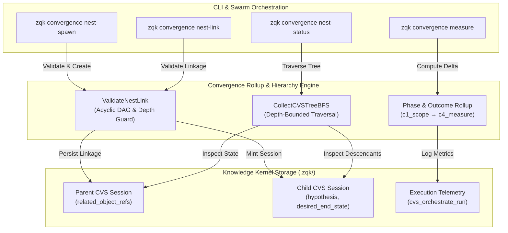
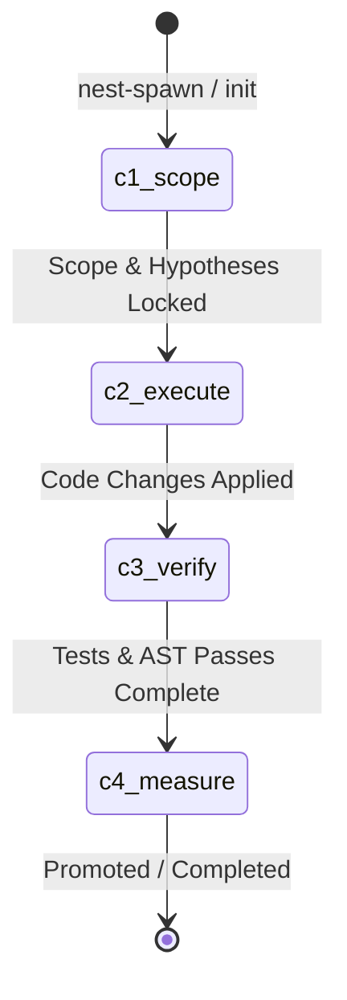

# CLI Convergence Subsystem Architectural & Operational Guide (`zqk convergence`)

## 1. Executive Summary & Architectural Mission

The `zqk convergence` subsystem provides the canonical command-line interface and programmatic orchestration surface for nested Convergence Session (`convergence_session`) management, iterative progress measurement, and multi-agent coordination within the ZQK Knowledge Kernel.

In complex, non-deterministic agent workflows, tasks frequently expand into nested problem domains requiring subagent isolation, hypothesis testing, and hierarchical progress tracking. Rather than managing ad-hoc child processes or relying on transient LLM context windows, the Convergence Subsystem models agent trajectories as first-class, versioned graph objects with deterministic parent-child linkages, phase telemetry, and breadth-first search (BFS) state aggregation.



### Key Architectural Invariants

1. **Strict DAG Acyclicity (Zero Ref Cycles)**: Convergence session hierarchies form a directed acyclic graph. Any linkage attempt that introduces a cycle—such as linking an ancestor session as a child of its own descendant—is rejected fail-closed before storage mutation.
2. **Depth-Bounded BFS Traversal**: Nest expansion is constrained by explicit depth bounds (`--max-depth`, defaulting to `3`), preventing denial-of-service or stack exhaustion across deep hierarchy traversals.
3. **Fail-Closed Input Validation**: Missing required parameters, malformed session IDs lacking the `CVS-` prefix, self-nesting, or unreachable parents fail closed with structured error diagnostics.
4. **Deterministic Phase Telemetry**: Sessions progress through explicit convergence phases (`c1_scope` $\rightarrow$ `c2_execute` $\rightarrow$ `c3_verify` $\rightarrow$ `c4_measure`), capturing hypotheses, desired end states, and outcome character.
5. **Statement Coverage Floor Invariant**: Production code in `cmd/zqk/convergence` maintains a strict 100.0% statement test coverage floor with zero swallowed errors.

---

## 2. Command Family Taxonomy & Invocation Modes

The `zqk convergence` command group exposes nest management veneers, metrics computation, and supervisory execution tooling:

| Command | Category | Purpose | Typical Use Case |
| :--- | :--- | :--- | :--- |
| `zqk convergence nest-spawn` | Veneer / Creation | Atomically create and link a child CVS session | Delegate sub-problem to an isolated child agent session |
| `zqk convergence nest-link` | Veneer / Mutation | Link an existing child CVS session under a parent | Attach an independently initialized session to a coordinator |
| `zqk convergence nest-status` | Inspection / BFS | Display the hierarchical BFS status tree of sessions | Inspect execution state and phase progress across the swarm |
| `zqk convergence measure` | Telemetry | Measure convergence score, entropy delta, and flake rate | Validate whether multi-agent iterations are converging |
| `zqk convergence overseer` | Supervision | Run convergence overseer checks and health assessments | Autonomous watchdog evaluation of running sessions |
| `zqk convergence record-cvs-orchestrate-run` | Ingestion | Ingest structured JSON run records from worker runs | Store execution telemetry from worker subprocesses |
| `zqk convergence promotion-readiness` | Evaluation | Check whether a session is eligible for phase promotion | Gate phase transitions against objective criteria |

---

## 3. Algorithmic Foundations

### 3.1 Depth-Bounded BFS Tree Hierarchy (`CollectCVSTreeBFS`)

The BFS tree hierarchy algorithm systematically explores session relationships starting from a designated root session. It operates with strict depth bounds:

```
Algorithm CollectCVSTreeBFS(rootID, maxDepth, nodeLoader):
    queue <- [ { id: rootID, depth: 0 } ]
    seen <- Set()
    result <- []

    while queue is not empty:
        current <- pop(queue)
        if current.id in seen:
            continue
        add current.id to seen

        refs, status, phase <- nodeLoader(current.id)
        result.append(Node(current.id, current.depth, status, phase))

        if current.depth >= maxDepth:
            continue

        for ref in refs:
            if ref starts with "CVS-" and ref not in seen:
                queue.append({ id: ref, depth: current.depth + 1 })

    return result
```

- **Selective Prefix Filter**: Only object references bearing the canonical `CVS-` prefix are enqueued as child nodes. Non-session references (such as requirements, backlog items, or artifacts) are filtered out cleanly.
- **Node Deduplication**: The `seen` map prevents duplicate traversal if a child is referenced across multiple branches.
- **Depth Limiting**: Descendants at `current.depth == maxDepth` are recorded in the output but their children are never added to the traversal queue.

### 3.2 Acyclic Validation & Cycle Detection (`ValidateNestLink`)

Before any child session is linked under a parent session, the subsystem executes a two-phase graph validation:

1. **Coordinator-to-Parent Reachability & Depth Check**:
   Traverses the tree downward from `coordinatorID` (or `parentID` if coordinator is omitted) to compute `parentDepth`.
   - If the parent session is not present in the coordinator's tree, the link is rejected (`parent not found under coordinator`).
   - If `parentDepth + 1 > maxDepth`, the link is rejected (`nesting under parent would exceed max depth`).
2. **Descendant Cycle Guard**:
   Traverses the tree downward from `childID`.
   - If `parentID` or `coordinatorID` is encountered anywhere in the child's reachable subtree, the link is rejected (`linking child under parent would create a cycle`).

### 3.3 Convergence Phase Lifecycle

Convergence sessions transition through four standard operational phases:



- **`c1_scope`**: Problem boundary formulation, hypothesis definition, and desired end state definition.
- **`c2_execute`**: Active code modification, AST refactoring, or test generation.
- **`c3_verify`**: Targeted test execution, compile check-valves, and regression analysis.
- **`c4_measure`**: Convergence entropy measurement, outcome character recording, and promotion evaluation.

---

## 4. Usage Patterns & CLI Examples

### 4.1 Spawning a Nested Child Session

To spawn a new child session under an existing parent session `CVS-PAR-001`:

```bash
zqk convergence nest-spawn \
  --parent-session-id CVS-PAR-001 \
  --title "Elevate Statement Test Coverage" \
  --hypothesis "Adding comprehensive flag and negative boundary tests achieves full coverage" \
  --desired-end-state "cmd/zqk/convergence passes with 100% statement coverage" \
  --next-action "Run targeted go test" \
  --current-phase "c1_scope" \
  --max-depth 3
```

**Output (JSON format)**:
```json
{
  "parent_id": "CVS-PAR-001",
  "child_id": "CVS-SESSION-101",
  "spawned": true,
  "related_object_refs": [
    "CVS-SESSION-101"
  ]
}
```

### 4.2 Linking an Existing Session

To link a pre-existing child session `CVS-CHD-002` under parent `CVS-PAR-001`:

```bash
zqk convergence nest-link \
  --parent-session-id CVS-PAR-001 \
  --child-session-id CVS-CHD-002 \
  --max-depth 3
```

**Output (YAML format)**:
```yaml
child_id: CVS-CHD-002
linked: true
parent_id: CVS-PAR-001
related_object_refs:
  - CVS-SESSION-101
  - CVS-CHD-002
```

### 4.3 Inspecting BFS Nest Tree Status

To inspect the full BFS status tree rooted at `CVS-PAR-001`:

```bash
zqk convergence nest-status \
  --parent-session-id CVS-PAR-001 \
  --max-depth 3 \
  --format table
```

**Output (Table format)**:
```text
PARENT_ID    MAX_DEPTH  NODES
CVS-PAR-001  3          3 nodes (CVS-PAR-001 [d0], CVS-SESSION-101 [d1], CVS-CHD-002 [d1])
```

---

## 5. Output Formatting & Machine Consumption

All `zqk convergence` subcommands respect global output formatting flags (`--format json`, `--format yaml`, `--format table`).

### JSON Schema: `nest-status`

```json
{
  "parent_id": "CVS-PAR-001",
  "max_depth": 3,
  "nodes": [
    {
      "id": "CVS-PAR-001",
      "depth": 0,
      "status": "active",
      "current_phase": "c1_scope"
    },
    {
      "id": "CVS-SESSION-101",
      "depth": 1,
      "status": "active",
      "current_phase": "c2_execute"
    },
    {
      "id": "CVS-CHD-002",
      "depth": 1,
      "status": "completed",
      "current_phase": "c4_measure"
    }
  ]
}
```

---

## 6. Verification & Statement Coverage Invariant

The `cmd/zqk/convergence` package is governed by strict code quality and verification invariants:

1. **100.0% Statement Coverage Floor**:
   All production statements in `cmd/zqk/convergence` must be covered by automated test cases. Regression below this threshold is blocked by local CI check-valves and gates.

2. **AST Quality Invariant (Zero Swallowed Errors)**:
   In test and production code alike, error return values must never be discarded using blank identifiers (`_ = err` or `val, _ := ...`). Every error path must be checked fail-closed with deterministic assertion (`if err != nil { t.Fatalf(...) }`).

3. **Deterministic Negative Boundary Testing**:
   The test suite explicitly verifies the complete boundary matrix:
   - Empty parent session IDs
   - Missing required creation flags (`--title`, `--hypothesis`, `--desired-end-state`)
   - Invalid session IDs lacking the `CVS-` prefix
   - Self-nesting (`parentID == childID`)
   - Reachability failures where parent is not in coordinator's tree
   - Max-depth boundary violations (`parentDepth + 1 > maxDepth`)
   - Cyclic nesting attempts

### Verification Execution

To run package tests and verify statement coverage:

```bash
go test -v -timeout 30s -cover ./cmd/zqk/convergence
```

Expected result:
```text
PASS
coverage: 100.0% of statements
ok      github.com/zqk-os/zqk/cmd/zqk/convergence      4.8s    coverage: 100.0% of statements
```
