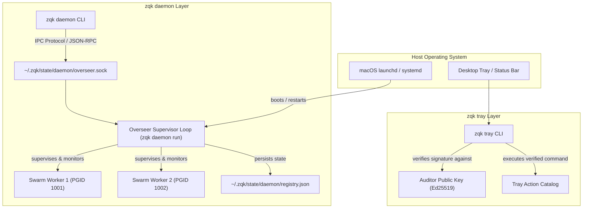

# CLI Daemon & Tray Process Management Guide

Comprehensive guide to background daemon supervision, system service integration, and cryptographically verified desktop tray actions within the **ZQK Knowledge Kernel**.

---

## 1. System Overview & Architecture

The ZQK process management layer provides robust supervision of background workers, swarms, and desktop status indicators through two primary CLI sub-ecosystems:

1. **`zqk daemon`**: Manages autonomous background worker processes via an in-tree supervisor (`overseer`), maintaining a local registry and communicating across an asynchronous UNIX domain socket IPC membrane.
2. **`zqk tray`**: Provides a desktop tray / menu-bar operational harness that executes pre-configured operational actions backed by Ed25519 digital signature auditing and fail-closed security invariants.



---

## 2. Daemon Management & Overseer Architecture

The daemon subsystem manages multiple long-lived processes (e.g., swarm nodes, scheduler daemons, sync agents) under distinct process groups (PGID).

### 2.1 The Overseer Supervisor
When running, the overseer acts as a local daemon manager:
- Monitors target processes, detects exits, and applies exponential backoff restart strategies.
- Exposes a UNIX domain socket (`~/.zqk/state/daemon/overseer.sock`) accepting structured JSON control commands.
- Maintains state in Content-Addressed Storage and local state registries (`~/.zqk/state/daemon/registry.json`).
- Isolates child processes into distinct process groups (`setpgid`) to ensure clean tree termination upon shutdown.

### 2.2 Dual-Mode Execution (Online IPC vs. Offline Registry)
The `zqk daemon` commands are designed to work seamlessly whether the supervisor is actively running or offline:
- **Online Mode:** If the overseer socket is active, CLI commands issue live IPC requests (`start`, `stop`, `restart`, `enable`, `disable`, `status`, `add`, `remove`). The overseer executes the mutation immediately and returns real-time process diagnostics (PID, PGID, uptime, restart counts).
- **Offline Mode:** If the overseer is not running, configuration commands (`add`, `enable`, `disable`, `remove`) mutate the `registry.json` file directly on disk, displaying an informational note. When the overseer next starts, it automatically loads and reconciles the updated registry.

---

## 3. Daemon CLI Command Reference

### 3.1 Running the Overseer
Start the supervisor loop directly in the foreground or as a background process:
```bash
# Run in the foreground with live log streaming
zqk daemon run --foreground

# Run with custom state root
zqk daemon run --dir ~/.zqk/custom-state
```

### 3.2 Process Registration & Lifecycle Controls
```bash
# Add a new worker process to the supervisor
zqk daemon add worker-alpha --cmd "zqk agent run-worker --worker-id alpha"

# Inspect overall supervisor status and running workers
zqk daemon status

# Inspect a specific worker
zqk daemon status worker-alpha

# Start, stop, or restart an individual daemon
zqk daemon start worker-alpha
zqk daemon stop worker-alpha
zqk daemon restart worker-alpha

# Enable or disable automated supervisor boot for a worker
zqk daemon enable worker-alpha
zqk daemon disable worker-alpha

# Remove a daemon from the registry
zqk daemon remove worker-alpha
```

### 3.3 Operating System Service Integration (`launchd` & `systemd`)
`zqk daemon service` integrates the overseer into the host operating system's service manager:
- **macOS:** Generates, loads, and manages `~/Library/LaunchAgents/com.zqk.daemon.plist`.
- **Linux:** Generates, enables, and manages user-level `systemd` units (`~/.config/systemd/user/zqk-daemon.service`).

```bash
# Install the background service into the host OS
zqk daemon service install

# Check service registration status
zqk daemon service status

# Uninstall the service and remove OS launch definitions
zqk daemon service uninstall
```

---

## 4. Desktop Tray Harness & Cryptographic Security Model

The `zqk tray` subsystem bridges desktop shell environments (macOS menu bar, Linux system tray, Windows notification area) with kernel capabilities. Because desktop actions often trigger privileged CLI operations without interactive human authentication, `zqk tray` enforces a strict cryptographic verification model.

### 4.1 Threat Model & Security Invariants
1. **Ed25519 Signature Auditing:** Operational actions must be cryptographically signed by an authorized auditor private key.
2. **Fail-Closed Execution:** If an action's signature fails, is missing, or does not match the canonical hash of the action definition, execution halts immediately with an audit violation.
3. **Privilege Boundary Guard:** Appending unauthorized privileged flags or argument overrides to pre-signed commands is rejected at runtime.
4. **Offline Key Verification:** Public keys can be supplied via configuration, environment variables (`ZQK_TRAY_AUDITOR_PUBKEY`), or root kernel policies.

### 4.2 Tray CLI Command Reference

```bash
# List all registered tray entries and their signature statuses
zqk tray list

# Show detailed specification of a specific tray entry
zqk tray show entry-diagnostics

# Explain the action and security provenance of an entry
zqk tray explain entry-diagnostics

# Cryptographically sign a tray entry using an auditor private key
zqk tray sign entry-diagnostics --private-key ~/.zqk/keys/auditor.priv

# Execute a tray entry (verifying signature before dispatch)
zqk tray run entry-diagnostics

# Dry-run execution to verify arguments without spawning subprocesses
zqk tray run entry-diagnostics --dry-run
```

---

## 5. Troubleshooting & Operational Guidance

### 5.1 Socket Path Length Limits on UNIX
UNIX domain sockets have a strict maximum path length of 104 bytes on macOS (`sockaddr_un.sun_path`) and 108 bytes on Linux.
- **Problem:** If `--dir` or a test runner uses deep temporary directories (e.g. `/var/folders/.../T/sub/sub/.../overseer.sock`), socket binding fails with `bind: invalid argument`.
- **Solution:** Place daemon state in standard short paths like `~/.zqk/state/daemon` or use `/tmp/` for short ephemeral test roots.

### 5.2 Stale Socket Cleanup
If the host system experiences an ungraceful shutdown or power loss, an orphaned socket file `overseer.sock` may remain on disk:
- When starting, `zqk daemon run` automatically tests socket responsiveness and cleans up stale sockets if no active process responds.
- In manual recovery, run `zqk system doctor` or verify the PID in `~/.zqk/state/daemon/overseer.pid`.

### 5.3 Automated Done-Gate Verification
Daemon and tray process integrity is verified as part of the ZQK test case harness:
```bash
# Execute daemon and tray unit test suites
ZQK_ALLOW_FOREGROUND_GO_TEST=1 go test -v -cover ./cmd/zqk/daemon ./cmd/zqk/tray

# Run the linked kernel test case
./bin/zqk test run TST-1791958203428881001-1e8395ba
```
