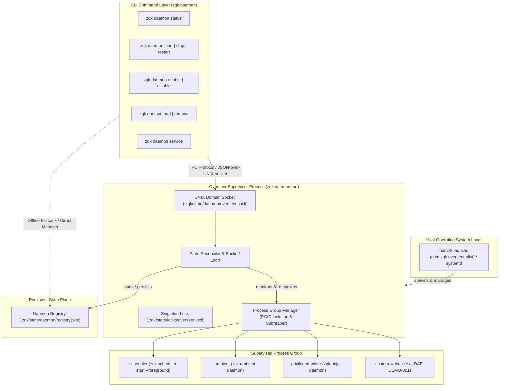
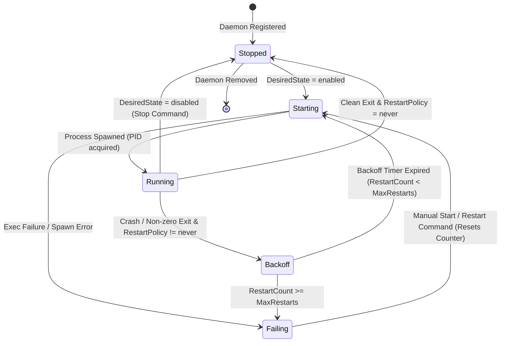

# CLI Daemon Subsystem Architectural Guide

Comprehensive architectural documentation for the background daemon supervision subsystem, overseer IPC protocol, registry state reconciliation, and host service lifecycle management within the **ZQK Knowledge Kernel**.

---

## 1. Architectural Overview & Design Principles

The **ZQK Daemon Subsystem** provides unified, deterministic supervision of long-running background processes (such as the task scheduler, ambient filesystem heuristics, CAS privileged writer, and custom worker agents). Rather than scattering uncoordinated host service definitions or relying on transient shell jobs, ZQK unifies background execution under a **single supervisor architecture** known as the **Overseer**.



### Core Design Principles

1. **Solitary Supervisor Invariant**: Exactly one overseer supervisor runs per project root. Multiple daemons do not register separate host launch daemons; the overseer manages them as child processes within its dedicated process group.
2. **Dual-Mode Execution (Online IPC vs. Offline Registry Fallback)**:
   - When the overseer is running, CLI commands issue live UNIX domain socket IPC requests for immediate state reconciliation and real-time status reporting.
   - When the overseer is offline, state and configuration commands directly inspect and mutate the persistent JSON registry (`registry.json`). When the overseer boots, it reconciles reality with the desired state.
3. **Process Tree & Group Isolation**: Every managed daemon process is spawned within the overseer's process group with child subreaping enabled (where supported by the host OS), preventing orphan daemon leaks upon unexpected termination.
4. **Resilient Backoff & Restart Discipline**: Failed processes are restarted according to declared restart policies (`always`, `on-failure`, `never`) using exponential backoff with configurable minimum and maximum delays.

---

## 2. Command Taxonomy (`zqk daemon`)

The CLI entrypoint for daemon management is `zqk daemon`. It provides a clean, predictable taxonomy of lifecycle, configuration, and service integration subcommands:

| Subcommand | Syntax | Mode | Description |
| :--- | :--- | :--- | :--- |
| `status` | `zqk daemon status [name]` | Online / Offline | Displays running state, PID, PGID, restart counts, or offline registry specs. |
| `start` | `zqk daemon start <name>` | Online / Offline | Signals the overseer to start a daemon immediately, or marks it `enabled` offline. |
| `stop` | `zqk daemon stop <name>` | Online / Offline | Stops a running daemon via overseer, or marks it `disabled` offline. |
| `restart` | `zqk daemon restart <name>` | Online Only | Triggers an immediate in-flight restart of a managed process via IPC. |
| `enable` | `zqk daemon enable <name>` | Online / Offline | Sets desired state to `enabled` (online triggers start; offline sets autostart). |
| `disable` | `zqk daemon disable <name>` | Online / Offline | Sets desired state to `disabled` (online stops; offline clears autostart). |
| `add` | `zqk daemon add <name> [flags] -- <cmd...>` | Online / Offline | Registers a new daemon specification in the registry and overseer runtime. |
| `remove` | `zqk daemon remove <name>` | Online / Offline | Unregisters a daemon from the supervisor runtime and removes it from disk. |
| `run` | `zqk daemon run` | Server Loop | Starts the overseer daemon process supervisor in the foreground. |
| `service install` | `zqk daemon service install [--root <path>]` | Host OS | Installs the solitary LaunchAgent/systemd host service definition. |
| `service uninstall` | `zqk daemon service uninstall` | Host OS | Safely stops all daemons and uninstalls host service units. |
| `service status` | `zqk daemon service status` | Host OS | Queries the current host service registration state (loaded, PID, path). |
| `service cleanup-legacy` | `zqk daemon service cleanup-legacy` | Host OS | Scans and unloads obsolete individual LaunchAgent units from older layouts. |

---

## 3. Overseer IPC Protocol

When the overseer supervisor is active, CLI commands communicate with it across a lightweight, local UNIX domain socket.

### 3.1 Socket Geometry & Location
The canonical socket path is anchored to the active project root:
```
<projectRoot>/.zqk/state/daemon/overseer.sock
```
Socket permissions are locked to `0600` (owner read/write only) to ensure strict process isolation on multi-user systems.

### 3.2 Wire Framing & Protocol Format
- **Transport**: Streaming UNIX domain socket (`net.DialContext(ctx, "unix", sockPath)`).
- **Framing**: Line-delimited JSON (`\n` terminated).
- **Request Envelope (`IPCRequest`)**:
  ```json
  {
    "action": "start",
    "target": "DAE-DEMO-001",
    "spec": null
  }
  ```
- **Response Envelope (`IPCResponse`)**:
  ```json
  {
    "success": true,
    "error": "",
    "daemons": [
      {
        "name": "DAE-DEMO-001",
        "desired_state": "enabled",
        "actual_state": "running",
        "pid": 48210,
        "pgid": 48200,
        "restart_count": 0,
        "started_at": "2026-10-20T04:00:00Z"
      }
    ]
  }
  ```

### 3.3 Supported Actions & Semantics

- **`status`**: If `target` is empty, returns statuses for all registered daemons. If `target` is provided, returns single daemon status or error.
- **`start`**: Sets desired state to `enabled` and triggers immediate process spawn if not already running.
- **`stop`**: Sets desired state to `disabled` and sends graceful termination (`SIGTERM`) to the process.
- **`restart`**: Kills the existing process and restarts it immediately, resetting any active backoff timer.
- **`enable` / `disable`**: Updates the desired state in both memory and disk registry.
- **`add`**: Ingests a new `DaemonSpec` into the supervisor and reconciles execution.
- **`remove`**: Stops the running process (if active) and drops the specification from the registry.
- **`shutdown`**: Initiates a clean overseer shutdown sequence, stopping all children and closing the socket.

---

## 4. Daemon Registry & State Transitions

The persistent state of all supervised processes is maintained in the daemon registry file:
```
<projectRoot>/.zqk/state/daemon/registry.json
```

### 4.1 Specification Schema (`DaemonSpec`)

```json
{
  "name": "DAE-DEMO-001",
  "description": "Demonstration Swarm Background Worker",
  "command": ["agent", "seat-worker", "--agent-id", "ACC-COMMUNITY-001"],
  "desired_state": "enabled",
  "restart_policy": "always",
  "max_restarts": 10,
  "backoff_min": 1000000000,
  "backoff_max": 30000000000,
  "working_dir": "",
  "env": {
    "ZQK_AGENT_ROLE": "craftsman"
  }
}
```

### 4.2 State Transition Matrix

The supervisor continuously reconciles the gap between **Desired State** (intent) and **Actual State** (process reality):



### 4.3 Actual State Definitions
- **`stopped`**: Process is not running and desired state is `disabled`, or process finished cleanly with `RestartPolicyNever`.
- **`starting`**: Process is actively being launched by the supervisor.
- **`running`**: Process is healthy and executing under its assigned PID/PGID.
- **`backoff`**: Process crashed or exited unexpectedly; waiting for exponential backoff duration before retry.
- **`failing`**: Process has exhausted its `max_restarts` budget and will not restart without operator intervention.

---

## 5. Offline Desired State Toggling

A cornerstone of ZQK's operational ergonomics is **seamless offline operation**. Operators frequently need to configure daemons, enable workers, or adjust restart policies before booting background services.

### Offline State Flow

1. **Detection**: The CLI checks if the overseer UNIX socket responds within a tight timeout (200ms).
2. **Registry Load**: If no response is detected, the CLI directly opens and parses `<projectRoot>/.zqk/state/daemon/registry.json`.
3. **Safe Mutation**: The CLI updates the targeted `DaemonSpec.DesiredState` (e.g. `enabled` or `disabled`) or adds/removes entries using atomic file writes.
4. **Informational Feedback**: The CLI prints a human-readable confirmation indicating that the desired state was recorded offline:
   ```yaml
   daemon: DAE-DEMO-001
   desired: enabled
   note: Overseer is not running; daemon will start when overseer runs.
   ```
5. **Reconciliation at Boot**: When `zqk daemon run` is subsequently started, the supervisor reads `registry.json` and immediately launches all specifications marked `enabled`.

---

## 6. Host Service Integration & Process Lifecycle Management

To survive host reboots and user sessions, ZQK integrates with native operating system service managers.

### 6.1 macOS LaunchAgent Architecture
On macOS (Darwin), ZQK manages a solitary user-level LaunchAgent:
- **Identifier**: `com.zqk.overseer`
- **Location**: `~/Library/LaunchAgents/com.zqk.overseer.plist`
- **Arguments**: Runs `zqk daemon run --timeout 0` targeting the absolute project root.
- **Logs**: Standard out and standard error are routed into `<projectRoot>/.zqk/logs/overseer.launchd.out` and `.err`.

### 6.2 Legacy Service Cleanup (`CleanLegacyLaunchAgents`)
Earlier architectures registered separate LaunchAgents per subsystem (e.g. `com.zqk.scheduler.*`, `com.zqk.privileged-writer.*`, `com.zqk.mesh.*`). The modern daemon subsystem includes an automated cleanup pass:
- Scans `~/Library/LaunchAgents/` and `disabled/` subdirectories.
- Unloads legacy units via `launchctl bootout gui/<uid>/<label>`.
- Removes legacy plist files to eliminate multi-daemon race conditions and zombie loops.

### 6.3 Process Group Management & Child Reaping
To prevent orphan child processes:
- The overseer establishes a new process group via `setpgid`.
- On Linux, the overseer invokes `prctl(PR_SET_CHILD_SUBREAPER, 1)` so orphaned grandchild processes are reparented back to the overseer rather than `init`.
- Upon receiving `SIGTERM`, `SIGINT`, or `SIGHUP`, the overseer shuts down all child processes in reverse dependency order, waiting up to a 5-second grace period before issuing `SIGKILL`.

---

## 7. Operational Runbook & Practical Examples

### 7.1 Registering and Starting a Custom Daemon
```bash
# Register a custom seat worker daemon
zqk daemon add DAE-DEMO-001 \
  --description "Community Task Processing Seat Worker" \
  --restart-policy on-failure \
  --max-restarts 5 \
  --enabled \
  -- agent seat-worker --agent-id ACC-COMMUNITY-001

# Inspect status
zqk daemon status DAE-DEMO-001
```

### 7.2 Managing Service Lifecycle
```bash
# Check if host LaunchAgent is installed and running
zqk daemon service status

# Install and bootstrap the solitary overseer service
zqk daemon service install

# Clean up legacy LaunchAgent plists from older releases
zqk daemon service cleanup-legacy

# Safely tear down all running daemons and uninstall host service
zqk daemon service uninstall
```

### 7.3 Troubleshooting & Diagnostics
- **Check socket connectivity**: `ls -la .zqk/state/daemon/overseer.sock`
- **Check lock status**: If the overseer refuses to start, check `.zqk/state/locks/overseer.lock` for stale PID flock holders.
- **View overseer output**: Tail `<projectRoot>/.zqk/logs/overseer.launchd.err` for host-level launch exceptions.
