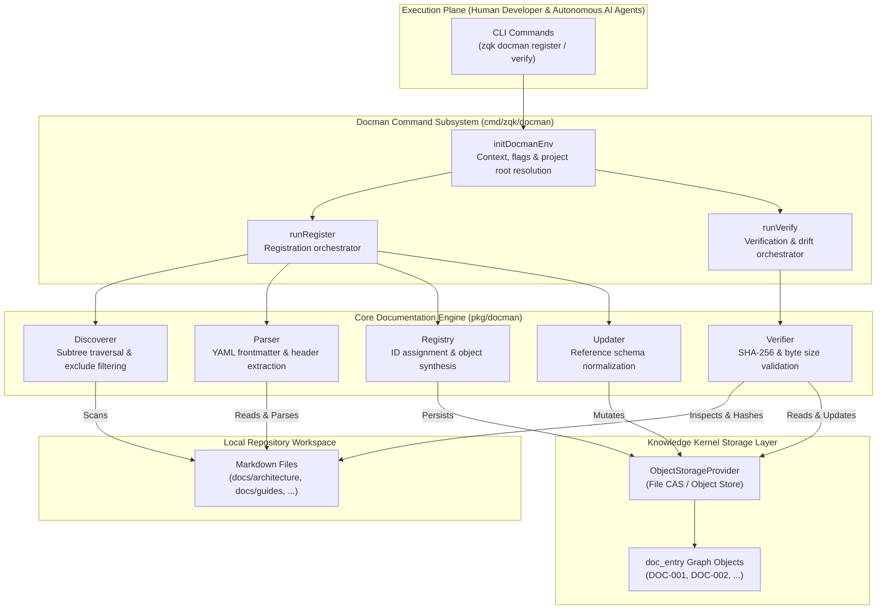

# CLI Documentation Management Subsystem Operational & Architectural Guide

## Overview

The ZQK Documentation Management Subsystem (`cmd/zqk/docman`, backed by `pkg/docman`) provides a content-addressed, cryptographically verified documentation registration and integrity engine engineered for human pair programmers and autonomous AI agent swarms operating within the **Zen Quantum Kernel**.

In conventional software projects and AI agent harnesses, documentation quickly decays into an unindexed, drifted graveyard of stale Markdown files. AI agents lack reliable ways to discover relevant operational guides, while continuous autonomous refactoring silently breaks file references, contracts, and architecture runbooks without triggering build errors.

The ZQK Documentation Management Subsystem solves this through four core capabilities:
1. **Automated Subtree Discovery**: Fast recursive scanning of markdown repositories with configurable subtrees and intelligent exclude filters.
2. **Metadata & Frontmatter Extraction**: Automatic extraction of document titles, summaries, categories, and ontological graph links from YAML frontmatter and Markdown headings.
3. **Content Addressable Storage (CAS) Registration**: Registering markdown files as persistent, versioned `doc_entry` graph objects within the Knowledge Kernel.
4. **Cryptographic Drift Verification & Auto-Sealing**: Continuous verification of SHA-256 hashes and byte lengths against on-disk files, detecting drift and auto-healing document signatures via fail-closed check-valves.

---

## Subsystem Command Taxonomy

The `zqk docman` command group provides an integrated suite of documentation operations:

| Command | Category | Purpose | Primary Flags & Options | Example |
|---|---|---|---|---|
| `zqk docman register` | Registration Pipeline | Discovers markdown documents and registers them as `doc_entry` graph objects | `--subtrees`, `--shipped-only`, `--dry-run`, `--update-existing`, `--format`, `--context` | `zqk docman register --shipped-only` |
| `zqk docman verify` | Integrity & Drift | Cryptographically verifies `doc_entry` objects against disk and detects drift | `--ids`, `--subtrees`, `--shipped-only`, `--auto-seal`, `--strict`, `--format`, `--context` | `zqk docman verify --strict` |

### 1. `zqk docman register` Flags & Options

| Flag | Short | Type | Default | Description |
|---|---|---|---|---|
| `--dry-run` | - | `bool` | `false` | Inspect candidate files and show what would be registered without creating graph objects |
| `--shipped-only` | - | `bool` | `false` | Only scan and register core shipped documentation subtrees (`docs/architecture`, `docs/best-practices`, `docs/onboarding`) |
| `--subtrees` | - | `[]string` | `docs/` | Specific relative subtree directories to scan (comma-separated or repeated) |
| `--update-existing` | - | `bool` | `false` | Backfill missing reference fields on existing `doc_entry` objects to comply with schema contracts |
| `--format` | `-f` | `string` | `table` | Output format: `table`, `json`, `yaml`, `jsonl`, `raw`, `md` |
| `--output` | `-o` | `string` | stdout | Write output to target file path |
| `--context` | - | `string` | `human` | Execution context profile: `human`, `ai-agent`, `debug` |
| `--quiet` | `-q` | `bool` | `false` | Suppress non-essential informational messages |
| `--verbose` | `-v` | `bool` | `false` | Enable verbose debug logging during discovery and parsing |

### 2. `zqk docman verify` Flags & Options

| Flag | Short | Type | Default | Description |
|---|---|---|---|---|
| `--ids` | - | `[]string` | all | Specific `doc_entry` IDs to verify (e.g. `DOC-001,DOC-002`) |
| `--subtrees` | - | `[]string` | all | Restrict verification to documents under specified relative subtrees |
| `--shipped-only` | - | `bool` | `false` | Only verify shipped documentation subtrees |
| `--auto-seal` | - | `bool` | `false` | Compute current SHA-256 hash and byte length on disk and update stored `doc_entry` hashes (heals drift) |
| `--strict` | - | `bool` | `true` | Fail closed with a non-zero exit code if any drift, unsealed, or missing documents are detected |
| `--format` | `-f` | `string` | `table` | Output format: `table`, `json`, `yaml`, `raw` |
| `--output` | `-o` | `string` | stdout | Write verification report to target file path |

---

## Core Architecture



### 1. Subtree Discovery & Directory Pruning

The discovery engine (`docman.Discoverer`) scans the repository starting from the project root:
- **Default Scope**: Scans all Markdown files under `docs/` when no specific subtrees are configured.
- **Targeted Subtrees**: Restricts scanning to one or more directory paths (e.g. `docs/architecture`, `docs/guides`).
- **Shipped Documentation Baseline**: The package defines canonical shipped documentation subtrees (`docman.ShippedInitDocSubtrees`):
  - `docs/architecture`
  - `docs/best-practices`
  - `docs/onboarding`
- **Exclude Directories**: Automatically prunes non-documentation and cache directories, including `.git`, `node_modules`, `__pycache__`, `.zqk`, and `archive`.

### 2. Frontmatter Parsing & Metadata Extraction

The parser (`docman.Parser`) extracts structured metadata from discovered files:
- **YAML Frontmatter**: Reads fenced YAML blocks (`---`) at the top of markdown files. Extracted fields include `title`, `summary`, `group`, `category`, and ontological reference links.
- **Header Fallback**: If YAML frontmatter is omitted, the parser derives the document title from the first `# Title` markdown heading and infers default categories based on subtree location.
- **Normalization**: Paths are normalized to repository-relative Unix slashes (`paths.NormalizeDocEntryPathForKey`) ensuring cross-platform stability across Windows, Linux, and macOS.

### 3. Registration Pipeline & Graph Object Synthesis

The registry (`docman.Registry`) transforms discovered files into versioned kernel objects:
- **Deterministic ID Generation**: Assigns monotonically increasing identifier keys formatted as `DOC-###` (e.g. `DOC-001`).
- **Duplicate Prevention**: Queries existing `doc_entry` objects in storage before creating new ones; files already registered are automatically skipped.
- **Initial Cryptographic Sealing**: Computes the initial SHA-256 hash and byte size of the document, sealing them onto the `doc_entry` payload upon registration.
- **Schema Backfilling (`--update-existing`)**: Synchronizes existing `doc_entry` records with required reference schema arrays (`goal_refs`, `workstream_refs`, `milestone_refs`, `requirement_refs`) without modifying document content.

### 4. Cryptographic Drift Verification & Self-Healing

The verifier (`docman.Verifier`) guarantees documentation integrity:
- **Double Cryptographic Anchor**: Validates both the SHA-256 content hash and the document size in bytes.
- **Drift Classification**:
  - `Passed`: On-disk file exactly matches the stored cryptographic signature.
  - `Drifted`: File has been altered on disk; hash or size does not match stored values.
  - `Unsealed`: `doc_entry` exists in storage but lacks content hash or size metadata.
  - `Missing`: `doc_entry` references a target path that does not exist on disk.
- **Auto-Sealing (`--auto-seal`)**: When files are intentionally updated by developers or agents, running verify with `--auto-seal` re-computes hashes and sizes, updating the CAS storage and restoring pristine status.
- **Fail-Closed Gate (`--strict`)**: In CI/CD pipelines and pre-commit checks, strict mode exits with an error if any drift or unsealed documents are present, preventing unverified changes from reaching production.

---

## Operational Workflows & Recipes

### Recipe 1: Initial Discovery & Shipped Documentation Seeding

Seed the Knowledge Kernel with core architectural and onboarding guides:

```bash
# Register shipped documentation entries into the kernel
zqk docman register --shipped-only

# Verify registration output
zqk object list --kind doc_entry
```

### Recipe 2: Preflight Dry-Run Auditing

Inspect what files will be registered before committing changes to storage:

```bash
# Preview documentation registration across all subtrees
zqk docman register --dry-run

# Output formatted as JSON for automated agent ingestion
zqk docman register --dry-run -f json
```

### Recipe 3: Targeted Subtree Scanning

Register documentation files within specific domain subtrees:

```bash
# Register architecture and operational guides only
zqk docman register --subtrees docs/architecture,docs/guides
```

### Recipe 4: Cryptographic Integrity Verification & CI Gate

Enforce that no documentation has drifted or been deleted:

```bash
# Verify shipped documentation integrity with strict fail-closed enforcement
zqk docman verify --shipped-only --strict

# Verify specific document IDs
zqk docman verify --ids DOC-001,DOC-002
```

### Recipe 5: Automated Drift Remediation & Sealing

Heal drifted documents after intentional content updates:

```bash
# Recompute SHA-256 signatures and seal all updated documents in storage
zqk docman verify --shipped-only --auto-seal
```

---

## Verification & Statement Coverage Invariant

To ensure reliability across continuous multi-agent swarm operations, the Documentation Management subsystem is bound by strict automated testing invariants:

1. **>=85.0% Statement Test Coverage Floor**: Every package routine (`resolveDocmanContext`, `resolveSubtreesAndShipped`, `initDocmanEnv`, `withDocmanEnv`, `NewDocmanCmd`, `NewRegisterCmd`, `NewVerifyCmd`, `runRegister`, `runVerify`) is thoroughly exercised across both standard execution paths and adversarial edge conditions.
2. **Hermetic Test Isolation**: Tests execute within isolated project workspaces generated via `testkit.PrepareIsolatedTempProject`, ensuring clean working directories and zero state leakage across test suites.
3. **Storage Provider Cleanup**: Every test fixture registers a cleanup routine invoking `cli.UnregisterStorageForProjectRoot` to prevent cached storage handles from interfering with subsequent runs.
4. **Zero Swallowed Errors**: All test cases rigorously assert error returns (`require.NoError`, `require.Error`, `assert.Contains`) without discarding errors via blank identifiers.
5. **Modular Function Boundaries**: All unit test helper routines and test functions remain concise (<100 lines), maintaining readability and maintainability.
