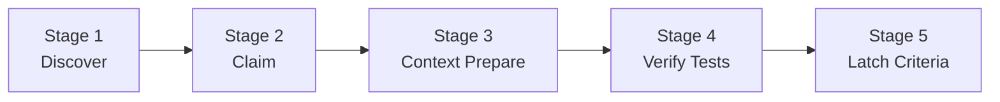
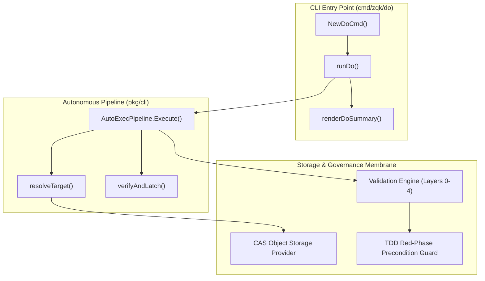

# CLI Do Subsystem Architectural & Operational Guide

## Overview

The ZQK Autonomous Workflow Execution Subsystem (`cmd/zqk/do` and `pkg/cli/auto_exec.go`) provides the canonical, deterministic single-command execution loop for the **Zen Quantum Kernel**.

In conventional agent harnesses (such as unconstrained interactive chat or prompt-promiscuous wrappers), AI coding agents frequently fall into failure modes:
- **Context Thrashing**: Indiscriminately invoking shell tools, reading entire directory trees, and exceeding token limits.
- **Lost Attribution & Collision**: Multiple agents attempting edits concurrently without persistent graph leases.
- **Premature Done-Gate Claims**: Marking tasks completed without verified test execution or AST compliance.
- **Idle Stalling**: Pausing execution upon milestone transitions instead of advancing along priority trajectories.

The `zqk do` subsystem solves these dilemmas by unifying target discovery, lease claiming, contextual prompt generation, test suite verification, and criteria latching into a single fail-closed pipeline.

```bash
zqk do [task_or_bli_id] [flags]
```

---

## Subsystem Taxonomy & CLI Invocations

The `zqk do` command family acts as the primary driver for human operators and autonomous worker agents:

| Command & Alias | Invocation | Scope & Operational Behavior |
|---|---|---|
| `zqk do` | `zqk do` | Auto-discovers the highest priority planned or in-progress backlog item and executes the end-to-end loop. |
| `zqk do <id>` | `zqk do BLI-CORE-001` | Targets a specific backlog item (`BLI-*`) or agent task (`ATK-*`) for directed execution. |
| `zqk auto-exec` | `zqk auto-exec` | Canonical alias for `zqk do`. |
| `zqk auto-do` | `zqk auto-do` | Interactive and shell shorthand alias for `zqk do`. |

### Primary Flags

- `--dry-run`: Simulates the entire discovery, claiming, and verification pipeline without mutating CAS storage or emitting irreversible state transitions.
- `--verify`: Executes test verification via registered test runners and latches completed criteria (defaults to `true`).
- `--by <claimant>`: Specifies claimant identity (seat or account). Defaults to `ZQK_AGENT_ID`, authenticated account, or `agent:auto-exec`.
- `--persona-ref <ref>`: Designates the semantic persona contract (defaults to `PER-COMMUNITY-SOFTWARE-ENGINEER`).
- `-f, --format <format>`: Emits structured output (`table`, `json`, `yaml`, `jsonl`).

---

## Five-Stage Autonomous Execution Pipeline

Every execution of `zqk do` proceeds through a deterministic five-stage lifecycle:



### Stage 1: Discovery & Target Resolution
- If an explicit ID is supplied:
  - Backlog Items (`BLI-*`): Resolved directly from storage.
  - Agent Tasks (`ATK-*`): Resolved via `related_object_refs` mapping to parent backlog items.
- If no ID is supplied:
  - Queries storage for candidates in `planned` or `in_progress` lifecycle states.
  - Prioritizes candidates based on priority tier (`critical` > `high` > `medium` > `low`).

### Stage 2: Claiming & Lease Acquisition
- Establishes exclusive single-claimant ownership by writing `claimed_by` attribution to the backlog item.
- Transitions lifecycle status from `planned` to `in_progress`.
- Enforces Test-Driven Development (TDD) red-phase preconditions: ensures linked criteria are bound to active test cases before allowing `in_progress` execution.

### Stage 3: Context Preparation & Agent Handoff
- Assembles a token-budgeted, AST-informed context bundle containing:
  - Target object specifications and criteria definitions.
  - Concrete instruction prompts for external coding agents (Cursor, Claude, Windsurf, Gemini, Cline, Hermes).
  - Prescribed verification command recipes.

### Stage 4: Test Verification & Operational Proof
- When `--verify` is set, locates registered test cases (`TST-*`) mapped to the backlog item's criteria.
- Dispatches targeted verification suites with explicit timeouts, preventing process hangs.
- Validates that test suites execute cleanly and return zero exit codes.

### Stage 5: Done-Gate Latching & State Transition
- Upon successful test suite execution, updates criteria status to `complete`.
- Inspects whether all criteria bound to the backlog item have been satisfied.
- Auto-discovers git commit hashes citing the backlog item.
- Transitions the backlog item to `complete` when all DoD gates pass.

---

## Core Architecture & Execution Topology



> [!NOTE]
> In dry-run mode (`--dry-run`), the pipeline executes complete target discovery and criteria lookup but skips mutating writes in storage, returning simulated steps with `dry_run` status.

---

## Invariant Enforcement & Protective Guards

The subsystem enforces strict operational invariants:

### 1. Error Containment & Fail-Closed Execution
- Target resolution failures (e.g. non-existent IDs, tasks without backlog item associations) fail immediately without mutating repository or kernel state.
- Test failures in Stage 4 halt criteria latching and mark the pipeline step as `failed`.

### 2. Token Conservation Discipline
- In contrast to naive agent frameworks that load entire repositories into LLM context, `zqk do` constructs minimal, deterministic prompt envelopes tailored exclusively to the claimed unit of work.

### 3. AST Quality & Zero-Swallowed-Errors Invariant
- All code within the subsystem strictly enforces error propagation:
  - Zero ignored error values (never use `_ = ...` for error returns).
  - Explicit error returns checked via `require.NoError` or proper error wrapping.

### 4. Anti-Thrashing & Single-Claimant Guard
- Backlog items can only be claimed by a single worker seat. Attempting to claim an already claimed item without explicit release is blocked by lifecycle validation.

---

## Operational Recipes

### Recipe 1: Auto-Discover and Claim Next Planned Work

```bash
# Discover next planned backlog item and initialize claim
zqk do

# Inspect dry-run plan without writing to storage
zqk do --dry-run
```

### Recipe 2: Target a Specific Backlog Item with Custom Claimant

```bash
# Execute specific item attributed to a designated worker seat
zqk do BLI-CORE-001 --by seat:craftsman-1

# Output machine-readable JSON status for CI/CD or agent pipelines
zqk do BLI-CORE-001 --dry-run -f json
```

### Recipe 3: Verify and Latch Completed Work

```bash
# Run verification suites and latch criteria
zqk do BLI-CORE-001 --verify

# Query next recommended priority action after latching
zqk workflow whats-next
```

---

## Verification & Statement Coverage Invariant

To guarantee runtime determinism and eliminate regressions in core orchestration, the `cmd/zqk/do` package is governed by a strict statement coverage invariant:

> [!IMPORTANT]
> **Coverage Floor Invariant**: Statement test coverage across `cmd/zqk/do` MUST remain >= **85.0%** at all times. Any pull request dropping coverage below this floor will fail automated gate verification (`zqk-vet`).

### Running the Subsystem Test Suite

To verify statement coverage while preventing unbounded execution or process hangs, always run targeted tests with an explicit timeout:

```bash
# Run isolated unit tests and measure statement coverage
ZQK_ALLOW_FOREGROUND_GO_TEST=1 go test -v -timeout 30s -cover ./cmd/zqk/do
```

> [!CAUTION]
> **No Process Bombs Rule**: Never invoke broad unbounded suites such as `go test ./...` or `go test ./cmd/zqk/...`. Unbounded test executions risk resource exhaustion and long-running hangs.

---

## Related Documentation

- **[Single-Command Execution Loop (`zqk do`)](./SINGLE_COMMAND_EXECUTION_LOOP_GUIDE.md)**: Conceptual guide on the 5-phase execution engine and anti-thrashing disciplines.
- **[CLI Workflow Subsystem Architectural & Operational Guide](./CLI_WORKFLOW_SUBSYSTEM_GUIDE.md)**: Workflow guidance and deterministic next-action resolution (`zqk workflow whats-next`).
- **[CLI Agent Feed Subsystem Architectural & Operational Guide](./CLI_FEED_SUBSYSTEM_GUIDE.md)**: Agent feed coordination and multi-agent correspondence.
- **[Validation Subsystem Architectural & Operational Guide](./VALIDATION_SUBSYSTEM_GUIDE.md)**: Multi-layer validation architecture and invariant policies.
