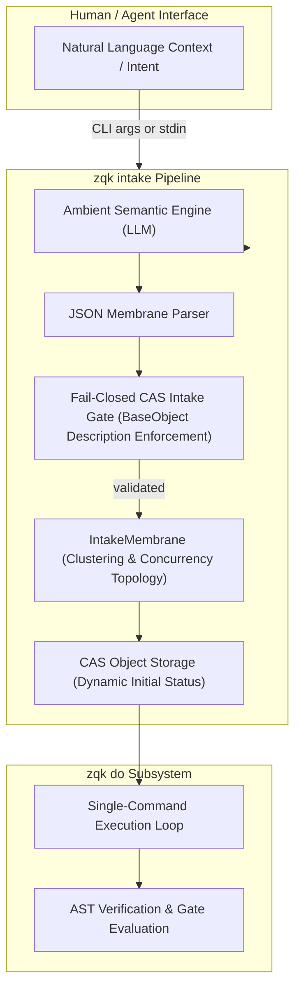

# CLI Execution & Intent Intake Guide

Comprehensive guide to semantic intent ingestion (`zqk intake`), autonomous execution loop (`zqk do`), ambient LLM synthesis, and fail-closed CAS validation membranes within the **ZQK Knowledge Kernel**.

---

## 1. System Overview & Ingestion Architecture

The ZQK ingestion and execution layer bridges free-form human or agent intent with strictly-typed, immutable Knowledge Kernel objects. It operates through two primary CLI command surfaces:

1. **`zqk intake`**: The semantic ingestion pipeline that processes raw natural language, meeting transcripts, or task specs into typed ZQK entities (`requirement`, `goal`, `technical_spec`, `strategic_plan`).
2. **`zqk do`**: The autonomous single-command execution engine that takes intent from capture through preflight, locking, dispatch, and verification.



---

## 2. Semantic Intake Pipeline (`zqk intake`)

### 2.1 The Fail-Closed CAS Intake Gate
Every object emitted by the semantic engine must satisfy core invariants before entering storage:
- **Base Object Description Gate:** Every synthesized object must have a non-empty `description`. Missing or whitespace-only descriptions are rejected fail-closed to prevent malformed CAS entities.
- **Dynamic Initial Status Resolution:** Objects are not hardcoded to a single status. Instead, the intake pipeline queries the object's canonical lifecycle (`GetOriginStatus`) to assign the legitimate origin status (e.g. `conceptual` or `originated` for requirements and goals, `planned` for backlog items).

### 2.2 Intake Membrane Clustering & Concurrency Topology
When multiple intents are ingested simultaneously (`len(objects) >= 2` or `--cluster`/`--concurrency` flags), the `IntakeMembrane` executes two analysis passes:
1. **Semantic Clustering:** Groups related requests sharing common path targets (e.g., `pkg/storage/wal`) into coherent thematic workstreams.
2. **Concurrency Synthesis:** Identifies dependencies between clusters to propose concurrent execution batches versus sequential stages.
3. **Strict Anti-Chaining:** Rejects redundant 1:1 micro-chains that clutter the graph.

---

## 3. Command Usage & Recipes

### 3.1 Basic Intent Ingestion
```bash
# Ingest single intent string via CLI arguments
zqk intake "We need a new sqlite connection and a metrics exporter"

# Ingest multiline intent or meeting notes via stdin pipe
cat architecture_notes.md | zqk intake
```

### 3.2 Clustering & Concurrency Planning
```bash
# Cluster multiple related requests into unified workstreams
zqk intake --cluster "Add WAL atomic rollback and expand storage telemetry metrics"

# Generate concurrency vs sequential execution pipelines
zqk intake --concurrency "Refactor CLI flags and upgrade test matrix"

# Combine clustering with strict anti-chain invariant checks
zqk intake --cluster --concurrency --strict-anti-chain "Implement agent claim gates and session validators"
```

### 3.3 Executing Intent via `zqk do`
```bash
# Execute end-to-end intent with single-command autonomy
zqk do "elevate cmd/zqk/intake test coverage to 80%"

# Dry-run execution to preview planned steps without mutations
zqk do "elevate cmd/zqk/intake test coverage to 80%" --dry-run
```

---

## 4. Troubleshooting & Invariant Diagnostics

| Symptom | Root Cause | Remediation |
| :--- | :--- | :--- |
| `no intent context provided` | CLI invoked without arguments and stdin was a terminal (not a pipe) | Pass text arguments or pipe input via `cat ... \| zqk intake` |
| `fail-closed CAS intake gate rejected` | LLM synthesized an object with an empty description | Ensure intent text provides sufficient detail, or clarify via prompt |
| `intake membrane processing failed` | Requests formed a circular dependency or redundant 1:1 micro-chain | Pass distinct task domains or run without `--strict-anti-chain` |
| `status ... not found in lifecycle` | Object was created with an incompatible lifecycle status | Dynamic lifecycle resolution (`resolveInitialStatusForKind`) prevents this automatically |

---

## 5. Automated Verification
Verify the intake test suite and done-gates:
```bash
# Execute intake test suite
ZQK_ALLOW_FOREGROUND_GO_TEST=1 go test -v -cover ./cmd/zqk/intake

# Run the linked kernel test case
./bin/zqk test run TST-1791959797154056001-0352317d
```
