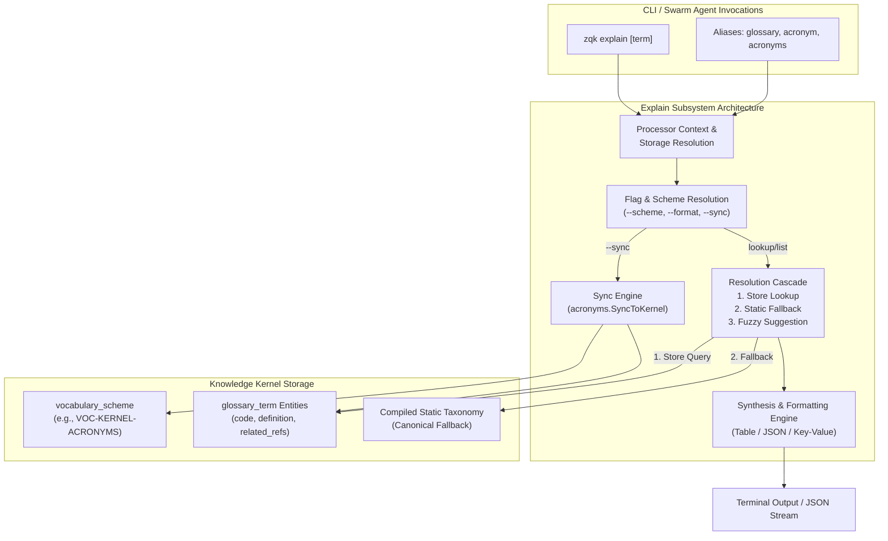
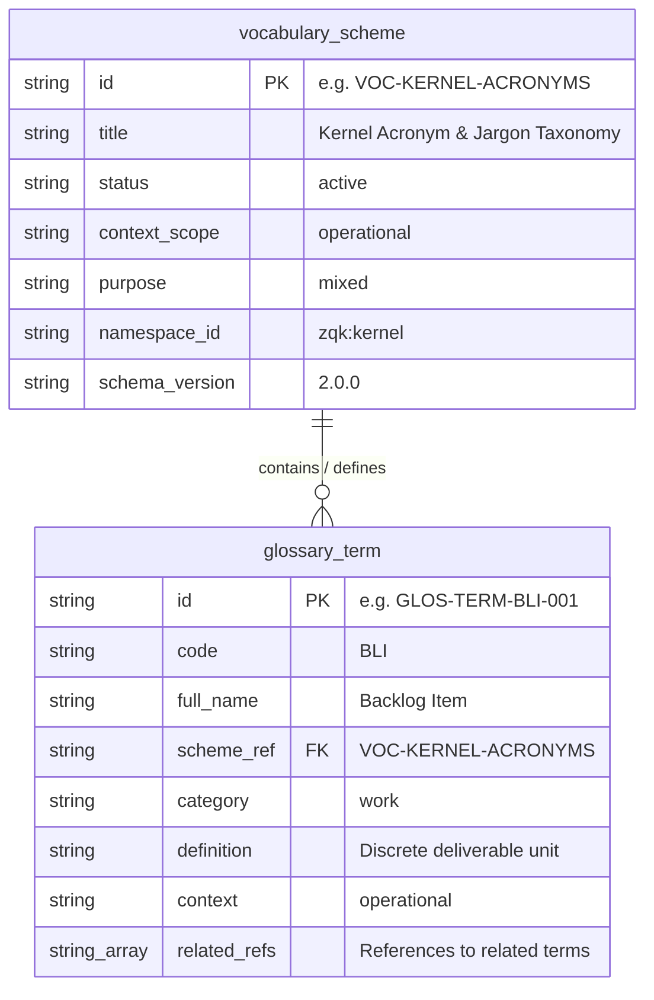
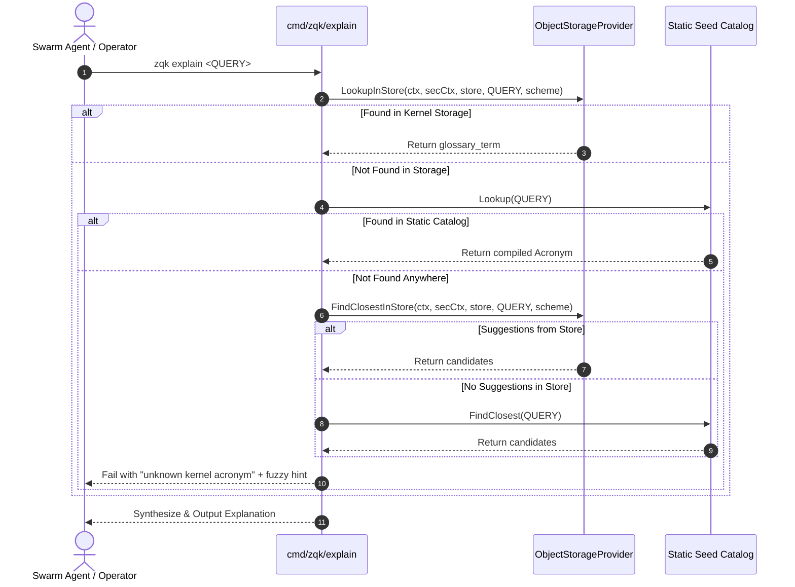

# CLI Explain Subsystem Architectural Guide (`zqk explain`)

## 1. Executive Summary & Architectural Mission

The `zqk explain` subsystem provides a deterministic, single-source-of-truth semantic reflection and explanation engine for both human operators and autonomous agent swarms.

In traditional software development and LLM harnesses, domain vocabulary, acronyms, and ontological relationships are frequently fragmented across disparate readmes, ephemeral prompt contexts, or tribal human knowledge. Within the ZQK Knowledge Kernel, all domain taxonomy is elevated to first-class, verifiable graph entities. The `explain` subsystem bridges storage and runtime comprehension by providing progressive disclosure:
- Instant disambiguation of core architectural acronyms (`BLI`, `PRI`, `REQ`, `CRIT`, `VDS`, `TCFG`, `CVS`, `ATK`, `CAS`, `WAL`, `CAP`).
- Dynamic runtime discovery of user-defined domain terminology stored in the Knowledge Kernel without requiring binary re-compilation.
- Semantic link traversal across related concepts via directional ontology references (`related_refs`).
- Fail-closed fallback pipelines with Levenshtein-distance fuzzy resolution to ensure resilient agent autonomous execution.



---

## 2. Command Family Taxonomy & Invocation Modes

The `explain` subsystem is registered at root with multiple mnemonic aliases to optimize discoverability across diverse agent personas and interactive human shells:

| Command & Alias | Invocation Pattern | Primary Function |
| :--- | :--- | :--- |
| `zqk explain` | `zqk explain [term]` | Canonical explanation and taxonomy query command. |
| `zqk glossary` | `zqk glossary [term]` | Ergonomic alias oriented toward project-level glossaries. |
| `zqk acronym` | `zqk acronym [term]` | Specialized alias for acronym disambiguation. |
| `zqk acronyms` | `zqk acronyms [term]` | Plural alias matching intuitive operator queries. |

### 2.1 Positional Arguments & Constraints

- **Zero Arguments (`zqk explain`)**: Synthesizes and displays the complete catalog of documented terms for the active vocabulary scheme.
- **Single Argument (`zqk explain <term>`)**: Disambiguates and outputs the detailed definition, category, operational context, and related ontological links for `<term>`.
- **Argument Cardinality Invariant**: Enforces `cobra.MaximumNArgs(1)`. Attempting to pass multiple query terms (e.g., `zqk explain BLI PRI`) fails immediately with a validation error.

### 2.2 Flag Reference

| Flag | Shorthand | Type | Default | Operational Impact |
| :--- | :--- | :--- | :--- | :--- |
| `--sync` | `-s` | `bool` | `false` | Synchronizes all canonical terms into the kernel storage plane under `VOC-KERNEL-ACRONYMS`. |
| `--format` | `-f` | `string` | `table` | Target serialization output format: `table` (default) or `json`. |
| `--scheme` | (none) | `string` | `VOC-KERNEL-ACRONYMS` | Target `vocabulary_scheme` identifier within kernel storage. When passed as empty string (`""`), defaults safely back to `VOC-KERNEL-ACRONYMS`. |

---

## 3. Kernel Relational Modeling & Ontology Traversal

The Explain subsystem is built upon two core Knowledge Kernel object schemas: `vocabulary_scheme` and `glossary_term`.



### 3.1 Vocabulary Scheme (`vocabulary_scheme`)
The container object defining the namespace, context scope, and governance lifecycle for a collection of terms:
- Canonical default: `VOC-KERNEL-ACRONYMS`
- Extensible custom schemes: e.g., `VOC-DYNAMIC-CATALOG`, `VOC-STANDALONE-TERMS`

### 3.2 Glossary Term (`glossary_term`)
Each term represents an atomic concept with typed semantic attributes:
- `code`: Normalized shorthand or acronym (e.g., `BLI`, `PRI`, `REQ`, `EXP-DEMO-001`).
- `full_name`: Complete human-readable expansion (e.g., `Backlog Item`).
- `category`: Functional domain classification (`work`, `architecture`, `assurance`, `system`).
- `definition`: Clear, unambiguous definition of the concept and its operational boundaries.
- `context`: Contextual applicability layer (`operational`, `strategic`, `runtime`).
- `related_refs`: Directional array of related term codes establishing the conceptual ontology graph.

### 3.3 Dynamic Graph Traversal & Resolution Cascade

When a term is queried (`zqk explain <QUERY>`), the resolution pipeline executes the following deterministic cascade:



1. **Storage Lookup (`LookupInStore`)**: Queries active storage for an exact matching `glossary_term` under the specified scheme. This guarantees that newly minted domain terms are discoverable instantly.
2. **Static Fallback (`Lookup`)**: If storage is unavailable, unseeded, or the term is not yet synced, checks the compiled static dictionary. This ensures the CLI remains functional in greenfield or minimal boot environments.
3. **Fuzzy Recovery (`FindClosestInStore` & `FindClosest`)**: If no exact match exists, calculates Levenshtein distance against known vocabulary codes and presents ranked suggestions.

---

## 4. Explanation Synthesis & Output Projections

The subsystem supports two output modalities depending on query context and formatting flags.

### 4.1 Single Term Inspection

#### Default Key-Value Display (`table` or default)
Presents a clear, structured block with aligned field labels:

```text
ACRONYM    : BLI
FULL NAME  : Backlog Item
CATEGORY   : work
DEFINITION : A discrete, tracked work package or deliverable scheduled within a Priority Plan.
CONTEXT    : operational
RELATED    : PRI, REQ, CRIT, ATK
```

When an item declares no related references (`related_refs == nil` or empty), the `RELATED` section is omitted cleanly without dangling delimiters.

#### Machine-Readable JSON (`-f json`)
Serializes the full typed term object for automated agent consumption:

```json
{
  "code": "BLI",
  "full_name": "Backlog Item",
  "scheme_ref": "VOC-KERNEL-ACRONYMS",
  "category": "work",
  "definition": "A discrete, tracked work package or deliverable scheduled within a Priority Plan.",
  "context": "operational",
  "related_refs": [
    "PRI",
    "REQ",
    "CRIT",
    "ATK"
  ]
}
```

### 4.2 Full Taxonomy Catalog Listing

When invoked without positional arguments (`zqk explain`), the engine lists all terms under the active scheme.

#### Tabular Overview (Default)
Renders an aligned monospace table displaying code, full name, category, and brief definition:

```text
CODE     FULL NAME             CATEGORY      DEFINITION
-----------------------------------------------------------------------------------------------------------------------
ACC      Actor / Context       architecture  System context or acting persona boundary...
ATK      Adversarial Test Kit  assurance     Automated adversarial verification test suite...
BLI      Backlog Item          work          A discrete, tracked work package or deliverable...
CAP      Continuous Autonomy   system        Autonomous looping and task execution engine...
CAS      Content Addressable   architecture  Cryptographically hashed, immutable object store...
...
```

#### JSON Catalog Stream (`-f json`)
Emits a serialized array containing all registered term objects, enabling agent parsers to hydrate comprehensive offline lookups.

---

## 5. Storage Synchronization & Dynamic Extension (`--sync`)

The Explain subsystem supports bidirectional synchronization between the compiled system baseline and kernel storage.

```bash
zqk explain --sync
```

### 5.1 Synchronization Lifecycle

1. **Scheme Verification**: Checks for the existence of `VOC-KERNEL-ACRONYMS`. If absent, creates the parent `vocabulary_scheme` with standard metadata.
2. **Object Upsert**: Iterates over all canonical seed terms, converts each to a `glossary_term` object map, and executes an idempotent write:
   - Attempts `store.Create(...)`.
   - On duplicate conflict, falls back to `store.Update(...)` with stripped timestamps.
3. **Receipt Emission**: Emits a deterministic console receipt confirming the number of synchronized terms:
   ```text
   ✓ Successfully synchronized 20 acronym terms into scheme VOC-KERNEL-ACRONYMS
   ```

### 5.2 Dynamic Project Extensions

Teams and autonomous agents can declare custom domain vocabulary schemes to support specific initiatives (e.g., `ACC-COMMUNITY-001`, `EXP-DEMO-001`):

```bash
# Query within custom domain scheme
zqk explain --scheme VOC-DYNAMIC-CATALOG DYNA

# Output custom scheme terms as JSON
zqk explain --scheme VOC-DYNAMIC-CATALOG -f json
```

If a queried custom scheme contains no stored terms, the subsystem gracefully falls back to the canonical static baseline (`acronyms.ListAll()`), preventing hard halts during transitional onboarding states.

---

## 6. Error Handling Invariants & Diagnostic Guidance

| Scenario | Subsystem Behavior | User / Agent Remediation |
| :--- | :--- | :--- |
| **Unknown Term with Similar Matches** | Returns fail-closed error with fuzzy suggestion: `unknown kernel acronym "BL". Did you mean: BLI?` | Re-run query using the suggested canonical code. |
| **Unknown Term with No Matches** | Returns fail-closed error: `unknown kernel acronym "ZZZZ". Run 'zqk explain' without arguments to see all registered acronyms` | Execute `zqk explain` to browse available terms or inspect `--scheme`. |
| **Storage Write / Sync Failure** | Emits wrapped error: `failed to synchronize acronyms to kernel: <reason>` | Verify project root storage permissions, disk space, and security context. |
| **Excess Arguments** | Command builder rejects with `accepts at most 1 arg(s), received <N>` | Quote multi-word queries or pass exactly one term argument. |

---

## 7. Verification & Statement Coverage Invariant

Statement test coverage for `cmd/zqk/explain` is strictly enforced:

- **Baseline Floor Requirement**: `>= 85.0%` statement coverage.
- **Cycle 106 Target Verified**: `>= 95.0%` statement coverage (`95.2%` achieved).
- **Test Matrix (`cmd/zqk/explain/`)**:
  - `explain_test.go`: Core functional acceptance, dynamic glossary term discovery, and fuzzy boundary verification.
  - `explain_extended_test.go`: Flag combinations (`--sync`, `-f json`), multi-field table formatting, and security context initialization.
  - `explain_coverage_elevation_cycle106_test.go`: Storage failure paths, empty scheme fallbacks, explicit empty scheme flag handling, terms without related refs, non-matching queries, command aliases, and argument limit enforcement.
