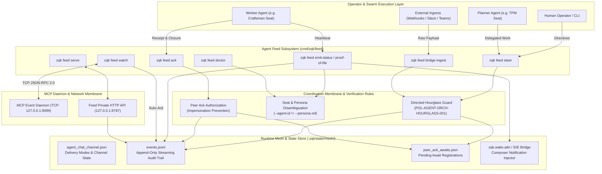

# CLI Agent Feed Subsystem Architectural & Operational Guide

## Overview

The ZQK Agent Feed Subsystem (`cmd/zqk/feed` and `pkg/agentfeed`) establishes the continuous, verifiable communication backbone connecting human operators, autonomous agent swarms, IDE bridges, and Model Context Protocol (MCP) daemons within the **Zen Quantum Kernel**.

In conventional AI assistant harnesses (such as transient chat sessions or prompt-promiscuous wrappers), steering cues, task status updates, and peer handoffs exist as fleeting conversational tokens that vanish once a session terminates. In contrast, ZQK anchors multi-agent collaboration in an append-only, content-addressed communication mesh. Every steering directive, progress broadcast, cognitive acknowledgment, and proof-of-life heartbeat is materialized as a durable, structured event record with cryptographic lineage.

The Agent Feed Subsystem fulfills five foundational architectural roles:
1. **Cognitive Steering & Directed Handoffs** (`zqk feed steer`, `zqk feed wake`): Dispatches targeted directives between planner and worker seats under strict directed hourglass protocols.
2. **Peer Cognitive Acknowledgment** (`zqk feed ack`, `zqk feed pending`): Closes the cognitive feedback loop by verifying peer receipt, unblocking parent workflows, and completing await registrations.
3. **Heartbeat & Telemetry Broadcast** (`zqk feed emit-status`, `zqk feed proof-of-life`): Publishes ambient progress indicators, pulse signals to human operators, and swarm liveness leases.
4. **Daemon Integration & Event Streaming** (`zqk feed watch`, `zqk feed serve`): Bridges asynchronous JSON lines event streams with real-time MCP IPC pub/sub and private HTTP endpoints.
5. **Ingress & Health Inspection** (`zqk feed doctor`, `zqk feed bridge-ingest`): Validates runtime seating health, repairs stale seat registrations, and ingests external notification payloads from webhook adapters.

---

## Subsystem Command Taxonomy

The `zqk feed` command family provides a complete CLI toolkit for agent correspondence and swarm coordination:

| Command | Category | Purpose | Primary Flags & Arguments |
|---|---|---|---|
| `zqk feed steer` | Directed Coordination | Appends a cognitive steering directive addressed to a swarm seat or broadcast mesh | `--message`, `--agent-id`, `--to-agent-id`, `--await-peer-ack`, `--non-interrupting`, `--reprime`, `--feed-id`, `--no-ack`, `--no-wake` |
| `zqk feed ack` | Cognitive Acknowledgment | Emits a peer acknowledgment referencing an in-flight steering event, resolving open awaits | `--in-reply-to`, `--agent-id`, `--persona-ref`, `--summary` |
| `zqk feed emit-status` | Telemetry & Observability | Broadcasts execution phase progress, task status stamps, and optional human pulse cues | `--persona-ref`, `--agent-id`, `--summary`, `--pulse-human`, `--no-ack` |
| `zqk feed proof-of-life` | Swarm Health & Leases | Sends a heartbeat pulse confirming that an autonomous worker process remains active | `--agent-id`, `--persona-ref`, `--summary`, `--no-pulse`, `--no-ack` |
| `zqk feed wake` | Peer Activation | Issues a lightweight wake signal to an agent seat without interrupting active execution | `--message`, `--agent-id`, `--to-agent-id`, `--await-peer-ack`, `--no-ack` |
| `zqk feed pending` | Diagnostic Inspection | Inspects inbox and outbox message queues, unacknowledged items, and next-action hints | `--agent-id`, `--persona-ref`, `--limit` |
| `zqk feed watch` | Event Streaming Loop | Subscribes to the live MCP daemon TCP socket, tailing events and executing auto-ack loops | `--agent-id`, `--persona-ref`, `--tcp`, `--auto-ack` |
| `zqk feed serve` | Network Membrane | Hosts a private, authenticated HTTP/JSON server exposing feed operations to IDE sidecars | `--listen`, `--token` |
| `zqk feed doctor` | Health & Self-Healing | Inspects feed health, validates default persona seating, and audits live process PIDs | `--refresh-seats`, `--dry-run` |
| `zqk feed bridge-ingest` | Ingress Normalization | Ingests external webhook payloads (Slack, Teams, Telegram, Signal, Generic) into feed events | `--channel`, `--payload`, `--payload-file`, `--agent-id`, `--to-agent-id`, `--feed-id`, `--no-ack`, `--no-wake` |

---

## Core Architecture



### 1. Swarm Seating, Personas, and Directed Hourglass Discipline

In the ZQK Knowledge Kernel, multi-agent execution enforces a strict ontological separation between **Swarm Seats** and **Kernel Personas**:
- **Kernel Persona (`--persona-ref`)**: A durable, versioned persona object in Content-Addressed Storage (e.g. `PER-COMMUNITY-SOFTWARE-ENGINEER`, `PER-DEFAULT-OPERATOR`) defining capabilities, architectural roles, and cognitive boundaries.
- **Swarm Seat (`--agent-id`)**: An ephemeral or session-scoped identifier representing an individual execution container, process, or subagent instance (e.g. `SEAT-TPM-01`, `SEAT-CODER-42`).

#### The Distinct Identity Invariant
Commands like `zqk feed ack`, `zqk feed emit-status`, and `zqk feed proof-of-life` strictly forbid using identical identifiers for `--agent-id` and `--persona-ref`. This check-valve prevents collision between structural roles and runtime execution instances.

#### Directed Hourglass Discipline (POL-AGENT-ORCH-HOURGLASS-001)
To eliminate fire-and-forget message loss in distributed multi-agent pipelines, any directed steering event that designates a target seat via `--to-agent-id` MUST declare `--await-peer-ack`. 
The system registers an explicit entry in `peer_ack_awaits.json`. The initiating agent's workflow remains anchored until the designated target acknowledges the message via `zqk feed ack` or an explicit timeout fires.

#### Impersonation Prevention & Peer Authorization
When `zqk feed ack` executes, `agentfeed.AuthorizePeerAck` inspects the parent event referenced by `--in-reply-to`. If the parent steering directive was directed to a specific seat, only that exact recipient seat is authorized to emit the peer acknowledgment. Unauthorized attempts by third-party seats are rejected with fail-closed errors.

---

### 2. Heartbeat Mechanisms, Proof-of-Life, and Seating Doctor

Autonomous agent loops operating over complex tasks require continuous proof-of-life verification to distinguish between deep computational processing and crashed or hung processes.

#### Proof-of-Life (`zqk feed proof-of-life`)
Workers periodically invoke `zqk feed proof-of-life` with their seat identifier and persona reference. This action appends a mesh status event to `events.jsonl` and pushes a live pulse notification to the IDE bridge queue (`.zqk/state/mesh/ide_bridge/`), signaling to operators and parent agents that the worker's execution lease remains active.

#### Status Emission (`zqk feed emit-status`)
Workers broadcast milestone completions, test suite outcomes, or blocking constraints via `zqk feed emit-status`. Passing `--pulse-human` immediately routes an ambient notice to the operator visual console, keeping human pair programmers synchronized with background swarm progress without requiring manual log polling.

#### Swarm Doctor & Seat Refresh (`zqk feed doctor`)
The diagnostic doctor performs a four-point mesh health inspection:
1. **Default Seating Verification**: Checks that required default operator and agent personas exist in authoritative CAS storage.
2. **PID Liveness Reconciliation**: When run with `--refresh-seats`, queries running system processes to detect terminated agent PIDs, clearing orphaned seat registrations.
3. **MCP Subscriber Health**: Probes active TCP subscribers connected to the local MCP daemon.
4. **Contract Path Integrity**: Verifies directory permissions and file availability across `.zqk/state/mesh/` and `.ide/hooks/`.

---

### 3. Non-Interrupting Steering & In-Flight Re-Priming

Traditional agent platforms treat incoming messages as immediate conversational interruptions that truncate current tool executions and invalidate the LLM context buffer. ZQK provides surgical steering modes designed for long-running workflows:

```
Standard Steering:         [Running Tool] ──► (Interrupt) ──► [Halted] ──► [Context Reset]
Non-Interrupting Re-Prime: [Running Tool] ──► (Buffered)   ──► [Tool Completes] ──► [Absorbs Next Turn]
```

- **Non-Interrupting (`--non-interrupting`)**: Stamped on steering events when updates provide advisory context rather than emergency stops. The event is written to the feed log and MCP pub/sub mesh without halting the target agent's active subshell or foreground process.
- **In-Flight Re-Priming (`--reprime`)**: Flags the event payload so that when the agent's current atomic tool execution concludes, the new guidance is automatically injected as an attention cue into the very next turn, preventing wasted execution while ensuring immediate guidance absorption.

---

### 4. Streaming JSON Lines & Append-Only Log Architecture

All feed transactions converge on a single, append-only, line-delimited JSON log located at:
```
<project-root>/.zqk/state/mesh/events.jsonl
```

#### Event Envelope Structure
Each line in `events.jsonl` encapsulates a structured event schema:
```json
{
  "event_id": "AFE-1792774953545653000-18b7ce6a",
  "feed_id": "FEED-CORE-CHANNEL",
  "event_type": "steering",
  "sender": "human_steer",
  "agent_id": "SEAT-TPM-01",
  "to_agent_id": "SEAT-CODER-01",
  "persona_ref": "PER-COMMUNITY-SOFTWARE-ENGINEER",
  "message": "Elevate test coverage for cmd/zqk/feed",
  "timestamp": "2026-10-23T17:02:49Z",
  "delivery_mode": "log",
  "in_reply_to": "",
  "non_interrupting": false,
  "in_flight_reprime": false
}
```

#### Delivery Modes
Configured via `agent_chat_channel.json` or command-line parameters:
- `log`: Appends event to `events.jsonl` without side-effects (headless and CI safe).
- `clipboard`: Writes the event payload to the host operating system clipboard.
- `paste`: Dispatches the payload directly into active terminal input buffers.
- `notify`: Triggers system notifications and MCP IPC broadcasts.
- `off`: Temporarily silences delivery mechanisms while preserving internal CAS records.

---

### 5. CLI-to-Daemon Bridge & Webhook Ingestion

The Feed Subsystem bridges command-line tools with asynchronous external systems:

#### MCP Event Daemon (`zqk feed watch`)
The `watch` daemon establishes a persistent TCP connection to the local MCP daemon (`127.0.0.1:9099`). It subscribes to `notifications/event` streams, tails the `events.jsonl` log, and filters incoming steering items. When configured with `--auto-ack`, it automatically acknowledges incoming notifications, preventing queue congestion in automated testing pipelines.

#### Private HTTP API Server (`zqk feed serve`)
Hosts an authenticated HTTP API allowing web hooks and local IDE sidecars to interact with the feed over HTTP. To prevent unauthorized network exposure:
- Binding to plain non-loopback addresses (outside `127.0.0.1`) without both TLS encryption and token authentication is strictly rejected.
- Graceful shutdown handles OS termination signals (`SIGINT`, `SIGTERM`), ensuring in-flight JSONL appends flush to disk before exit.

#### Ingress Bridge (`zqk feed bridge-ingest`)
Enables bidirectional communication with chat platforms. The ingress adapter parses native payloads from Slack, Microsoft Teams, Telegram, and Signal, mapping external author and message text into standardized ZQK `SteerInput` structures.

---

## Operational Recipes & Command Workflows

### Recipe 1: Directed Task Steering with Peer Acknowledgment

A planner seat directs a software engineer seat to execute unit test elevation, awaiting explicit receipt:

```bash
# 1. Planner dispatches directed steering with required await flag
zqk feed steer \
  --agent-id "SEAT-TPM-01" \
  --to-agent-id "SEAT-CODER-01" \
  --await-peer-ack \
  --message "Implement boundary validation tests for cmd/zqk/feed" \
  --format json

# Output returns event_id: AFE-1792774953545653000-18b7ce6a
# and peer_ack_await_id: AWAIT-1792774953545653000-9a8b7c6d

# 2. Worker seat inspects pending inbox
zqk feed pending --agent-id "SEAT-CODER-01" --format json

# 3. Worker acknowledges receipt and work acceptance
zqk feed ack \
  --agent-id "SEAT-CODER-01" \
  --persona-ref "PER-COMMUNITY-SOFTWARE-ENGINEER" \
  --in-reply-to "AFE-1792774953545653000-18b7ce6a" \
  --summary "Task accepted; commencing test implementation" \
  --format json
```

---

### Recipe 2: Heartbeat Monitoring & Status Broadcasting

A long-running autonomous worker broadcasts incremental progress and heartbeat signals:

```bash
# 1. Broadcast milestone status with human pulse notification
zqk feed emit-status \
  --agent-id "SEAT-CODER-01" \
  --persona-ref "PER-COMMUNITY-SOFTWARE-ENGINEER" \
  --summary "Unit test elevation complete: 10/10 test suites passing" \
  --pulse-human \
  --format json

# 2. Issue a periodic proof-of-life lease heartbeat
zqk feed proof-of-life \
  --agent-id "SEAT-CODER-01" \
  --persona-ref "PER-COMMUNITY-SOFTWARE-ENGINEER" \
  --summary "Compiling coverage profiles and running hygiene verification" \
  --format json
```

---

### Recipe 3: Subsystem Diagnostics and Seat Healing

Audit feed health, clean orphaned seat registrations, and verify persona seating:

```bash
# Audit feed health and refresh seat leases based on live system PIDs
zqk feed doctor --refresh-seats --format json
```

Example diagnostic output:
```json
{
  "contract_paths_ok": true,
  "default_seating_ok": true,
  "feed_health": "healthy",
  "mcp_subscribers": 1,
  "peer_seats_live": 2,
  "peer_wake_live": true,
  "refresh_seats": {
    "scanned_pids": 48,
    "cleared_stale_seats": 0,
    "active_seats": 2
  }
}
```

---

### Recipe 4: Starting the Private HTTP API

Launch the private HTTP server for IDE sidecar integration:

```bash
# Start private HTTP feed server on loopback port
zqk feed serve --listen "127.0.0.1:8787" --token "secret-token-key"
```

---

## Verification & Statement Coverage Invariant

The Agent Feed Subsystem maintains a mandatory **>= 85.0% Statement Coverage Invariant** across all routines in `cmd/zqk/feed`:

```
Package Target: cmd/zqk/feed
Coverage Gate:  >= 85.0% statement coverage
Execution:      go test -short -cover ./cmd/zqk/feed
```

### Quality Invariants
All unit and integration tests under `cmd/zqk/feed` adhere to strict quality rules:
1. **Isolated Environments**: Tests must run within hermetic sandbox directories (`t.TempDir()`), setting explicit test project roots via environment variables (`zqkenv.ProjectRoot()` and `zqkenv.TestRoot()`).
2. **Zero Swallowed Errors**: No error return values may be ignored or discarded (`_ = ...`). All error outputs are verified with `require.NoError`, `require.Error`, or domain-specific assertions.
3. **Bounded Function Complexity**: Functions must not exceed 100 lines, factoring common setup and assertions into modular helper routines.
4. **Named Goroutines**: Any background task or asynchronous reader spawned during testing must be created via `goroutinelabels.NewGoroutine(...)` to ensure trace observability and deadlock immunity.
5. **No Process Bombs**: Tests target specifically `./cmd/zqk/feed` with bounded execution timeouts (`-timeout 30s`), preventing unbounded test cascades.
