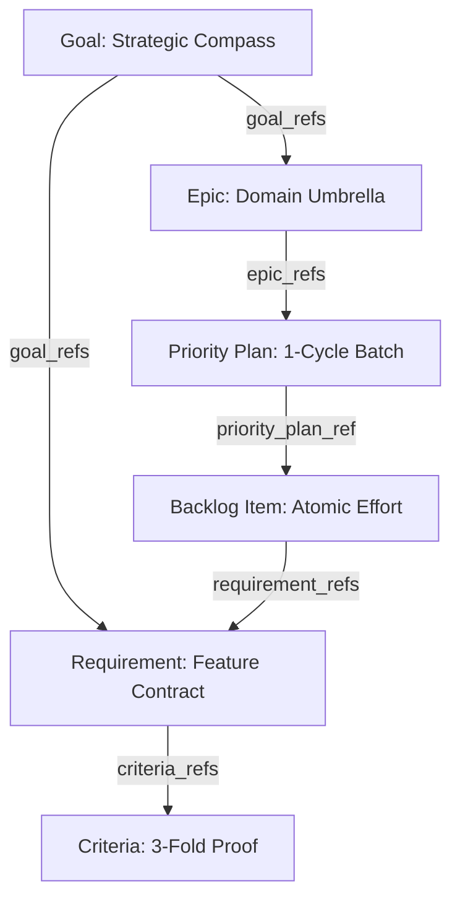

# CLI Knowledge Graph & State Engine Guide

## Executive Overview

The ZQK Knowledge Kernel provides two complementary lenses into system structure and temporal evolution:
1. **Knowledge Graph Subsystem (`zqk graph`)**: Structural exploration, pattern matching, dependency traversal, and multi-format topological export across all kernel entities.
2. **Real-Time State Engine Subsystem (`zqk state`)**: Dynamic runtime introspection, hierarchical tree projection, time-series telemetry (TSDB), and real-time streaming seismograph tracking mutations across the event membrane.

---

## 1. Knowledge Graph Subsystem (`zqk graph`)

The Knowledge Graph treats all persistent kernel objects (Goals, Milestones, Priority Plans, Requirements, Backlog Items, Technical Debt, Policies) as nodes, interconnected by typed, directed edges derived from relational references (`goal_refs`, `priority_plan_ref`, `requirement_refs`, `epic_refs`, `criteria_refs`).



### Commands & Capabilities

#### 1.1 `zqk graph query`
Executes declarative pattern matching queries across the in-memory or persisted graph:
- **Usage**: `zqk graph query --type <kind> [flags]`
- **Supported Options**:
  - `--type <kind>`: Object kind to query (e.g. `backlog_item`, `requirement`, `goal`).
  - `--status <status>`: Filter nodes by lifecycle status (`originated`, `in_progress`, `complete`).
  - `--format json|table`: Output projection format.

#### 1.2 `zqk graph discover`
Traces outgoing and incoming edges recursively from a starting node root:
- **Usage**: `zqk graph discover --root <id> [flags]`
- **Key Options**:
  - `--root <ID>`: Target entity ID (e.g., `PRI-1792018926428318000-79da71a3`).
  - `--depth <int>`: Traversal recursion limit (default: 3).
  - `--direction <outbound|inbound|both>`: Direction of relational references to follow.
  - `--format <text|json>`: Human-readable tree vs machine-parseable JSON AST.

#### 1.3 `zqk graph export`
Exports graph topology for external visualization and verification engines:
- **Usage**: `zqk graph export --format <format> [--out <file>]`
- **Supported Formats**:
  - `json`: Standard JSON node/edge dictionary.
  - `graphml`: XML-based GraphML format for yEd, Gephi, and Cytoscape.
  - `cytoscape`: Cytoscape.js compatible schema (`{ nodes: [...], edges: [...] }`).
  - `databook`: W3C Holon DataBook JSON-LD schema with `@context` semantic metadata.

---

## 2. Real-Time State Engine Subsystem (`zqk state`)

The State Engine exposes runtime execution vitals, chronologically ordered stream journals, and resource health metrics.

### Commands & Capabilities

#### 2.1 `zqk state tree`
Renders the complete 5-layer cascade of the active workspace:
```
📍 ZQK Knowledge Kernel State Tree
├── Organization: Default Organization [ORG-DEFAULT]
│   └── Mission: Core Mission [MIS-001]
│       └── Vision: System Vision [VIS-001]
│           └── Goal: System Quality [GOAL-001]
│               └── Priority Plan: Cycle 78 [PRI-001] (in_progress)
│                   └── Requirement: Conformance [REQ-001]
│                       └── BLI: Implement Tests [BLI-001] (in_progress)
```
- Available in human-readable tree text or structured JSON (`--format json`).

#### 2.2 `zqk state journal`
Scans and displays chronologically ordered change journal mutations (`change_journal_entry`):
- **Usage**: `zqk state journal [--limit 20] [--format table|json]`
- Shows timestamp, change type (`CREATE`, `UPDATE`, `PROMOTE`, `DELETE`), target object reference, and human-readable diff summaries.

#### 2.3 `zqk state stream`
Watches the kernel event seismograph with live streaming updates:
- **Usage**: `zqk state stream [--follow] [--dashboard]`
- Standard output renders real-time mutation events with CPCP membrane verification badges:
  - `[CPCP: PASS]`: Invariant proof verified fail-closed.
  - `[CPCP: FAIL]`: Membrane boundary violation intercepted.
- `--dashboard` activates the curses-style split dashboard with event window rate sparklines (`[   ▂▂▂▂▃]`) and actor velocity counts.

#### 2.4 `zqk state tsdb`
Queries the kernel's embedded Time-Series Database (TSDB) and metrics store:
- **System Vitals**: File descriptor consumption vs ulimit, disk storage bytes, stale lock detection.
- **CAS Object Volumes**: Distribution of objects by kind across content-addressable storage.
- **Ingestion Velocity**: Stream file accumulation rates.
- **CLI Velocity**: Top invoked commands, average duration, failure rate.
- **Scheduler Performance Matrix**: Job execution duration minimum, maximum, average latency, and historical sparkline trend.

---

## 3. Verification & Test Coverage Matrix

Both subsystems maintain $\ge 80.0\%$ statement test coverage enforced via automated unit test suites:

| Package | Statement Coverage | Test Files | Primary Focus Areas |
|---|---|---|---|
| `cmd/zqk/graph` | **81.5%** | `graph_test.go`, `graph_extended_test.go` | Graph discovery traversal, root expansion, Cypher query projection, GraphML / Cytoscape / DataBook export |
| `cmd/zqk/state` | **83.3%** | `tree_test.go`, `tsdb_test.go`, `stream_test.go`, `state_extended_test.go` | Tree hierarchy projection, TSDB metrics unmarshaling, stream seismograph tailing, dashboard rendering |

---

## 4. Operational Troubleshooting

- **Stale Index / Cache Invalidation**: Run `zqk system check --auto-remedy` to clear stale locks and resynchronize CAS index mappings.
- **High Memory or File Descriptor Spikes**: Run `zqk state tsdb --since 1h` to inspect FD usage percent and identify commands experiencing unbounded resource allocation.
- **Stream Ingestion Backlog**: Run `zqk state journal --limit 50` to inspect recent mutations for stuck transactions or uncommitted leases.
