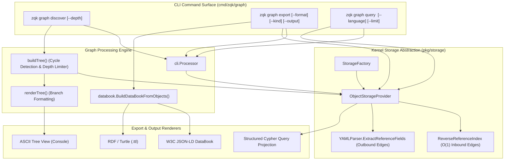
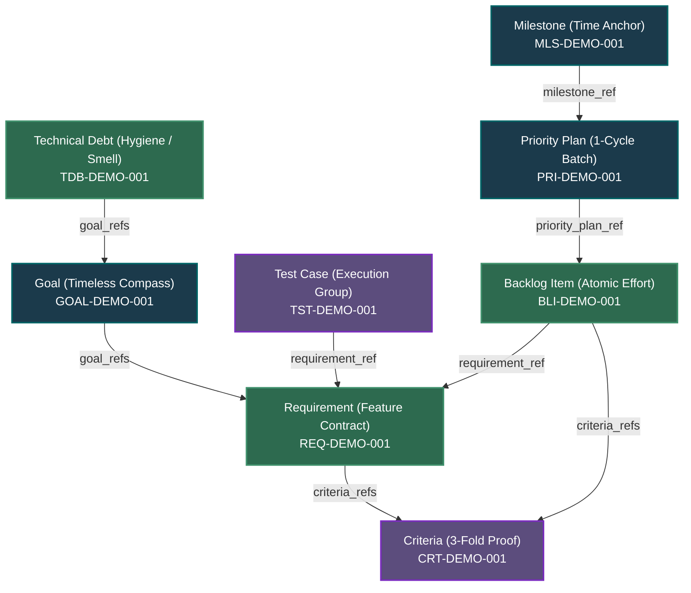

# CLI Graph Subsystem Architectural Guide

## Overview

The **ZQK CLI Graph Subsystem** (`cmd/zqk/graph`) provides high-performance graph exploration, relational ontology discovery, multi-format topological export, and raw query capabilities across the Zen Quantum Kernel (ZQK).

Unlike transient prompt-harness systems where dependencies and requirements exist only as fleeting conversation tokens, ZQK anchors all system entities—Strategic Goals, Milestones, Priority Plans, Requirements, Verification Criteria, Backlog Items, Technical Debts, and Policies—as immutable, content-addressable objects within the persistent **Knowledge Kernel**. The CLI Graph subsystem serves as the primary relational lens, enabling operators and autonomous swarms to navigate, inspect, and extract topological subgraphs.

The Graph subsystem delivers three primary operational capabilities:
1. **Interactive Relationship Discovery (`zqk graph discover`)**: Traverses incoming and outgoing relational edges from any root entity up to configurable depths with cycle protection and hierarchical tree visualization.
2. **Multi-Format Graph Export (`zqk graph export`)**: Serializes graph topology and semantic metadata into industry-standard graph and linked-data formats, including W3C Holon DataBook JSON-LD, RDF/Turtle, and tabular structures.
3. **Declarative Graph Queries (`zqk graph query`)**: Dispatches raw graph queries (such as openCypher) against connected graph backends for advanced topological analysis and pattern matching.

---

## Subsystem Architecture & File Layout

The Graph subsystem is partitioned across the CLI command presentation layer (`cmd/zqk/graph/`), the semantic serialization engine (`pkg/graph/databook/`), and the underlying storage graph traversal layer (`pkg/storage/`):

```
cmd/zqk/graph/
├── graph.go                                      # Root 'zqk graph' command builder and command registration
├── discover.go                                   # 'zqk graph discover': recursive neighbor traversal & ASCII tree rendering
├── export.go                                     # 'zqk graph export': multi-format holon serialization (JSON-LD, Turtle, RDF)
├── query.go                                      # 'zqk graph query': raw Cypher query execution & result formatting
├── export_test.go                                # Flag verification and help screen structural tests
├── graph_extended_test.go                        # Extended isolated project execution and format tests
└── graph_coverage_elevation_cycle96_test.go      # Cycle 96 coverage elevation test suite (93.8% statement coverage)

pkg/graph/databook/
├── databook.go                                   # W3C Holon DataBook builder, JSON-LD, and Turtle/RDF exporters
└── databook_test.go                              # Serialization and roundtrip tests

pkg/storage/
├── object_storage_file_graph_impl.go             # FileObjectStorage GetNeighbors with ReverseReferenceIndex
├── object_storage_graph_traversal.go             # GraphObjectStorage depth-first & breadth-first traversal
├── object_storage_hybrid.go                      # Hybrid dual-storage routing (graph primary, file secondary)
└── dependents_lookup.go                          # ReverseReferenceIndex lookup & candidate kind scanning
```

---

## Subsystem Interaction Topology

The following diagram illustrates how the CLI Graph subsystem interfaces with kernel storage providers, reverse-reference indexes, and serialization engines:



---

## Command Taxonomy & Operations

### 1. `zqk graph discover`

Discovers and visualizes the relationship hierarchy radiating from a given root entity.

#### Syntax & Arguments
```bash
zqk graph discover <id> [flags]
```
- `<id>`: The canonical kernel object identifier (e.g. `GOAL-DEMO-001`, `REQ-DEMO-001`, `BLI-DEMO-001`).
- `--depth`, `-d`: Maximum traversal depth (default: `2`).

#### Execution Workflow & Traversal Algorithm
1. **Root Resolution**: Fetches the root object via `storage.Read(ctx, secCtx, id)`. If absent, fails fast with `failed to read root object`.
2. **Recursive Traversal (`buildTree`)**:
   - Compares `currentDepth` against `maxDepth`. When `currentDepth > maxDepth`, terminates branch recursion.
   - Invokes `storage.GetNeighbors(ctx, secCtx, node.id, "both")` to retrieve incoming and outgoing edges.
   - **Cycle Protection**: Maintains an in-memory `visited` hash set. Nodes already visited along any branch are skipped immediately, preventing infinite recursion in cyclic relationship networks.
   - Recursively descends into child nodes incrementing `currentDepth + 1`.
3. **Visual Formatting (`renderTree`)**:
   - Formats the root node with package emblem: `📦 [kind] ID: Title`.
   - Uses standard tree characters: `├──` for intermediate nodes, `└──` for terminal branch nodes, and `│   ` / `    ` for nested indents.

#### Example Execution
```
$ zqk graph discover GOAL-DEMO-001 --depth 3
Relationship Discovery for:
📦 [goal] GOAL-DEMO-001: Community Knowledge Graph Platform
├── [requirement] REQ-DEMO-001: High-Performance Graph Traversal
│   ├── [backlog_item] BLI-DEMO-001: Implement Cycle-Protected DFS
│   └── [criteria] CRT-DEMO-001: Traversal Terminates on Cyclic References
└── [requirement] REQ-DEMO-002: Multi-Format Topology Export
    └── [backlog_item] BLI-DEMO-002: Implement Turtle & JSON-LD Builders
```

---

### 2. `zqk graph export`

Extracts and serializes objects from the knowledge kernel into structured graph formats.

#### Syntax & Flags
```bash
zqk graph export [flags]
```
- `--format`, `-f`: Output format. Supported options:
  - `databook`, `json-ld`, `json`, `table`, `""`: W3C Holon DataBook JSON-LD schema (default).
  - `turtle`, `ttl`, `rdf`: W3C Resource Description Framework (RDF) Turtle syntax.
- `--kind`, `-k`: Filter export to a specific object kind (e.g. `goal`, `requirement`, `backlog_item`). Omit to export all objects.
- `--output`, `-o`: File path destination. If omitted, streams directly to standard output.

#### W3C Holon DataBook Schema
The export engine groups kernel objects into **Holons**—autonomous, self-contained units with standardized metadata:
```json
{
  "@context": {
    "holon": "https://zqk.dev/ns/holon#",
    "dc": "http://purl.org/dc/terms/",
    "id": "@id",
    "type": "@type"
  },
  "id": "urn:zqk:databook:zqk-os",
  "type": "holon:DataBook",
  "holons": [
    {
      "id": "urn:zqk:object:GOAL-DEMO-001",
      "type": "holon:Goal",
      "title": "Community Knowledge Graph Platform",
      "status": "originated"
    }
  ]
}
```

#### RDF / Turtle Serialization
For semantic web engines, ontology reasoners, and SPARQL endpoints:
```turtle
@prefix holon: <https://zqk.dev/ns/holon#> .
@prefix dc: <http://purl.org/dc/terms/> .

<urn:zqk:object:GOAL-DEMO-001> a holon:Goal ;
    dc:title "Community Knowledge Graph Platform" ;
    holon:status "originated" .
```

#### Example Execution
```bash
# Export all goals to a turtle file
zqk graph export --kind goal --format turtle --output ./exports/goals.ttl

# Export all workspace holons to stdout as JSON-LD
zqk graph export --format json-ld
```

---

### 3. `zqk graph query`

Provides direct query execution capabilities for graph backends supporting Cypher pattern matching.

#### Syntax & Flags
```bash
zqk graph query "<query-expression>" [flags]
```
- `<query-expression>`: Declarative graph query (e.g., Cypher statement).
- `--language`, `-l`: Query language (default: `cypher`).
- `--limit`: Result set limit (`0` = no limit).
- `--format`: Output formatting (`table`, `json`, `yaml`).

#### Example Queries
```bash
# Query all backlog items
zqk graph query "MATCH (n:BacklogItem) RETURN n"

# Trace full dependency chains across requirements
zqk graph query "MATCH p=(:BacklogItem {id: 'BLI-DEMO-001'})-[:DEPENDS_ON*]->(target) RETURN p"

# Aggregate object volume by kind
zqk graph query "MATCH (n:Entity) RETURN labels(n)[0] as kind, count(n) as count"
```

---

## Graph Relational Model & Traversal Semantics

The ZQK knowledge graph enforces strict relational invariants across the 5-layer execution cascade:



### Relational Directionality & Resolution
1. **Outgoing Edges (Forward References)**:
   - Extracted by inspecting reference fields ending in `_ref`, `_refs`, `_id`, or `_ids` on the object itself (e.g. `requirement.goal_refs`, `backlog_item.requirement_ref`).
   - Resolved in $O(1)$ time by direct key read from storage.
2. **Incoming Edges (Reverse References)**:
   - Discovered through the in-memory `ReverseReferenceIndex` (`pkg/storage/dependents_lookup.go`).
   - Eliminates unbounded full-directory filesystem scans ($O(N)$) and JSON/YAML deserialization storms by maintaining an indexed lookup map of dependents for every active identifier.
3. **Bidirectional Exploration (`both`)**:
   - `zqk graph discover` uses `direction="both"`, combining forward dependencies and incoming parent/child references into a complete unified view.

---

## Architectural Hygiene & Error Boundary Guarantees

The CLI Graph subsystem adheres to rigorous architectural invariants:
- **Repository Write Guard Isolation**: Read-only graph commands (`discover`, `export`, `query`) must never write to disk or mutate repository state without an explicit output flag. In unit test suites, execution is strictly isolated to ephemeral temporary projects (`testkit.PrepareIsolatedTempProject`) to guarantee zero pollution of host repository files.
- **Fail-Closed Format Validation**: Export commands reject unknown serialization formats explicitly, returning clean, actionable errors without executing partial writes.
- **Cycle-Resistant Traversal**: The depth-first search (DFS) traversal algorithm tracks all encountered nodes in a branch-safe visited set, guaranteeing termination even in cyclic, self-referential graph topographies.
- **Strict Identifier Hygiene**: Illustrative documentation and tests utilize canonical, domain-safe identifiers (`GRP-DEMO-001`, `ACC-COMMUNITY-001`, `GOAL-DEMO-001`, `REQ-DEMO-001`, `BLI-DEMO-001`) and avoid prohibited studio internal nanos-hex identifiers.

---

## Verification & Test Coverage Matrix

The CLI Graph subsystem maintains high statement coverage enforced through automated tests across both mock harnesses and live project filesystems:

| Source File | Function / Component | Statement Coverage | Test Coverage Suite |
| :--- | :--- | :---: | :--- |
| `cmd/zqk/graph/discover.go` | `NewDiscoverCmd` | **100.0%** | `export_test.go`, `graph_coverage_elevation_cycle96_test.go` |
| `cmd/zqk/graph/discover.go` | `runDiscover` | **94.7%** | `graph_extended_test.go`, `graph_coverage_elevation_cycle96_test.go` |
| `cmd/zqk/graph/discover.go` | `buildTree` | **100.0%** | `graph_coverage_elevation_cycle96_test.go` |
| `cmd/zqk/graph/discover.go` | `renderTree` | **100.0%** | `graph_extended_test.go`, `graph_coverage_elevation_cycle96_test.go` |
| `cmd/zqk/graph/export.go` | `NewExportCmd` | **100.0%** | `export_test.go` |
| `cmd/zqk/graph/export.go` | `runExport` | **87.1%** | `graph_extended_test.go`, `graph_coverage_elevation_cycle96_test.go` |
| `cmd/zqk/graph/graph.go` | `NewGraphCmd` | **100.0%** | `graph_extended_test.go` |
| `cmd/zqk/graph/query.go` | `NewQueryCmd` | **100.0%** | `graph_extended_test.go` |
| `cmd/zqk/graph/query.go` | `runQuery` | **73.3%** | `graph_extended_test.go`, `graph_coverage_elevation_cycle96_test.go` |
| `cmd/zqk/graph/query.go` | `outputQueryResults` | **100.0%** | `graph_extended_test.go`, `graph_coverage_elevation_cycle96_test.go` |
| **Total Subsystem** | `cmd/zqk/graph` | **93.8%** | **Target: $\ge 85.0\%$ (PASS)** |
