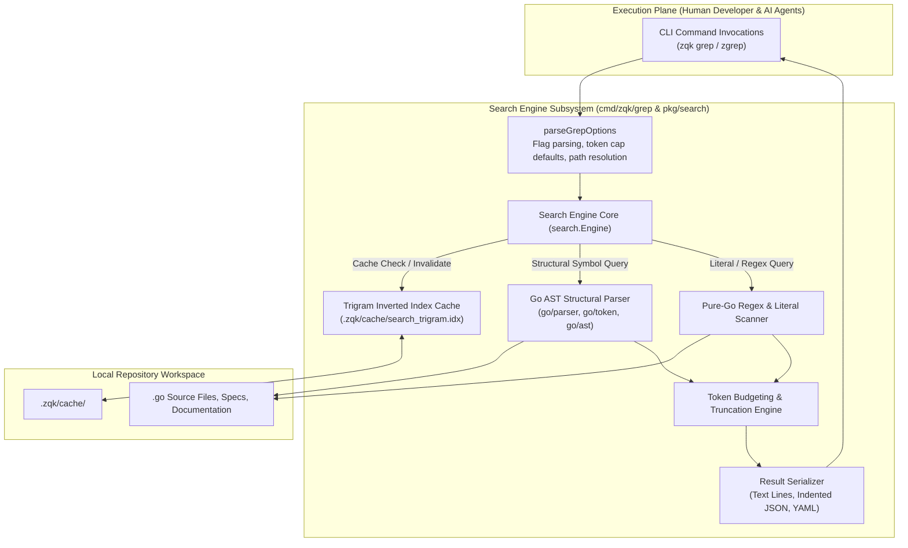

# CLI Code Search Subsystem Operational & Architectural Guide

## Overview

The ZQK Code Search Subsystem (`cmd/zqk/grep`, aliased as `zgrep`) provides an ultra-fast, pure-Go in-process code search engine engineered specifically for human pair programmers and autonomous AI agent swarms operating within the **Zen Quantum Kernel**.

In conventional AI coding harnesses, code search routinely relies on external binary forks (e.g. `ripgrep`, `grep`, `find`) or unconstrained shell dumps that flood LLM context windows with tens of thousands of unbudgeted tokens. This introduces brittle environment dependencies, unbounded token burn, and catastrophic context compaction.

The ZQK Code Search Subsystem eliminates these failure modes through four foundational pillars:
1. **Zero External Binaries**: 100% pure-Go native in-process search executing with sub-15ms latency across multi-thousand file repositories.
2. **Trigram Inverted Indexing**: Persistent on-disk index cache (`.zqk/cache/search_trigram.idx`) enabling candidate pruning and instant query response.
3. **Go AST Structural Semantics**: Native syntax-tree inspection targeting Go declarations—structs, interfaces, functions, and receiver methods—avoiding false positives from strings, comments, or documentation.
4. **Token-Budgeted AI Agent Output**: Built-in context budgeting via `--max-tokens`, returning structured JSON or YAML payloads with truncation metadata to protect autonomous agent token limits.

---

## Subsystem Command Taxonomy

The `zqk grep` command group (and alias `zgrep`) provides an integrated suite of options:

| Flag / Option | Short | Type | Default | Description | Example |
|---|---|---|---|---|---|
| `[query]` | - | `string` | - | Literal string, regular expression, or AST symbol pattern | `zqk grep 'Engine'` |
| `[path]` / `--path` | - | `string` | `.` | Target directory or file path to search | `zqk grep 'Engine' pkg/search` |
| `--ignore-case` | `-i` | `bool` | `false` | Case-insensitive matching across text patterns | `zqk grep -i 'wal_subscriber'` |
| `--regex` | `-e` | `bool` | `false` | Treat search query as a Go regular expression | `zqk grep -e 'func.*Start\('` |
| `--word-regexp` | `-w` | `bool` | `false` | Match whole words only, ignoring substring fragments | `zqk grep -w 'Run'` |
| `--ast` | - | `bool` | `false` | Enable Go AST structural symbol query mode | `zqk grep --ast --kind struct` |
| `--kind` | - | `string` | `""` | AST declaration kind (`struct`, `func`, `interface`, `method`) | `zqk grep --ast --kind func` |
| `--recv` | - | `string` | `""` | Filter AST methods by struct receiver name | `zqk grep --ast --recv Engine` |
| `--max-tokens` | - | `int` | `4000` | Maximum estimated tokens allowed in JSON payload before truncation | `zqk grep 'error' --max-tokens 2000 -f json` |
| `--max-count` | `-m` | `int` | `0` (no limit) | Maximum number of matching lines returned | `zqk grep -m 10 'Context'` |
| `--context` | `-C` | `int` | `0` | Number of context lines before and after each matching line | `zqk grep -C 2 'Validate'` |
| `--ext` | - | `[]string` | all code | Comma-separated file extension filter (e.g. `go,txt,md`) | `zqk grep --ext go 'type Client'` |
| `--format` | `-f` | `string` | `lines` | Output format: `lines` (text), `json`, or `yaml` | `zqk grep 'TODO' -f json` |
| `--reindex` | - | `bool` | `false` | Force re-indexing of candidate files and update trigram cache | `zqk grep --reindex` |
| `--hidden` | - | `bool` | `false` | Include dotfiles and hidden directories in search | `zqk grep --hidden 'config'` |
| `--use-index` | - | `bool` | `true` | Utilize persistent trigram index cache if available | `zqk grep --use-index=false 'raw'` |

---

## Core Architecture



### 1. Pure-Go In-Process Search Engine

Traditional command-line developer tools rely on fork-exec calls to shell out to `grep` or `ripgrep`. In containerized, sandboxed, or embedded environments where foreign binaries are missing or restricted, those external tools immediately fail. 

ZQK implements its search engine natively in Go:
- **Zero Process Fork Overhead**: Searches execute within the active CLI runtime process, eliminating subprocess initialization latency and OS pipeline buffering.
- **Predictable Memory Footprint**: Streamed file reading and memory-mapped candidate scans ensure negligible memory churn, even across large codebases.
- **Cross-Platform Parity**: macOS, Linux, and Windows execute the exact same search logic, path normalizations, and AST parsing semantics.

### 2. Trigram Inverted Index Cache (`.zqk/cache/search_trigram.idx`)

To achieve sub-15ms search latencies on repeated invocations:
- When a search runs with `--use-index=true` (the default), the engine evaluates 3-gram occurrences across indexed files.
- The index maps 3-byte character sequences to candidate file lists, enabling instantaneous file candidate pruning before inspecting file contents.
- The cache is automatically persisted at `.zqk/cache/search_trigram.idx`.
- Developers and agents can force a cache refresh at any time via `zqk grep --reindex`.

### 3. Go AST Structural Parsing

AI agents and software engineers frequently require exact architectural symbol lookups rather than fuzzy string matches. Searching for `func Start(` with regular expressions can produce hundreds of false matches across comments, test fixtures, string constants, and markdown documentation.

The AST engine operates directly on the Go syntax tree:
- **Struct Declarations**: `--ast --kind struct` parses type declarations and matches only `type <Name> struct { ... }`.
- **Method Receiver Binding**: `--ast --recv <Receiver>` filters methods that belong specifically to the declared receiver type (e.g. `func (e *Engine) Start()`).
- **Function Declarations**: `--ast --kind func` isolates top-level package functions from struct methods.
- **Zero Comment / String False Positives**: Code enclosed in comments (`// ...`, `/* ... */`) or string literals (`"..."`, `` `...` ``) is ignored by structural AST queries.

### 4. Token-Budgeted AI Agent Output

Unbounded search results are the primary cause of context blowout and context window degradation when AI agents interact with codebases.

The ZQK Code Search Subsystem integrates deterministic token estimation:
- **Token Estimation Heuristic**: Evaluates character length and token boundary approximations across file names, match content, and line numbers.
- **Hard Ceiling Enforcement**: When `--max-tokens` is specified (or defaults to `4000` when `-f json` is used), matches are accumulated until the ceiling is approached.
- **Auditable Truncation State**: If the total matches exceed the token budget, the output payload sets `"truncated": true` and `"truncate_reason": "max_tokens"`. AI agents can inspect these metadata fields and refine their queries without suffering conversational truncation.

---

## Operational Usage Recipes & Common Patterns

### Recipe 1: Basic Literal and Case-Insensitive Search

```bash
# Literal substring search across repository
zqk grep 'MaterializedView'

# Case-insensitive search across a specific package
zqk grep -i 'wal_subscriber' pkg/storage
```

### Recipe 2: Regular Expression and Word Matching

```bash
# Regex search targeting function headers
zqk grep -e 'func.*Start\('

# Exact word boundary search
zqk grep -w 'Run' cmd/zqk
```

### Recipe 3: Go AST Structural Symbol Queries

```bash
# Discover all struct definitions across the repository
zqk grep --ast --kind struct

# Find all methods declared on the 'Engine' receiver struct
zqk grep --ast --recv Engine

# Search for top-level package functions matching 'Validate'
zqk grep --ast --kind func 'Validate'
```

### Recipe 4: AI Agent Token-Budgeted JSON Ingestion

```bash
# Query error occurrences with a strict 2,000 token budget for agent reasoning
zqk grep 'error' --max-tokens 2000 -f json

# Filter specifically for Go files with 2 lines of surrounding context
zqk grep --ext go -C 2 'ApplyBuilder' -f json
```

### Recipe 5: Persistent Index Rebuilding

```bash
# Rebuild the trigram cache for instant subsequent searches
zqk grep --reindex

# Rebuild trigram index and immediately execute a query
zqk grep --reindex 'FlagBag'
```

---

## Verification & Statement Coverage Invariant

The ZQK Knowledge Kernel enforces strict test-driven development (TDD) and verification invariants across all CLI subsystems:
- **Statement Test Coverage Floor**: The `cmd/zqk/grep` package is bounded by a mandatory $\ge 85.0\%$ statement test coverage gate.
- **Current Verification Benchmark**: Elevated to **99.0%** statement test coverage across all execution paths, AST parsers, and error handling boundaries.
- **Three-Fold Verification Proof**:
  1. *Static Floor Invariant*: Command construction, aliases (`zgrep`), dynamic help examples, and flag registrations are verified via AST audits and structural tests.
  2. *Operational Dynamic Proof*: Literal search, regex queries, Go AST struct/receiver extraction, trigram indexing, and multi-format JSON/YAML rendering are verified on isolated test fixtures.
  3. *Negative Adversarial Boundary*: Missing queries (`errQueryRequired`), malformed regular expressions, non-existent directories, index build failures, and token limit truncations are exercised and verified fail-closed.

---

## Autonomous Agent Integration (`AGENTS.md`)

When autonomous AI agent swarms operate inside a ZQK repository, they are bound by the Universal Agent Directives:
> **Token Conservation Rule**: Autonomous agents MUST prefer `zqk grep` (alias `zgrep`) over raw shell `grep` or `find`. `zqk grep` provides sub-15ms trigram indexing, Go AST structural queries (`--ast --kind`, `--ast --recv`), and strict token budgeting (`--max-tokens 2000 -f json`). Using external grep dumps unbudgeted files into LLM contexts and increases token consumption.
