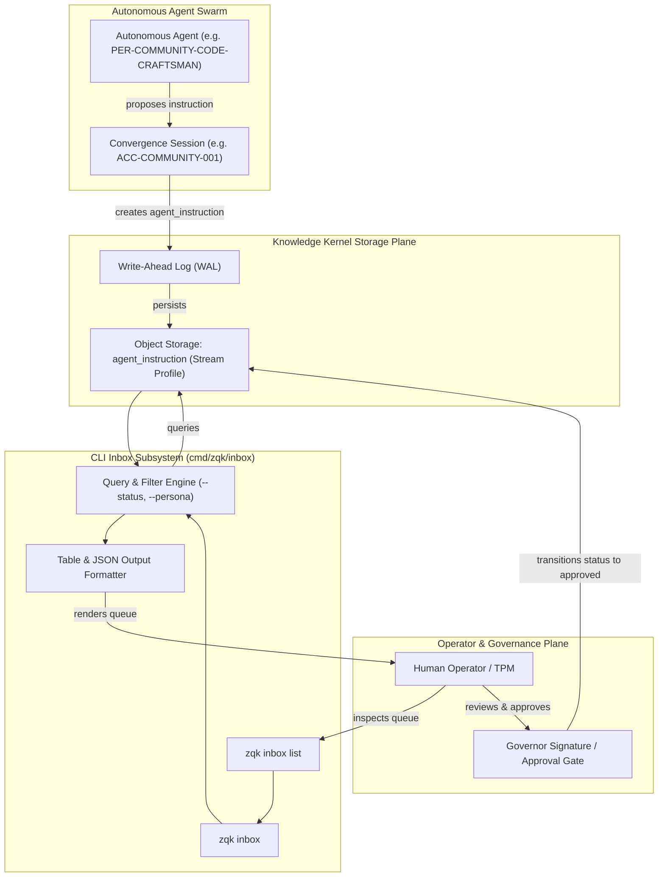
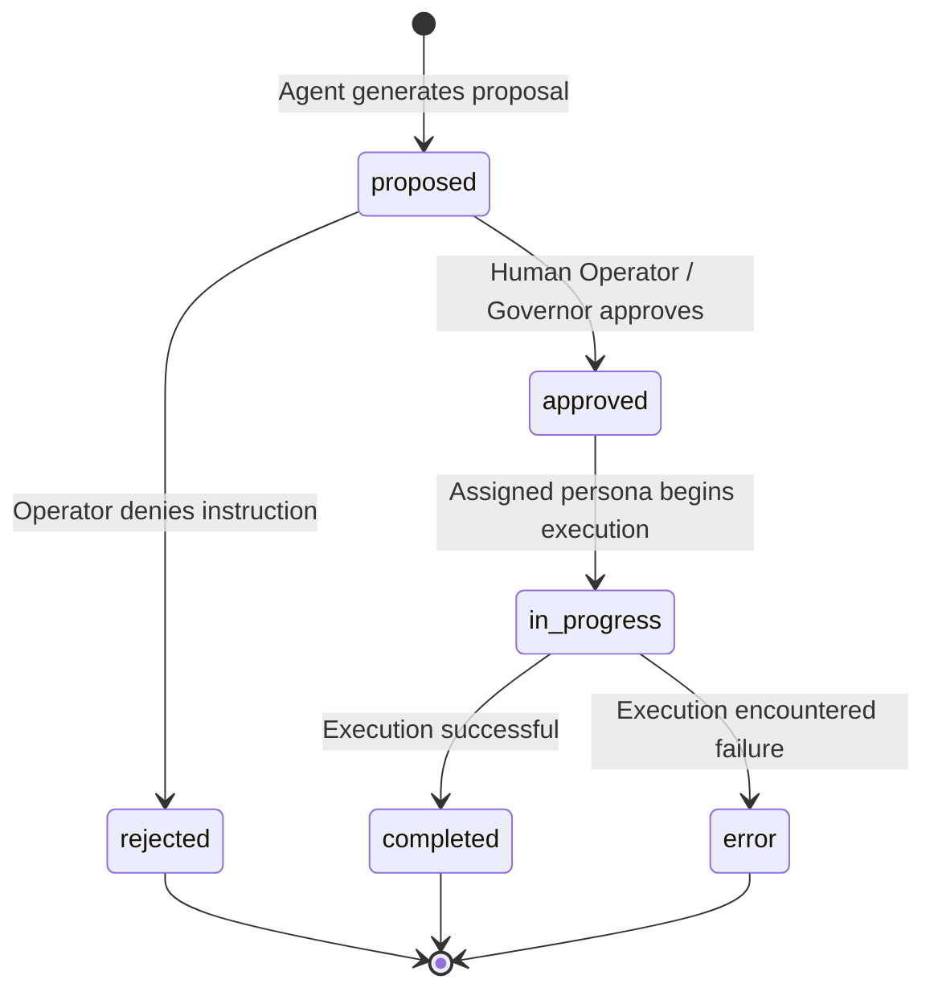

# CLI Inbox Subsystem Architectural Guide

Comprehensive architectural documentation for the **Autonomy Inbox subsystem**, agent instruction proposal queuing, persona-targeted dispatching, and operator governance within the **ZQK Knowledge Kernel**.

---

## 1. Architectural Overview & Design Principles

The **ZQK Autonomy Inbox Subsystem** (`cmd/zqk/inbox`) provides a governed, human-in-the-loop boundary between autonomous AI swarms and repository mutations. While autonomous agents generate proactive improvement proposals, architectural refactors, and test elevations, safety policies dictate that sensitive or high-impact actions must not execute unilaterally without operator inspection and sign-off.

The Autonomy Inbox bridges this boundary by objectifying agent prompts and intent into persistent, queryable `agent_instruction` objects within the Knowledge Kernel.



### Core Design Principles

1. **Persistent Objectification (Anti-Ephemeral Intent)**: Proposed agent actions are never stored in transient chat buffers, temporary files, or vendor-specific memory caches. Instructions are first-class `agent_instruction` objects tracked by the Knowledge Kernel.
2. **Reverse-Chronological Observability**: Operators reviewing inbox activity must immediately observe the freshest proposals first. The system enforces strict descending timestamp ordering (`created_at`) both at the storage layer and via in-memory sorting invariants.
3. **Decoupled Persona Targeting**: Instructions specify an intended executing persona (`target_persona`), enabling specialized swarm agents (e.g. craftsmen, architects, QA evaluators) to filter their active queues without cross-talk.
4. **Resilient Display Formatting**: The CLI table formatter provides consistent tabular alignment with deterministic boundary truncation (truncating instructions longer than 40 characters to 37 characters plus `...`) while supporting clean `--format json` output for automated tooling.

---

## 2. Command Taxonomy & Architecture

The CLI inbox subsystem resides in `cmd/zqk/inbox` and conforms to standard ZQK command builder patterns.

```
cmd/zqk/inbox/
├── inbox.go                                     # Parent 'inbox' command group registration
├── list.go                                      # 'inbox list' command implementation & rendering
├── inbox_test.go                                # Base command hierarchy & functional tests
└── inbox_coverage_elevation_cycle102_test.go   # Comprehensive verification suite & edge branches
```

### 2.1 The Parent Command (`zqk inbox`)

The top-level command is initialized via `bldr_cli_cmd_v1.NewInboxCommandBuilder()` and acts as the logical container for inbox operations:

```go
func NewInboxCmd() *cobra.Command {
	cmd := bldr_cli_cmd_v1.NewInboxCommandBuilder()
	cmd.AddCommand(NewListCmd())
	return cmd
}
```

### 2.2 The List Command (`zqk inbox list`)

The `list` subcommand retrieves and displays queued agent instruction proposals. It wires standard command requirements and async progress handling:

```go
func NewListCmd() *cobra.Command {
	cmd := bldr_cli_cmd_v1.NewInboxListCommandBuilder()
	cli.RequireSession(cmd, true)
	cli.BindAsyncProgress(cmd, func(cmd *cobra.Command, args []string) error {
		// Parameter resolution, storage retrieval, filtering, sorting, rendering
	})
	cli.AddCommonFlags(cmd)
	return cmd
}
```

#### Execution Requirements & Annotations

- `RequireSession(cmd, true)`: Requires a valid ZQK session context before executing the command.
- `RequireStorage(cmd, true)`: Pre-warms and verifies access to the project object storage provider.
- `RequireSchedulerCheck(cmd, false)`: Disables blocking scheduler daemon status checks, allowing operators to inspect the inbox even during maintenance windows.
- `BindAsyncProgress`: Wraps execution in asynchronous progress monitoring, emitting progress events and preventing uncommunicative terminal stalls.

---

## 3. The `agent_instruction` Object Model

Every item in the Autonomy Inbox represents an `agent_instruction` object defined in `packs/agent/specs/agent_instruction.yaml` using the `stream` storage profile.

### 3.1 Field Schema

| Field Name | Type | Required | Description | Example |
|------------|------|----------|-------------|---------|
| `id` | `string` | Yes | Unique identifier prefixed with `AGI-` | `AGI-COMMUNITY-001` |
| `kind` | `string` | Yes | Object kind identifier (`agent_instruction`) | `agent_instruction` |
| `status` | `enum` | Yes | Current lifecycle status | `proposed` |
| `instruction` | `text` | Yes | The prompt or task specification for the agent | `"Refactor inbox test suite"` |
| `target_persona` | `string` | No | Target persona ID for routing | `PER-COMMUNITY-CODE-CRAFTSMAN` |
| `source_session` | `string` | No | Originating convergence or agent session ID | `ACC-COMMUNITY-001` |
| `execution_log` | `list` | No | Sequential execution log entries | `["Started analysis", "Patch ready"]` |
| `created_at` | `string` | Auto | ISO 8601 creation timestamp | `2026-10-20T10:00:00Z` |

### 3.2 Lifecycle State Transitions

The lifecycle (`packs/agent/lifecycles/agent_instruction_lifecycle.yaml`) governs how proposals progress:



- **`proposed`**: Initial status when an agent or session registers an instruction in the Autonomy Inbox.
- **`approved`**: The proposal has received human review or cryptographic governor endorsement and is eligible for execution.
- **`rejected`**: The proposal was inspected and declined by the operator.
- **`in_progress`**: The designated agent persona has claimed the instruction and begun processing.
- **`completed`**: The instruction finished execution and recorded results in `execution_log`.
- **`error`**: The instruction failed execution or violated environmental constraints.

---

## 4. Querying, Filtering & Sorting Mechanics

The `inbox list` command supports flexible querying against the underlying Knowledge Kernel object store.

### 4.1 Supported Command Flags

| Flag | Shorthand | Type | Default | Purpose |
|------|-----------|------|---------|---------|
| `--status` | `-s` | `string` | `""` | Filter proposals by lifecycle status (`proposed`, `approved`, `rejected`, etc.) |
| `--persona` | `-p` | `string` | `""` | Filter proposals by target persona ID (`PER-COMMUNITY-CODE-CRAFTSMAN`, etc.) |
| `--format` | `-f` | `string` | `table` | Output format: `table`, `json`, `yaml`, `jsonl` |

### 4.2 Query Filter Construction

When flags are provided, `inbox list` maps them directly into a `storage.ListFilter`:

```go
filters := make(map[string]any)
if statusFilter != "" {
    filters[objects.FieldKeyStatus] = statusFilter
}
if personaFilter != "" {
    filters[objects.FieldKeyTargetPersona] = personaFilter
}

listFilter := storage.ListFilter{
    Kind:    "agent_instruction",
    Filters: filters,
    SortBy:  objects.FieldKeyCreatedAt,
    SortAsc: false, // newest first
}
```

### 4.3 Deterministic Sorting Invariant

Because distributed or storage backends may exhibit subtle variations in sorting compliance, `inbox list` implements a strict in-memory sort guard immediately following retrieval:

```go
sort.Slice(items, func(i, j int) bool {
    iTime, _ := items[i][objects.FieldKeyCreatedAt].(string)
    jTime, _ := items[j][objects.FieldKeyCreatedAt].(string)
    return iTime > jTime
})
```

This guarantees that operators always see the newest proposals at the top of the console output.

---

## 5. Output Formatting & Display Invariants

The subsystem supports both human-readable console rendering and machine-readable data serialization.

### 5.1 Empty Queue Output

When no items match the specified filters, `inbox list` returns a clean terminal advisory:

```text
Inbox is empty. No agent instructions pending.
```

In JSON format (`--format json`), it returns an empty JSON array:

```json
[]
```

### 5.2 Populated Table Rendering

For non-empty results in table format, `inbox list` renders a structured grid:

```text
ID                                       STATUS       PERSONA      SESSION                                  INSTRUCTION
────────────────────────────────────────────────────────────────────────────────────────────────────────────────────────
AGI-COMMUNITY-001                        proposed     PER-ARCH     ACC-COMMUNITY-001                        Design inbox subsystem guide...
AGI-DEMO-001                             approved     PER-CRAFT    ACC-COMMUNITY-002                        Refactor parser test cases

2 item(s)
```

#### Table Formatting Rules

1. **Fixed Column Widths**:
   - `ID`: 40 characters left-aligned (`%-40s`)
   - `STATUS`: 12 characters left-aligned (`%-12s`)
   - `PERSONA`: 12 characters left-aligned (`%-12s`)
   - `SESSION`: 40 characters left-aligned (`%-40s`)
   - `INSTRUCTION`: Remaining line width (`%s`)
2. **Visual Separator**: A solid rule consisting of 120 box-drawing characters (`─`).
3. **Instruction Truncation**:
   - Instructions of length $\le 40$ are displayed fully without modification.
   - Instructions of length $> 40$ are truncated to the first 37 characters followed by an ellipsis (`...`), ensuring table rows do not wrap disruptively.
4. **Summary Footer**: Appends a final count summary (`\n%d item(s)\n`).

### 5.3 JSON Output Formatting

When `--format json` is supplied, the raw object payload is serialized with 2-space indentation:

```bash
zqk inbox list --format json
```

```json
[
  {
    "created_at": "2026-10-20T10:00:00Z",
    "id": "AGI-COMMUNITY-001",
    "instruction": "Design inbox subsystem guide",
    "kind": "agent_instruction",
    "source_session": "ACC-COMMUNITY-001",
    "status": "proposed",
    "target_persona": "PER-COMMUNITY-ARCH-DESIGN"
  }
]
```

---

## 6. Resilience, Error Handling & Diagnostics

The CLI Inbox subsystem is designed to handle edge cases without silent failures or terminal hanging.

### 6.1 Diagnostic Error Handling

| Failure Mode | Detection Point | User-Facing Error Message |
|--------------|-----------------|---------------------------|
| **Uninitialized CLI Context** | `cli.GetContext(cmd) == nil` | `failed to get context` |
| **Missing Project Root / Storage** | `cli.GetObjectStorageForCommand(cmd, root)` | `failed to get storage: <err>` |
| **Storage Query Failure** | `store.List(...) != nil` | `failed to query inbox: <err>` |
| **JSON Serialization Failure** | `json.MarshalIndent(...) != nil` | `failed to marshal results: <err>` |

### 6.2 Process & Concurrency Hygiene

In adherence to `POL-CONCURRENCY` and ZQK core standards:
- The subsystem strictly prohibits raw `go func()` invocations.
- Background progress heartbeats and telemetry are managed via `goroutinelabels.NewGoroutine` inside `cliapp.RunWithAsyncProgress`.
- Test executions run in strictly isolated temporary sandboxes via `testkit.PrepareIsolatedTempProject`, preventing any leakage into `.zqk/` or the live repository tree.

---

## 7. Operator Usage Examples

### Listing All Instructions

```bash
zqk inbox list
```

### Filtering Pending Proposals for Code Craftsman

```bash
zqk inbox list --status proposed --persona PER-COMMUNITY-CODE-CRAFTSMAN
```

### Using Flag Shorthands

```bash
zqk inbox list -s approved -p PER-COMMUNITY-ARCH-DESIGN
```

### Streaming JSON for External Webhooks or CI Automation

```bash
zqk inbox list --format json | jq '.[] | select(.status=="proposed")'
```

---

## 8. Summary

The CLI Inbox subsystem provides essential guardrails for autonomous agent swarms operating within the ZQK ecosystem. By coupling persistent `agent_instruction` objects in the Knowledge Kernel with robust querying, sorting, and display mechanics, the inbox ensures complete operational transparency, strict human governance, and uncompromised codebase integrity.
