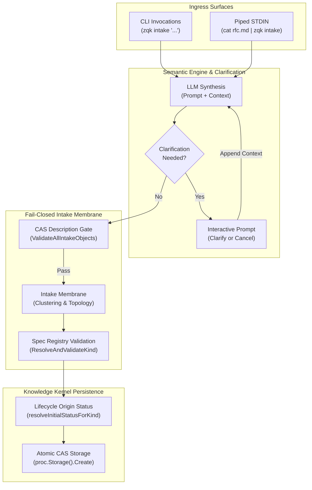
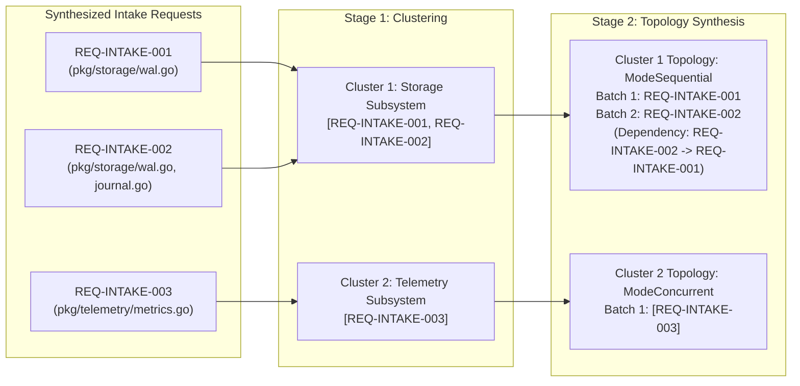
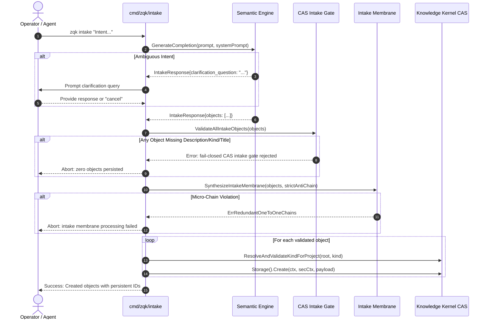

# CLI Intake Subsystem Architectural & Operational Guide (`zqk intake`)

## 1. Executive Summary & Architectural Mission

The `zqk intake` subsystem provides the canonical semantic ingestion pipeline (Intent Capture) for the ZQK Knowledge Kernel. It translates unstructured human intent—ranging from conversational briefs, architecture discussion transcripts, and design specifications to piped terminal streams—into strictly typed, schema-validated Knowledge Kernel objects.

Unlike transient chat prompts or lossy agent scratchpads, `zqk intake` treats human intent as a persistent, verifiable ingress gateway. Intent undergoes semantic synthesis, fail-closed CAS schema gating, domain clustering via the Intake Membrane, execution topology analysis, and atomic graph persistence.



### Key Architectural Invariants

1. **Fail-Closed CAS Intake Gate (Base Object Description Rule)**: Every object synthesized by the semantic engine must carry a valid, non-empty `description`. If even a single synthesized object in a batch lacks a description or required fields, the entire ingestion run aborts immediately (`ValidateAllIntakeObjects`), preventing malformed or half-formed drafts from polluting the kernel graph.
2. **Intake Membrane Domain Clustering & Topology Analysis**: When multiple objects are synthesized (or when `--cluster` or `--concurrency` is set), the Intake Membrane groups related objects by domain categorization and tokenized target path overlap, identifying sequential bottlenecks vs concurrent swarm opportunities.
3. **Strict Anti-Chaining Defense**: Redundant 1:1 micro-chains across disparate domains are rejected fail-closed (`kernelintake.ErrRedundantOneToOneChains`) under default strict mode, guarding the kernel against fragmenting initiatives into uncoordinated micro-objects.
4. **Interactive Multi-Turn Clarification Loop**: When incoming intent is ambiguous or under-specified, the semantic engine returns targeted clarification queries. The operator can provide incremental clarity in-session or cleanly abort with `cancel` without persisting partial state.
5. **Statement Test Coverage Floor**: Production code in `cmd/zqk/intake` maintains a strict statement test coverage floor exceeding 85.0% (targeting $\ge 95\%$) with zero swallowed errors and strict AST line-count boundaries.

---

## 2. Command Taxonomy & Ingestion Modes

The `zqk intake` command supports two primary ingestion modalities: direct command-line arguments and streaming Unix pipelines.

### 2.1 Direct CLI Invocation

For direct commands, intent arguments are joined into a contiguous context string:

```bash
zqk intake "We need a persistent SQLite connection pool and a Prometheus metrics exporter"
```

### 2.2 Streaming STDIN Ingestion

When invoked without positional arguments, `zqk intake` inspects `os.Stdin`. If STDIN is connected to a FIFO pipe or redirected file (non-character device), it streams the complete payload:

```bash
cat docs/rfcs/storage_wal_hardening.md | zqk intake
```

### 2.3 CLI Flags & Configuration Options

| Flag | Type | Default | Operational Effect |
| :--- | :--- | :--- | :--- |
| `--cluster` | `bool` | `false` | Enables explicit console visualization of domain clusters formed by the Intake Membrane. |
| `--concurrency` | `bool` | `false` | Computes and outputs topological execution batches (`ModeConcurrent`, `ModeSequential`, `ModeHybridDAG`) and cross-item dependencies. |
| `--strict-anti-chain` | `bool` | `true` | Enforces fail-closed rejection when intake items propose redundant 1:1 single-item clusters across separate domains. |

---

## 3. Intake Membrane: Clustering & Concurrency Synthesis

The Intake Membrane (`pkg/kernel/intake`) sits between the semantic synthesis engine and persistence. It prevents uncoordinated swarm execution by structuring synthesized objects into coherent workstreams and topological dependency graphs.



### 3.1 Two-Stage Pipeline

1. **Semantic & Path Clustering (`ClusterRequests`)**:
   - Groups incoming requests by `DomainCategory` (derived from object `kind`).
   - Analyzes lexical tokens and target code paths extracted from descriptions (e.g. `pkg/storage/...`, `cmd/zqk/...`).
   - Merges items touching common packages into cohesive execution clusters.

2. **Topological Execution Analysis (`SynthesizeTopologies`)**:
   - Builds an adjacency overlap matrix across target paths within each cluster.
   - Evaluates concurrency potential:
     - **`ModeConcurrent`**: Zero path intersections across items. Swarm agents can execute items simultaneously in parallel worktrees without merge conflicts.
     - **`ModeSequential`**: Items modify identical paths. Execution must be linearized to prevent lock contention or regression.
     - **`ModeHybridDAG`**: Partial overlapping paths partition work into distinct topological execution levels.

### 3.2 Anti-Chaining Defense

When operators or external agents generate fragmented, 1:1 micro-chains across unrelated domains (e.g. three separate items each isolated to their own synthetic domain), the membrane rejects the proposal:

$$\text{If } \text{strictAntiChain} = \text{true} \land \text{IsMicroChainCluster}() \implies \text{ErrRedundantOneToOneChains}$$

This prevents the Knowledge Kernel from accumulating disconnected micro-objects that lack overarching strategic goals.

---

## 4. Validation Pipelines & Error Handling Invariants

The intake subsystem operates under strict fail-closed validation semantics. Any defect halts execution before graph modification.



### 4.1 Two-Phase CAS Gate

- **Phase 1 (Batch Invariant)**: `ValidateAllIntakeObjects` pre-scans every synthesized object before persistence commences. If any object lacks a kind, title, or description, the run is rejected fail-closed and no writes occur.
- **Phase 2 (Persistence Invariant)**: `ValidateIntakeObject` re-checks constraints at the atomic creation loop, followed by spec index validation via `ResolveAndValidateKindForProject`. Unregistered object kinds trigger immediate rejection.

### 4.2 Error Classification Table

| Error Scenario | Manifested Error Message | Remediation Action |
| :--- | :--- | :--- |
| Missing CLI context / empty pipe | `no intent context provided. Please provide arguments or pipe content via stdin.` | Supply arguments or pipe non-empty content into stdin. |
| Inaccessible stdin stream | `failed to read from stdin` | Verify file descriptor permissions on the input pipe. |
| LLM service failure (e.g. 400 invalid request) | `semantic engine failed to synthesize intent` | Verify LLM credentials, model naming, and payload limits. |
| Malformed JSON from LLM | `failed to unmarshal JSON from semantic engine` | Check LLM prompt formatting; ensure JSON markdown fences are stripped. |
| Missing description on base object | `fail-closed CAS intake gate rejected X of Y object(s)` | Re-run intake with sufficient contextual detail explaining the intent. |
| Redundant 1:1 micro-chains | `intake membrane processing failed: redundant 1:1 micro-chains detected` | Consolidate micro-items into cohesive workstreams or pass `--strict-anti-chain=false`. |
| Unregistered schema kind | `failed to resolve kind '<kind>': unknown kind ...` | Use canonical registered kinds (`requirement`, `goal`, `backlog_item`, `technical_spec`). |

---

## 5. Knowledge Kernel Integration

Intake objects integrate directly into the versioned Knowledge Kernel graph:

1. **Origin Lifecycle Status Resolution**:
   - `resolveInitialStatusForKind` queries the lifecycle subsystem (`objects.NewLifecycleLoader(projectRoot)`).
   - If the project declares a formal lifecycle with an origin status (e.g., `conceptual`), that status is assigned.
   - Fallback defaults assign `planned` to backlog items and `conceptual` to requirements and specifications.

2. **Atomic Content-Addressable Storage (CAS)**:
   - Persisted via `proc.Storage().Create(ctx, proc.SecurityContext(), payload)`.
   - Generates persistent IDs and commits metadata into `.zqk/process/` or project storage.

3. **Downstream Cascade**:
   - Synthesized requirements and goals are linked to execution Priority Plans (`zqk new plan`) or decomposed into verifiable criteria (`zqk new criteria`) and Backlog Items (`zqk new bli`).

---

## 6. Illustrative Walkthroughs & Operational Patterns

### Scenario A: Ingesting a Complex Multi-Package Refactoring

An operator ingests a multi-part enhancement covering storage and telemetry:

```bash
zqk intake --cluster --concurrency \
  "Harden write-behind queues in pkg/storage/wal.go and pkg/storage/journal.go, and expose metrics in pkg/telemetry/metrics.go"
```

**Synthesis & Membrane Output:**
```
=== Intake Membrane Synthesis ===
Total Inputs: 2 | Clusters: 2 | Deduplicated/Merged: 0

Cluster 1 [CLS-DEMO-001]: Storage WAL Hardening (Domain: requirement, Mode: sequential)
  Batches: [[REQ-INTAKE-001]]
Cluster 2 [CLS-DEMO-002]: Telemetry Metrics Export (Domain: requirement, Mode: concurrent)
  Batches: [[REQ-INTAKE-002]]

Synthesized 2 objects. Applying Policy Shockwave Validation and saving...

Created [requirement] Storage WAL Hardening (ID: INT-DEMO-001)
Created [requirement] Telemetry Metrics Export (ID: ACC-COMMUNITY-001)
```

### Scenario B: Clarification & Refinement

When intent lacks required implementation specifics:

```
$ zqk intake "Improve the cache"
Synthesizing objects from input context via ambient Semantic Engine...

Clarification needed: Which cache layer should be modified (in-memory LRU or WAL disk cache) and what is the target eviction policy?
> Use the in-memory LRU cache in pkg/cache/lru.go with TTL eviction

Synthesizing objects from input context via ambient Semantic Engine...

Synthesized 1 objects. Applying Policy Shockwave Validation and saving...

Created [requirement] LRU Cache TTL Eviction (ID: INT-DEMO-002)
```
