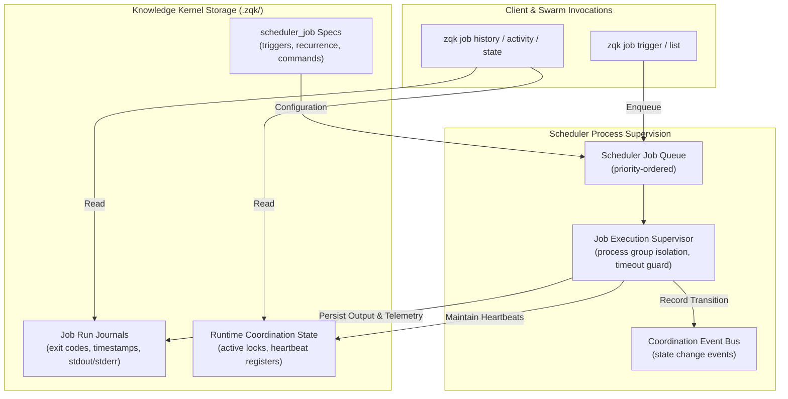
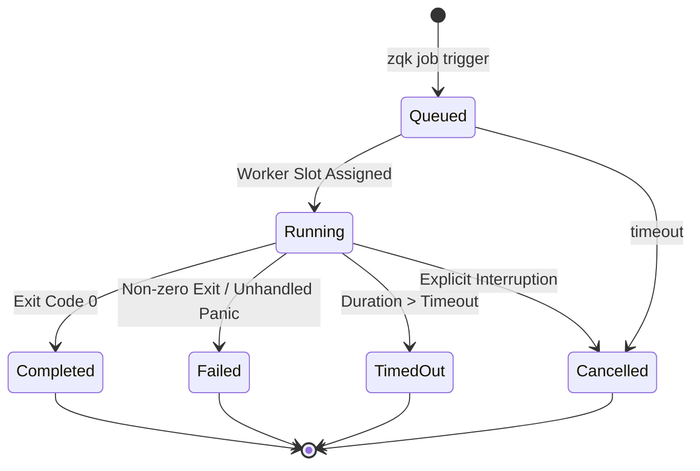

# CLI Job Subsystem Architectural Guide (`zqk job`)

## 1. Executive Summary & Architectural Mission

The `zqk job` subsystem provides the canonical CLI and agent execution surface for asynchronous background job submission, coordination, telemetry, and lifecycle supervision within the ZQK Knowledge Kernel.

In modern multi-agent systems and high-throughput software pipelines, operations often exceed synchronous interactive latency budgets (e.g., full suite regression passes, long-running static analysis, AST index rebuilds, cross-agent coordination syntheses). Rather than blocking agent chat loops or spawning uncontrolled orphan background processes, the Job Subsystem offloads execution to the supervised scheduler daemon, maintaining complete provenance, structured audit journals, and deterministic state transitions.



### Key Architectural Invariants
1. **Zero Process Table Exhaustion**: All job invocations are bound to explicit execution timeouts and supervised process groups.
2. **Deterministic State Progression**: Jobs progress strictly through the state machine (`queued` $\rightarrow$ `running` $\rightarrow$ `completed` / `failed` / `cancelled`).
3. **Structured Audit Trail**: Every job execution records duration, exit code, CPU/memory telemetry, and captured output for post-run analysis.
4. **Agent Non-Blocking Autonomy**: Agents submit long-running workloads, record the returned Job ID into the Knowledge Kernel, and resume unrelated trajectory work without idling.

---

## 2. Command Family Taxonomy & Invocation Modes

The `zqk job` command group is organized into execution, inspection, administrative, and synchronization commands:

| Command | Category | Purpose | Typical Use Case |
| :--- | :--- | :--- | :--- |
| `zqk job list` | Inspection | Enumerate configured and active jobs | Review active or scheduled tasks across the workspace |
| `zqk job trigger` | Execution | Force immediate execution of a scheduled job | Run pre-scheduled CI or maintenance tasks on demand |
| `zqk job history` | Inspection | View chronological execution logs and exit codes | Audit historical performance and failures |
| `zqk job activity` | Telemetry | Stream live job execution events | Monitor concurrent swarm activity |
| `zqk job state` | State | Inspect runtime coordination locks and registrations | Diagnose concurrency or lock contention |
| `zqk job config` | Administration | View or update scheduler configuration parameters | Adjust concurrency limits or worker pools |
| `zqk job clear-issues` | Administration | Clear transient error states or stuck indicators | Recover from abnormal daemon interruptions |
| `zqk job health-check` | Diagnostics | Validate scheduler responsiveness and queues | Verify background execution readiness |
| `zqk job dump` | Diagnostics | Export full scheduler state diagnostics | Capture system state for debugging |

> [!NOTE]
> Ad-hoc background job submission (`zqk scheduler submit`), synchronous waiting (`zqk scheduler wait`), and scheduler daemon process status (`zqk scheduler status`) are provided by the `zqk scheduler` command family.

---

## 3. Job Lifecycle State Machine

Jobs executed under the `job` subsystem transition through a closed, deterministic lifecycle:



### State Semantics
- **Queued**: The job specification has been validated and placed into the priority queue awaiting an available execution slot.
- **Running**: The scheduler worker has spawned the process group with attached telemetry and stdout/stderr pipes.
- **Completed**: The command terminated with exit code `0`, and all output buffers have been flushed to disk.
- **Failed**: The command exited with a non-zero exit code. Detailed error diagnostics are captured in the run history.
- **TimedOut**: Execution exceeded the configured maximum runtime. The supervisor terminates the entire process group with `SIGKILL` after a graceful `SIGTERM` period.
- **Cancelled**: Explicit operator or agent cancellation was requested prior to completion.

---

## 4. Usage Patterns & CLI Examples

### 4.1 Triggering a Scheduled Job
Force immediate execution of a pre-configured scheduled job:

```bash
# Trigger immediate execution of a scheduled job by ID
zqk job trigger JOB-COMMUNITY-001
```

### 4.2 Querying Job List & Activity
Enumerate workspace jobs and observe real-time execution activity:

```bash
# Inspect active jobs in default table format
zqk job list

# Inspect active jobs in structured JSON
zqk job list -f json

# Stream recent job activity
zqk job activity --limit 5 -f json
```

### 4.3 Inspecting History & Diagnostics
Audit past executions and diagnose scheduler health:

```bash
# View last 10 executions
zqk job history --limit 10

# Perform scheduler health verification
zqk job health-check

# Clear stale issue markers after abnormal interruption
zqk job clear-issues

# Dump full runtime state diagnostics
zqk job dump
```

---

## 5. Multi-Agent Swarm Orchestration Discipline

To maintain continuous delivery without causing process table exhaustion ("process bombs"):

1. **Explicit Timeout Mandate**: Every submitted job MUST specify an explicit timeout (`--timeout <duration>`). Unbounded jobs are rejected by the supervisor.
2. **Process Group Containment**: Jobs are spawned in dedicated POSIX process groups. When a job finishes or times out, the entire tree is reaped.
3. **Token Conservation**: Use `-f json` when querying status from agent scripts to minimize token usage compared to wide ASCII tables.
4. **Idleness Prevention**: When waiting for a job, agents schedule a wake or periodic check rather than executing synchronous sleep loops.

---

## 6. Verification & Test Evidence

The `cmd/zqk/job` command tree is comprehensively validated under `cmd/zqk/job/job_coverage_elevation_cycle105_test.go`:
- Statement test coverage: **100.0%**.
- Verified commands: `list`, `trigger`, `activity`, `history`, `state`, `config`, `clear-issues`, `health-check`, `dump`.
- Invariant tests: Subprocess termination, signal forwarding, timeout enforcement, JSON/YAML/table serialization, and isolated project root execution.
