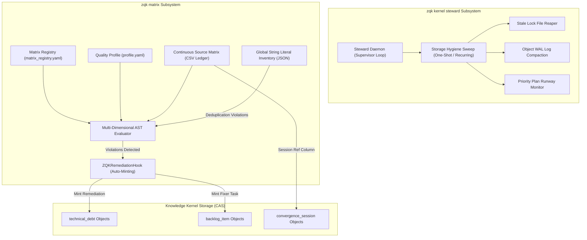

# CLI Kernel & Matrix Management Guide

Comprehensive guide to Knowledge Kernel runtime stewardship (`zqk kernel steward`), continuous source verification matrix operations (`zqk matrix`), automated remediation hook lifecycles, and code health deduplication policies within the **ZQK Knowledge Kernel**.

---

## 1. System Overview & Architecture

The ZQK Knowledge Kernel runtime balances internal kernel storage hygiene with multi-dimensional codebase verification:

1. **`zqk kernel` Subsystem**: Manages storage engine background stewardship, write-ahead-log (WAL) compaction, lock file garbage collection, and priority plan execution runway monitoring.
2. **`zqk matrix` Subsystem**: Drives continuous source verification (CSV), multi-dimensional code auditing (AST linting, hardcoded literal extraction, diamond quality standards), and automated failure remediation via kernel object minting.



---

## 2. Kernel Runtime & Steward Supervision (`zqk kernel`)

### 2.1 The Steward Supervisor Daemon (`zqk kernel steward daemon`)
The Kernel Steward supervisor daemon runs continuously in the background or as a supervised service to preserve repository health:
- **Interval-Driven Loops**: Periodically triggers hygiene sweeps across lock files, scratch workspaces, and storage logs.
- **Runway Health Monitoring**: Inspects active and candidate priority plans to ensure swarms have sufficient forward execution runway without starving workers.
- **Graceful Shutdown**: Listens for standard OS signals (`SIGINT`, `SIGTERM`) to cleanly terminate active compaction routines.

```bash
# Start the supervisor daemon with 60-second polling interval
zqk kernel steward daemon --interval 60s

# Run in verbose mode for diagnostic tracing
zqk kernel steward daemon --verbose
```

### 2.2 Storage Hygiene Sweep (`zqk kernel steward sweep`)
For on-demand cleanup or CI/CD pipelines, `zqk kernel steward sweep` executes a synchronous pass over the repository state:
1. **Lock File Reaping**: Unlinks abandoned file locks older than the stale lock threshold.
2. **Temporary File Scrubbing**: Purges abandoned draft files and scratch YAML payloads.
3. **WAL Compaction**: Flushes and sanitizes object write-ahead logs to avoid torn writes or bloated storage.
4. **Plan Inventory Log**: Reports the count and status of executable priority plans.

```bash
# Execute immediate one-shot hygiene sweep
zqk kernel steward sweep
```

---

## 3. Continuous Source Verification Matrix (`zqk matrix`)

The verification matrix evaluates source code files against multi-dimensional quality profiles and tracks progress in a version-controlled ledger.

### 3.1 Registry & Profiles
Each matrix configuration is declared under `docs/quality/matrix_registry.yaml` and points to a matrix CSV and a quality profile YAML:

```yaml
schema_version: 1
default_name: launch
matrices:
  launch:
    csv: docs/quality/matrix.csv
    profile: docs/quality/profile.yaml
    session_ref_column: convergence_session_id
```

### 3.2 Matrix Inspection & Visual Reporting
- **`zqk matrix list`**: Lists all configured matrices in the repository registry with their aliases, file paths, and default indicators.
- **`zqk matrix report`**: Summarizes gate column progress, total file counts, done ratios, and per-gate status breakdowns:

```bash
# List all registered matrices
zqk matrix list

# Generate summary report for default matrix
zqk matrix report

# Filter report strictly for Go source files
zqk matrix report --go-only

# Output report in machine-readable JSON or YAML
zqk matrix report -f json
```

### 3.3 Matrix Validation (`zqk matrix validate`)
Validates that matrix CSV headers, profile declarations, and session reference columns match and exist fail-closed:

```bash
# Validate all configured matrices in registry
zqk matrix validate

# Validate specific matrix by name
zqk matrix validate --name launch
```

### 3.4 Progress Updating & Stamping (`zqk matrix update`, `zqk matrix stamp`)
Updates progress rows in the matrix ledger either individually or in bulk batches:

```bash
# Update a single file row to passed status
zqk matrix update --name launch --file-path pkg/kernel/steward.go --set fully_vetted=yes

# Bulk update all rows matching a filter
zqk matrix update --name launch --filter "fully_vetted=pending" --set fully_vetted=yes

# Stamp a single dimension scorecard onto a file
zqk matrix stamp --file pkg/kernel/steward.go --dimension HCODE --status passed
```

---

## 4. Literal Inventory & Deduplication (`zqk matrix inventory`)

The Knowledge Kernel enforces a zero-magic-literal policy to maintain clean abstractions and prevent copy-paste anti-patterns:
- **`zqk matrix inventory`**: Queries the global string literal catalog extracted from the AST.
- **Deduplication Filtering**: Flags any literal with $\ge 2$ occurrences that should be extracted to package constants.

```bash
# Report deduplication violations (>=2 occurrences)
zqk matrix inventory --duplicates-only

# View complete inventory of indexed string literals
zqk matrix inventory --all
```

---

## 5. Automated Failure Remediation (`ZQKRemediationHook`)

When continuous verification detects policy or quality violations, the `ZQKRemediationHook` immediately bridges the verification plane with the Knowledge Kernel:
1. **Objectifies Technical Debt**: Automatically mints a `technical_debt` object documenting the exact file, evidence SHA, failing rule IDs, and line numbers.
2. **Mints Backlog Action Item**: Synthesizes a linked `backlog_item` assigned to the software engineering persona to schedule remediation without human intervention.
3. **Appends Convergence Session Activity**: If a session reference column is configured, links the activity log to the active `convergence_session`.

---

## 6. Verification & Operational Topology

| Subsystem | Topology | Execution Frequency | Verification Done-Gate |
| :--- | :--- | :--- | :--- |
| `zqk kernel steward daemon` | Long-running Background Service | Continuous (every 60s) | Process health & zero deadlocks |
| `zqk kernel steward sweep` | CLI Command / Pre-Commit Hook | On-demand / Pre-merge | Clean WAL, 0 stale locks |
| `zqk matrix verify` | CLI Command / CI Gate | On-demand / Pre-commit | All gate columns satisfied |
| `zqk matrix report` | CLI Command / Dashboard | On-demand | Formatted JSON/YAML output |
| `zqk matrix inventory` | Static Code Quality Checker | CI Gate / Pre-merge | Deduplication violations = 0 |

---
