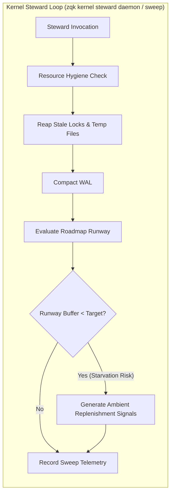

# CLI Kernel Steward Subsystem and Runway Guide

## 1. Overview and Operational Philosophy

The `zqk kernel steward` subsystem acts as the autonomous maintenance heartbeat and runway monitoring watchdog for the ZQK Knowledge Kernel. It guarantees two essential invariants:

1. **Deterministic Resource and Storage Hygiene:** Continually reaps stale lock files, flushes orphaned temporary files, and performs write-ahead log (WAL) compaction. This prevents multi-agent concurrency leaks and unbounded storage growth across long-running autonomous execution sessions.
2. **Roadmap Runway Depletion Sensing:** Measures the volume of shovel-ready Priority Plans and Backlog Items currently in the execution pipeline. When shovel-ready runway drops below target safety buffers (e.g. fewer than 2 shovel-ready plans), the steward generates deterministic ambient signals (`SIG-RUNWAY-REPLENISHMENT`) that inform autonomous Technical Program Management (TPM) agents to replenish the queue before worker swarms face starvation.



---

## 2. Command Architecture and Taxonomy

The steward CLI surface is nested cleanly under `zqk kernel steward`:

| Command | Usage | Description |
| :--- | :--- | :--- |
| `zqk kernel steward sweep` | One-shot execution | Runs an immediate single pass of storage hygiene, reaps stale locks/temps, compacts the WAL, evaluates runway, and outputs a formatted `SweepResult`. |
| `zqk kernel steward daemon` | Long-running daemon | Runs in the background (or foreground with `--interval`) continuously executing periodic hygiene and runway monitoring cycles at configured intervals (default: 30s). Protected by singleton PID locks. |

### Command Flags
- `--interval <seconds>` (daemon only): Polling interval in seconds (default: 30). Non-positive or omitted values fall back safely to 30 seconds.
- Standard Global Flags: `--format (json|yaml|table)` and `--context (ai-agent|human|debug)`.

---

## 3. Storage and Process Hygiene

The steward coordinates with the underlying `pkg/resourcehygiene` and `pkg/storage` components to ensure spotless state across execution:

- **Stale Lock Reaping:** Discovers and unlinks abandoned `.lock` files older than `resourcehygiene.DefaultLockStaleAge` (e.g. `.cas_sweep.lock`, `session.lock`).
- **Orphaned Temp File Cleanup:** Identifies durable and transient `.tmp` files in `.zqk/cache/` or `.zqk/tmp/` older than 30 minutes and purges them.
- **WAL Compaction:** Invokes `storage.CompactWAL(projectRoot)` to checkpoint append-only write-ahead logs into durable CAS storage while verifying zero transaction loss.
- **Test Isolation Discipline:** In test environments, tests executing `steward sweep` or `steward daemon` MUST register teardown via `storage.RunProjectTestTeardown(storage.TempProjectTeardown(testRoot, nil))` to ensure open SQLite and WAL descriptors are flushed before temporary directory removal.

---

## 4. Runway Monitoring and Starvation Risk Signals

The steward interfaces with `pkg/kernel/steward/monitor.go` to compute runway metrics:

- **Shovel-Ready Criteria:** A Priority Plan is considered shovel-ready when:
  1. Its lifecycle status is either `planned` or `active`.
  2. It has one or more linked Backlog Items (`backlog_item_refs`).
- **Target Buffer:** The default safety buffer is `MinimumShovelReadyRunway = 2`.
- **Ambient Signals:** If the shovel-ready buffer falls below target, the steward emits a high-priority ambient signal:
  ```yaml
  signalid: SIG-RUNWAY-1792076808375819000
  priority: P4-RUNWAY-REPLENISHMENT
  message: Roadmap runway lead (0 plans) is below target buffer (2). Autonomous steward replenishing queue.
  timestamp: 2026-10-15T08:06:48.375821-07:00
  ```
  Autonomous agents consuming `zqk workflow whats-next` inspect this signal to proactively groom the next batch of priority plans without human intervention.

---

## 5. Verification and Done-Gates

Verification for the kernel steward subsystem is tracked under `TST-1792076192252488001-88021e12` and satisfies the Three-Fold Proof:

1. **Static Floor Invariant (`CRIT-1792076192252488000-f4517f8c`):** Statement test coverage in `cmd/zqk/kernel` maintains $\ge 90.0\%$ with no unhandled branch paths.
2. **Operational Dynamic Proof (`CRIT-1792076192252489000-0a1e990d`):** `TestStewardDaemon_TickerIteration` and `TestKernelStewardSweepExecution` execute cleanly in isolated temp roots and verify sweep telemetry collection.
3. **Negative Boundary & Hygiene Proof (`CRIT-1792076192252490000-84d273f1`):** Negative flag values (`--interval -10`), missing interval flag fallback, and singleton daemon duplicate prevention execute deterministically without panics or leaks.
