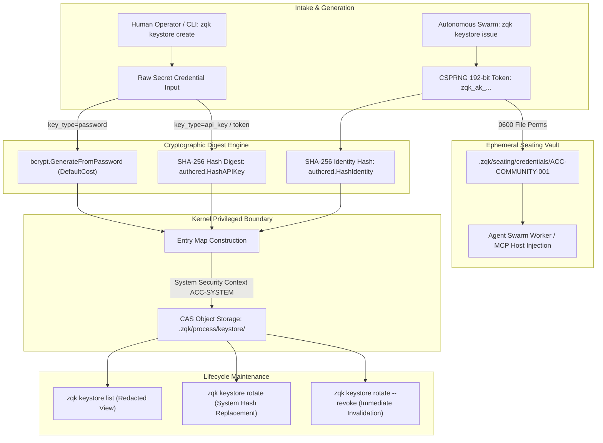

# CLI Keystore Subsystem & Cryptographic Credential Guide

## Overview

The ZQK Keystore Subsystem (`cmd/zqk/keystore`) provides cryptographic key lifecycle management, credential hashing, and process-isolated access control for identities and execution seats within the Zen Quantum Knowledge Kernel.

Unlike transient AI harnesses and conversational wrappers that leak API credentials into prompt context or store plaintext keys in shell environment histories, ZQK enforces a zero-plaintext persistence invariant:
1. **Irreversible Cryptographic Digesting**: Raw secret credentials (passwords, tokens, API keys) are hashed immediately upon intake using industry-standard primitives (bcrypt with cost-adaptive salting for passwords; SHA-256 digests for API keys and tokens). Raw secrets are never written to Content Addressable Storage (CAS) or logs.
2. **Privileged Writer Security Boundary**: Invariant `POL-KEYSTORE-PRIVILEGE-001` dictates that only the kernel runtime (`ACC-SYSTEM`) possesses authority to write or mutate `credential_hash` or `salt` fields. Standard user and agent contexts cannot forge or overwrite cryptographic hashes directly.
3. **Automated Seating & Ephemeral Issuance**: The `zqk keystore issue` protocol mints high-entropy agent seat tokens, registers irreversible SHA-256 fingerprints in the account and keystore objects, and outputs local credentials to isolated Unix mode `0600` seating vaults (`.zqk/seating/credentials/<account-id>`) for daemon and swarm worker injection.

---

## Architectural Taxonomy & Source Map

```
cmd/zqk/keystore/
├── keystore.go                              # Root 'zqk keystore' command builder and subcommand aggregation
├── create.go                                # 'keystore create' entry point, CLI flags & dispatch
├── create_helpers.go                        # Ingestion hashing, account validation & result structuring
├── issue.go                                 # 'keystore issue' automated seat token issuance & seating file writer
├── list.go                                  # 'keystore list' query, filtering, sorting, and field redaction
├── rotate.go                                # 'keystore rotate' credential rotation & revocation dispatch
├── rotate_helpers.go                        # Rotation updates, permission checks, and status transformations
├── keystore_test.go                         # Baseline functional and layout integration tests
├── keystore_security_isolation_test.go      # Process isolation, permission boundary & tampering verification
└── keystore_coverage_elevation_cycle104_test.go # Comprehensive branch coverage elevation & edge-case proofs
```

---

## 1. Cryptographic Key Lifecycle



### 1.1 Credential Hashing Mechanics
The keystore categorizes credentials into two operational classes:
- **Human Passwords (`key_type: password`)**: Hashed via `golang.org/x/crypto/bcrypt` using `bcrypt.DefaultCost`. Bcrypt incorporates an adaptive cost factor and automatic per-credential salting directly within the modular crypt format string (`$2a$10$...`).
- **Machine & Agent Tokens (`key_type: api_key`, `oauth_token`, `personal_access_token`)**: Hashed via standard SHA-256 (`crypto/sha256`) prefixed with `sha256:`. This enables constant-time verification when incoming requests present authorization tokens.

### 1.2 Irreversible Invariant
Once hashed, the original plaintext credential is permanently discarded from memory. The CLI prints the generated secret exactly once upon issuance. If lost, credentials cannot be decrypted or retrieved from the Knowledge Kernel; a new credential must be generated or rotated.

---

## 2. Security Boundaries & Process Isolation Invariants

### 2.1 Privileged Writer Boundary
The Knowledge Kernel strictly segregates access to object mutations through security contexts (`pkgctx.SecurityContext`).

| Security Context | `keystore create` | `keystore issue` | `keystore list` | `keystore rotate --revoke` | `keystore rotate --new-credential` |
|:---|:---:|:---:|:---:|:---:|:---:|
| **`ACC-SYSTEM`** | Full Access | Full Access | Full Access | Full Access | Full Access |
| **`role: admin`** | Any Account | Any Account | All Entries | Any Key | Blocked (Requires System) |
| **Account Owner** | Own Account | Own Account | Own Entries | Own Keys | Blocked (Requires System) |
| **Other User** | Denied | Denied | Denied | Denied | Denied |

> [!IMPORTANT]
> Rotating a credential hash via `--new-credential` requires the kernel system context (`ACC-SYSTEM`). When an administrator or operator executes `zqk keystore rotate`, the CLI runtime verifies administrative authorization before transitioning to the internal system context to execute the CAS update.

### 2.2 Sensitive Field Redaction Invariant
The list and display commands guarantee that sensitive cryptographic verification material is never exposed over standard streams:
- `credential_hash` is unconditionally excluded from console tables and human summaries.
- `salt` is excluded from console tables.
- Warning notices accompany tabular outputs: `⚠️ Sensitive fields (credential_hash, salt) are never displayed`.

### 2.3 Filesystem Isolation & Permissions
The keystore enforces explicit POSIX permission boundaries on disk:
- **Keystore Process Store (`.zqk/process/keystore/`)**: Directory permissions locked to `0700` (`rwx------`).
- **Seating Credentials Directory (`.zqk/seating/credentials/`)**: Directory permissions locked to `0700`.
- **Seating Credential Files (`.zqk/seating/credentials/<account-id>`)**: File permissions locked to `0600` (`rw-------`).

---

## 3. Command Taxonomy & Reference

### 3.1 `zqk keystore create`
Creates a new cryptographic credential entry in the keystore vault for human or pre-generated tokens.

```bash
# Create an API key entry for current user
zqk keystore create \
  --key-type api_key \
  --credential "my-external-api-token" \
  --title "Continuous Integration Runner Key"

# Create a password entry for a specific account (admin only)
zqk keystore create \
  --account-id ACC-COMMUNITY-001 \
  --key-type password \
  --credential "ComplexPassword88!" \
  --title "Production Database Key" \
  --expires-at "2027-12-31T23:59:59Z"
```

#### Flags:
- `--account-id <id>`: Target account ID (`ACC-*`). Defaults to current authenticated user. Only administrators can specify another account.
- `--key-type <type>`: Credential type: `password`, `api_key`, `oauth_token`, or `personal_access_token`. Defaults to `api_key`.
- `--credential <val>`: Raw secret to hash and store (Required).
- `--title <title>`: Human-readable label for the key (Required).
- `--description <desc>`: Optional description.
- `--expires-at <iso8601>`: Optional expiration timestamp in RFC-3339 format.
- `--format <fmt>`: Output format: `text` (default), `json`, `jsonl`, or `yaml`.

---

### 3.2 `zqk keystore issue`
Automates cryptographically secure token generation for autonomous agent worker seats and swarms.

```bash
# Issue a new worker seat API key and generate local seating file
zqk keystore issue \
  --account-id ACC-WORKER-001 \
  --title "Autonomous Craftsman Swarm Seat"

# Issue key in JSON format without writing a local seating file
zqk keystore issue \
  --account-id ACC-WORKER-001 \
  --title "Ephemeral Headless Key" \
  --no-seating-file \
  --format json
```

#### Issuance Pipeline:
1. Validates `--account-id` matches canonical format (`^ACC-[A-Za-z0-9][A-Za-z0-9_-]*$`).
2. Checks calling identity against target account (Owner, Admin, or System permitted).
3. Generates a 192-bit cryptographic random token with prefix `zqk_ak_` (`authcred.AgentPrefix`).
4. Computes SHA-256 fingerprint hash.
5. Persists `keystore_entry` in the Knowledge Kernel.
6. Appends token fingerprint metadata to the parent `account` object under `tokens[]`.
7. Writes the plaintext token to `.zqk/seating/credentials/<account-id>` with `0600` permissions (unless `--no-seating-file` is set).
8. Prints the plaintext secret once alongside environment export instructions (`export ZQK_API_KEY=...`).

---

### 3.3 `zqk keystore list`
Lists keystore credential entries associated with the caller's account, or all entries if invoked by an administrator.

```bash
# Standard table view
zqk keystore list

# List with field filtering
zqk keystore list --filter key_type=api_key

# JSON output with sorting and pagination
zqk keystore list \
  --sort-by created_at \
  --sort-asc=false \
  --limit 10 \
  --format json
```

#### Filtering & Output Fields:
Output entries detail `id`, `title`, `key_type`, `account_id`, `status` (`Active` or `REVOKED`), `expires_at`, and `last_used_at`. Sensitive hash data is withheld.

---

### 3.4 `zqk keystore rotate`
Executes credential hash rotation or revokes an active key.

```bash
# Rotate key credential (system/admin operation)
zqk keystore rotate KEY-DEMO-001 --new-credential "new-secret-api-token"

# Revoke key immediately (owner or admin)
zqk keystore rotate KEY-DEMO-001 --revoke

# Rotate credential and mark previous version revoked simultaneously
zqk keystore rotate KEY-DEMO-001 --new-credential "new-key-val" --revoke-old
```

#### Rotation Dynamics:
- **Credential Replacement**: Re-hashes the new secret with the appropriate algorithm based on the existing key's `key_type`. Resets `last_used_at` to an empty string.
- **Revocation**: Sets `revoked: true` and writes `revoked_at` timestamp. Revoked keys fail authentication validation across all CLI and MCP gateways.

---

## 4. Key Store Layout under the Knowledge Kernel

All keystore objects are stored as versioned YAML entities in Content Addressable Storage under `.zqk/process/keystore/`:

```
.zqk/
├── process/
│   ├── keystore/
│   │   ├── KEY-DEMO-001.yaml               # Keystore entry object
│   │   └── KEY-DEMO-002.yaml
│   └── accounts/
│       └── ACC-COMMUNITY-001.yaml          # Account object with tokens[] array
└── seating/
    └── credentials/
        └── ACC-COMMUNITY-001               # 0600 plaintext seat credential
```

### 4.1 Schema Blueprint: `keystore_entry`
```yaml
schema_version: 2.0.0
ontology: keystore_entry
id: KEY-DEMO-001
status: active
title: "Primary Swarm Worker Key"
description: "Authentication key for worker craftsman agent"
account_id: ACC-COMMUNITY-001
key_type: api_key
credential_hash: "sha256:7f9a12c8e3b5..."
salt: ""
revoked: false
expires_at: "2028-12-31T23:59:59Z"
last_used_at: "2026-10-20T10:00:00Z"
origin_project: community
origin_system: kernel
```

### 4.2 Account Token Binding
When a key is minted via `zqk keystore issue`, the account's `tokens` array in `.zqk/process/accounts/ACC-COMMUNITY-001.yaml` is updated:

```yaml
tokens:
  - id: KEY-DEMO-001
    fingerprint: "sha256:7f9a12c8e3b5..."
    issued_at: "2026-10-20T10:00:00Z"
    expires_at: "2028-12-31T23:59:59Z"
```

---

## 5. Security & Verification Invariants Checklist

When integrating or testing the Keystore Subsystem, ensure compliance with these verification invariants:

- [x] **POL-KEYSTORE-DIGEST**: No raw credentials stored in `.zqk/process/keystore/`.
- [x] **POL-KEYSTORE-REDACT**: `credential_hash` and `salt` excluded from `list` output.
- [x] **POL-KEYSTORE-PERM-DIR**: `.zqk/process/keystore/` permissions are `0700`.
- [x] **POL-KEYSTORE-PERM-SEAT**: `.zqk/seating/credentials/` files are mode `0600`.
- [x] **POL-KEYSTORE-PREFIX**: Issued agent seat keys start with `zqk_ak_`.
- [x] **POL-KEYSTORE-CANONICAL-ID**: Accounts adhere to `^ACC-[A-Za-z0-9][A-Za-z0-9_-]*$`.
- [x] **POL-KEYSTORE-REVOKE-FAILSAFE**: Revoked keys reject any subsequent authentication attempts.
