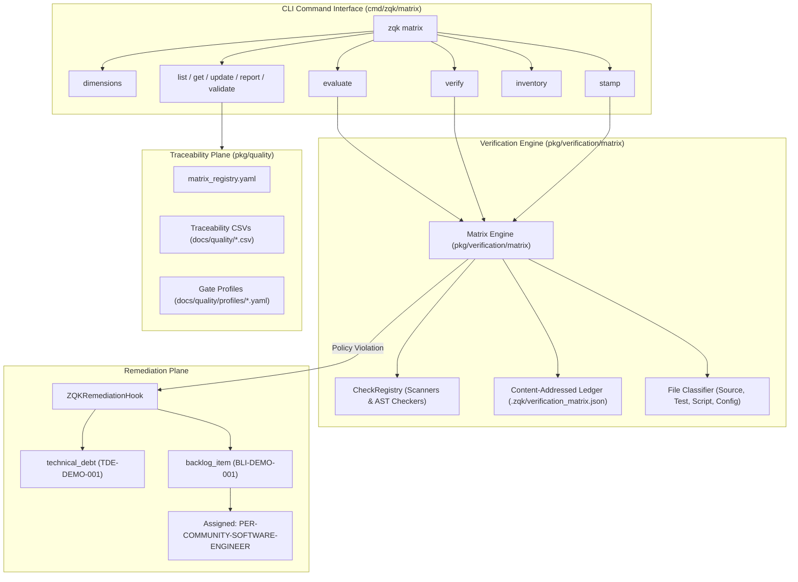

# CLI Matrix Subsystem Architectural & Operational Guide

## Executive Summary

The **ZQK Continuous Source Verification Matrix Subsystem** (`cmd/zqk/matrix`) is an automated, content-addressed quality gate and traceability engine embedded directly within the ZQK Knowledge Kernel. It guarantees continuous enforcement of non-functional requirements, architectural invariants, code cleanliness, and security policies across repository assets.

Rather than relying on probabilistic evaluations or transient linter runs, the Matrix Subsystem pairs cryptographic content addressing (SHA-256 evidence hashing) with deterministic evaluation dimensions. When files violate kernel policies or exceed threshold boundaries, the subsystem automatically computes diamond quality scores and auto-mints remediation objects (`technical_debt` and `backlog_item`) assigned directly to craftsman personas.

Key capabilities delivered by the Matrix Subsystem include:
- **Traceability Matrix Management (`matrix {list,get,update,report,validate}`)**: Centralized management of tabular CSV quality matrices, validation against gate profiles, row querying, and convergence session synchronization.
- **Canonical Evaluation Dimensions (`matrix dimensions`)**: Six core non-functional dimensions (`HCODE`, `EFFPERF`, `ERRHYG`, `CONCURR`, `SECOBS`, `DOCSIG`) bound directly to Knowledge Kernel policy contracts.
- **Automated Scorecard Evaluation (`matrix evaluate`)**: Deep AST and pattern analysis computing 1–5 diamond scores and auto-generating remediation tickets upon threshold violations.
- **Content-Addressed Cache & Gate Enforcement (`matrix verify`)**: $O(1)$ cached verification skipping unchanged source files and policing clean release invariants.
- **Cryptographic Evidence Stamping (`matrix stamp`)**: Immutable recording of verified checks with strict SHA-256 hash assertions preventing manual tampering or stale check approvals.
- **Literal Inventory & Deduplication (`matrix inventory`)**: Repository-wide trigram and AST string literal tracking enforcing zero-magic-literal policies.

---

## 1. Architectural Taxonomy & Core File Layout

The matrix subsystem is located in `cmd/zqk/matrix/` and interfaces with `pkg/verification/matrix`, `pkg/quality`, `pkg/cli`, and `pkg/cliapp`:

```
cmd/zqk/matrix/
├── matrix.go                                   # Subsystem root, command group registration, engine initialization, and shared resolution helpers
├── dimensions.go                               # CLI handler for canonical evaluation dimensions and policy bindings
├── evaluate.go                                 # Deep file scorecard evaluation, diamond score computation, and auto-mint trigger
├── get.go                                      # Tabular matrix CSV row querying with filtering, glob matching, and field projections
├── inventory.go                                # Global literal inventory inspector and deduplication violation reporter
├── list.go                                     # Configured matrix registry listing from matrix_registry.yaml
├── remediation.go                              # ZQK remediation hook minting technical_debt and backlog_item kernel objects
├── report.go                                   # Matrix summary and gate completion status reporter
├── stamp.go                                    # Programmatic check stamper enforcing SHA-256 content evidence
├── update.go                                   # Atomic CSV row updater with convergence session activity log propagation
├── validate.go                                 # Schema and profile validator for registered matrix definitions
├── verify.go                                   # Repository-wide content-addressed verification gate runner
├── matrix_coverage_elevation_cycle98_test.go   # Comprehensive branch coverage elevation test suite
├── matrix_extended_test.go                     # Integration tests for matrix commands and lifecycle scenarios
├── matrix_test_fixture_test.go                 # Isolated test environment setup and minimal matrix project fixtures
├── get_test.go                                 # Flag parser and field projection unit tests
├── update_test.go                              # Row update and CVS activity log validation tests
└── verify_test.go                              # Clean vs violating file gate verification tests
```

---

## 2. Subsystem Architecture & Data Flow

The Matrix Subsystem coordinates CLI interactions, the check execution engine, and kernel object storage:



---

## 3. Canonical Evaluation Dimensions & Policy Bindings

The Matrix Subsystem categorizes quality attributes into six formal evaluation dimensions, queried via `zqk matrix dimensions`:

| Dimension Code | Name | Bound Policy ID | Default Severity | Description & Operational Scope |
| :--- | :--- | :--- | :--- | :--- |
| `HCODE` | Hardcoded Logic & Literals | `POL-CODE-HARDCODING-001` | High | Programmatic eradication of hardcoded literals, raw Unix permissions (`0777`, `0755`), static release version tags, and magic strings. |
| `EFFPERF` | Efficiency & Performance | `POL-PERF-EFFICIENCY-001` | Medium | Allocation patterns, hot-path allocations, sub-optimal loops, and unbudgeted memory retention. |
| `ERRHYG` | Error Handling & Hygiene | `POL-CORE-ERROR-HYGIENE-001` | High | Strict error wrapping, prevention of ignored errors, canonical error formatting, and sentinel error discipline. |
| `CONCURR` | Concurrency & Goroutine Safety | `POL-CONCURRENCY-LABEL-001` | Critical | Goroutine lifecycle tracking via labeled goroutines, prevention of raw `go func()` leaks, and mutex contention hygiene. |
| `SECOBS` | Security & Observability | `POL-SECURITY-FOUNDATION-001` | Critical | Secret leakage prevention, structured logging parity, sensitive parameter masking, and secure context propagation. |
| `DOCSIG` | Documentation & Signature Integrity | `POL-DOCS-MAINTENANCE-001` | Low | Docstring completeness, public API symbol documentation integrity, and architecture guide synchronization. |

---

## 4. Diamond Scoring Model & Thresholds

When evaluating a source file (`zqk matrix evaluate --file <path>`), the engine computes a 1–5 Diamond Quality Score:

- **◆◆◆◆◆ (5/5 Flawless)**: Zero findings. Code complies fully with all static invariants and style policies.
- **◆◆◆◆◇ (4/5 Solid)**: Low-severity informational findings only. No policy thresholds breached.
- **◆◆◆◇◇ (3/5 Needs Attention)**: Medium-severity findings. File requires scheduled refactoring.
- **◆◆◇◇◇ (2/5 Substandard)**: High-severity violations or threshold breaches (e.g. duplicate string literals across packages). Auto-mints remediation objects.
- **◆◇◇◇◇ (1/5 Critical Failure)**: Critical severity failures (security leaks, raw unmanaged concurrency, broken build tags). Gate blocks promotion.

### Invisible Threshold Enforcement

In addition to static AST rules, the evaluation engine enforces systemic thresholds across the entire repository:
- **Maximum Duplicate Literals**: No string literal of length $\ge 4$ characters may appear in more than 1 package unless declared in a canonical constants definition.
- **Zero Raw Permissions**: Unix file mode octals (`0777`, `0755`, `0644`) are prohibited in favor of `fileutil.StandardFilePerm` and `fileutil.StandardDirPerm`.
- **Zero Unlabeled Goroutines**: Concurrency spawns must wrap routines using `goroutinelabels.NewGoroutine`.

---

## 5. Refactored Resolution Architecture (DRY Implementation)

To resolve duplicative flag extraction patterns flagged by `zqk-vet` (hygiene gate POL-HYGIENE-DRY), flag resolution logic across matrix commands was refactored into shared package-internal helpers in `cmd/zqk/matrix/matrix.go`:

### `resolveMatrixTargetFlags`

Extracts target selector flags (`--name` and `--registry`) uniformly across validate, list, and query commands:

```go
func resolveMatrixTargetFlags(cmd *cobra.Command) (name, registryFlag string, err error) {
	var flags clipkg.FlagBag
	name = flags.String(cmd, "name")
	registryFlag = flags.String(cmd, "registry")
	if err := flags.Err(); err != nil {
		return "", "", err
	}
	return name, registryFlag, nil
}
```

### `resolveMatrixFromCmd`

Combines project root resolution with target flags and direct matrix/profile file overrides, returning a canonical `quality.MatrixResolution`:

```go
func resolveMatrixFromCmd(cmd *cobra.Command) (string, quality.MatrixResolution, error) {
	projectRoot, err := resolveProjectRoot(cmd)
	if err != nil {
		return "", quality.MatrixResolution{}, err
	}
	name, registryFlag, err := resolveMatrixTargetFlags(cmd)
	if err != nil {
		return projectRoot, quality.MatrixResolution{}, err
	}
	var flags clipkg.FlagBag
	matrixPath := flags.String(cmd, "matrix")
	profilePath := flags.String(cmd, "profile")
	if err := flags.Err(); err != nil {
		return projectRoot, quality.MatrixResolution{}, err
	}
	resolved, err := quality.ResolveMatrixForCLI(projectRoot, name, registryFlag, matrixPath, profilePath)
	if err != nil {
		return projectRoot, quality.MatrixResolution{}, err
	}
	return projectRoot, resolved, nil
}
```

### `resolveProjectRoot`

Provides 3-tier hierarchical project root resolution:
1. `cli.GetContext(cmd)`: Context bound by CLI pre-run middleware.
2. `pkgctx.GetLifecycleProjectRoot(cmd.Context())`: Command lifecycle context set by automated test runners or parent processes.
3. `cli.ResolveProjectRoot(".")`: Upward directory traversal searching for canonical `.zqk` project data boundary.

---

## 6. Command Taxonomy & Operational Usage

### 6.1 `zqk matrix dimensions`

Displays canonical evaluation dimensions, bound policies, severities, and descriptions.

```bash
# Human-readable table
zqk matrix dimensions

# Machine-readable JSON output
zqk matrix dimensions --json
```

### 6.2 `zqk matrix evaluate`

Performs deep analysis on a specific file, computes diamond scores, and optionally triggers kernel object auto-minting.

```bash
# Evaluate source file against default dimension (HCODE)
zqk matrix evaluate --file pkg/community/distribution.go

# Evaluate against a specific dimension
zqk matrix evaluate --file pkg/storage/store.go --dimension EFFPERF

# Output scorecard as JSON
zqk matrix evaluate --file pkg/core/runner.go --json

# Run evaluation without auto-minting remediation tickets
zqk matrix evaluate --file pkg/bad.go --auto-mint=false
```

### 6.3 `zqk matrix verify`

Runs content-addressed verification across all tracked project files or a single target. Caches passed results in `.zqk/verification_matrix.json` keyed by SHA-256 content hashes for instantaneous subsequent passes.

```bash
# Fast repository-wide verification (O(1) cache hits on unchanged files)
zqk matrix verify

# Verify single file
zqk matrix verify --file pkg/community/distribution.go

# Force full re-evaluation ignoring cached passes
zqk matrix verify --force
```

### 6.4 `zqk matrix stamp`

Programmatically records a verified check result for a file. Enforces SHA-256 evidence validation before approval.

```bash
# Stamp check passing
zqk matrix stamp \
  --file pkg/community/distribution.go \
  --dimension HCODE \
  --status passed \
  --score 5 \
  --feedback "Verified by software craftsman"

# Stamp with explicit SHA-256 hash match assertion
zqk matrix stamp \
  --file pkg/core/runner.go \
  --check hardcoded-logic \
  --hash "e3b0c44298fc1c149afbf4c8996fb92427ae41e4649b934ca495991b7852b855" \
  --status passed
```

### 6.5 `zqk matrix inventory`

Inspects and reports literal occurrences across the codebase, identifying violations of the single-occurrence rule.

```bash
# Report duplicate string literals violating policy
zqk matrix inventory --duplicates-only

# Display all tracked string literals
zqk matrix inventory --all
```

### 6.6 `zqk matrix list`

Lists all configured traceability matrices defined in `docs/quality/matrix_registry.yaml`.

```bash
zqk matrix list
```

### 6.7 `zqk matrix get`

Queries rows from a registered matrix CSV with column filtering, glob matching, and field projections.

```bash
# Filter pending rows for a matrix
zqk matrix get --name MTX-DEMO-001 --filter fully_vetted=pending

# Project specific fields as JSON
zqk matrix get --name MTX-DEMO-001 --field file_path --field status --format json
```

### 6.8 `zqk matrix update`

Atomically updates row statuses in a matrix CSV and optionally records activity entries in associated convergence sessions (`--append-cvs-activity`).

```bash
# Single row status update
zqk matrix update --name MTX-DEMO-001 --file-path pkg/sample.go --set fully_vetted=yes

# Bulk update with convergence session tracking
zqk matrix update --name MTX-DEMO-001 --filter fully_vetted=pending --set fully_vetted=yes --append-cvs-activity --cvs-id CVS-DEMO-001
```

### 6.9 `zqk matrix report`

Generates an aggregated gate completion summary for a matrix.

```bash
# Generate report for default matrix
zqk matrix report

# Filter to Go source files only
zqk matrix report --name MTX-DEMO-001 --go-only
```

### 6.10 `zqk matrix validate`

Validates that registered matrix CSV headers conform to their respective profile YAML schema definitions.

```bash
# Validate all registered matrices
zqk matrix validate

# Validate specific matrix
zqk matrix validate --name MTX-DEMO-001
```

---

## 7. Output Format Schemas

### 7.1 Scorecard Output (`matrix evaluate --json`)

```json
{
  "schema_version": "1.0.0",
  "file_path": "pkg/community/distribution.go",
  "content_hash": "a1b2c3d4e5f60718293a4b5c6d7e8f90123456789abcdef0123456789abcdef0",
  "file_class": "source",
  "evaluated_at": "2026-10-20T05:30:00Z",
  "evaluator": "PER-HARDCODING-ERADICATION-CZAR",
  "dimension": "HCODE",
  "policy_id": "POL-CODE-HARDCODING-001",
  "status": "passed",
  "diamond_score": 5,
  "diamond_label": "◆◆◆◆◆ (5/5 Flawless)",
  "findings": [],
  "policy_evaluation": {
    "evaluated_at": "2026-10-20T05:30:00Z",
    "passed": true,
    "remediation_required": false
  }
}
```

### 7.2 Violation Scorecard with Auto-Minted Remediation

When a file violates policy thresholds, `policy_evaluation` populates the remediation block referencing minted kernel objects:

```json
{
  "schema_version": "1.0.0",
  "file_path": "pkg/demo/bad.go",
  "content_hash": "fedcba9876543210fedcba9876543210fedcba9876543210fedcba9876543210",
  "file_class": "source",
  "evaluated_at": "2026-10-20T05:30:00Z",
  "evaluator": "PER-HARDCODING-ERADICATION-CZAR",
  "dimension": "HCODE",
  "policy_id": "POL-CODE-HARDCODING-001",
  "status": "failed",
  "diamond_score": 2,
  "diamond_label": "◆◆◇◇◇ (2/5 Substandard)",
  "findings": [
    {
      "rule_id": "hardcoded-version-string",
      "severity": "high",
      "line": 40,
      "message": "Found hardcoded version literal 'v1.2.3'"
    }
  ],
  "policy_evaluation": {
    "evaluated_at": "2026-10-20T05:30:00Z",
    "passed": false,
    "remediation_required": true,
    "threshold_failures": [
      "Found 1 high-severity hardcoded version literals"
    ],
    "remediation": {
      "technical_debt_id": "TDE-DEMO-001",
      "backlog_item_id": "BLI-DEMO-001",
      "assigned_persona": "PER-COMMUNITY-SOFTWARE-ENGINEER",
      "minted_at": "2026-10-20T05:30:01Z",
      "status": "pending"
    }
  }
}
```

---

## 8. Verification & Test Coverage Elevation

Statement test coverage for the `cmd/zqk/matrix` package is verified at **93.1%** statement coverage through `matrix_coverage_elevation_cycle98_test.go` and accompanying suites:

```bash
go test -cover ./cmd/zqk/matrix/...
```

The test coverage elevation verifies:
- Complete error branch coverage across project root resolution, registry parsing, and path discovery.
- Edge cases in convergence session activity append (`appendMatrixCvsActivity`) and object verification (`validateCvsIDsReadable`).
- Mocked subprocess execution for kernel object remediation in `remediation.go`.
- Content-addressed cache hit/miss transitions in `verify.go` and `stamp.go`.
- JSON encoding and decoding paths across all subcommands.
