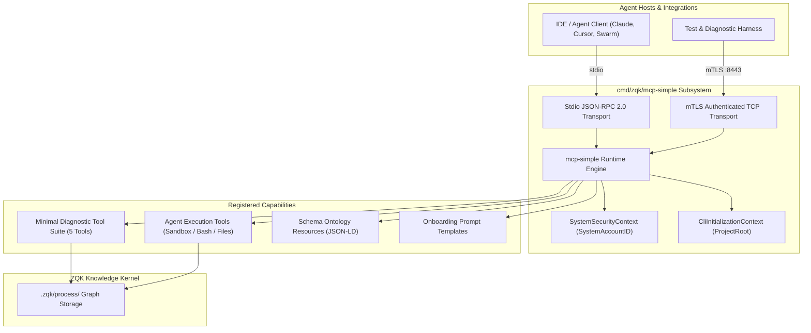

# CLI MCP-Simple Subsystem Architectural Guide

## Overview

The **ZQK MCP-Simple Subsystem** (`cmd/zqk/mcp-simple`) is a specialized, lightweight Model Context Protocol (MCP) server implementation within the **Zen Quantum Kernel (ZQK)**. While the primary MCP daemon (`cmd/zqk/mcp`) provides full-featured multi-client supervision, in-process CLI dispatch, dynamic adapter auto-configuration, and mesh routing, `mcp-simple` is intentionally designed with a minimal footprint.

`mcp-simple` serves three critical architectural purposes:
1. **Diagnostic & Troubleshooting Anchor**: Provides a minimal, reliable JSON-RPC 2.0 endpoint that bypasses complex process supervisors, timeout interceptor chains, and storage provider adapters when diagnosing agent connectivity or environment issues.
2. **Minimal Footprint Agent Execution**: Exposes core kernel graph traversal, object query, interactive object creation, and guarded sandbox execution tools without the memory or startup overhead of the full command tree.
3. **Resilient Transport Testing**: Implements both high-throughput Standard I/O (`stdio`) and Mutual TLS (`mTLS`) transport layers to verify end-to-end client negotiation and cryptographic authentication under clean, isolated conditions.

---

## Subsystem Architecture & Design Principles

### Architectural Topology



### Key Design Principles

1. **Zero-Overhead Initialization**:
   `mcp-simple` does not bootstrap the entire hierarchical Cobra CLI command tree. It registers only a curated set of diagnostic and execution tools, eliminating startup latency and circular dependency risks.

2. **Decoupled Server Runner Abstraction**:
   Serving operations are decoupled through the `serverRunner` interface (`Serve()` and `ServeMTLS(...)`), enabling 100% statement test coverage with deterministic mocking of stdio and network transports.

3. **Autonomous Execution Safety**:
   All agent execution tools operate with project root boundaries enforced via `CliInitializationContext`, ensuring tools cannot traverse outside the sovereign workspace.

---

## Command Taxonomy & CLI Invocation

The `mcp-simple` server can be invoked directly as a standalone binary or as a subcommand.

### Synopsis

```bash
zqk-mcp-simple [flags]
```

### Command Flags

| Flag | Type | Default | Description |
| :--- | :--- | :--- | :--- |
| `-mtls-addr` | string | `""` | Listen address for Mutual TLS (e.g. `:8443` or `127.0.0.1:8443`). |
| `-cert` | string | `""` | Path to the x509 TLS server certificate file (required if `-mtls-addr` is set). |
| `-key` | string | `""` | Path to the TLS private key file (required if `-mtls-addr` is set). |
| `-ca` | string | `""` | Path to the trusted CA certificate file for client verification (required if `-mtls-addr` is set). |

### Operational Modes

#### 1. Standard I/O (Default Mode)
When executed without network flags, `mcp-simple` listens on standard input (`stdin`) and writes responses to standard output (`stdout`):

```bash
# Launch minimal MCP server on stdio
zqk-mcp-simple
```

This mode is ideal for direct IDE integration (Claude Desktop, Cursor, Zed) and terminal-based subshell testing.

#### 2. Mutual TLS (mTLS Mode)
When `-mtls-addr` is provided, `mcp-simple` enforces strict mutual authentication:

```bash
# Launch mTLS authenticated endpoint on port 8443
zqk-mcp-simple -mtls-addr ":8443" \
  -cert "/etc/zqk/certs/server.crt" \
  -key "/etc/zqk/certs/server.key" \
  -ca "/etc/zqk/certs/ca.crt"
```

All three certificate flags (`-cert`, `-key`, `-ca`) are mandatory when `-mtls-addr` is supplied; omitting any of them results in an immediate, clean validation error.

---

## Tool & Capability Suite

The `mcp-simple` subsystem configures four capability layers:

### 1. Minimal Diagnostic Tool Suite

`mcp-simple` registers five focused tools designed for troubleshooting and baseline graph validation:

| Tool Name | Purpose | Key Parameters |
| :--- | :--- | :--- |
| `zqk_test_echo` | Connectivity and ping test; echoes back the input message. | `message` (string, required) |
| `zqk_graph_traversal` | Performs multi-hop relationship traversal starting from a node. | `start_node_id` (string, required), `max_depth` (number, default: 3) |
| `zqk_object_list` | Lists stored kernel objects with optional kind filtering and formatting. | `kind` (string, optional), `format` (`json`\|`yaml`\|`table`) |
| `zqk_get_current_priority_plan` | Retrieves the active priority plan governing current cycle execution. | `format` (`json`\|`yaml`\|`table`) |
| `zqk_create_object_interactive` | Guided, interactive object drafting session for agents. | `kind` (string, required), `session_id` (string, optional) |

#### Illustrative JSON-RPC Tool Invocation: `zqk_test_echo`

```json
{
  "jsonrpc": "2.0",
  "id": "req-001",
  "method": "tools/call",
  "params": {
    "name": "zqk_test_echo",
    "arguments": {
      "message": "SMP-DEMO-001 probe"
    }
  }
}
```

Response:
```json
{
  "jsonrpc": "2.0",
  "id": "req-001",
  "result": {
    "content": [
      {
        "type": "text",
        "text": "Echo: SMP-DEMO-001 probe"
      }
    ]
  }
}
```

### 2. Agent Execution Tools (`RegisterAgentExecutionTools`)

To allow autonomous agents and swarms to execute work, `mcp-simple` binds the sandbox execution tools defined in `pkg/mcp/tools_sandbox.go`:
- **`zqk_execute_bash`**: Deterministic command execution within the workspace sandbox, protected by a 60-second execution timeout and command allowlists.
- **`zqk_read_file`**: Safe workspace file reading relative to `CliInitializationContext.ProjectRoot`.
- **`zqk_write_file`**: Atomic workspace file writing with path validation.
- **`zqk_read_code`**: AST-indexed structural code lookup.
- **`zqk_write_code`**: Guarded modification of code artifacts.

Tool names dynamically respect the product brand prefix (`zqk_*` via `brand.SetExecutableName("zqk")`).

### 3. Schema Ontology Resources (`RegisterSchemaResources`)

Agents can discover and introspect Knowledge Kernel schemas via registered JSON-LD resources:
- `schema://registry`: Root catalog of all registered object kinds (`goal`, `requirement`, `priority_plan`, `backlog_item`, etc.).
- `schema://cli-ontology`: Hierarchical mapping of commands, flags, and constraints.
- `schema://common-fields`: Common identity and audit fields shared across all kernel entities.

### 4. Onboarding Prompt Templates (`RegisterOnboardingPrompts`)

`mcp-simple` registers standard onboarding prompt templates, allowing agents to bootstrap mission awareness:
- `onboarding_first_contact`: Interactive paired initialization protocol for new developers or swarms.
- `onboarding_intent_discovery`: Guides agents through drafting goals, requirements, and criteria without premature execution locks.

---

## Security & Initialization Contexts

`mcp-simple` constructs a minimal, high-privilege execution environment:

```go
// Create minimal security context (system context)
secCtx := pkgctx.NewSystemSecurityContext()
server.SetSecurityContext(secCtx)

// Set minimal initialization context
initCtx := &pkgctx.CliInitializationContext{
    ProjectRoot: projectRoot,
}
server.SetCliInitializationContext(initCtx)
```

1. **System Security Context**:
   Grants `pkgctx.SystemAccountID` identity, bypassing fine-grained interactive permission prompts for non-destructive diagnostic reads while maintaining audit logging.
2. **Project Root Resolution**:
   Resolves the repository root (`cli.ResolveProjectRoot(".")`) and anchors all path operations, preventing directory traversal vulnerabilities.

---

## Source Layout & Test Architecture

The `cmd/zqk/mcp-simple/` package contains:

```
cmd/zqk/mcp-simple/
├── main.go                                                 # Server lifecycle, flag parsing, and tool bindings
├── main_test.go                                            # Baseline tool registration tests
├── main_extended_test.go                                   # Configuration parsing and transport unit tests
└── mcp_simple_coverage_elevation_cycle119_test.go          # Complete coverage elevation suite (100.0% coverage)
```

### Test Strategy & 100.0% Coverage

Test coverage is verified using hookable runner and exit injection:
- `serverFactory`: Hookable factory `func(projectRoot string) serverRunner` allowing tests to inject mock runners without binding actual stdio or network sockets.
- `osExit`: Hookable process termination `var osExit = os.Exit` enabling full execution verification of `main()` error pathways.

To execute tests and verify coverage:

```bash
ZQK_ALLOW_FOREGROUND_GO_TEST=1 go test -v -cover ./cmd/zqk/mcp-simple/...
```

Expected result:
```
PASS
coverage: 100.0% of statements
ok      github.com/zqk-os/zqk/cmd/zqk/mcp-simple    0.081s    coverage: 100.0% of statements
```

---

## Troubleshooting & Diagnostics

### Symptom: `mTLS requires -cert, -key, and -ca flags`
- **Cause**: `-mtls-addr` was passed without providing all three necessary certificate files.
- **Resolution**: Ensure `-cert <cert-file>`, `-key <key-file>`, and `-ca <ca-file>` are all specified.

### Symptom: Tool names prefix mismatch in tests
- **Cause**: Tool names use `mcp.GetBrandPrefix()`, which resolves the current running binary name (e.g. `mcp-simple.test` during `go test`).
- **Resolution**: Use `mcp.GetToolName("execute_bash")` or test the minimal tools (`zqk_test_echo`, `zqk_object_list`) which use explicit static names.
