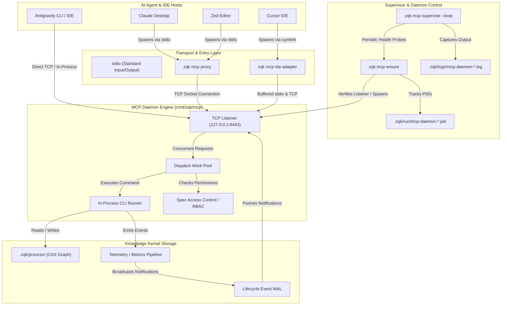
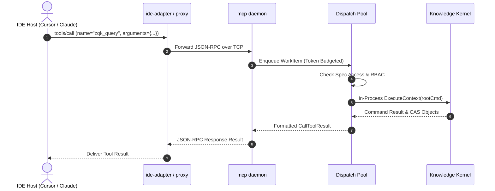

# CLI MCP Subsystem Architectural Guide

## Overview

The **ZQK Model Context Protocol (MCP) Subsystem** (`cmd/zqk/mcp`) provides the high-performance, standardized JSON-RPC integration layer connecting AI agent environments (including Claude Desktop, Cursor, Zed, and Google Antigravity) directly with the Zen Quantum Kernel (ZQK).

Unlike transient prompt harnesses or unverified context dumps that treat tool execution as disposable subshell invocations, ZQK roots all MCP interactions in the sovereign, persistent **Knowledge Kernel**. Every tool execution, capability registration, permission gate, and diagnostic probe is tied to verifiable graph objects stored in Content Addressable Storage (CAS) under `.zqk/process/`.

The CLI MCP subsystem enables:
1. **Zero-Latency In-Process Execution**: Direct Go AST command dispatch without process-spawn overhead for high-frequency agent tool calls.
2. **Multi-Transport Flexibility**: Standard I/O (`stdio`) for local IDE processes alongside persistent local loopback TCP sockets (`127.0.0.1:8443`) for concurrent agent swarms.
3. **Resilient Daemon Supervision**: Background supervisor daemon with automatic heartbeat recovery, PID lockfile hygiene, and graceful zero-downtime drain.
4. **Universal IDE Adaptation**: Dynamic auto-configuration for major agent hosts with zero manual JSON configuration required.
5. **Spec-Based Security & RBAC**: Automated capability filtering and access enforcement ensuring agents execute only explicitly authorized commands.

---

## Subsystem Architecture & File Layout

The CLI MCP subsystem resides in `cmd/zqk/mcp/` and interfaces with core protocol implementations in `pkg/mcp/` and `pkg/mcp/ideadapter/`:

```
cmd/zqk/mcp/
├── mcp.go                                      # Root 'zqk mcp' command, serve entrypoint, in-process CLI runner
├── daemon.go                                   # 'zqk mcp daemon': Long-lived multi-client TCP service
├── daemon_control.go                           # PID management, process liveness check, diagnostics payload
├── ensure.go                                   # 'zqk mcp ensure': Idempotent daemon & role symlink healthcheck
├── supervise.go                                # 'zqk mcp supervise': Process watchdog, auto-restart loop, stop lifecycle
├── proxy.go                                    # 'zqk mcp proxy': Lightweight stdio-to-TCP bridge
├── ide_adapter.go                              # 'zqk mcp ide-adapter' / 'cursor-adapter': IDE stdio harness
├── install.go                                  # 'zqk mcp install': Automated IDE client configuration
├── list_tools.go                               # 'zqk mcp list-tools': Tool inventory and command path inspection
├── storage_provider_adapter.go                 # Adapter bridging storage.ObjectStorageProvider to pkg/mcp
├── coordinator_setup.go                        # Event routing and telemetry pipeline integration
├── detach_unix.go                              # Setsid process detachment for Unix platforms
└── detach_windows.go                           # Process detachment abstraction for Windows platforms
```

---

## MCP Subsystem Interaction Topology

The following diagram illustrates how external IDE hosts interface with the ZQK CLI MCP subsystem, supervisor, and kernel:



---

## 1. Command Taxonomy (`zqk mcp`)

The MCP command suite exposes specialized entrypoints designed for both manual operator control and autonomous IDE process lifecycles:

| Command | Primary Role | Execution Mode | Transport | Target Consumer |
| :--- | :--- | :--- | :--- | :--- |
| `zqk mcp serve` | Primary MCP protocol server | Foreground blocking | `stdio` or TCP (`--tcp`) | Direct stdio IDE harness or containerized runners |
| `zqk mcp daemon` | Multi-client persistent server | Background / Long-lived | TCP loopback (`--tcp`, `--port`) | Shared local development workstation daemon |
| `zqk mcp proxy` | Lightweight stdio-to-TCP bridge | Foreground per-session | `stdio` bridging to TCP | Claude Desktop, legacy IDE stdio spawners |
| `zqk mcp ide-adapter` | Resilient IDE stdio connector | Foreground per-session | `stdio` with auto-reconnect | Cursor, Zed, Claude Desktop |
| `zqk mcp supervise` | Self-healing daemon watchdog | Background daemon | Detached Setsid (`--loop`) | Automated background reliability management |
| `zqk mcp ensure` | Idempotent health validator | One-shot execution | Local socket probe | Pre-launch IDE hooks, CI pipelines, shell init |
| `zqk mcp install` | Automatic IDE configuration | One-shot configuration | Filesystem CAS | Developer onboarding, IDE setup |
| `zqk mcp list-tools` | Introspect exposed MCP tools | One-shot query | stdout table / JSON | Debugging, agent capability verification |

---

## 2. Protocol Architecture & Transports

### JSON-RPC 2.0 Foundation
The ZQK MCP subsystem adheres strictly to the Model Context Protocol specification built atop JSON-RPC 2.0:
- **Requests**: Standard JSON-RPC call structure containing `jsonrpc: "2.0"`, integer or string `id`, `method` name, and `params`.
- **Responses**: Paired responses returning `result` or standardized `error` objects (`code`, `message`, `data`).
- **Notifications**: Fire-and-forget events with no `id`, utilized for telemetry, agent synthesis notifications, and lifecycle event streaming.

### Transport Modes
1. **Standard I/O (`stdio`)**:
   - Primary communication channel when spawned directly by an IDE host process (e.g. `claude_desktop_config.json`).
   - Standard input (`os.Stdin`) receives newline-delimited JSON-RPC messages; standard output (`os.Stdout`) transmits framed responses.
   - **Stdout Hygiene Guarantee**: The MCP subsystem guarantees zero non-protocol pollution on `os.Stdout`. All logging, diagnostic outputs, and panic traces are routed exclusively to `os.Stderr` or file logs (`pkg/logging/mcp`).
2. **Plain TCP Loopback (`127.0.0.1:8443`)**:
   - Used by `zqk mcp daemon` to serve multiple concurrent clients through a single shared server instance.
   - By security invariant (`CRIT-MCP-SEC-LOOPBACK`), unauthenticated TCP binding is strictly restricted to loopback addresses (`127.0.0.1`, `::1`).
3. **Encrypted Network Transports (TLS / mTLS)**:
   - For remote or cross-host mesh integration, the server supports TLS (`--tls-cert`, `--tls-key`) and mutual TLS (`--tls-ca`) with cryptographic client verification.

---

## 3. Server Lifecycle & Execution Context Mapping

### Initialization Sequence
The MCP server startup lifecycle follows a deterministic three-stage cascade:

1. **Bootstrap & Context Initialization**:
   - `pkgctx.NewCliInitializationContext` resolves the sovereign project root.
   - Global dispatch pool (`dispatch.StartGlobalPool`) initializes worker routines for concurrent tool submissions.
   - Security context (`secCtx`) binds identity and authorization boundaries.
   - Storage provider (`storage.NewStorageFactory`) initializes local CAS access.
2. **Deferred Tool Discovery (`initialize`)**:
   - CLI command discovery and tool schema generation is intentionally deferred until the client sends the `initialize` JSON-RPC handshake.
   - This ensures rapid startup without blocking on disk-intensive spec scans.
3. **In-Process CLI Execution**:
   - In-process execution serializes access to the root command structure via an internal execution mutex (`cliExecMu`).
   - Standard output and standard error are captured into in-memory buffers (`bytes.Buffer`).
   - Sticky Cobra command contexts from previous runs are sanitized via `clearCobraCommandContexts` to prevent context leakages.

### Tool Execution Flow


---

## 4. Daemon Supervisor Mechanics & Fault Tolerance

The daemon supervisor (`zqk mcp supervise`) ensures continuous MCP availability without manual operator intervention:

### PID Lockfile Hygiene
The subsystem maintains deterministic state files under `.zqk/run/`:
- `mcp-daemon-<port>.pid`: Stores the active PID of the TCP daemon process.
- `mcp-daemon-supervise.pid`: Stores the active PID of the background supervisor loop.

Before spawning a new process, `daemon_control.go` verifies process liveness using POSIX signal 0 probes (`processAlive(pid)`). If a stale PID file exists with no corresponding living process, it is automatically cleaned and reclaimed.

### Self-Healing Watchdog Loop (`--loop`)
When invoked with `--loop`, the supervisor enters a detached monitoring cycle:
1. Spawns `zqk mcp ensure --tcp <addr> --timeout 0` every 5 seconds.
2. Appends stdout and stderr to `.zqk/logs/mcp-daemon-supervise.log`.
3. If the daemon process crashes or drops its TCP port, `runEnsure` automatically starts a new instance and waits up to 8 seconds for socket readiness.
4. Responds gracefully to POSIX termination signals (`SIGINT`, `SIGTERM`), killing child processes cleanly.

---

## 5. IDE Adapter Integration

The ZQK MCP subsystem includes native auto-configuration and adapter harnesses for all major AI coding platforms:

### 1. Cursor IDE
- Configured via `~/.cursor/mcp.json` or project-local `.cursor/mcp.json`.
- Uses role symlink `.zqk/bin/zqk-mcp-ide-adapter` or direct `zqk mcp ide-adapter --tcp 127.0.0.1:8443`.
- Handles rapid IDE connection resets and heartbeat pings without marking the connector red.

### 2. Claude Desktop
- Configured in `claude_desktop_config.json`:
  ```json
  {
    "mcpServers": {
      "zqk": {
        "command": "zqk",
        "args": ["mcp", "proxy", "--tcp", "127.0.0.1:8443"]
      }
    }
  }
  ```

### 3. Google Antigravity & Zed
- Connects directly to the loopback TCP daemon or executes via `zqk mcp serve`.
- Leverages structured JSON-RPC 2.0 streaming with telemetry subscription support.

### One-Click Installation (`zqk mcp install`)
Running `zqk mcp install` inside any project root automatically inspects installed IDE environments, generates the requisite configuration JSON payloads, registers role symlinks, and sets up project hooks.

---

## 6. Security Model, Tool Sandboxing, and RBAC

The MCP subsystem enforces a defense-in-depth security architecture:

1. **Loopback Invariant (`POL-MCP-SEC-LOOPBACK`)**:
   - Plain TCP listeners refuse to bind to public or non-loopback IP interfaces.
   - Any external network exposure requires TLS/mTLS encryption.
2. **Subprocess Environment Scrubbing**:
   - `zqkenv.ScrubDaemonProcessEnv()` strips internal parent execution variables (`ZQK_PARENT_PID`, `ZQK_MCP_ACCOUNT_ID`) from daemon startup shells.
   - Prevents recursive watchdog termination and environment variable pollution.
3. **Spec Access Control (RBAC)**:
   - Tool visibility and execution permissions are evaluated against spec definitions loaded via `objects.SpecLoader`.
   - Disallowed commands are omitted from `tools/list` and rejected at execution time with standardized JSON-RPC error codes.
4. **Panic Isolation**:
   - Top-level panic recovery wrappers in `runServe` capture any unhandled exceptions, log the stack trace to stderr, and return clean error responses without terminating the host process.

---

## 7. Error Handling, Exit Codes & Boundary Semantics

The subsystem distinguishes sharply between standard protocol disconnections and unrecoverable runtime errors:

| Condition | Protocol Behavior | Exit Code | Rationale |
| :--- | :--- | :--- | :--- |
| **Client Disconnect (`io.EOF`)** | Clean shutdown | `0` | Normal IDE process closure; must not trigger error alarms |
| **Idle Timeout / Context Cancel** | Soft graceful drain | `0` | Expected lifecycle timeout during inactive development sessions |
| **Invalid CLI Flags** | Error message to stderr | `1` | Command-line invocation error |
| **Port Conflict / Bind Failure** | Supervisor retry / error log | `1` | Address already in use by unauthorized process |
| **Tool Execution Failure** | JSON-RPC error result | `0` | Tool-level domain failure returned in payload to agent |

---

## 8. Verified Architectural Invariants

| ID | Category | Description | Verification Surface |
| :--- | :--- | :--- | :--- |
| `INV-MCP-001` | **Transport** | Standard output (`os.Stdout`) is strictly reserved for framed JSON-RPC messages; all logging routes to stderr or file. | `cmd/zqk/mcp/mcp_test.go` |
| `INV-MCP-002` | **Security** | Unauthenticated TCP daemon binding is strictly constrained to loopback network interfaces. | `pkg/mcp/server_tcp_test.go` |
| `INV-MCP-003` | **Resilience** | `mcp supervise --stop` terminates supervisor, daemon PID, and port holders cleanly. | `cmd/zqk/mcp/mcp_coverage_elevation_cycle118_test.go` |
| `INV-MCP-004` | **Hygiene** | Stale daemon PID files are cleared automatically if process validation fails. | `cmd/zqk/mcp/daemon_control_test.go` |
| `INV-MCP-005` | **Idempotence** | `mcp ensure` succeeds with no-op when daemon is already actively listening on designated port. | `cmd/zqk/mcp/ensure_test.go` |
