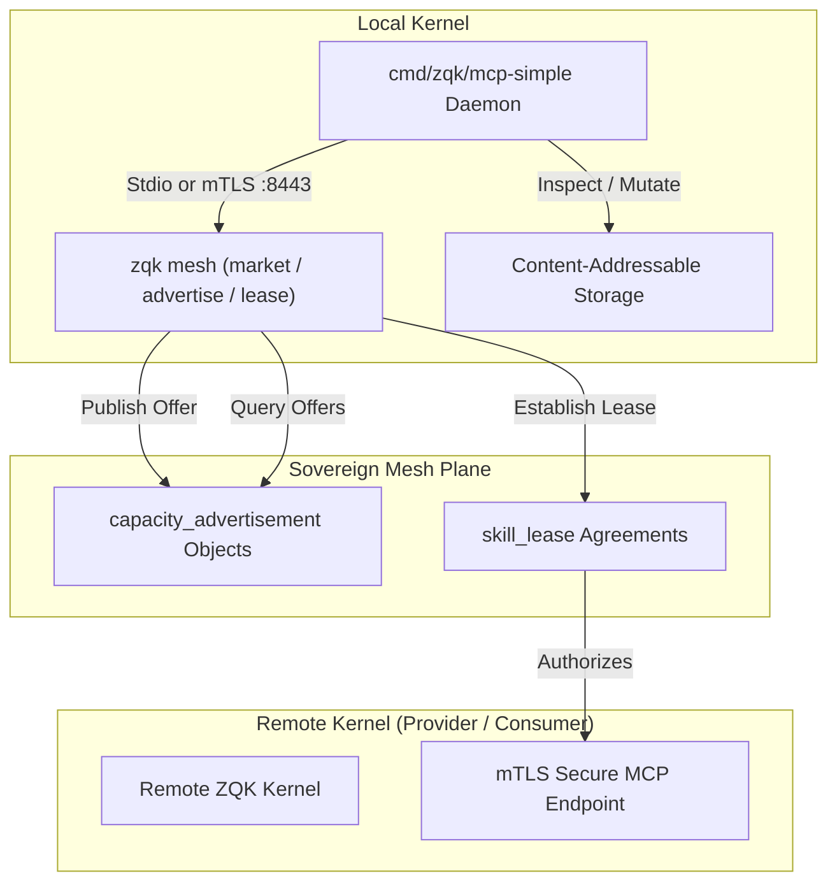

# CLI Mesh & MCP-Simple Command Engine Guide

Comprehensive architectural and operational guide to sovereign mesh capacity management (`zqk mesh`), decentralized capability leasing, marketplace discovery, and the lightweight Model Context Protocol engine (`cmd/zqk/mcp-simple`) within the **ZQK Knowledge Kernel**.

---

## 1. System Overview & Architecture

The Sovereign Mesh and MCP-Simple subsystems provide decentralized compute, storage, and agent seat sharing across sovereign kernels without centralized coordination.

1. **`zqk mesh`**: Peer-to-peer capacity exchange surface allowing kernels to:
   - Advertise local capacity (compute cores, agent seats, storage volumes) to the sovereign mesh.
   - Query available offerings in the mesh marketplace with granular resource-type filtering.
   - Establish cryptographically tokenized resource leases (`skill_lease`) between provider and consumer kernels.
2. **`zqk mcp-simple`**: Minimalist Model Context Protocol daemon for local and remote agent interaction, supporting:
   - High-throughput Stdio (JSON-RPC over standard input/output).
   - Enterprise-grade Mutual TLS (mTLS) with client/server certificate validation.
   - Core diagnostic tools (`zqk_test_echo`, `zqk_graph_traversal`, `zqk_object_list`, `zqk_get_current_priority_plan`, `zqk_create_object_interactive`).
   - Standardized Agent Execution Tool bindings (`execute_bash`, `read_file`, `write_file`).
   - JSON-LD ontology schema resources and agent onboarding prompts.



---

## 2. Mesh Command Engine (`zqk mesh`)

### 2.1 Advertising Capacity (`zqk mesh advertise`)
Kernels broadcast available resources into the mesh marketplace via typed `capacity_advertisement` objects.

```bash
# Advertise compute capacity
zqk mesh advertise compute --amount 8.0 --units cores --resource-id comp-worker-1

# Advertise agent seats with default units (instances)
zqk mesh advertise agent_seat --amount 4

# Advertise dedicated NVMe storage
zqk mesh advertise storage --amount 250 --units GB --resource-id vol-nvme-fast
```

Flags:
- `--amount`: Floating-point quantity of the advertised capacity (required).
- `--units`: Resource units (default: `instances`).
- `--resource-id`: Specific identifier of the physical or virtual resource.

### 2.2 Marketplace Discovery (`zqk mesh market`)
Operators and agents query the sovereign mesh marketplace to discover available capacity matching current workload requirements.

```bash
# Query all advertised resources across all kinds
zqk mesh market

# Filter marketplace by specific resource type
zqk mesh market --type compute
zqk mesh market --type agent_seat
zqk mesh market --type storage
```

Output Format:
```text
SOVEREIGN MESH MARKETPLACE
============================================================

compute [CADV-1791968006711160000-7ace399d]
  Provider: KER-REMOTE-COMP
  Capacity: 4.5 cores
  Resource: comp-node-42

agent_seat [CADV-1791968007000647000-496bd3d4]
  Provider: KER-REMOTE-AGENTS
  Capacity: 2.0 seats
```

### 2.3 Establishing Leases (`zqk mesh lease`)
To consume a resource advertised by a peer kernel, the consumer executes a lease request. This creates an immutable `skill_lease` record and returns a cryptographic authorization token.

```bash
# Establish a 2-hour lease for a remote verification worker
zqk mesh lease qa-verifier --from KER-REMOTE-001 --duration 2h

# Establish an open-ended lease
zqk mesh lease sandbox-01 --from KER-REMOTE-002 --duration 0s
```

Parameters:
- `resource_id`: The target resource identifier (argument 0).
- `--from`: Target provider kernel identifier (`KER-...`).
- `--duration`: Lease time duration (Go duration string, e.g. `30m`, `2h`, `24h`).

---

## 3. Lightweight MCP Server (`mcp-simple`)

`cmd/zqk/mcp-simple` is an optimized MCP daemon designed for fast boot, lean context footprint, and zero daemon lock overhead.

### 3.1 Operating Modes

#### Standard Stdio Mode (Default)
Ideal for IDE plugins (Cursor, VS Code, Zed) and local subagent subprocesses:
```bash
zqk mcp-simple
```

#### Mutual TLS Mode (Enterprise / Distributed Swarm)
Requires client certificate, private key, and root CA certificate for authenticated peer communication:
```bash
zqk mcp-simple \
  -mtls-addr ":8443" \
  -cert "/etc/zqk/tls/server.crt" \
  -key "/etc/zqk/tls/server.key" \
  -ca "/etc/zqk/tls/ca.crt"
```

### 3.2 Registered Diagnostic & Operational Tools

| Tool Name | Purpose | Required Arguments |
|:---|:---|:---|
| `zqk_test_echo` | Healthcheck and loopback ping | `message` |
| `zqk_graph_traversal` | Multi-hop AST and kernel relational traversal | `start_node_id`, `max_depth` (default 3) |
| `zqk_object_list` | Filtered, paginated CAS object query | `kind`, `format` (json/yaml/table) |
| `zqk_get_current_priority_plan` | Active Priority Plan resolution | `format` (json/yaml/table) |
| `zqk_create_object_interactive` | Guided multi-step object creation | `kind`, `session_id` (optional) |
| `execute_bash` | Sandboxed CLI execution | `command` |
| `read_file` / `write_file` | Guarded filesystem interactions | `path`, `content` |

---

## 4. Verification & Testing

Both subsystems are covered by strict AST, unit, and integration test suites:
```bash
# Run mesh tests with coverage
ZQK_ALLOW_FOREGROUND_GO_TEST=1 go test -v -cover ./cmd/zqk/mesh/...

# Run mcp-simple tests with coverage
ZQK_ALLOW_FOREGROUND_GO_TEST=1 go test -v -cover ./cmd/zqk/mcp-simple/...

# Verify bound DoD gate
./bin/zqk test run TST-1791966217716359001-19e9ba1b
```
