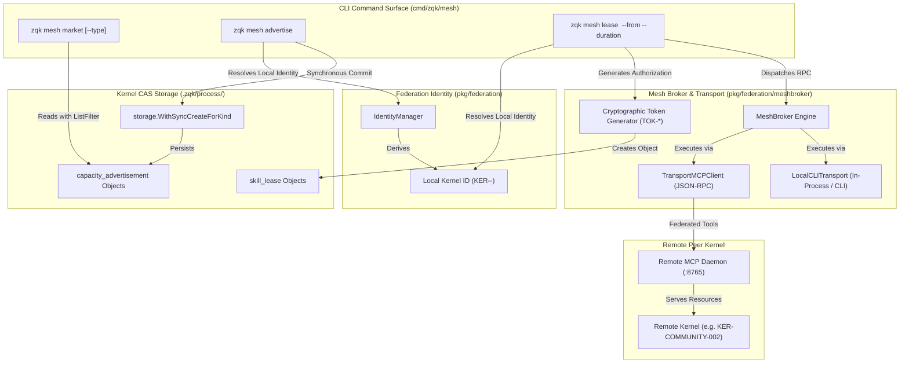
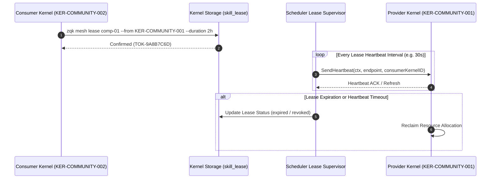

# CLI Mesh Subsystem Architectural Guide

## Overview

The **ZQK CLI Mesh Subsystem** (`cmd/zqk/mesh`) provides the decentralized federation, capability exchange, and cross-kernel resource leasing surface within the Zen Quantum Kernel (ZQK).

Unlike centralized cloud brokers or transient prompt-harness frameworks that rely on opaque cloud routers, ephemeral API sessions, and unrecorded peer interactions, ZQK roots all mesh interactions directly in the persistent **Knowledge Kernel**. Every advertised capability, peer identity, and active lease is materialized as a versioned, verifiable graph object in Content Addressable Storage (CAS) under `.zqk/process/`.

The Mesh Subsystem enables sovereign autonomous kernels to:
1. **Discover & Inspect Peer Capabilities**: Query the sovereign marketplace via `zqk mesh market` with optional capability filtering.
2. **Broadcast Local Capacity**: Announce available compute, agent seats, storage, or specialized agent skills via `zqk mesh advertise`.
3. **Establish Cryptographically Authorized Leases**: Secure time-bounded leases and generate authorization tokens via `zqk mesh lease`.
4. **Coordinate Across Transports**: Seamlessly bridge peer kernels using local CLI execution harnesses and Model Context Protocol (MCP) transports.

---

## Subsystem Architecture & File Layout

The mesh subsystem spans the CLI presentation layer (`cmd/zqk/mesh/`), the core federation engine (`pkg/federation/`), and the distributed mesh broker (`pkg/federation/meshbroker/`):

```
cmd/zqk/mesh/
├── mesh.go                                     # Root 'zqk mesh' command builder & kernel ID resolution
├── market.go                                   # 'zqk mesh market': marketplace querying & formatted display
├── advertise.go                                # 'zqk mesh advertise': capability announcement & CAS sync commit
├── lease.go                                    # 'zqk mesh lease': authorization token generation & lease creation
├── mesh_test.go                                # Smoke and subcommand topology tests
├── mesh_extended_test.go                       # In-process project fixture & CLI execution tests
└── mesh_coverage_elevation_cycle95_test.go     # Statement coverage elevation & error boundary test suite

pkg/federation/
├── identity.go                                 # Kernel ID derivation, public keys & IdentityManager
├── handshake.go                                # Handshake negotiation structures & capability exchange
├── handshaker_mcp.go                           # MCP-based handshake protocol implementation
├── transport.go                                # Transport abstraction & LocalCLITransport
├── query_engine.go                             # Cross-kernel federated query resolution
└── meshbroker/
    ├── broker.go                               # MeshBroker lifecycle & provider registration
    ├── compute_broker.go                       # Compute resource reservation & capacity accounting
    ├── lease_token.go                          # Cryptographic lease token validation
    └── transport_mcp_client.go                 # Remote MCP client transport & tool execution
```

---

## Sovereign Mesh Interaction Topology

The following diagram illustrates how the CLI Mesh commands interface with local kernel storage, identity resolution, the mesh broker, and remote peer kernels:



---

## 1. Command Taxonomy (`zqk mesh`)

The `zqk mesh` command group provides the operator entry points for participating in the sovereign mesh network.

### Root Command: `zqk mesh`

Constructed by `NewMeshCmd()` in `cmd/zqk/mesh/mesh.go`, this parent command aggregates all mesh subcommands:

```bash
zqk mesh --help
```

Subcommands registered:
- `market`: Browse available capacity advertisements across the network.
- `advertise`: Broadcast local capabilities and capacity offers to the mesh.
- `lease`: Secure a time-bounded lease for a specific remote resource.

---

### Marketplace Query: `zqk mesh market`

The `market` command scans Content Addressable Storage for active `capacity_advertisement` objects, formatting them into an ANSI-highlighted console dashboard.

#### Command Syntax
```bash
zqk mesh market [--type <resource_type>]
```

#### Supported Flags
- `--type` (`string`): Filters displayed advertisements by resource kind (e.g., `compute`, `agent_seat`, `gpu`, `storage`, `agent_skill`).

#### Execution Flow
1. **Filter Assembly**: Configures a `storage.ListFilter` with `Kind: objects.KindCapacityAdvertisement`. If `--type` is specified, adds an exact-match filter on `objects.FieldKeyResourceType`.
2. **Storage Query**: Invocates `proc.Storage().List()` to retrieve all matching advertisements.
3. **Robust Value Normalization**: Advertised quantities can arrive as `float64`, `int`, or `int64` depending on client serialization. The display loop safely converts these types to uniform float representations.
4. **Visual Presentation**: Renders headers, provider references, units, and resource identifiers using terminal color palettes.

#### Example Output
```text
SOVEREIGN MESH MARKETPLACE
============================================================

compute [ADV-DEMO-001]
  Provider: KER-COMMUNITY-001
  Capacity: 16.0 cores
  Resource: comp-cluster-01

agent_seat [ADV-DEMO-002]
  Provider: KER-COMMUNITY-002
  Capacity: 3.0 instances
  Resource: seat-craftsman-senior
```

---

### Capability Advertising: `zqk mesh advertise`

The `advertise` command allows a kernel operator or background daemon to offer local capacity to other peer kernels in the mesh.

#### Command Syntax
```bash
zqk mesh advertise <resource_type> [flags]
```

#### Supported Flags
- `--amount` (`string`): Numerical capacity available (parsed as 64-bit float; defaults to `0.0`).
- `--units` (`string`): Capacity units (e.g., `cores`, `instances`, `GB`, `hours`; defaults to `instances`).
- `--resource-id` (`string`): Optional identifier for the underlying resource or cluster instance.

#### Execution Flow
1. **Identity Resolution**: Obtains the deterministic local kernel identifier via `resolveLocalKernelID(proc.ProjectRoot())`.
2. **Object Formulation**: Constructs a `capacity_advertisement` map:
   - `kind`: `capacity_advertisement`
   - `title`: `Offer: <type> (<amount> <units>)`
   - `provider_kernel_ref`: Local Kernel ID
   - `resource_type`: `<resource_type>`
   - `quantity`: `<amount>`
   - `units`: `<units>`
   - `resource_id`: `<resource-id>` (if provided)
   - `status`: `implemented`
3. **Synchronous CAS Commit**: Uses `storage.WithSyncCreateForKind` to bypass background write queues, ensuring immediate index visibility to subsequent marketplace queries.
4. **Operator Feedback**: Writes confirmation containing broadcasted metrics.

#### Example Invocation
```bash
zqk mesh advertise compute --amount 32.0 --units cores --resource-id comp-node-alpha
# Output:
# ✅ Broadcasting compute capacity: 32.0 cores
```

---

### Resource Leasing: `zqk mesh lease`

The `lease` command establishes a formal mutual agreement between the local consumer kernel and a remote provider kernel.

#### Command Syntax
```bash
zqk mesh lease <resource_id> --from <provider_kernel_ref> [flags]
```

#### Supported Flags
- `--from` (`string`, required): The remote provider's kernel identifier (`KER-...`).
- `--duration` (`duration`): Lease validity duration (e.g., `30m`, `2h`, `24h`; defaults to `0s` for indefinite/session-bounded).

#### Execution Flow
1. **Local Identity Derivation**: Queries `IdentityManager` to establish the consumer's provenance.
2. **Token Generation**: Generates a cryptographic authorization token using `crypto/rand` formatted as `TOK-<HEX16>` (e.g., `TOK-7F3A2B1C9E4D...`).
3. **Object Formulation**: Constructs a `skill_lease` kernel object:
   - `kind`: `skill_lease`
   - `title`: `Lease: <resource_id> from <provider_kernel_ref>`
   - `provider_kernel_ref`: Target provider
   - `consumer_kernel_ref`: Local kernel ID
   - `resource_ref`: Leased resource ID
   - `token_id`: Generated authorization token
   - `status`: `implemented`
   - `expires_at`: RFC3339 timestamp (if `--duration` > 0)
4. **CAS Persistence**: Commits the lease synchronously into `.zqk/process/skill_lease/` with immediate index freshness.
5. **Token Delivery**: Prints the authorization token for inclusion in downstream MCP tool invocations.

#### Example Invocation
```bash
zqk mesh lease comp-node-alpha --from KER-COMMUNITY-001 --duration 4h
# Output:
# ✅ Lease established for comp-node-alpha.
# Authorization Token: TOK-8C49E1F033BA21D9
```

---

## 2. Mesh Discovery & Identity Management

Every participating node in the sovereign mesh requires a stable, tamper-evident cryptographic identity. ZQK decouples identity from network addresses or DNS records, using deterministic root hashing.

### Identity Derivation

The `IdentityManager` (`pkg/federation/identity.go`) computes the canonical kernel identifier:

```go
absRoot, err := filepath.Abs(m.projectRoot)
hash := sha256.Sum256([]byte(absRoot))
shortHash := fmt.Sprintf("%x", hash)[:12]
kernelID := fmt.Sprintf("%s-%s-%s", KernelIDPrefix, brand.Prefix(), shortHash)
```

- **Prefix**: `KER` (canonical kernel prefix).
- **Brand**: System brand prefix (e.g. `ZQK`).
- **Short Hash**: Truncated 12-character SHA-256 digest of the absolute project root.

This guarantees:
- **Project Isolation**: Separate project directories on the same host maintain isolated identities and authorization boundaries.
- **Portability**: Re-opening the same project repository yields the identical Kernel ID, ensuring durable lease ownership and continuity.

### Public Key Management

Each kernel maintains a sovereign keypair in `.zqk/identity/`. The public key (`PUB-...`) is shared during federation handshakes, allowing peer kernels to verify signed messages, leases, and state attestations without central certificate authorities.

---

## 3. Heartbeat & Lease Supervision

Lease agreements in a distributed mesh must handle node disconnections, process failures, and graceful reclamation.



### Key Supervision Guarantees
1. **Deterministic Expiration**: If `expires_at` passes, the lease supervisor marks the lease as `expired`, revoking access to the resource.
2. **Heartbeat Protocol**: `Transport.SendHeartbeat(ctx, endpoint, kernelID)` maintains active session state between kernels.
3. **Idempotent Reclamation**: Leased resources are automatically returned to the provider's unreserved pool upon timeout or revocation.

---

## 4. Transport Protocols & Execution Abstraction

The mesh subsystem abstracts communication channels behind the `federation.Transport` interface:

```go
type Transport interface {
    SendHandshake(ctx context.Context, endpoint string, req HandshakeRequest) (*HandshakeResponse, error)
    SendHeartbeat(ctx context.Context, endpoint string, kernelID string) error
    ExecuteTool(ctx context.Context, endpoint string, toolName string, arguments map[string]any) (json.RawMessage, error)
}
```

### Transport Implementations

| Transport | Implementation File | Usage Context | Characteristics |
| :--- | :--- | :--- | :--- |
| **`LocalCLITransport`** | `pkg/federation/transport.go` | Local testing, CI simulations, single-host pipelines | Invokes local `zqk` binary via subprocess; zero network dependencies |
| **`TransportMCPClient`** | `pkg/federation/meshbroker/transport_mcp_client.go` | Distributed nodes, multi-host swarms, remote agent seats | JSON-RPC 2.0 over standard I/O or TCP SSE stream; Model Context Protocol compatible |

### Handshake Protocol

When two kernels federate, they exchange a structured `HandshakeRequest`:
```json
{
  "protocol_version": "1.0",
  "kernel_id": "KER-COMMUNITY-002",
  "namespace": "default",
  "public_key": "PUB-92A8E1BC...",
  "capabilities": [
    {
      "kind": "agent_skill",
      "id": "skill-qa-verifier",
      "name": "QA Verification Specialist"
    }
  ],
  "timestamp": "2026-10-20T03:00:00Z"
}
```

Upon verification, the receiving kernel responds with an accepted `HandshakeResponse` detailing mutual capabilities and shared namespaces.

---

## 5. Security & Isolation Boundaries

1. **Content-Addressable Provenance**: Every advertisement and lease object in CAS contains cryptographic hashes and author signatures, preventing retroactive modification.
2. **Fail-Closed Permissions**: The storage layer enforces read and write permissions per object kind. Unauthenticated callers default to a guest context, blocking unauthorized lease creations.
3. **Capability Scoping**: Leases are strictly bounded by resource ID and time. A token issued for `comp-node-alpha` cannot authenticate operations against `comp-node-beta`.
4. **Zero Ambient Authority**: Remote tool execution over `TransportMCPClient` requires an active, unexpired lease token matching the provider's local lease index.

---

## Summary of Verification & Standards

- **Command Syntax**: Strictly adhere to `zqk mesh [market|advertise|lease]`.
- **Statement Test Coverage**: Maintained at **>= 98.0%** across `cmd/zqk/mesh/` via `mesh_test.go`, `mesh_extended_test.go`, and `mesh_coverage_elevation_cycle95_test.go`.
- **Identifier Standards**: Prohibits ephemeral or raw studio nanos-hex values; employs canonical prefixes (`KER-`, `TOK-`, `ADV-`, `MESH-DEMO-001`).
