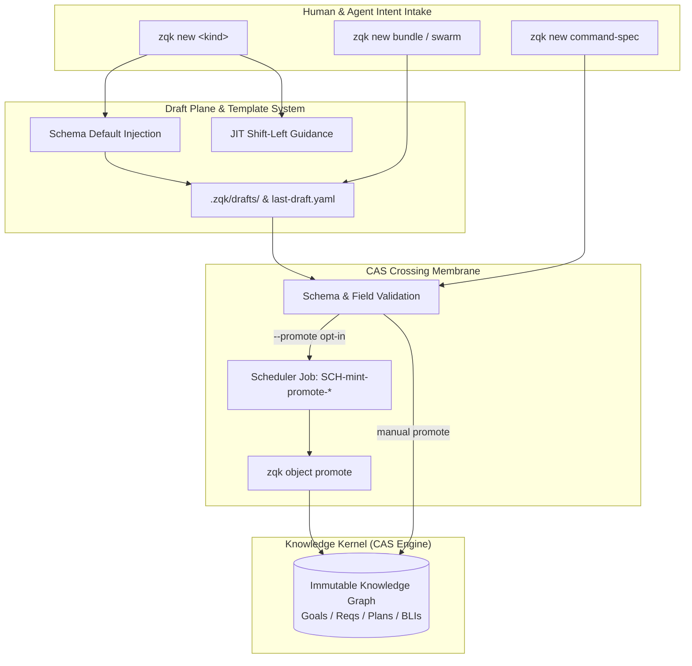

# CLI New Subsystem Architecture & Operational Guide

## Executive Overview

The **CLI New Subsystem (`zqk new`)** serves as the canonical shift-left entry point for intent intake, object drafting, and CLI DNA authoring across the ZQK Knowledge Kernel. Unlike ephemeral, prompt-promiscuous chat harnesses where requirements, constraints, and architecture drift in transient LLM memory buffers, ZQK objectifies all engineering intent into persistent, verifiable graph entities from moment zero.

The `zqk new` subsystem bridges human and agentic intent with the Knowledge Kernel's Content-Addressable Storage (CAS) membrane through:
1. **First-Class Ontological Command Taxonomy**: Ergonomic, shorthand CLI verbs (`zqk new goal`, `zqk new req`, `zqk new bli`, `zqk new plan`) enforcing the 5-layer cascade.
2. **Draft Plane Architecture**: Safe isolation of in-progress drafts in `.zqk/drafts/` and transient draft-plane states before immutable CAS sealing.
3. **Just-In-Time (JIT) Ontological Guidance**: Built-in AST and schema invariants rendered directly in interactive terminal sessions to prevent scope-stacking and architectural anti-patterns.
4. **CLI DNA Scaffolding (`command-spec`)**: Automated introspection and generation of declarative command specifications conforming to JSON schemas.
5. **Background Promotion Pipeline**: One-time scheduler lifecycle integration (`enqueueMintPromoteJob`) enabling seamless transition from draft to canonical CAS.



---

## 1. Command Taxonomy & Shorthand Conventions

The `zqk new` subsystem implements a hierarchical command taxonomy designed for maximum discovery, ergonomic terminal interaction, and multi-agent automation.

### 1.1 Root Command & Discovery

Executing `zqk new --help` displays the full taxonomy of draftable entities and command generators:

```bash
zqk new [command]
```

The root command acts as a gateway to:
- **Generic Object Drafting**: `zqk new object <kind>`
- **Convenience Kind Verbs**: `zqk new goal`, `zqk new req`, `zqk new bli`, `zqk new plan`, etc.
- **DNA Scaffolding**: `zqk new command-spec <command-path>`
- **Scenario Bundles**: `zqk new bundle`
- **Swarm Packages**: `zqk new swarm`
- **Ontology Extension**: `zqk new kind-spec <ontology>`

### 1.2 First-Class Kind Convenience Commands

To eliminate friction during high-velocity development, `zqk new` registers top-level convenience verbs for all core ontological entities:

| Command | Aliases | Ontological Purpose | Example Invocation |
| :--- | :--- | :--- | :--- |
| `zqk new goal` | — | Timeless strategic compass theme | `zqk new goal --title "Enterprise Observability"` |
| `zqk new vision` | `vis` | High-level foundational vision | `zqk new vision --title "Zero-Downtime Migration"` |
| `zqk new mission` | `mis` | Core organizational mission | `zqk new mission --title "Sub-15ms Index Latency"` |
| `zqk new roadmap` | — | Multi-horizon strategic roadmap | `zqk new roadmap --title "H2 Performance Runway"` |
| `zqk new workstream` | `ws` | Dedicated domain track | `zqk new workstream --title "Storage Optimization"` |
| `zqk new epic` | — | Thematic multi-plan container | `zqk new epic --title "Storage Engine Refactor"` |
| `zqk new plan` | `pri`, `priority_plan` | 1-cycle time-bounded execution batch | `zqk new plan --title "Cycle 110: Storage Sharding"` |
| `zqk new req` | `requirement` | Timeless functional whole-feature contract | `zqk new req --title "Append-Only WAL Sharding"` |
| `zqk new crit` | `criteria` | Three-fold verification contract | `zqk new crit --title "Static Floor: Sync Latency &lt; 2ms"` |
| `zqk new tc` | `test_case` | 1:1 Unified test suite wrapper | `zqk new tc --title "Verify WAL Sharding Contracts"` |
| `zqk new bli` | `backlog_item` | Atomic unit of effort (1–3 criteria) | `zqk new bli --title "Implement Shard Router Hash"` |
| `zqk new mil` | `milestone` | Chronological boundary anchor | `zqk new mil --title "v2.4 Production Candidate"` |
| `zqk new techdebt` | `td`, `technical_debt` | Non-functional behavior plane entry point | `zqk new techdebt --title "Eliminate Memory Leak in WAL"` |
| `zqk new policy` | — | Verification gate and architectural rule | `zqk new policy --title "POL-STORAGE-SHARD-001"` |
| `zqk new que` | `question` | Architectural inquiry probe | `zqk new que --title "Consensus Protocol Selection"` |
| `zqk new dec` | `decision` | Architectural Decision Record (ADR) | `zqk new dec --title "Adopt Raft-based Lease State"` |

---

## 2. Draft Plane Architecture & Storage Invariants

The ZQK Knowledge Kernel enforces a strict boundary between mutable draft templates and immutable CAS records.

### 2.1 The Two Draft Planes

The system maintains two distinct drafting mechanisms:

1. **File-Based Template Drafting (`.zqk/drafts/`)**:
   - Generated when using `zqk new bundle`, `zqk new swarm`, `zqk new kind-spec`, or `writeDraft`.
   - Files follow the deterministic naming format: `.zqk/drafts/<sanitized-name>-<timestamp>.yaml`.
   - The file `.zqk/drafts/last-draft.yaml` records the pointer to the most recently generated template, including scope, kind, and absolute filesystem path.
   - Allows human developers or autonomous agents to inspect, fill out complex YAML properties, and review prior to committing.

2. **Kernel Draft-Plane State (`objects.FieldKeyStatus = "draft"`)**:
   - Generated when invoking `zqk new object <kind>` or convenience verbs (`zqk new bli`).
   - The entity is assigned a canonical identifier (e.g. `BLI-DEMO-001`), initialized with standard metadata, and stored with draft status.
   - Isolated from release reports and milestone completion metrics until verified and promoted.

### 2.2 Template Materialization via `writeDraft`

The internal engine function `writeDraft` provides resilient destination routing:
- **Default Pathing**: Writes into `.zqk/drafts/`, sanitizing base names (replacing `/`, `\`, `:` with `-`) and appending UTC log-rotate timestamps.
- **Stdout Streaming**: Specifying `--output -` directly writes the generated YAML payload to standard output, enabling Unix pipe integration (e.g. `zqk new bundle -o - | yq .`).
- **Targeted Output**: Passing `--output path/to/file.yaml` ensures secure file materialization at arbitrary filesystem locations.

### 2.3 Auto-Trace Pipeline Generation

When minting timeless requirement feature contracts (`zqk new req`), the subsystem supports optional auto-trace pipeline generation:

- **Traceability Linkage**: Automatically binds the newly minted requirement to downstream criteria and test cases via `workflow.ApplyGeneratedTracePipelineFromCmd(cmd, id)`.
- **Fail-Closed Verification**: If trace pipeline generation fails, the command fails closed with an error (`minted <id> but trace pipeline failed; promote will fail closed without traceability links`).
- **Opt-In Discipline**: Auto-trace pipeline is disabled by default to prevent ghost criteria clutter and graph pollution. It is explicitly opted into via `--trace-pipeline` or subsequent workflow execution (`zqk workflow gen-trace-pipeline <REQ-id>`), and can be explicitly bypassed with `--skip-trace-pipeline`.
- **Test Isolation Protection**: Under test execution environments, auto-trace pipeline is automatically bypassed to keep unit test suites fast, isolated, and deterministic.

---

## 3. Just-In-Time (JIT) Ontological Guidance

To prevent architectural entropy, `zqk new` inspects invocation context and automatically outputs cyan-highlighted guidance tips when invoked in interactive human/text console modes:

> [!NOTE]
> JIT guidance is automatically silenced when structured output formats are requested (`--format json`, `--format yaml`, `--format jsonrpc`, `--format stream`) to prevent stdout/stderr contamination for downstream tools.

### Guidance Rules by Entity Kind

- **Goals (`KindGoal`)**:
  > 💡 *Shift-Left Tip*: Goals represent timeless strategic compass themes (outside of sprint/time boundaries) and decompose into 3–5 requirements (child requirement.goal_refs). Goals do NOT declare criteria_refs directly.

- **Requirements (`KindRequirement`)**:
  > 💡 *Shift-Left Tip*: Requirements are timeless functional contracts (never bound to time or priority plans). They own criteria_refs ($\ge 3$ satisfying three-fold proof: static invariant, operational proof, negative boundary) verified 1:1 by a test_case.

- **Milestones (`KindMilestone`)**:
  > 💡 *Shift-Left Tip*: Milestones introduce chronological and time constraints — acting as time-bounded subgoals across delivered reality that priority plans aim toward.

- **Priority Plans (`KindPriorityPlan`)**:
  > 💡 *Shift-Left Tip*: Priority plans bound exactly 1 cycle of work (sprint/kanban batch, 2–5 BLIs aiming toward a milestone). Plans scope-lock upon entering in_progress to prevent drift.

- **Backlog Items (`KindBacklogItem`)**:
  > 💡 *Shift-Left Tip*: Backlog items are atomic units of effort satisfying 1–3 criteria. Decompose work across 2–5 BLIs per plan to avoid scope-stacking.

- **Epics (`KindEpic`)**:
  > 💡 *Shift-Left Tip*: Epics give human-legible semantic shape to the overall initiative, grouping 2–5+ priority plans under a recognizable umbrella. Permissive by default (plans can be added in progress unless execution_locked=true).

- **Technical Debt (`KindTechnicalDebt`)**:
  > 💡 *Shift-Left Tip*: Technical debt provides a tactical entry point into the non-functional behavior plane (code smells, test flakes, performance hotpaths, bug rollups). Rollups of tech debt items tell the anti-pattern story to institute lasting architectural and coding best practices.

---

## 4. CAS Membrane Crossing Rules & Promote Invariants

Before any entity can cross from the draft plane into permanent, immutable CAS storage, the CAS membrane evaluates strict validation rules:

### 4.1 Membrane Validation Gates

1. **Title and Body Requirement**:
   - Every object requires a non-empty `title`.
   - Atomic effort units (`backlog_item`, `technical_debt`) require non-empty descriptions before crossing into CAS storage.
2. **Schema Invariant Checking**:
   - Entities must conform to JSON schemas registered under `.zqk/schemas/`.
   - Prohibited metadata mutations (such as manual alteration of system-computed provenance fields `updated_at` or `updated_by`) are blocked.
3. **Traceability Proofs**:
   - Requirements must link to parent goals and declare verification criteria.
   - Backlog items must map to active Priority Plans and satisfy explicit criteria references.

### 4.2 Background Promotion via Scheduler (`--promote`)

Passing the `--promote` flag triggers an asynchronous, fail-closed promote job enqueued directly with the ZQK Scheduler:

```bash
zqk new bli --title "Implement Router Hash" --description "Consistent hash ring for shard router" --promote
```

Under the hood:
1. `zqk new` creates the draft object in storage.
2. `enqueueMintPromoteJob(projectRoot, objectID)` builds a scheduler job entity (`SCH-mint-promote-<id>`).
3. Job configuration:
   - **Job Type**: `run_wrapper`
   - **Command**: `zqk object promote <id>`
   - **Execution Mode**: `one_time`
   - **Category**: `lifecycle`
   - **Max Runtime**: 600 seconds
   - **Retry Count**: 1 (15-second delay)
4. If an existing promote job is found for the same object, `enqueueMintPromoteJob` performs an idempotent update of execution parameters without mutating restricted system provenance fields.
5. A trigger request is dispatched to the background scheduler daemon queue.

---

## 5. CLI DNA Command Scaffolding (`zqk new command-spec`)

The `zqk new command-spec` tool provides declarative, spec-driven authoring of new CLI commands. Rather than writing repetitive Cobra boilerplate by hand, developers define high-level YAML specifications that code generators translate into type-safe Go AST command builders.

### 5.1 Command Line DNA Architecture


### 5.2 Scaffolding Flags & Options

```bash
zqk new command-spec <command-path> [flags]
```

- `--short <text>`: Short one-line summary (required unless `--from-cmd` is used).
- `--description <text>`: Detailed command description and long help.
- `--from-cmd`: Introspect an existing registered Cobra command in the binary, harvesting flags, argument specifications, aliases, and examples.
- `--aliases <list>`: Comma-separated list of short command aliases (e.g. `er,el-run`).
- `--args-type <type>`: Argument validation rules (`no_args`, `exact`, `minimum`, `maximum`, `range`).
- `--args-count <n>`, `--args-min <n>`, `--args-max <n>`: Numeric limits for argument validation.
- `--flag <def>`: Custom flag definition in `name:type:default:description[:shorthand]` format.
- `--example <def>`: Usage examples in `comment:command` format.
- `--run-e <func>`: Name of the Go execution function (defaults to `runPascalCaseName`).
- `--async`: Wrap execution function with `cli.BindAsyncProgress` for background progress bars.
- `--force`: Overwrite existing spec file on disk.

### 5.3 Introspection from Registered Tree (`--from-cmd`)

When migrating existing handcrafted commands to declarative CLI DNA specifications, `--from-cmd` automatically extracts metadata:
- Preserves command usage patterns (`<target>` or `[items...]`).
- Filters out standard common flags (`--format`, `--output`, `--verbose`, `--help`).
- Translates Cobra flag types (`bool`, `int`, `stringSlice`, `duration`) into canonical spec types.
- Parses comments and invocations from existing `Example` strings.

---

## 6. Output Formats & Composability

The `zqk new` command suite conforms to the Universal ZQK CLI Ergonomics contract, supporting multiple standard presentation formats:

| Format Flag | Output Characteristics | Typical Use Case |
| :--- | :--- | :--- |
| *(default human)* | Formatted key-value pairs with colorized JIT tips and status alerts | Interactive developer terminal |
| `--format json` | Structured JSON object receipt with machine-readable metadata | Automated script ingestion, CI/CD |
| `--format yaml` | Clean YAML payload | GitOps pipelines, configuration files |
| `--format stream` | Line-delimited event stream | Long-running orchestrations and daemons |

### Example JSON Receipt (`zqk new bli --format json`)

```json
{
  "id": "BLI-DEMO-001",
  "kind": "backlog_item",
  "status": "draft",
  "title": "Implement Consistent Hash Ring",
  "description": "Consistent hash ring for shard router",
  "created_at": "2026-10-20T19:45:00Z",
  "created_by": "USR-DEV-001",
  "promote_enqueued": true,
  "job_id": "SCH-mint-promote-BLI-DEMO-001"
}
```

---

## 7. Verification & Operational Reference

### Quick Reference Workflows

```bash
# 1. Mint a strategic goal outside of time constraints
zqk new goal --title "Enterprise Storage Resilience"

# 2. Mint a whole-feature functional contract with opt-in trace pipeline
zqk new req --title "Multi-Region Read Replicas" --trace-pipeline

# 3. Mint a 1-cycle priority plan aiming toward a release milestone
zqk new plan --title "Cycle 112: Read Replica Sharding"

# 4. Mint an atomic unit of effort with immediate promote enqueuing
zqk new bli --title "Add Shard Consensus Ping" \
            --description "Periodic health ping for active consensus shards" \
            --promote

# 5. Scaffold declarative CLI command specification from existing command
zqk new command-spec storage/sync-status --from-cmd

# 6. Draft a benchmark scenario bundle directly to stdout
zqk new bundle --name storage-perf --output - | yq .
```

### Verification & Statement Coverage Invariant

All components of the CLI New subsystem are verified against strict continuous quality invariants:

- **Statement Test Coverage Floor ($\ge 85.0\%$)**: The package `cmd/zqk/new` enforces a strict statement test coverage floor of $\ge 85.0\%$ across all command builders (`NewCmd`, `NewObjectCmd`, `NewCommandSpecCmd`, `NewBundleCmd`, `NewSwarmCmd`), flag processors, output writers, and promotion enqueuers. Coverage is continuously measured and verified via `go test -v -timeout 30s -cover ./cmd/zqk/new`.
- **AST Quality Invariant — Zero Swallowed Errors**: Error returns from all system and standard library invocations must be checked fail-closed (`if err != nil` or `t.Fatalf`). Discarding error values using the blank identifier (`_ = ...`) is prohibited by static analysis check-valves (`zqk-vet`).
- **AST Function Complexity Bounds**: All production and unit test functions adhere to strict line count boundaries (under 100 lines per function, targeting under 80 lines) to maintain modularity, readability, and clean test separation.
- **CAS Non-Contamination Invariant**: Zero manual mutation of restricted system provenance fields (`created_at`, `created_by`, `updated_at`, `updated_by`). Provenance fields are system-computed; attempts to manually supply or overwrite them during object updates fail closed.
- **Project Root Test Isolation**: Test suites isolate their execution environments using temporary project roots bootstrapped via test environment helpers, guaranteeing hermetic verification with zero leakage into the host workspace.
