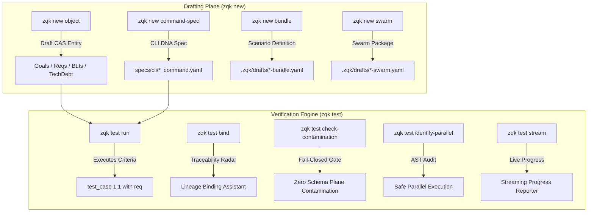

# CLI Object Drafting & Test Verification Engine Guide

## Executive Overview

The ZQK Knowledge Kernel pairs two critical capabilities at opposite ends of the delivery lifecycle:
1. **CLI Object Drafting Plane (`zqk new`)**: Shift-left entry point for authoring persistent kernel entities, CLI DNA command specifications, scenario bundles, and swarm packages with just-in-time ontological guidance.
2. **Universal Test Verification Engine (`zqk test`)**: Unified dynamic test runner, lineage binding assistant, schema contamination guard, parallel test auditor, and real-time streaming progress reporter.

Together, these subsystems guarantee that intent entering the Knowledge Kernel is correctly structured from moment zero, and that implementation exiting the kernel is continuously verified against immutable criteria contracts without schema plane contamination.

---

## 1. CLI Object Drafting Plane (`zqk new`)

The `zqk new` command suite provides the primary user- and agent-facing mechanism to draft kernel objects, CLI DNA specifications, and operational assets.



### Commands & Capabilities

#### 1.1 `zqk new object <kind>`
Mints a new draft-plane object into CAS storage with automatic JIT guidance:
- **Usage**: `zqk new object <kind> [--title <title>] [--file <path>] [--content <text>]`
- **Supported Kinds**: `goal`, `requirement`, `milestone`, `priority_plan`, `backlog_item`, `technical_debt`, `epic`, `test_case`, `scenario`, etc.
- **JIT Shift-Left Guidance**: When invoked interactively (in human or table format), `zqk new object` prints context-sensitive ontological tips:
  - **Goals**: Outside sprint/time boundaries; decompose into 3–5 requirements (never direct criteria refs).
  - **Requirements**: Timeless functional contracts owning $\ge 3$ criteria (static invariant, operational proof, negative boundary).
  - **Milestones**: Chronological boundary anchors across delivered reality.
  - **Priority Plans**: 1-cycle work batches (2–5 BLIs) scope-locked upon starting.
  - **Backlog Items**: Atomic units of effort satisfying 1–3 criteria.

#### 1.2 `zqk new command-spec <command-path>`
Generates spec-driven CLI DNA yaml files:
- **Usage**: `zqk new command-spec <path> --short "<summary>" [--from-cmd] [--flags ...]`
- **Capabilities**:
  - Introspects existing Cobra commands to harvest flags, aliases, arguments, and examples.
  - Formats output schema conforming to `.zqk/cli/specs/schemas/command_spec.schema.json`.
  - Produces deterministic, build-safe spec trees for `zqk system generate-command-builders`.

#### 1.3 `zqk new bundle` & `zqk new swarm`
- **`zqk new bundle`**: Drafts end-to-end scenario bundles for integration and benchmark suites (`.zqk/drafts/bundle-*.yaml`).
- **`zqk new swarm`**: Generates swarm package manifests defining cellular archetypes, persona seating, and token budgets (`.zqk/drafts/swarm-*.yaml`).

---

## 2. Universal Test Verification Engine (`zqk test`)

The `zqk test` suite executes and audits the verification plane across requirements, test cases, and test suites.

### Commands & Capabilities

#### 2.1 `zqk test run [test_case_ids...]`
Executes test cases and their bound criteria proofs:
- **Usage**: `zqk test run [ids...] [--all] [--dry-run] [--verbose] [--timeout <dur>] [--criteria <crit_ids>]`
- **Key Features**:
  - **Criteria Evaluation**: Executes shell, binary, and AST criteria commands, capturing stdout, stderr, exit codes, and millisecond duration.
  - **Shockwave Ripple Cascade**: Automatically updates test case status upon passing, propagating status transitions to parent requirements (`requirement.status -> complete`).
  - **Dry-Run Mode**: Inspects criteria commands without executing subshell processes.

#### 2.2 `zqk test discover`
Discovers and catalogues test cases, criteria bindings, and suite health across the project:
- **Usage**: `zqk test discover [--format table|json|yaml]`
- **Output**: Reports mapped test cases, associated criteria counts, execution runtimes, and status badges.

#### 2.3 `zqk test bind [test_case_id]`
TPM Lineage Binding Assistant to enforce Definition of Done and full traceability:
- **Usage**:
  - Interactive Assistant: `zqk test bind`
  - Explicit Linkage: `zqk test bind <tc_id> --req <req_id> [--goal <goal_id>] [--bli <bli_id>]`
  - Auto-Repair: `zqk test bind --auto [--dry-run]`
- **Key Features**:
  - Scans active test cases for broken or missing lineage links.
  - Ranks candidate requirements and goals using word overlap and TF-IDF keyword heuristics.
  - Strips legacy fields and enforces clean relational contracts.

#### 2.4 `zqk test check-contamination`
Enforces schema plane immutability during test runs:
- **Usage**: `zqk test check-contamination -- <command...>`
- **Safety Invariant**:
  - Snapshots file states in schema planes (e.g. `.zqk/specs`, `.zqk/process`).
  - Executes the given test command.
  - Detects any modified, created, or deleted schema files.
  - Fail-closed: Exits with non-zero code if test execution contaminated read-only schema planes.

#### 2.5 `zqk test identify-parallel`
Performs static AST inspection of Go test suites to identify parallelization candidates:
- **Usage**: `zqk test identify-parallel [--path <dir>] [--safe-only] [--unsafe-only] [--format json|table]`
- **Audit Levels**:
  - `⚡ [PARALLEL]`: Already declares `t.Parallel()`.
  - `✅ [SAFE]`: Safe candidate for `t.Parallel()` (no global mutations, no `os.Setenv`).
  - `❌ [UNSAFE]`: Unsafe (contains `os.Setenv`, `t.Setenv`, global lock acquisitions, or directory mutations).
  - `⚠️ [REVIEW]`: Complex or ambiguous calls requiring human review.

#### 2.6 `zqk test stream`
Streams test execution progress in real-time with live progress counters and ANSI updates:
- **Usage**: `zqk test stream [package_pattern] [--parallel <n>] [--test-timeout <dur>]`
- **Output**: Streams running test count, pass/fail counts, and execution duration without buffering.

---

## 3. Operator Verification Runbook

### Verifying CLI Object Drafting
```bash
# 1. Draft a new technical debt item
zqk new object technical_debt --title "Refactor test runner helper duplication"

# 2. Draft a new command spec
zqk new command-spec custom/worker --short "Run custom worker routine"

# 3. Inspect generated draft in CAS
zqk object inspect <minted-id>
```

### Verifying Test Execution & Lineage
```bash
# 1. Inspect test case readiness and lineage
zqk test bind

# 2. Execute test cases in dry-run mode
zqk test run --all --dry-run

# 3. Check for schema plane contamination
zqk test check-contamination -- go test ./cmd/zqk/new/...

# 4. Audit parallel test safety
zqk test identify-parallel --path ./cmd/zqk/test --safe-only
```
