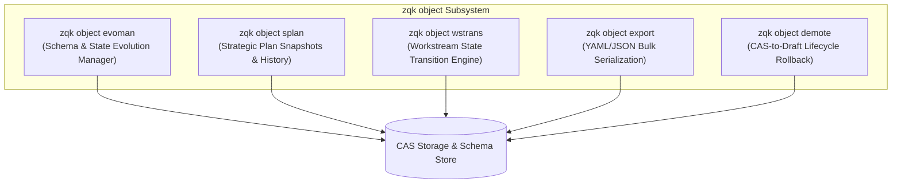

# CLI Object Subsystem and Command Taxonomy Guide

## 1. Overview and Relational Architecture

The `zqk object` command subsystem provides administrative, reflective, and lifecycle manipulation facilities across all persistent entities within the ZQK Knowledge Kernel.

Unlike ephemeral chat contexts or unstructured scratchpads, the ZQK Knowledge Kernel models all software engineering intent as a strongly typed, content-addressed directed acyclic graph (DAG). The `zqk object` family contains high-level inspection, migration, lifecycle transition, and disaster recovery commands that govern this graph.



---

## 2. Command Family Taxonomy

| Subcommand | Scope & Purpose | Primary Operations |
| :--- | :--- | :--- |
| `zqk object evoman` | Evolution Manager | Schema version verification, evolutionary status inspection, migration resolution, and revert capabilities. |
| `zqk object splan` | Strategic Plan Engine | Inspect strategic plan definitions, query temporal audit history, and capture immutable timeline snapshots. |
| `zqk object wstrans` | Workstream Transitions | Inspect active workstream states, validate proposed state transitions against policy invariants, and review transition audit trails. |
| `zqk object export` | Bulk Export Engine | Filter and serialize objects of any registered kind into YAML or JSON streams, supporting file output (`--out`) or stdout (`-`). |
| `zqk object demote` | Disaster Recovery Rollback | Demote committed CAS objects back to the Draft Plane (`.zqk/drafts/`) when accidental promotions or schema misconfigurations occur. |

---

## 3. Detailed Command Guides and Invariants

### 3.1 Evolution Manager (`zqk object evoman`)
The Evolution Manager ensures that on-disk object topologies remain compatible across kernel schema releases.

- **List Evolution Records:**
  ```bash
  zqk object evoman list
  ```
  Lists all recognized evolutionary steps and their status (`applied`, `pending`, or `skipped`).

- **Show Evolution Object:**
  ```bash
  zqk object evoman show [id]
  ```
  Displays the singleton or first evolution management record, or inspects a specific evolution object by ID.

---

### 3.2 Strategic Plan Manager (`zqk object splan`)
Strategic Plans (`strategic_plan`) orchestrate long-term roadmaps across quarters and major operational milestones.

- **List Strategic Plans:**
  ```bash
  zqk object splan list
  ```
  Lists all strategic plan entities currently registered in CAS or local draft stores.

- **Show Strategic Plan:**
  ```bash
  zqk object splan show [id]
  ```
  Displays the primary strategic plan or target ID, displaying high-level goals, target milestones, and workstream allocations.

---

### 3.3 Workstream Transitions (`zqk object wstrans`)
Workstreams represent continuous tracks of engineering activity (e.g. `WS-STARTER-COMMUNITY-001`). State transitions are gated by strict validation rules.

- **List Workstream Transitions:**
  ```bash
  zqk object wstrans list
  ```
  Lists all workstream transition audit records and lifecycle triggers.

- **Show Workstream Transition:**
  ```bash
  zqk object wstrans show [id]
  ```
  Displays the active or specified workstream transition object, including trigger reasons and source/destination states.

---

### 3.4 Bulk Export (`zqk object export`)
The export engine extracts objects directly from CAS storage matching optional query and flag filters.

- **Standard Export to File:**
  ```bash
  zqk object export backlog_item --out items.yaml
  ```
- **Filtered Export in JSON Format:**
  ```bash
  zqk object export backlog_item --filter status=planned --format json --out items.json
  ```
- **Streaming to Standard Output:**
  ```bash
  zqk object export backlog_item --out - | jq .
  ```

#### Ergonomic Flag Guarantees:
Both `--out <path>` and the standard CLI common flag `-o, --output <path>` are supported interchangeably. When unspecified or set to `-`, output writes directly to stdout.

---

### 3.5 Demotion & Disaster Recovery (`zqk object demote`)
When an object is prematurely promoted to CAS before fulfilling quality invariants, `demote` safely relocates the object back to the Draft Plane.

- **Demote CAS Object to Draft:**
  ```bash
  zqk object demote <object-id>
  ```
  The kernel removes the object hash from the CAS index, marks the object as a draft in `.zqk/drafts/<kind>/<id>.yaml`, and logs a demotion event in the system audit journal.

- **Guards & Constraints:**
  - Demotion of objects actively depended upon by CAS child objects is prohibited unless cascade demotion is explicitly permitted.
  - Read-only CAS archives cannot be demoted without administrative override flags.

---

## 4. Verification and Done-Gates

Verification for the object management subsystem is codified in `TST-1792077428809684001-039304c2` and satisfies the Three-Fold Proof:

1. **Static Floor Invariant (`CRIT-1792077428809684000-f3224048`):** Statement test coverage in `cmd/zqk/object` elevates to $\ge 80.0\%$ with all subcommands exercising in-process execution paths.
2. **Operational Dynamic Proof (`CRIT-1792077428809685000-703332cd`):** In-process test suite `TestInProcess_SubcommandCoverageElevation` executes commands against live SQLite/CAS stores, validating stdout payloads, YAML/JSON structure, and state transitions.
3. **Negative Boundary & Hygiene Proof (`CRIT-1792077428809686000-8522dd87`):** Commands reject invalid object kinds, malformed filters, unresolvable IDs, and missing positional arguments with informative exit codes and enhanced error guards; complete architectural documentation and guides linked to kernel.
