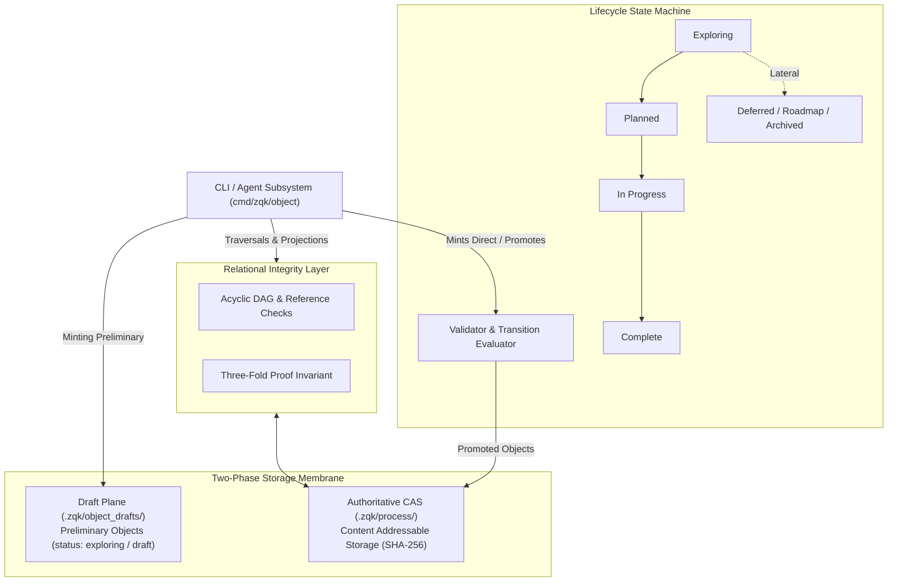

# CLI Object Subsystem Operational Guide

## Overview

The ZQK Object Subsystem (`cmd/zqk/object`) provides the primary command-line interface and programmatic entrypoint for creating, inspecting, updating, traversing, and retiring knowledge graph objects within the **Zen Quantum Kernel**.

Unlike ephemeral chat-based programming harnesses where context, decisions, and criteria are lost across conversation turns, ZQK treats goals, requirements, criteria, test cases, and backlog items as first-class, cryptographically validated graph entities. Every object conforms to a declarative JSON/YAML schema, is stored in Content Addressable Storage (CAS), and transitions across formal lifecycle state machines.

The Object Subsystem operates as the user-facing and agentic boundary over the Knowledge Kernel data plane, enforcing schema integrity, referential invariants, and two-phase transactional isolation.

---

## Subsystem Command Taxonomy

The `zqk object` command hierarchy is partitioned into distinct functional groups: core verbs, relationship traversals, batch import/export, and schema discovery:

| Command | Group | Purpose | Primary Flags & Arguments |
|---|---|---|---|
| `zqk object create <kind>` | Core Verbs | Mints a new kernel object from CLI data or schema file | `--data <json>`, `--file <path>`, `--dry-run`, `--cas`, `--promote` |
| `zqk object get <id>` | Core Verbs | Retrieves an object by ID with projection and overlays | `--format json\|yaml\|table`, `--fields`, `--view` |
| `zqk object list <kind>` | Core Verbs | Lists objects of a specific kind or all kinds | `--filter <expr>`, `--sort-by <field>`, `--group-by <field>`, `--count` |
| `zqk object update <id>` | Core Verbs | Applies granular mutations and optimistic locking | `--field <k=v>`, `--add-ref`, `--remove-ref`, `--expected-updated-at` |
| `zqk object delete <id>` | Core Verbs | Deletes objects with referential integrity check-valves | `--unlink-references`, `--cascade`, `--dry-run`, `--reason-code` |
| `zqk object promote <id>` | Core Verbs | Advances object status forward along lifecycle edges | `--dry-run`, `--skip-hooks`, `--relaxed` |
| `zqk object demote <id>` | Core Verbs | Retreats object status backward to earlier stages | None |
| `zqk object park <id>` | Core Verbs | Lateral sequencing exit along authorized transitions | `--to deferred\|roadmap\|archived` |
| `zqk object move <id>` | Core Verbs | Reorganizes object across kind or namespace boundary | `--kind <target>`, `--update-references`, `--relaxed` |
| `zqk object rename <old> <new>` | Core Verbs | Updates object ID and propagates reference rewrites | `--update-references`, `--dry-run` |
| `zqk object count <kind>` | Core Verbs | Reports count of stored instances by kind or filter | `--filter <expr>`, `--group-by <field>` |
| `zqk object template <kind>` | Core Verbs | Generates schema-compliant skeleton template | `--format json\|yaml`, `--output <path>` |
| `zqk object fields [kind]` | Discovery | Explores field metadata, traits, and registered kinds | `--list-kinds`, `--filterable`, `--sortable`, `--groupable` |
| `zqk object ref <add\|rm\|list>` | Graph | Manages explicit graph relationships between objects | `<source_id> <target_id>`, `--kind <relationship>` |
| `zqk object path <from> <to>` | Graph | Finds shortest directional path between two objects | `<from_id> <to_id>` |
| `zqk object neighbors <id>` | Graph | Queries immediate graph neighbors | `--direction incoming\|outgoing\|both` |
| `zqk object related <id>` | Graph | Discovers connected graph subtrees | `--depth <int>`, `--relationship <type>` |
| `zqk object bulk <op>` | Batch | Executes bulk create, update, get, or delete | `create`, `update`, `get`, `delete`, `--file`, `--ids` |
| `zqk object export <kind>` | Batch | Exports kernel objects to stdout or external file | `-o <path>`, `--format json\|yaml`, `--filter <expr>` |
| `zqk object import` | Batch | Ingests objects from external file with deduplication | `--file <path>`, `--mode create_only\|upsert`, `--dry-run` |
| `zqk object draft <sweep\|promote>` | Shortcuts | Operates on preliminary draft plane objects | `sweep`, `promote`, `--dry-run`, `--force` |

---

## Core Architecture



### 1. Two-Phase Transactional Plane Isolation

To prevent unvetted, work-in-progress, or half-specified ideas from contaminating authoritative system state, ZQK enforces strict transactional plane isolation:

1. **The Draft Plane (`.zqk/object_drafts`)**:
   - Objects minted in preliminary lifecycle statuses (`exploring`, `draft`) initially reside in the isolated draft plane.
   - Draft objects are visible for interactive authoring and refinement, but are ignored by execution schedulers, gate verifiers, and production scoreboards.
   - Batch cleanup and promotion are mediated via `zqk object draft sweep` and `zqk object draft promote`.

2. **The Authoritative CAS Plane (`.zqk/process`)**:
   - Shovel-ready and active objects reside in Content Addressable Storage.
   - Content is indexed by canonical IDs and cryptographically fingerprinted with SHA-256 digests.
   - Direct mutations to authoritative objects trigger Write-Ahead Log (WAL) recording and synchronous index updates.

### 2. Content Addressable Storage (CAS) Membrane

Authoritative storage is organized by ontological kind directories under `.zqk/process/` (e.g., `goals/`, `requirements/`, `criteria/`, `backlog/`, `priority_plans/`).

- **Atomic File Writing**: All updates are written to temporary staging files on the same filesystem and atomically moved into position using POSIX `rename(2)`.
- **Deduplication & Immutability**: Objects carry immutable provenance headers (`id`, `kind`, `created_at`, `created_by`, `schema_version`) that are locked against tampering.
- **Optimistic Concurrency Control**: The CLI supports `--expected-updated-at` flags to guarantee that parallel agent workers never overwrite concurrent updates without detection.

### 3. Relational Graph Validation & Referential Check-Valves

Objects in the knowledge kernel form a strongly typed, directed property graph. The Object Subsystem enforces referential integrity at every mutation point:

- **Ghost Reference Prevention**: Objects cannot be deleted if inbound references exist, unless `--unlink-references` (which strips inbound pointers atomically) or `--cascade` is explicitly provided.
- **Core Kernel Object Break-Glass Guard**: Hard-deleting core entities (`goal`, `requirement`, `criteria`, `priority_plan`) requires a deliberate justification via `--reason-code` containing at least 30 characters, preventing accidental erasure of organizational memory.
- **The Three-Fold Proof**: Requirements must declare at least 3 criteria satisfying:
  1. *Static Floor Invariant*: Architectural and schema floor constraints.
  2. *Operational Dynamic Proof*: Executable unit, functional, or integration test assertion.
  3. *Negative Adversarial Boundary*: Error handling, fuzzing, or boundary rejection check.

---

## Operational Recipes & Command Examples

### 1. Scaffolding and Minting Shovel-Ready Objects

```bash
# Generate a template for a backlog item
zqk object template backlog_item --format yaml > /tmp/item.yaml

# Mint an object directly via inline JSON data
zqk object create backlog_item --data '{
  "id": "BLI-001",
  "title": "Implement Resilient Cache Invalidation",
  "description": "Ensure CAS cache entries are evicted deterministically on object mutation.",
  "problem_statement": "Stale CAS indexes cause transient read misses during rapid multi-agent updates.",
  "acceptance_considerations": "Zero stale read anomalies observed during swarm stress runs.",
  "priority": "high",
  "priority_tier": "P1"
}'

# Validate object creation without persisting (Dry-Run)
zqk object create backlog_item --file /tmp/item.yaml --dry-run
```

### 2. Lifecycle State Progression (Promote, Demote, Park)

```bash
# Advance object status forward through the lifecycle state machine
zqk object promote BLI-001

# Move object to deferred or roadmap status along valid lateral transitions
zqk object park BLI-001 --to deferred

# Retreat object status backward if prerequisites were prematurely declared
zqk object demote BLI-001
```

### 3. Relationship Traversal & Graph Inspection

```bash
# Find directional dependency path between requirement and parent goal
zqk object path REQ-001 GOAL-001

# Inspect immediate inbound and outbound neighbors
zqk object neighbors REQ-001 --direction both

# Traverse related graph objects to depth 2
zqk object related REQ-001 --depth 2

# Link two objects with a typed relationship
zqk object ref add BLI-001 REQ-001
```

### 4. Bulk Operations & Migrations

```bash
# Batch retrieve multiple objects with JSON formatting
zqk object bulk get --ids BLI-001,BLI-002,BLI-003 --format json

# Export a collection of objects matching a filter
zqk object export backlog_item --filter "status=planned" -o /tmp/planned_blis.yaml

# Ingest and validate external items without mutating storage
zqk object import --file /tmp/planned_blis.yaml --dry-run

# Execute atomic bulk delete with automatic reference unlinking
zqk object bulk delete --ids BLI-001,BLI-002 --unlink-references
```

---

## Verification & Statement Coverage Invariant

As part of Cycle 121 governance, the Object Subsystem CLI implementation (`cmd/zqk/object`) enforces a statement test coverage invariant of **$\ge 80.0\%$**.

Unit and integration test suites for this package are implemented in:
- `cmd/zqk/object/object_coverage_elevation_cycle121_test.go`
- `cmd/zqk/object/object_inprocess_comprehensive_test.go`
- `cmd/zqk/object/object_coverage_elevation_test.go`

### Test Suite Execution Guidelines
To prevent long-running integration suites from triggering process timeouts during CI/CD or local agent runs, always execute targeted test runs with explicit package bounds:

```bash
# Execute Cycle 121 test suite
ZQK_ALLOW_FOREGROUND_GO_TEST=1 go test -v -timeout 30s ./cmd/zqk/object -run 'TestCycle121'

# Measure statement coverage
ZQK_ALLOW_FOREGROUND_GO_TEST=1 go test -timeout 30s -coverprofile=coverage.out ./cmd/zqk/object -run 'TestCycle121'
go tool cover -func=coverage.out
```

All test cases adhere to the following invariants:
- **Strict Bounded Execution**: Every test completes within allocated micro-benchmarks ($\le 15\text{s}$ package ceiling).
- **Environment Isolation**: Tests create temporary projects via `testkit.PrepareIsolatedTempProject` and clean up storage handles upon completion.
- **Zero Swallowed Errors**: Error returns are asserted with `require.NoError`, `assert.NoError`, or `assert.Error`.
- **AST Size Ceilings**: Test functions are partitioned into modular helper functions $\le 100$ lines.
