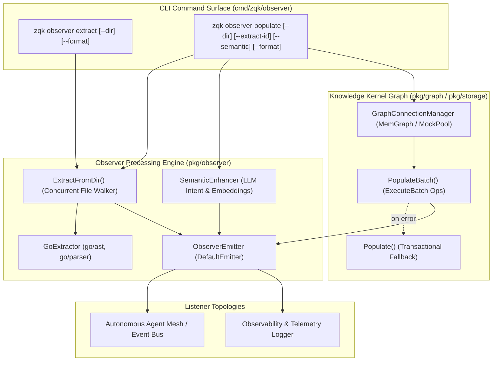
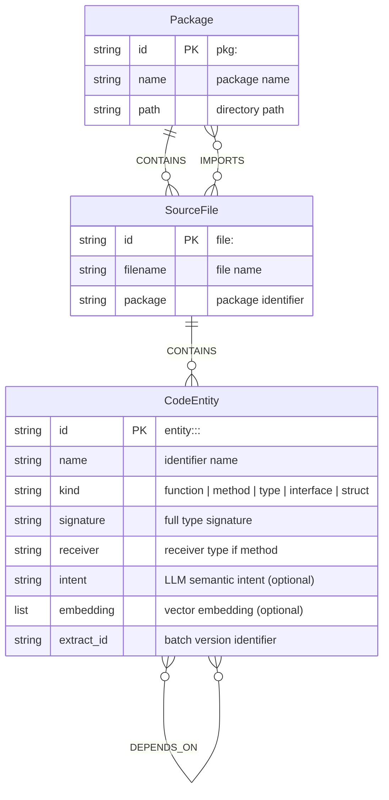
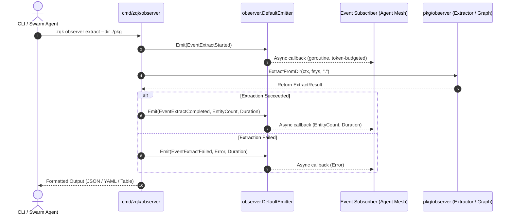

# CLI Observer Subsystem Architectural Guide

## Overview

The **ZQK CLI Observer Subsystem** (`cmd/zqk/observer`) provides automated source code AST extraction, relational graph population, semantic intent synthesis, and event streaming across the Zen Quantum Kernel (ZQK).

In complex codebases, autonomous agents and developer tooling require deep structural awareness of code architecture—understanding not just raw text files, but function signatures, method receivers, interface implementations, inter-package dependencies, and call graphs. The CLI Observer subsystem bridges the physical filesystem and the persistent **Knowledge Kernel Graph**, transforming raw source code into strongly-typed graph nodes and edges with optional LLM-synthesized semantic vector embeddings.

The Observer subsystem delivers three foundational capabilities:
1. **Source Code AST Extraction (`zqk observer extract`)**: Walks directories to parse source files via language-specific AST engines (such as `GoExtractor`), emitting structured code entities (functions, methods, types, interfaces, structs, imports, calls, and dependencies) without requiring an active graph backend.
2. **Knowledge Kernel Graph Population (`zqk observer populate`)**: Ingests extracted AST entities into the graph backend (e.g. MemGraph or MockGraph), minting `CodeEntity`, `SourceFile`, and `Package` nodes and linking them with `CONTAINS`, `METHOD_OF`, `CALLS`, `DEPENDS_ON`, and `IMPORTS` relationships in high-throughput concurrent batches.
3. **Reactive Event Streaming & Listener Topologies**: Emits lifecycle events (`observer.extract_started`, `observer.extract_completed`, `observer.populate_started`, `observer.populate_completed`, `observer.agent_connection_started`) across asynchronous, token-budgeted subscriber topologies to drive autonomous swarm coordination and real-time observability.

---

## Subsystem Architecture & File Layout

The Observer subsystem is cleanly partitioned into the CLI presentation and command routing layer (`cmd/zqk/observer/`) and the core observer extraction and ingestion engine (`pkg/observer/`):

```
cmd/zqk/observer/
├── observer.go                                      # Root 'zqk observer' command builder, 'extract', and 'populate' subcommands
├── observer_test.go                                # Hierarchy and command structural verification
├── observer_extended_test.go                       # Base integration tests (isolated temp project execution, mock graph)
└── observer_coverage_elevation_cycle99_test.go     # Cycle 99 comprehensive unit tests (flags, syntax warnings, event streaming)

pkg/observer/
├── extractor.go                                    # Extractor interface, ExtractResult, concurrent directory walker
├── go_extractor.go                                 # Go standard library AST parser (go/ast, go/parser, go/token)
├── graph_populate.go                               # Graph batch ingestion, node/edge conversion, fallback populator
├── semantic.go                                     # LLM-assisted semantic intent generation & vector embedding enhancement
├── events.go                                       # ObserverEmitter, DefaultEmitter, event types, thread-safe callbacks
├── types.go                                        # CodeEntity, SourceFile, Package node models & relationship constants
└── agent_registration.go                           # Agent connection handler, automatic account provisioning (BLI-OBS-001)
```

---

## Subsystem Interaction Topology

The following diagram illustrates how the CLI Observer subsystem interfaces with local source repositories, the AST extraction engine, optional semantic enrichment, and kernel graph storage:



---

## Command Taxonomy & Ergonomics

The observer command suite is exposed under the `zqk observer` namespace:

### 1. `zqk observer extract`

Extracts code entities directly from source files using language AST engines.

```bash
# Extract entities from the current directory and output as JSON
zqk observer extract --format json

# Extract entities from a specific subpackage with YAML output
zqk observer extract --dir ./pkg/domain --format yaml

# Human-readable table summary of extracted entities
zqk observer extract --dir ./cmd/zqk --format table
```

#### Flags:
- `--dir <path>`: Root directory to scan for source files (defaults to current directory `.`).
- `-f, --format <format>`: Output presentation format (`json`, `yaml`, `table`; defaults to standard CLI output).

### 2. `zqk observer populate`

Extracts entities and writes them to the connected Knowledge Kernel graph backend. Also aliased to `zqk observer ingest-ast`.

```bash
# Ingest current directory AST into Knowledge Kernel graph
zqk observer populate --format json

# Ingest with a specific versioned extract run identifier
zqk observer populate --dir ./pkg/api --extract-id "OBS-RUN-2026-10" --format yaml

# Ingest with LLM-powered semantic intent and vector embeddings
zqk observer populate --dir ./pkg/core --semantic --format json
```

#### Flags:
- `--dir <path>`: Directory to scan for source files (defaults to current directory `.`).
- `--extract-id <id>`: Extract run identifier for graph versioning (defaults to current UTC timestamp in ISO 8601 format).
- `--semantic`: Generates LLM-powered semantic intents and vector embeddings for extracted entities before writing to the graph.
- `-f, --format <format>`: Output presentation format (`json`, `yaml`, `table`).

---

## Knowledge Kernel Graph Relational Schema

When `zqk observer populate` executes, it maps the extracted AST hierarchy into strongly-typed nodes and directional edges in the knowledge graph:



### Relational Edges:
- **`CONTAINS`**: Connects a `Package` to its constituent `SourceFile` nodes, and a `SourceFile` to its defined `CodeEntity` nodes.
- **`METHOD_OF`**: Connects a method `CodeEntity` to its parent struct or interface `CodeEntity`.
- **`CALLS`**: Direct call edge between invoking functions and referenced functions/methods.
- **`DEPENDS_ON`**: Structural dependency edge (e.g. types referenced in struct fields, function parameters, or return types).
- **`IMPORTS`**: Connects a `SourceFile` to external or internal `Package` nodes.

---

## Event Streaming & Listener Topologies

The Observer subsystem incorporates an asynchronous event notification mechanism driven by `observer.ObserverEmitter` (`pkg/observer/events.go`).

### Event Lifecycle

The following sequence details how events are emitted during an extraction or population run:



### Canonical Event Types

| Event Identifier | Description | Emitted On |
| :--- | :--- | :--- |
| `observer.extract_started` | Source AST parsing started | Beginning of directory walk |
| `observer.extract_completed` | AST parsing finished successfully | Extracted entities aggregated |
| `observer.extract_failed` | AST parsing encountered fatal error | Walk or file read error |
| `observer.populate_started` | Graph population started | Prior to batch graph insertion |
| `observer.populate_completed` | Nodes and edges persisted to graph | Batch commit completion |
| `observer.populate_failed` | Graph insertion failed | Connection or query failure |
| `observer.agent_connection_started` | Unregistered agent connected via MCP | Inbound agent handshake |

### Concurrency and Thread Safety
- **Lock Discipline**: Subscriber registration and callback list copies use `concurrency.RunInLockWithLogger` to prevent lock contention and data races.
- **Asynchronous Dispatch**: Subscriber notifications run in dedicated goroutines labeled via `goroutinelabels.NewGoroutine("observer_emitter_subscriber", "notifying observer event subscriber")`, preventing slow listeners from blocking the CLI pipeline.
- **Clean Teardown**: Listeners must respect `context.Context` cancellation to guarantee zero orphaned background tasks.

---

## Operational Scenarios

### Scenario 1: Pre-Execution Codebase Indexing (Swarm Warmup)
Autonomous swarm agents initialize code discovery by indexing fresh worktrees before executing priority plans:

```bash
# 1. Self-discover mission and active plan
zqk workflow whats-next

# 2. Extract AST topology to verify compile-level integrity
zqk observer extract --format json

# 3. Populate kernel graph with versioned batch ID
zqk observer populate --extract-id "OBS-DEMO-001" --format json
```

### Scenario 2: Semantic Intent Discovery for Vector Search
When deeper vector similarity and semantic search are needed across code entities:

```bash
# Ingest with vector embeddings and intent summaries
zqk observer populate --dir ./pkg/storage --semantic --extract-id "OBS-DEMO-002"
```

### Scenario 3: Agent Auto-Registration (MCP Handshake)
When an external agent connects via the Model Context Protocol (MCP):
1. MCP triggers `observer.NotifyAgentConnection(ctx, AgentConnectionInfo{ClientID: "ACC-COMMUNITY-001", ClientName: "CommunityAgent", Version: "1.0"})`.
2. Registered callbacks in the Observer subsystem receive the connection notification and automatically provision the corresponding account in the Knowledge Kernel graph without manual human intervention.

---

## Verification & Quality Assurance

The CLI Observer subsystem is backed by comprehensive unit and integration suites:

```bash
# Execute full observer test suite with statement coverage
go test -v -cover ./cmd/zqk/observer/...

# Run subsystem tests alongside core pkg/observer engine
go test -v -cover ./cmd/zqk/observer/... ./pkg/observer/...

# Verify repository hygiene and AST linting rules
./bin/zqk-vet -suite hygiene,tree_police
```

All test cases adhere strictly to kernel filesystem hygiene (prohibiting direct `os.*` mutations in favor of `fileutil.WriteFile` and `fileutil.MkdirAll`) and concurrency standards (`goroutinelabels.NewGoroutine`).
