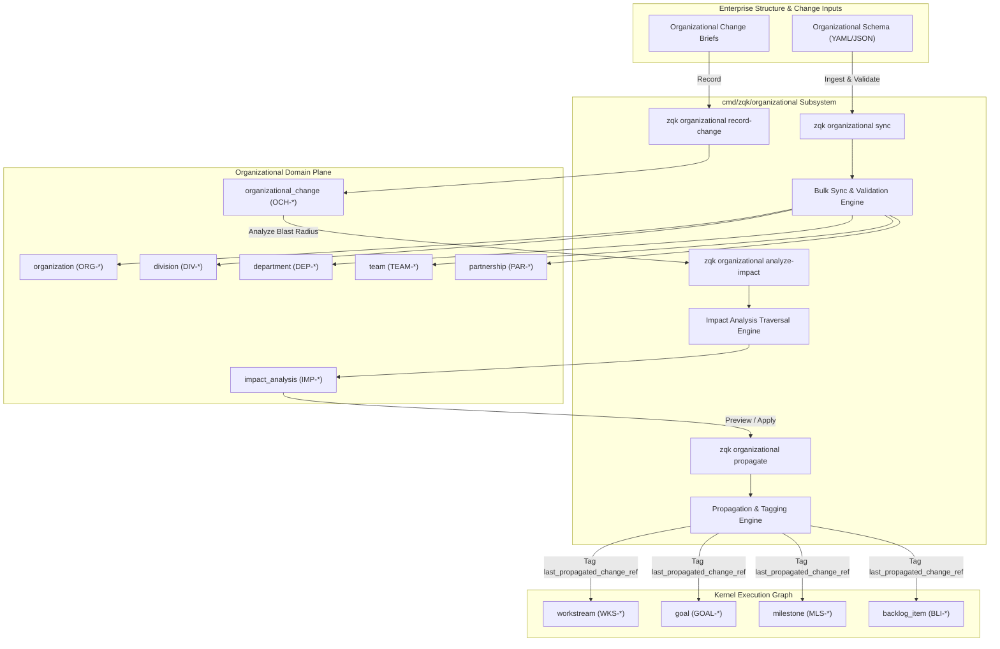

# CLI Organizational Subsystem Architectural Guide

## Overview

The **ZQK Organizational Subsystem** (`cmd/zqk/organizational`) provides first-class, graph-native structural modeling, change recording, impact analysis, and cascade propagation across the **Zen Quantum Kernel (ZQK)**. 

In traditional enterprise software and project management tools, organizational structure lives in an external Human Resources Information System (HRIS) or siloed identity directory (such as LDAP or Okta). As a result, technical program management objects—such as goals, milestones, workstreams, requirements, and backlog items—are frequently orphaned or misassigned when teams reorganize, split, or merge.

ZQK treats organizational topology and organizational changes as versioned, deterministic objects within the persistent Knowledge Kernel. The organizational subsystem bridges human team topology with autonomous execution swarms through four core operational capabilities:

1. **Deterministic Change Recording (`record-change`)**: Captures structural mutations (restructures, team reassignments, division splits) as immutable kernel change events.
2. **Graph-Native Impact Analysis (`analyze-impact`)**: Traverses ontological relationships across workstreams, milestones, goals, and backlog items to compute exact affected blast radiuses.
3. **Guarded Change Propagation (`propagate`)**: Applies controlled updates across downstream kernel objects with two-phase verification, dry-run safety, and cryptographic provenance.
4. **Declarative Structure Sync (`sync`)**: Ingests bulk enterprise structure representations via YAML or JSON with schema validation gates, allowed-kinds filtering, and idempotent upsert semantics.

---

## Subsystem Architecture & Design Principles

### Architectural Topology



### Key Design Principles

1. **Graph-Native Domain Modeling**:
   Organizations, divisions, departments, teams, and partnerships are fully registered ontological kinds governed by specs in `.zqk/process/_internal/specs/` and validated by Content-Addressed Storage (CAS) schemas.
2. **Two-Phase Impact & Propagation Separation**:
   Structural mutations never mutate downstream technical work implicitly. Changes must first produce a verifiable `impact_analysis` artifact. Propagation requires deliberate human or automated confirmation (`--confirm`), preventing unintended graph corruption.
3. **Declarative Synchronization with Schema Check-Valves**:
   Enterprise synchronizations enforce strict schema validation, rejecting unallowed object kinds and guaranteeing atomic or fault-tolerant ingestion via configurable error recovery modes.
4. **Auditability & Cryptographic Provenance**:
   All state updates record `last_propagated_change_ref` attributes, allowing continuous traceability back to the root `organizational_change` record that initiated the transition.

---

## Organizational Domain Model

The subsystem manages seven primary ontological kinds within the `domain:organizational` namespace:

| Kind | Prefix | Description | Key Relationships |
| :--- | :--- | :--- | :--- |
| **`organization`** | `ORG-*` | The root enterprise or sovereign company envelope. | Contains `division_refs`. |
| **`division`** | `DIV-*` | High-level organizational unit (e.g., Engineering, Product, Design). | Linked to parent division or organization; contains `team_refs`. |
| **`department`** | `DEP-*` | Sub-division functional grouping. | Belongs to a division; groups functional teams. |
| **`team`** | `TEAM-*` | Atomic execution team composed of humans and autonomous agents. | Owns workstreams, backlog items, and seats. |
| **`partnership`** | `PAR-*` | Formal collaboration between internal teams or external vendors. | Connects multiple `team_refs` or external partner IDs. |
| **`organizational_change`** | `OCH-*` | Immutable audit record capturing a structural transition event. | Holds `affected_objects` and `impact_analysis_refs`. |
| **`impact_analysis`** | `IMP-*` | Calculated dependency graph report detailing affected kernel objects. | Links 1:1 via `change_ref` to its originating `organizational_change`. |

### Illustrative Object Identifiers

All organizational objects strictly adhere to canonical prefix patterns (`^[A-Z]+-\d{3,}$`):

- Organizations: `ORG-DEMO-001`, `ORG-CORE-001`
- Divisions: `DIV-ENG-001`, `DIV-PROD-001`
- Departments: `DEP-PLATFORM-001`, `DEP-AI-001`
- Teams: `TEAM-KERNEL-001`, `TEAM-FOUNDATION-001`
- Partnerships: `PAR-ALLIANCE-001`
- Organizational Changes: `OCH-001`, `OCH-002`
- Impact Analyses: `IMP-001`, `IMP-002`

---

## Command Taxonomy & CLI Invocations

The command group is registered under `zqk organizational`:

```bash
zqk organizational [subcommand] [flags]
```

### Available Subcommands

```
  analyze-impact   Analyze impact of organizational changes on kernel objects
  propagate        Propagate organizational changes to affected objects
  record-change    Record an organizational change in the knowledge kernel
  sync             Sync organizational structure from YAML or JSON files
```

---

### 1. `zqk organizational record-change`

Records a structural change event in the Knowledge Kernel.

#### Flags

- `--id` *(required)*: Unique identifier for the organizational change (e.g., `OCH-001`).
- `--change-type` *(required)*: Semantic type of change (`division_restructure`, `team_reassignment`, `split`, `merge`, `lead_transition`).
- `--title`: Brief human-readable title. Defaults to `--change-type`.
- `--description`: Detailed architectural justification. Defaults to `--title`.
- `--affected-objects`: Path to a YAML or JSON file explicitly detailing affected entities.
- `--change-date`: RFC3339 timestamp of the change. Defaults to current UTC time.
- `--dry-run`: Validates input and logs simulated creation without persisting to storage.

#### Example Invocations

```bash
# Record an engineering restructure with dry-run verification
zqk organizational record-change \
  --id OCH-001 \
  --change-type division_restructure \
  --title "Engineering Platform Realignment" \
  --dry-run

# Record a team reassignment referencing an affected objects payload
zqk organizational record-change \
  --id OCH-002 \
  --change-type team_reassignment \
  --title "Reassign Core Team to Platform Division" \
  --description "Migrating Core Infrastructure team to Division Platform" \
  --affected-objects /tmp/affected_teams.json
```

---

### 2. `zqk organizational analyze-impact`

Executes graph traversal across the Knowledge Kernel to compute the full blast radius of an organizational change.

#### Traversal & Cascade Engine

When `analyze-impact` runs, the analyzer inspects the target `organizational_change`:
1. Extracts `change_type` and explicitly defined `affected_objects`.
2. Inspects team and division memberships for downstream dependencies.
3. Traverses active technical program management entities linked to those units:
   - **Workstreams (`workstream`)**: Active streams aligned with the affected team or division.
   - **Goals (`goal`)**: High-level strategic objectives owned by affected units.
   - **Milestones (`milestone`)**: Time-bounded deliverables scheduled under affected workstreams.
   - **Backlog Items (`backlog_item`)**: In-flight or unassigned backlog units mapped to affected teams.
4. Generates an `impact_analysis` object (`IMP-*`) storing the computed mappings in `affected_objects`.
5. Links the resulting impact report back to the `organizational_change` record via `impact_analysis_refs`.

#### Flags

- `--change` *(required)*: ID of the `organizational_change` to analyze (e.g., `OCH-001`).

#### Example Output

```bash
$ zqk organizational analyze-impact --change OCH-001
Impact analysis created: IMP-001
Change: OCH-001 (division_restructure)
Affected object types: 4
  - workstreams: 2 objects
  - goals: 3 objects
  - milestones: 4 objects
  - backlog_items: 12 objects
```

---

### 3. `zqk organizational propagate`

Propagates the findings of an impact analysis across downstream kernel entities.

#### Propagation Lifecycle

Propagation follows a strict three-state safety model:

1. **Default Preview Mode**:
   Running `zqk organizational propagate --change OCH-001` resolves the active impact analysis and outputs a summary of affected entities, prompting the operator for confirmation.
2. **Explicit Dry-Run Mode**:
   Running `zqk organizational propagate --change OCH-001 --dry-run` performs a full simulated execution without updating objects in CAS storage.
3. **Confirmed Execution**:
   Running `zqk organizational propagate --change OCH-001 --confirm` updates each affected object in storage, writing the `last_propagated_change_ref` attribute.

#### Flags

- `--change` *(required)*: Organizational change object ID (`OCH-*`).
- `--impact-analysis`: Specific impact analysis object ID (`IMP-*`). If omitted, automatically resolves the latest analysis from references, storage, or draft plane.
- `--dry-run`: Preview propagation without modifying objects in storage.
- `--confirm`: Confirms and applies propagation updates.

#### Example Invocations

```bash
# 1. Preview affected entities
zqk organizational propagate --change OCH-001

# 2. Preview dry-run
zqk organizational propagate --change OCH-001 --dry-run

# 3. Confirm and apply propagation updates
zqk organizational propagate --change OCH-001 --confirm
```

---

### 4. `zqk organizational sync`

Performs high-throughput, declarative ingestion of complete organizational structures from external files.

#### Allowed Kinds Whitelist

For security and domain boundary enforcement, `zqk organizational sync` enforces a strict whitelist of permitted object kinds:
- `organization`
- `division`
- `department`
- `team`
- `partnership`
- `organizational_change`

Any object kind outside this whitelist (e.g., attempting to sync `backlog_item` or `policy` through the organizational sync command) is intercepted and rejected by validation check-valves.

#### Flags

- `--file` *(required)*: Path to YAML or JSON file containing organizational definitions.
- `--input-format`: Format of input data (`yaml` or `json`). Defaults to `yaml`.
- `--mode`: Ingestion mode:
  - `upsert` *(default)*: Creates non-existent objects and updates existing objects.
  - `create_only`: Fails if any object already exists in storage.
- `--dry-run`: Validates file schema and integrity without writing to storage.
- `--continue-on-error`: Continues processing subsequent records when individual object errors occur.

#### Example Invocations

```bash
# Dry-run validation of corporate org structure
zqk organizational sync --file org_structure.yaml --dry-run

# Bulk upsert with error resilience
zqk organizational sync --file org_structure.yaml --mode upsert --continue-on-error

# Ingestion from JSON manifest
zqk organizational sync --file org_structure.json --input-format json --mode create_only
```

---

## Security Model, Audit Trails & CAS Boundaries

### Security Context & Permissions

All CLI commands in the organizational subsystem operate within the ZQK `SecurityContext` pipeline:
- **System Authority**: Administrative bulk sync operations require `SystemSecurityContext` or equivalent administrative capabilities.
- **Access Control**: Objects conform to public or confidential access profiles defined in their respective YAML schema specifications.
- **Actor Attribution**: When changes and propagations are applied, CAS metadata captures the executing agent or operator ID in `created_by` and `updated_by`.

### CAS Storage Membrane & Draft Plane

1. **Draft Plane Preliminary Isolation**:
   When organizational changes and impact analyses are initially staged, preliminary drafts can reside on the mutable draft plane (`.zqk/object_drafts/`).
2. **CAS Immutability & Content Addressing**:
   Once validated and promoted, objects are immutably persisted in CAS storage (`.zqk/process/`). Subsequent changes require new versioned transactions.
3. **Reference Validation Check-Valves**:
   References such as `division_refs`, `team_refs`, and `change_ref` are validated against the live CAS index to guarantee relational integrity across the graph.

---

## Best Practices & Operational Runbook

### Slicing & Evolution Guidelines

- **Shift-Left Organization Modeling**:
  Keep team and division topologies up-to-date in source control before launching major technical initiatives. This ensures workstream and backlog assignment automations target accurate teams.
- **Never Skip Impact Analysis**:
  Always execute `analyze-impact` and review the generated `impact_analysis` summary before executing `propagate --confirm`.
- **Atomic Sync Files**:
  When syncing corporate hierarchies, structure files from root to leaves (`organization` ➔ `division` ➔ `department` ➔ `team`) to allow foreign key references to resolve cleanly during single-pass imports.
- **Idempotent Automation**:
  Integrate `zqk organizational sync --dry-run` into CI/CD pipelines to validate HRIS export schemas before staging into production kernels.
