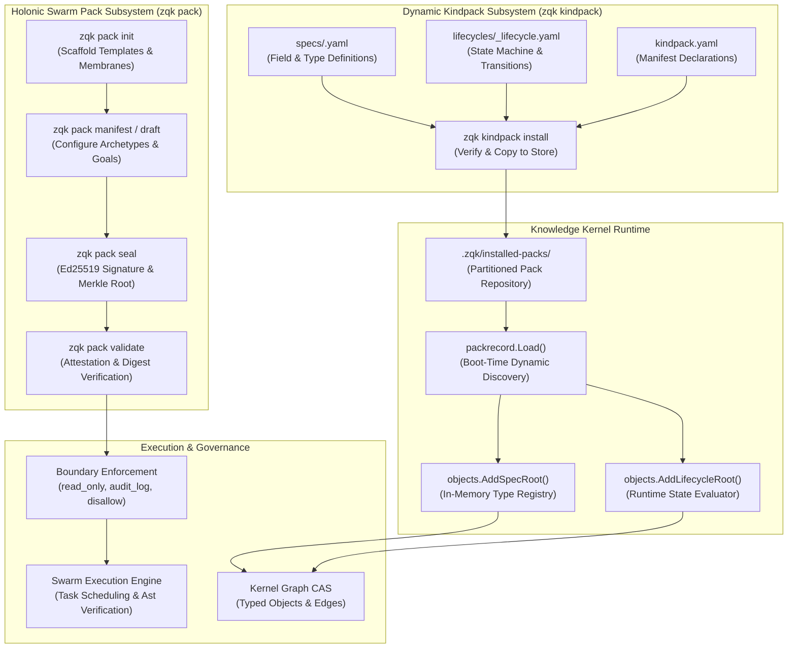

# CLI Pack & Kindpack Subsystem Architectural Guide

## Executive Summary

The **ZQK Pack and Kindpack Subsystems** provide a dual-plane architecture for extending the Zen Quantum Kernel (ZQK):
1. **Holonic Swarm Packages (`zqk pack`)**: Portable, cryptographically sealed bundles of autonomous agent personas, cellular archetypes (neuron, muscle, heart, lungs), prompt templates, and execution membranes.
2. **Dynamic Kind Packages (`zqk kindpack`)**: Dynamic, zero-rebuild ontology extensions that allow teams to introduce new typed kernel objects, schema definitions, and lifecycle state machines into the persistent Knowledge Kernel at runtime.

By decoupling agent team topologies and ontological schema definitions from the core compiled binary, ZQK provides safe, decentralised extensibility while preserving strict fail-closed boundary enforcement, deterministic Merkle attestation, and verifiable graph integrity.

---

## Architectural Topology & Flow

The following diagram illustrates the relationship between the Swarm Pack plane (`cmd/zqk/pack`) and the Kindpack plane (`cmd/zqk/kindpack`), demonstrating how artifacts flow from authoring and sealing into runtime execution and kernel object storage:



---

## Subsystem Layout & File Organization

The Pack and Kindpack subsystems are partitioned cleanly across command implementations in `cmd/zqk/` and domain logic in `pkg/`:

```
cmd/zqk/pack/
├── pack.go                                      # Cobra command tree: init, seal, validate, manifest
├── pack_test.go                                 # Existing CLI integration tests
└── pack_coverage_elevation_cycle101_test.go     # Cycle 101 elevation tests (>94% coverage)

cmd/zqk/kindpack/
├── command.go                                   # Cobra command tree: install, joinKinds
├── command_test.go                              # Existing CLI integration tests
└── kindpack_coverage_elevation_cycle101_test.go # Cycle 101 elevation tests (100% coverage)

pkg/swarm/pack/
├── manifest.go                                  # SwarmPackage, TeamConfiguration, MembraneRule, AgentConfig
├── seal.go                                      # Merkle root computation (SHA-256), Ed25519 signing/verification
├── semver.go                                    # SemVer 2.0.0 parser and compatibility validation
├── manifest_test.go                             # Swarm manifest schema tests
├── seal_test.go                                 # Cryptographic attestation unit tests
└── semver_test.go                               # SemVer parser test cases

pkg/packrecord/
├── record.go                                    # Spec pack verification, file copying, registration
└── record_test.go                               # Install and dynamic Load verification tests
```

---

## Holonic Swarm Packages (`zqk pack`)

A Holonic Swarm Package encapsulates a complete collaborative agent swarm designed to achieve a specific operational objective (e.g. code evaluation, legacy refactoring, security boundary audit).

### 1. Swarm Pack Anatomy

When scaffolded via `zqk pack init`, a pack contains:

```
my-swarm-pack/
├── swarm.yaml               # Core package manifest declaring agents, tasks, membranes, and parameters
├── templates/               # Modular prompt templates injected into agent context
│   └── eval_prompt.yaml     # Baseline evaluation prompt
└── membranes/               # Directory-level security and boundary rules
```

#### Manifest Structure (`swarm.yaml`)
```yaml
$schema: "https://zqk.dev/schemas/swarm_package_spec.schema.json"
name: "pck-demo-compliance"
version: "1.0.0"
description: "High-assurance governance and compliance swarm"
license: "Apache-2.0"
parameters:
  baseline_score:
    type: "float"
    default: 4.8
    description: "Required compliance rating threshold"
    required: false
membranes:
  - path: ".zqk/process/"
    mode: "read_only"
  - path: ".zqk/audit/"
    mode: "audit_log"
agents:
  - name: "Lead Specialist"
    role: "software_engineer"
    skills:
      - "ASK-COMMUNITY-CODE-CRAFTSMAN"
    system_prompt: "Execute tasks adhering to clean craftsmanship principles."
  - name: "Adversarial Verifier"
    role: "qa_auditor"
    skills:
      - "ASK-COMMUNITY-QA-VERIFICATION"
    system_prompt: "Subject outcomes to falsifiable verification and fail-closed bounds."
tasks:
  - id: "task-evaluate"
    title: "Execute core evaluation for pck-demo-compliance"
    role: "software_engineer"
  - id: "task-verify"
    title: "Verify evaluation outcomes and certify compliance"
    role: "qa_auditor"
    depends_on:
      - "task-evaluate"
```

### 2. Command Taxonomy: `zqk pack`

#### `zqk pack init [target_dir]`
Scaffolds a new swarm package directory with standard layout, templates, and `swarm.yaml`.
- Flags:
  - `--name <name>`: Package name (defaults to target directory name).
  - `--version <semver>`: Semantic version (default `1.0.0`).
  - `--description <desc>`: Human-readable description.
- Example:
  ```bash
  zqk pack init ./packs/compliance-checker --name pck-demo-compliance --version 1.1.0
  ```

#### `zqk pack manifest` (Alias: `draft`)
Generates a draft manifest based on cellular team archetypes and parameter specs. Can emit to stdout or write directly to a destination file.
- Flags:
  - `-o, --output <path>`: Target file path, or `-` for stdout (default `-`).
  - `--name`, `--version`, `--description`, `--author`, `--license`.
  - `--cell-type <type>`: Cellular archetype (`neuron`, `muscle`, `heart`, `lungs`).
  - `--goal-metric <metric>`, `--goal-target <target>`.
- Example:
  ```bash
  zqk pack manifest --name pck-demo-auditor --cell-type neuron -o ./packs/auditor/swarm.yaml
  ```

#### `zqk pack seal [pack_dir]`
Calculates a deterministic SHA-256 Merkle root digest across all package files (excluding the integrity block itself) and signs it using an Ed25519 private key.
- Flags:
  - `--signer-id <id>`: Signer identity or email (default `support@zqkos.com`).
  - `--key <path>`: Path to 64-byte raw or hex-encoded Ed25519 private key (generates ephemeral key if omitted).
  - `--pubkey-out <path>`: File path to save hex-encoded public key for downstream distribution.
- Example:
  ```bash
  zqk pack seal ./packs/compliance-checker --signer-id release@zqk.dev --pubkey-out ./keys/release.pub
  ```

#### `zqk pack validate [pack_dir]`
Validates package structure, SemVer adherence, Merkle digest consistency, and optional Ed25519 cryptographic signature.
- Flags:
  - `--key <path>`: Ed25519 public key file (32-byte raw or hex-encoded) for cryptographic attestation.
- Verification States:
  - **SEALED & Valid**: Content digest matches Merkle calculation and signature checks pass.
  - **UNSEALED Warning**: Package structure and syntax are valid, but no cryptographic integrity block is present.
  - **Fail-Closed Mismatch**: Any file modification or tampered template causes immediate validation failure.
- Example:
  ```bash
  zqk pack validate ./packs/compliance-checker --key ./keys/release.pub
  ```

---

## Dynamic Kind Packages (`zqk kindpack`)

Kind packages provide a zero-rebuild mechanism for extending the Knowledge Kernel's object graph. By installing a kindpack, an organization can register custom domain entities (e.g. `device`, `incident`, `service_contract`) with full schema validation and lifecycle state governance.

### 1. Kindpack Anatomy

A kindpack directory must provide:
```
kpk-demo-telemetry/
├── kindpack.yaml                            # Root manifest declaring owned kinds
├── specs/                                   # Formal schema definitions for each kind
│   ├── sensor.yaml                          # Schema for 'sensor' kind
│   └── reading.yaml                         # Schema for 'reading' kind
└── lifecycles/                              # State machines governing transitions
    ├── sensor_lifecycle.yaml                # Lifecycle for 'sensor'
    └── reading_lifecycle.yaml               # Lifecycle for 'reading'
```

#### Manifest (`kindpack.yaml`)
```yaml
name: "kpk-demo-telemetry"
kinds:
  - "sensor"
  - "reading"
```

#### Kind Specification (`specs/sensor.yaml`)
```yaml
ontology: "sensor"
schema_version: "2.0.0"
fields:
  - name: "device_id"
    type: "string"
    required: true
  - name: "firmware_version"
    type: "string"
  - name: "sample_rate_hz"
    type: "integer"
```

#### Lifecycle State Machine (`lifecycles/sensor_lifecycle.yaml`)
```yaml
name: "sensor"
statuses:
  - name: "provisioned"
    initial: true
  - name: "calibrated"
  - name: "active"
  - name: "degraded"
  - name: "decommissioned"
    terminal: true
transitions:
  - from: "provisioned"
    to: "calibrated"
  - from: "calibrated"
    to: "active"
  - from: "active"
    to: "degraded"
  - from: "degraded"
    to: "active"
  - from: ["active", "degraded"]
    to: "decommissioned"
```

### 2. Command Taxonomy: `zqk kindpack`

#### `zqk kindpack install <path>`
Verifies the spec pack invariants and copies the formal specifications into the local project data store under `.zqk/installed-packs/<bucket>/<name>`.
- **Validation Checks**:
  1. Manifest exists, has a valid lowercase kebab-case name, and declares at least one kind.
  2. No duplicate kinds within the pack.
  3. Every declared kind has matching `specs/<kind>.yaml` where `ontology == kind`.
  4. Every declared kind has a non-empty `lifecycles/<kind>_lifecycle.yaml`.
  5. The pack has not already been installed in this project.
- **Registration**:
  - Dynamically invokes `objects.AddSpecRoot(...)` and `objects.AddLifecycleRoot(...)` so that the running session can immediately instantiate, query, and validate objects of the new kind.
- Example:
  ```bash
  zqk kindpack install ./packs/telemetry
  # Output: recorded kpk-demo-telemetry (sensor,reading)
  ```

---

## Integration with the Knowledge Kernel

The Knowledge Kernel manages kind extensions seamlessly without requiring code generation or Go recompilation.

### Runtime Discovery & Bootstrapping (`packrecord.Load`)
When the ZQK kernel initializes:
1. `packrecord.Load(projectRoot)` scans `.zqk/installed-packs/`.
2. The storage layout uses single-character bucketing to ensure fast directory traversal:
   ```
   .zqk/
   └── installed-packs/
       ├── k/
       │   └── kpk-demo-telemetry/
       │       ├── kindpack.yaml
       │       ├── specs/
       │       └── lifecycles/
       └── p/
           └── pck-demo-governance/
   ```
3. Each validated pack directory registers its `specs` and `lifecycles` directories into the kernel's global registries:
   - `objects.AddSpecRoot(filepath.Join(dir, "specs"))`
   - `objects.AddLifecycleRoot(filepath.Join(dir, "lifecycles"))`
4. All subsequent kernel operations (such as `zqk object create <kind>`, `zqk query`, and AST schema validation) treat these dynamic kinds as first-class citizens.

---

## Verification & Cryptographic Provenance

All packages within the ZQK ecosystem enforce strict cryptographic guarantees:

| Feature | Swarm Pack (`zqk pack`) | Kind Pack (`zqk kindpack`) |
| :--- | :--- | :--- |
| **Primary Focus** | Agent personas, prompts, tasks, membranes | Ontological kinds, schemas, lifecycles |
| **Integrity Mechanism** | Deterministic SHA-256 Merkle root digest | Strict AST schema & ontology cross-check |
| **Attestation** | Ed25519 digital signature with signer ID | Project-scoped CAS storage registration |
| **Tamper Resistance** | Any file modification breaks Merkle digest | Schema and lifecycle mismatches fail closed |
| **Runtime Effect** | Scaffolds and bounds agent swarm execution | Registers dynamic types in `pkg/objects` |

---

## Clean Identifiers & Naming Standards

To prevent namespace collisions and maintain uniform auditability, all package entities follow the canonical naming convention:
- **Swarm Packages**: Prefixed with `pck-` (e.g., `pck-code-eval`, `pck-demo-compliance`).
- **Kind Packages**: Prefixed with `kpk-` (e.g., `kpk-telemetry`, `kpk-demo-device`).
- **Object Identifiers**: Illustrative IDs use clear semantic prefixes (e.g. `PCK-DEMO-001`, `KPK-DEMO-001`, `ACC-COMMUNITY-001`). Never use prohibited studio nanos-hex identifiers.
- **Ontology Kind Names**: Singular lowercase alphanumeric identifiers (e.g. `sensor`, `metric`, `policy`).
