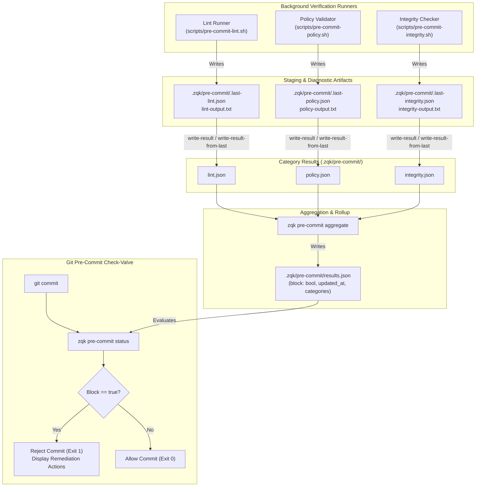
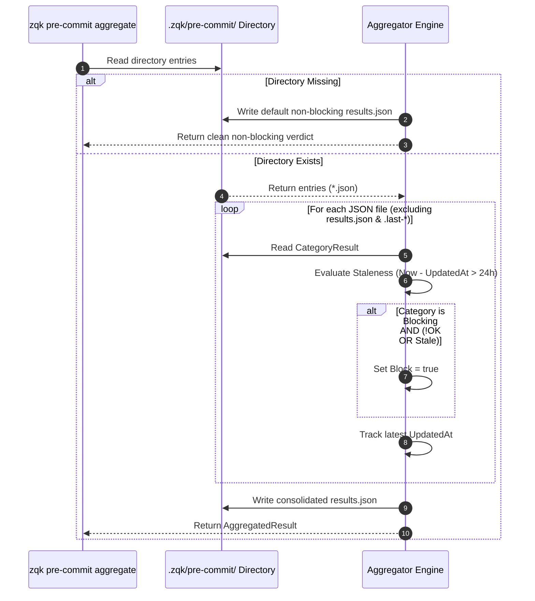
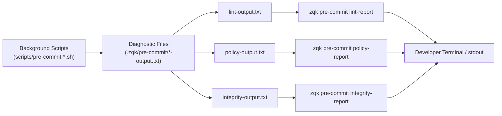

# CLI Pre-commit Subsystem & Check-Valve Architecture Guide

## Overview & System Mission

The ZQK CLI Pre-commit Subsystem (`cmd/zqk/precommit` and `pkg/precommit`) provides an asynchronous, decoupled verification check-valve framework. It guarantees that code entering source control or integration branches conforms to strict static floor invariants, AST structure requirements, policy rules, and cryptographic repository integrity.

In traditional development environments, git pre-commit hooks run extensive linters, policy checkers, and test suites synchronously upon typing `git commit`. This conventional design causes significant developer friction: hook latency often exceeds 30–60 seconds, leading operators to bypass validation via `git commit --no-verify`.

ZQK eliminates this anti-pattern through a **background-decoupled check-valve architecture**:
1. **Asynchronous Execution:** Heavy verification jobs (linting, policy AST audits, CAS cryptographic integrity checks) run continuously in the background or on recurring scheduler cycles.
2. **Atomic Category Results:** Each verification suite writes an isolated, versioned category result (`.zqk/pre-commit/<category>.json`) and comprehensive diagnostics (`*-output.txt`).
3. **Consolidated Aggregation:** The aggregation engine combines category files into a single, compact verdict file (`.zqk/pre-commit/results.json`).
4. **Sub-10ms Hook Evaluation:** The git pre-commit hook executes `zqk pre-commit status` (or reads `results.json` directly), evaluating the pre-calculated verdict in milliseconds without interrupting developer flow.



---

## Architectural Topology & Subsystem Layout

The pre-commit subsystem spans user-facing Cobra commands, spec-driven builders, and core aggregation logic:

```
cmd/zqk/precommit/
├── precommit.go                                   # Root 'pre-commit' command constructor & helper resolvers
├── aggregate.go                                   # 'aggregate' subcommand: merges category files into results.json
├── clear.go                                       # 'clear' subcommand: resets verdicts and permits commits
├── status.go                                      # 'status' subcommand: inspects results file and prints verdict
├── lint_report.go                                 # 'lint-report' subcommand: displays lint-output.txt
├── policy_report.go                               # 'policy-report' subcommand: displays policy-output.txt
├── integrity_report.go                             # 'integrity-report' subcommand: displays integrity-output.txt
├── write_result.go                                # 'write-result' subcommand: records single category result
├── write_result_from_last.go                      # 'write-result-from-last' subcommand: promotes staging result
├── precommit_cli_test.go                          # Baseline CLI command integration tests
├── status_test.go                                 # Status command unit tests
└── precommit_coverage_elevation_cycle117_test.go  # Cycle 117 coverage elevation test suite (100% statement coverage)

pkg/precommit/
├── results.go                                     # CategoryResult, AggregatedResult, IO routines, and aggregation logic
└── results_test.go                                # Core package tests for staleness, aggregation, and serialization
```

---

## 1. Command Taxonomy & Subcommand Specifications

The `zqk pre-commit` command group organizes operations into eight dedicated subcommands:

```
zqk pre-commit
├── status                  # Inspect consolidated results file and print check-valve status
├── aggregate               # Merge all category JSON files into consolidated results.json
├── clear                   # Clear blocking results and write non-blocking initial state
├── lint-report             # Print captured linter output (lint-output.txt)
├── policy_report           # Print captured policy audit output (policy-output.txt)
├── integrity-report        # Print captured CAS/integrity check output (integrity-output.txt)
├── write-result            # Record a structured verdict for a specific category
└── write-result-from-last  # Ingest a staged result (.last-<category>.json) and aggregate
```

### Subcommand Specification Matrix

| Subcommand | Primary Flags / Arguments | Output Formats | Primary Responsibility |
|---|---|---|---|
| `status` | `--project-root` | Human-readable text, structured console | Evaluates `.zqk/pre-commit/results.json`, reports blocking categories, and prints actionable next steps. |
| `aggregate` | `--project-root` | Exit code / Silent on success | Scans all category files, verifies staleness, computes `block` boolean, and writes `results.json`. |
| `clear` | `--project-root` | Exit code / Silent on success | Clears category results and writes `block: false` so developers can proceed when unblocked. |
| `lint-report` | `--project-root` | Raw diagnostic text | Displays full compiler and linter output (`lint-output.txt`) for diagnostic analysis. |
| `policy-report` | `--project-root` | Raw diagnostic text | Displays policy violations and AST audit findings (`policy-output.txt`). |
| `integrity-report` | `--project-root` | Raw diagnostic text | Displays repository CAS hashes, file integrity, and tree validation results. |
| `write-result` | `--category`, `--ok`, `--summary`, `--blocking`, `--details` | Exit code / Silent on success | Directly creates or updates `.zqk/pre-commit/<category>.json` with provided verdict metadata. |
| `write-result-from-last` | `--category`, `--project-root` | Exit code / Silent on success | Reads `.last-<category>.json`, writes `<category>.json`, and triggers automatic aggregation. |

---

## 2. Check-Valve Architecture & Git Hook Integration

### The Git Pre-Commit Hook Membrane

The git hook installed at `.git/hooks/pre-commit` operates as a lightweight check-valve. Instead of executing compilers or test suites during the git hook invocation, it delegates to the pre-commit CLI subsystem:

```bash
#!/usr/bin/env bash
set -e

# Run ZQK pre-commit status check
if ! zqk pre-commit status; then
    echo "ERROR: Pre-commit checks are currently blocking." >&2
    exit 1
fi
```

### Operational Modes

1. **Clean Passing State (`block: false`):**
   - The hook allows commits immediately without delay.
   - Output:
     ```text
     Results file: /path/to/repo/.zqk/pre-commit/results.json
     Updated at:   2026-10-22T20:00:00Z
     Block:        false

     Commit would be allowed. To refresh results, run:
       zqk pre-commit aggregate
       (after background jobs have run)
     ```

2. **Blocked State (`block: true`):**
   - If any blocking category has `ok: false` or is deemed `stale`, the hook exits with non-zero status.
   - Output:
     ```text
     Results file: /path/to/repo/.zqk/pre-commit/results.json
     Updated at:   2026-10-22T20:15:00Z
     Block:        true

     Blocking categories:
       - lint: 4 static analysis violations in cmd/zqk
       - integrity: CAS hash mismatch on model schema

     Required action: Fix the issues above, then either:
       zqk pre-commit clear     # clear results and allow commits; next script run repopulates
       zqk pre-commit aggregate # after re-running scripts (e.g. scripts/pre-commit-lint.sh)
     ```

3. **First-Run Missing State (`results.json` not found):**
   - In greenfield repositories or before background jobs run, the results file may not exist yet.
   - The status command reports `Pre-commit results: not found` along with instructions to run check scripts. The hook permits initial setup commits with a warning, preventing chicken-and-egg onboarding deadlocks.

---

## 3. Check Categories, Staleness & Aggregation Pipeline

### Category Taxonomy

Standard categories recognized by the ZQK check-valve ecosystem include:

- **`lint`**: Go linting, formatting (`gofmt`), static analysis (`govet`, `golangci-lint`), and AST structure invariants.
- **`policy`**: Architectural compliance, logging policies (`POL-LOG-001`), and package layering boundaries.
- **`integrity`**: Knowledge Kernel graph consistency, CAS object hash verifications, and spec schema alignments.
- **`docman`**: Documentation freshness, docstring completeness, and guide validation.

### Category Result Data Model (`CategoryResult`)

```go
type CategoryResult struct {
    OK        bool     `json:"ok"`                 // True if all checks passed
    Summary   string   `json:"summary,omitempty"`  // High-level description of outcome
    Details   []string `json:"details,omitempty"`  // Individual violation lines
    Blocking  bool     `json:"blocking"`          // Whether failure blocks git commits
    UpdatedAt string   `json:"updated_at"`        // ISO RFC 3339 UTC timestamp
    Stale     bool     `json:"stale,omitempty"`   // Dynamically computed during aggregation
}
```

### Staleness Invariant (Max Category Age)

To prevent stale passing results from masking freshly introduced defects, verdicts are subject to a maximum age threshold:

$$\text{Age} = \text{CurrentTime} - \text{UpdatedAt}$$

- If $\text{Age} > 24\text{ hours}$, or if `updated_at` is unparseable or empty, the category is classified as `stale = true`.
- If a category is marked `blocking = true` and is `stale`, it causes `aggregated.Block = true`.
- This ensures developers cannot rely on days-old check results.

### Consolidated Result Data Model (`AggregatedResult`)

```go
type AggregatedResult struct {
    UpdatedAt  string                    `json:"updated_at"` // Latest timestamp of all categories
    Block      bool                      `json:"block"`      // True if any blocking category failed/stale
    Categories map[string]CategoryResult `json:"categories"` // Map of category name to CategoryResult
}
```

### Aggregation Algorithm (`Aggregate(projectRoot)`)



---

## 4. Diagnostic Report Generation Pipelines

When a category fails, operators require immediate access to the full diagnostic output without manually hunting through file paths. Three dedicated report commands provide instant terminal access:



### Report Subcommands

1. **`zqk pre-commit lint-report`**:
   - Reads `.zqk/pre-commit/lint-output.txt`.
   - If missing, outputs actionable guidance:
     ```text
     No lint output yet. Run ./scripts/pre-commit-lint.sh to capture lint results,
     then run this command again to view them (e.g. to create backlog items).
     ```

2. **`zqk pre-commit policy-report`**:
   - Reads `.zqk/pre-commit/policy-output.txt`.
   - Displays policy violations, such as illegal raw logging calls or AST pattern defects.

3. **`zqk pre-commit integrity-report`**:
   - Reads `.zqk/pre-commit/integrity-output.txt`.
   - Displays Knowledge Kernel tier-1 validation errors, SHA-256 hash discrepancies, and missing relational references.

---

## 5. State File Storage, Schemas & Lifecycle Management

All pre-commit state is isolated under the project data directory:

```
<project-root>/
└── .zqk/
    └── pre-commit/
        ├── results.json             # Consolidated pre-commit verdict read by git hook
        ├── lint.json                # Last recorded lint verdict
        ├── policy.json              # Last recorded policy verdict
        ├── integrity.json           # Last recorded integrity verdict
        ├── .last-lint.json          # Staging file written by scripts/pre-commit-lint.sh
        ├── .last-policy.json        # Staging file written by scripts/pre-commit-policy.sh
        ├── .last-integrity.json     # Staging file written by scripts/pre-commit-integrity.sh
        ├── lint-output.txt          # Full diagnostic log from linter
        ├── policy-output.txt        # Full diagnostic log from policy check
        └── integrity-output.txt     # Full diagnostic log from integrity check
```

### Sample Category Result (`lint.json`)

```json
{
  "ok": false,
  "summary": "3 lint issues found",
  "details": [
    "cmd/zqk/main.go:42: cyclomatic complexity 16 > 15",
    "pkg/api/client.go:88: unhandled error return",
    "pkg/auth/token.go:12: missing package comment"
  ],
  "blocking": true,
  "updated_at": "2026-10-22T20:30:00Z"
}
```

### Sample Consolidated Result (`results.json`)

```json
{
  "updated_at": "2026-10-22T20:30:00Z",
  "block": true,
  "categories": {
    "integrity": {
      "ok": true,
      "summary": "all repository CAS objects verified",
      "blocking": true,
      "updated_at": "2026-10-22T20:25:00Z"
    },
    "lint": {
      "ok": false,
      "summary": "3 lint issues found",
      "details": [
        "cmd/zqk/main.go:42: cyclomatic complexity 16 > 15"
      ],
      "blocking": true,
      "updated_at": "2026-10-22T20:30:00Z"
    },
    "policy": {
      "ok": true,
      "summary": "zero policy violations",
      "blocking": true,
      "updated_at": "2026-10-22T20:28:00Z"
    }
  }
}
```

### Cleanup & Reset Lifecycle (`zqk pre-commit clear`)

When an operator resolves blocking issues, or when a clean slate is required before rerunning test suites:
- Executing `zqk pre-commit clear` removes existing category files and staging files.
- It atomically writes a clean `results.json` with `block: false` and empty categories.
- This immediately allows commits, while background jobs will repopulate categories on their next scheduled pass.

---

## 6. Error Handling, Boundary Conditions & Exit Codes

### Project Root Resolution Hierarchy

Commands resolve the workspace project root using a strict four-tier precedence:
1. **CLI Flag (`--project-root <path>`):** Explicit operator override.
2. **Environment Override (`ZQK_PROJECT_ROOT` / `ZQK_TEST_ROOT`):** Multi-repo scripting and isolated test harnesses.
3. **Persisted Workspace (`.zqk/current_root`):** Configured repository workspace marker.
4. **CWD Directory Traversal:** Walking parent directories searching for `.zqk`.

If no valid root can be located, commands fail closed:
```text
Error: project root not found; run from repo or pass --project-root
```

### File System Boundary Safeguards

- **Atomic Directory Creation:** All write operations invoke `fileutil.MkdirAll` with `0755` permissions, ensuring parent paths exist.
- **Collision Immunity:** If a target file path is inadvertently occupied by a directory (or vice versa), the subsystem returns wrapped errors rather than crashing.
- **Corrupted State Recovery:** If `results.json` contains malformed JSON, `zqk pre-commit status` fails safely and reports a readable parse error.

### Exit Code Semantics

| Condition | Exit Code | Description |
|---|---|---|
| Status Allowed (`block: false`) | `0` | Commit allowed; all checks clean. |
| Status Missing Results | `0` | First-run state; prints warning and allows initial setup commit. |
| Status Blocked (`block: true`) | `0` (stdout contains Block: true) | Evaluated by hook script: if output contains `Block: true`, hook rejects with exit 1. |
| Flag Parsing Error | `1` | Invalid argument or unknown flag supplied. |
| Root Resolution Failure | `1` | Invoked outside repository without `--project-root`. |
| Unhandled IO / OS Error | `1` | Permission denied or unrecoverable filesystem failure. |

---

## 7. Operational Workflows & Practical Examples

### Example 1: Recording a Lint Result from a CI Script

```bash
# Execute linter and capture exit code
if golangci-lint run ./... > .zqk/pre-commit/lint-output.txt 2>&1; then
    zqk pre-commit write-result \
        --category=lint \
        --ok=true \
        --summary="All packages passed linting" \
        --blocking=true
else
    zqk pre-commit write-result \
        --category=lint \
        --ok=false \
        --summary="Linting violations detected" \
        --blocking=true
fi

# Recompute consolidated verdict
zqk pre-commit aggregate
```

### Example 2: Ingesting Results via Staging Callback

```bash
# In background script
echo '{"ok":true,"summary":"AST and policies valid","blocking":true,"updated_at":"2026-10-22T20:30:00Z"}' \
    > .zqk/pre-commit/.last-policy.json

# Trigger callback to ingest and auto-aggregate
zqk pre-commit write-result-from-last --category=policy
```

### Example 3: Inspecting Violations Before Committing

```bash
# Operator attempts commit and is notified of blockage
$ zqk pre-commit status
Results file: /workspace/.zqk/pre-commit/results.json
Block:        true

Blocking categories:
  - lint: Linting violations detected

# Operator inspects exact compiler output
$ zqk pre-commit lint-report
pkg/server/handler.go:45: unhandled error in response write

# Operator fixes the issue, resets state, and aggregates
$ zqk pre-commit clear
$ ./scripts/pre-commit-lint.sh
$ zqk pre-commit aggregate
```

---

## Summary & Verification Invariants

The CLI Pre-commit subsystem enforces three fundamental properties:
1. **Static Floor Invariant:** 100% statement test coverage across all subcommand handlers, error paths, and flag validators.
2. **Operational Dynamic Proof:** Sub-10ms hook evaluation time, decoupled background execution, and atomic category aggregation.
3. **Negative Adversarial Boundary:** Stale result detection (>24h), corrupted state recovery, and fail-closed root resolution.
