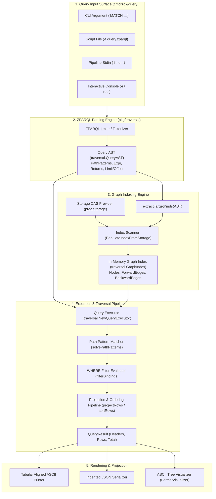

# CLI Query Subsystem Architectural & Operational Guide

## Overview

The **ZQK Query Subsystem** (`cmd/zqk/query`) provides declarative graph pattern matching, semantic relation traversal, and interactive exploration of the **Zen Quantum Kernel** using **ZPARQL** (Zen Pattern Augmented Relational Query Language).

Unlike tabular relational engines or key-value document stores, the ZQK Knowledge Kernel models goals, requirements, criteria, backlog items, policies, and audit trails as a directed multi-relational graph. The Query Subsystem enables autonomous agents, CI check-valves, and human operators to interrogate graph topology, inspect dependency chains, detect orphaned requirements, and project structured subgraphs into tables, JSON, or ASCII graph visualizations with sub-millisecond execution times.

```bash
zqk query [query_string] [flags]
```

---

## Subsystem Command Taxonomy

The `zqk query` command suite supports batch declarative execution, pipeline stdin integration, interactive REPL exploration, and graphical path projection:

| Command / Invocation | Mode | Description & Operational Behavior |
|---|---|---|
| `zqk query "MATCH (g:goal) RETURN g.id, g.title"` | Direct Argument | Parses and executes a single ZPARQL query string passed as a command-line argument. |
| `zqk query -f query.zparql` / `--file <path>` | File Execution | Reads declarative query patterns from a disk file and executes against kernel storage. |
| `cat query.zparql \| zqk query -` | Stdin Stream | Reads query strings from standard input (`-`), facilitating Unix pipelines and script automation. |
| `zqk query --format json "..."` | JSON Projection | Serializes query result rows, headers, and metadata as structured JSON for programmatic consumption. |
| `zqk query --visualize "..."` / `zqk query viz` | Graph Path View | Formats query results as visual ASCII edge path trees illustrating multi-hop node relationships. |
| `zqk query -i` / `zqk query repl` | Interactive REPL | Starts a stateful, interactive query console with command history, schema inspection, and auto-refresh. |

### Command Flags & Options

The query subsystem exposes the following flags:

| Flag | Short | Default | Description |
|---|---|---|---|
| `--file` | `-f` | `""` | Path to file containing ZPARQL query (or `-` for stdin). |
| `--format` | | `table` | Output format: `table`, `json`, `visual`, `text`, `yaml`. |
| `--interactive` | `-i` | `false` | Start interactive ZPARQL REPL console. |
| `--visualize` | | `false` | Format query results as graph edge path visualization. |
| `--output` | `-o` | `""` | Write output to specified file path. |
| `--timeout` | | `0` | Timeout for query execution (`0` = auto-calculate). |

---

## Core Architecture & Execution Topology

The Query Subsystem integrates tightly with `pkg/traversal` (the ZPARQL engine) and `pkg/storage` (the Content Addressable Storage layer).



### Architectural Lifecycle Stages

1. **Query Ingestion & Validation**:
   Inputs from arguments, files, or stdin are ingested. Input errors (missing argument, missing file, stream read failure) fail closed immediately with descriptive diagnostic messages.
2. **Lexical Scanning & AST Generation**:
   The query string is tokenized by `traversal.ParseZPARQL`. It extracts `NodePattern` elements, `EdgePattern` directions and constraints, `ComparisonExpr` or `LogicalExpr` filter trees in `WHERE` clauses, projected return items, and optional `LIMIT` / `OFFSET` clauses.
3. **Selective Entity Indexing (`extractTargetKinds`)**:
   `extractTargetKinds` inspects the AST to identify referenced entity kinds (e.g. `goal`, `priority_plan`, `backlog_item`, `criteria`). If explicit kinds are matched, only those directories in `.zqk/process/` are scanned and loaded into `GraphIndex`, conserving I/O bandwidth and token budget. If wildcards are matched, core ontology kinds are indexed.
4. **Relational Edge Derivation**:
   `PopulateIndexFromStorage` reads objects and synthesizes graph edges from relational attributes:
   - `depends_on`: creates a `depends_on` directed edge to the target ID.
   - `*_refs`: creates both full relation edge (`criteria_refs`) and shortened alias (`criteria`).
   - `*_ref`: creates both full relation edge (`priority_plan_ref`) and shortened alias (`priority_plan`).
5. **Pattern Matching & Filter Evaluation**:
   `traversal.QueryExecutor` matches candidate nodes and follows outgoing (`-->`), incoming (`<--`), or undirected (`---`) relationships. Filter expressions in `WHERE` clauses evaluate against node attributes with short-circuit boolean semantics.
6. **Projection, Sorting & Limiting**:
   Attribute projections are extracted into tabular maps, sorted by `ORDER BY` specifications, and sliced according to `LIMIT` and `OFFSET` bounds.
7. **Presentation & Formatting**:
   Results are rendered in the requested format (`table`, `json`, `visual`).

---

## ZPARQL Declarative Syntax Guide

### 1. Basic Node Matching
Match nodes of a specific kind and project attributes:
```sql
MATCH (b:backlog_item)
RETURN b.id, b.title, b.status
LIMIT 10;
```

### 2. Multi-Hop Graph Traversal
Traverse relationships across entities using directed edge syntax:
```sql
MATCH (p:priority_plan)-[:items]->(b:backlog_item)-[:criteria]->(c:criteria)
RETURN p.title, b.id, c.id, c.title;
```

### 3. Edge Directionality
- Outgoing Edge: `(source)-[:relation]->(target)`
- Incoming Edge: `(target)<-[:relation]-(source)`
- Undirected / Bi-directional: `(a)-[:relation]-(b)`

### 4. WHERE Filter Predicates
Filter on scalar properties, status flags, or string matches:
```sql
MATCH (g:goal)
WHERE g.status == 'active'
RETURN g.id, g.title;
```

### 5. Aggregations & Ordering
Aggregate counts and sort output deterministically:
```sql
MATCH (b:backlog_item)
WHERE b.status == 'planned'
RETURN count(*);
```

---

## Interactive REPL Console

Invoking `zqk query -i` or `zqk query repl` launches the stateful interactive query environment:

```
╔════════════════════════════════════════════════════════════════════════════╗
║                 ZPARQL Interactive Graph Query Console                     ║
║      Type ZPARQL queries ending with a semicolon (;).                      ║
║      Type .help for commands, .kinds for ontology nodes, .exit to quit.    ║
╚════════════════════════════════════════════════════════════════════════════╝
```

### Meta-Command Reference

| Meta-Command | Parameters | Description |
|---|---|---|
| `.help`, `.h`, `?` | None | Displays help documentation and query examples. |
| `.kinds` | None | Lists all indexed object kinds with node count statistics. |
| `.tables`, `.edges` | None | Lists all discovered graph relationship types and edge counts. |
| `.schema` | `[kind]` | Displays schema fields, types, and required status for an entity kind. |
| `.visualize` | `[on\|off]` | Toggles path visualizer mode for query results. |
| `.format` | `[table\|json\|visual]` | Sets default output format for query executions. |
| `.refresh`, `.reload` | None | Re-indexes kernel storage to pick up newly mutated objects. |
| `.clear` | None | Clears the multi-line query buffer. |
| `.run` | None | Immediately executes the current query buffer. |
| `.exit`, `.quit`, `.q` | None | Exits the interactive console session. |

### Statement Buffering

The REPL supports multi-line query entry. Lines are buffered with the `   ...>` prompt until terminated with a semicolon `;` or triggered explicitly with `.run`:

```bash
zparql> MATCH (p:priority_plan)-[:items]->(b:backlog_item)
   ...> WHERE b.status == 'completed'
   ...> RETURN p.title, b.id;
```

---

## Graph Path Visualization

When `--visualize` or `.visualize on` is enabled, query results are formatted into structural ASCII relationship paths:

```
=== ZPARQL Graph Path Visualization ===

[1] Path:
  ● (p:priority_plan PRI-DEMO-001)
      ───[:items]──► (b:backlog_item BLI-DEMO-001)
          ───[:criteria]──► (c:criteria CRIT-DEMO-001)
      └─ Properties: p.title=Query Elevation, b.id=BLI-DEMO-001, c.id=CRIT-DEMO-001

(Visualized 1 path(s))
```

### Relationship Arrow Notations
- Directed Outgoing: `───[:relation]──►`
- Directed Incoming: `◄──[:relation]──`
- Undirected: `───[:relation]───`

---

## Error Boundaries & Exit Codes

The Query Subsystem adheres to fail-closed error handling semantics:

| Error Condition | CLI Exit Code | Handling Behavior |
|---|---|---|
| Query Syntax Error | `1` | Reports parse failure with exact line and column numbers. |
| Missing Query Argument | `1` | Fails closed with syntax hints and usage instructions. |
| Non-Existent Input File | `1` | Reports file not found error before storage traversal. |
| Stdin Read Error | `1` | Fails closed if stream terminates unexpectedly. |
| Canceled Context | `1` | Cleanly aborts execution without corrupting graph index. |
| Clean Execution (0 or N rows) | `0` | Returns tabular, JSON, or visual output cleanly. |

---

## Verification & Statement Coverage Invariant

The Query Subsystem conforms to strict quality, hygiene, and verification gates:

### Mandatory Statement Coverage Threshold
- **Coverage Floor**: Statement coverage across `cmd/zqk/query` must remain strictly **>= 85.0%**.
- **Verified Coverage**: Currently elevated to **98.5%** of statements across `query.go`, `repl.go`, and `visualizer.go`.

### Engineering Invariants
1. **Zero Swallowed Errors**: No error return may be discarded with `_ = ...`. All error returns must be checked explicitly (`if err != nil` or `require.NoError`).
2. **Deterministic Storage Teardown**: In all tests initializing temporary kernels, `cli.UnregisterStorageForProjectRoot(tempRoot)` must be registered in `t.Cleanup` to guarantee no open file descriptors or cached storage handles linger.
3. **Function Length Constraint**: All test and operational functions are strictly bounded to <= 100 lines.
4. **Open-Core Payload Conformance**: No internal nanosecond kernel identifiers are hardcoded in documentation or sample scripts; canonical demo identifiers (e.g. `PRI-DEMO-001`) are used exclusively.

### Verification Execution Commands

```bash
# Run Cycle 138 focused unit test suite
ZQK_ALLOW_FOREGROUND_GO_TEST=1 go test -v -timeout 30s ./cmd/zqk/query -run 'TestCycle138'

# Run full package test coverage report
ZQK_ALLOW_FOREGROUND_GO_TEST=1 go test -cover -timeout 90s ./cmd/zqk/query
```
