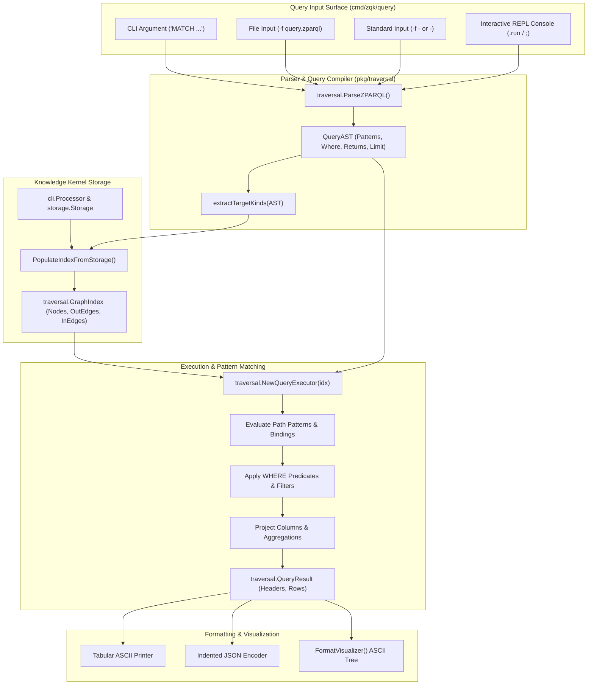

# CLI Query Subsystem Architectural Guide

## Executive Summary

The **ZQK CLI Query Subsystem** (`cmd/zqk/query`) provides a declarative, in-memory graph query language and execution environment for the Zen Quantum Kernel (ZQK). Leveraging **ZPARQL** (a Cypher-inspired graph pattern matching DSL implemented in `pkg/traversal`), the subsystem empowers human operators, autonomous agents, and toolchains to interrogate the knowledge kernel graph with millisecond latency.

Rather than traversing raw YAML files in `.zqk/process/` or writing custom aggregation scripts, operators use declarative graph patterns to discover relationships, filter entity states, inspect schemas, and visualize multi-hop dependency chains.

The Query Subsystem delivers four primary capabilities:
1. **Declarative Graph Queries (`zqk query`)**: Compiles and executes ZPARQL queries against in-memory graph indexes built dynamically from kernel storage, supporting tabular, JSON, and ASCII path output formats.
2. **Interactive Query Console (`zqk query repl` / `-i`)**: A stateful Read-Eval-Print Loop (REPL) featuring multi-line statement buffering, runtime index refreshing, live schema introspection, and interactive output toggling.
3. **Graph Path Visualizer (`--visualize` / `--format visual`)**: An ASCII tree rendering engine displaying directed (`───[:rel]──►`), incoming (`◄──[:rel]──`), and undirected (`───[:rel]───`) graph edges with bound properties.
4. **Selective Index Extraction**: An AST analysis phase (`extractTargetKinds`) that identifies queried object kinds to avoid unnecessary storage scans when running targeted queries.

---

## Architectural Topology & Flow

The following diagram illustrates the lifecycle of a query from ingestion through parsing, index population, AST evaluation, and terminal formatting:



---

## Subsystem Layout & File Organization

The query subsystem is organized into CLI command bindings, REPL lifecycle handlers, visualizers, and underlying traversal engine packages:

```
cmd/zqk/query/
├── query.go                                      # Top-level 'zqk query' command builder, flag parsing, storage indexing
├── repl.go                                       # Interactive REPL console, meta-command router, schema inspection
├── visualizer.go                                 # Terminal ASCII path tree visualizer and node property formatter
├── query_test.go                                 # Black-box CLI command execution tests
├── query_internal_test.go                        # White-box tests for index population, AST extraction, formatting
└── query_coverage_elevation_cycle100_test.go     # Comprehensive branch elevation tests (97%+ coverage)

pkg/traversal/
├── ast.go                                        # QueryAST, PathPattern, NodePattern, EdgePattern definitions
├── parser.go                                     # ZPARQL lexical scanner and syntax parser
├── index.go                                      # In-memory bidirectional graph index (GraphIndex)
├── executor.go                                   # Pattern matching, binding evaluation, and filter executor
└── types.go                                      # QueryResult, Binding, and direction constants
```

---

## Command Taxonomy & Ergonomics

The subsystem is accessed via the `zqk query` command (aliased to `zqk zparql`):

### 1. Direct Inline Evaluation

Evaluates a raw ZPARQL query string passed as a command argument:

```bash
# Query active goals
zqk query "MATCH (g:goal) WHERE g.status == 'active' RETURN g.id, g.title;"

# Query priority plans and linked backlog items with limit
zqk query "MATCH (p:priority_plan)-[:items]->(b:backlog_item) RETURN p.title, b.id LIMIT 10;"
```

### 2. File-Based & Stdin Evaluation

Executes queries stored in `.zparql` script files or piped from standard input:

```bash
# Execute from a script file
zqk query -f ./scripts/audit_blockers.zparql

# Read query from stdin
echo "MATCH (b:backlog_item) WHERE b.status == 'blocked' RETURN b.id, b.title;" | zqk query -

# Read from stdin using file flag
cat ./scripts/trace_criteria.zparql | zqk query -f -
```

### 3. Interactive REPL Mode

Launches the stateful interactive console:

```bash
# Start REPL via flag
zqk query -i

# Start REPL via subcommand
zqk query repl

# Start REPL with visualization enabled by default
zqk query repl --visualize
```

### 4. Output Formatting Flags

The query subsystem supports three primary output formats:

- `--format table` (default): Formats result bindings into an aligned ASCII column table with summary row counts.
- `--format json`: Emits machine-readable JSON containing `headers` and an array of key-value `rows`.
- `--format visual` (or `--visualize`): Renders matching relationship paths as hierarchical ASCII trees showing relationship types and node identifiers.

---

## ZPARQL Graph Matching & Query Engine

ZPARQL is a declarative query language designed specifically for knowledge kernel graphs. It matches subgraphs against node patterns and relationship edges:

### Query Structure

```sql
MATCH <pattern> [, <pattern> ...]
[WHERE <expression>]
RETURN <projection> [, <projection> ...]
[LIMIT <integer>];
```

### Pattern Matching Syntax

- **Node Patterns**: Declared with parentheses `(variable:kind)` or wildcard `(variable)`.
  - `(g:goal)`: Matches nodes whose kind is `goal`, bound to variable `g`.
  - `(n)`: Matches any node regardless of kind, bound to variable `n`.
- **Edge Patterns**: Declared with brackets `[:relation]` and directional indicators:
  - Outgoing: `(a)-[:items]->(b)`
  - Incoming: `(a)<-[:depends_on]-(b)`
  - Undirected: `(a)-[:related]-(b)`
- **Multi-Hop Traversal**: Paths can chain multiple nodes and edges:
  ```sql
  MATCH (g:goal)-[:requirement_refs]->(r:requirement)-[:criteria_refs]->(c:criteria)
  RETURN g.id, r.id, c.id;
  ```

### WHERE Predicates & Filters

Expressions in the `WHERE` clause evaluate properties on bound nodes:
- Equality: `WHERE b.status == 'in_progress'`
- Inequality: `WHERE b.status != 'completed'`
- Numeric comparisons: `WHERE b.points >= 5`
- Boolean combinations: `WHERE g.status == 'active' AND b.status == 'blocked'`

### Projections & Aggregations

The `RETURN` clause selects attributes or computes aggregate values:
- Property projection: `RETURN p.title, b.id, b.status`
- Aggregation count: `RETURN count(*)`

---

## Storage Indexing & Dynamic Edge Discovery

When executing queries, `PopulateIndexFromStorage` dynamically indexes entities from the persistent Knowledge Kernel storage into a fast `traversal.GraphIndex`.

### Target Kind Optimization (`extractTargetKinds`)

To minimize disk I/O, `extractTargetKinds(ast)` inspects the query's node patterns:
- If all node patterns specify explicit kinds (e.g. `(g:goal)` and `(p:priority_plan)`), only those object directories in `.zqk/process/` are scanned and indexed.
- If any node pattern is a wildcard (e.g. `(n)`), the engine automatically falls back to scanning all registered kernel kinds from `objects.GetGlobalFieldRegistry()`.

### Edge Derivation Rules

The indexer automatically creates directed edges from object attributes:
1. **Explicit Dependencies**: The `depends_on` field produces a `depends_on` edge to the referenced object ID.
2. **Plural References (`*_refs`)**: Fields ending in `_refs` (e.g. `criteria_refs`, `requirement_refs`, `milestone_refs`) produce both:
   - Full relation edge: `criteria_refs`
   - Canonical shortened alias: `criteria`
3. **Singular References (`*_ref`)**: Fields ending in `_ref` (e.g. `priority_plan_ref`, `parent_ref`) produce both:
   - Full relation edge: `priority_plan_ref`
   - Canonical shortened alias: `priority_plan`
4. **Item Collections (`items`)**: Priority plans containing `items` slices produce `items` edges to child backlog items.

---

## Interactive REPL Lifecycle & Meta-Commands

The interactive REPL provides an exploratory environment with rich meta-commands:

```
╔════════════════════════════════════════════════════════════════════════════╗
║                 ZPARQL Interactive Graph Query Console                     ║
║      Type ZPARQL queries ending with a semicolon (;).                      ║
║      Type .help for commands, .kinds for ontology nodes, .exit to quit.    ║
╚════════════════════════════════════════════════════════════════════════════╝
```

### Meta-Command Reference

| Command | Aliases | Description |
| :--- | :--- | :--- |
| `.help` | `.h`, `?` | Displays the interactive guide, command list, and syntax examples. |
| `.kinds` | | Lists all indexed object kinds with node counts and unique kind totals. |
| `.tables` | `.relations`, `.edges` | Displays common traversal edges and relationship patterns. |
| `.schema [kind]` | | Displays field definitions, data types, and `[REQUIRED]` markers for an entity. |
| `.visualize [on\|off]` | | Toggles ASCII graph path visualization mode on or off. |
| `.format [fmt]` | | Sets default output format (`table`, `json`, `visual`). |
| `.refresh` | `.reload` | Re-indexes all kernel storage entities into the active graph index. |
| `.clear` | | Clears the multi-line input buffer without executing. |
| `.run` | | Immediately executes whatever statement is currently in the input buffer. |
| `.exit` | `.quit`, `.q` | Exits the interactive console session. |

### Statement Buffering

The REPL supports multi-line query entry. Lines are buffered with the `   ...>` prompt until terminated with a semicolon `;` or triggered explicitly with `.run`:

```bash
zparql> MATCH (p:priority_plan)-[:items]->(b:backlog_item)
   ...> WHERE b.status == 'completed'
   ...> RETURN p.title, b.id;
```

---

## Terminal Visualization Formats

### ASCII Graph Path Visualizer

When visualization is enabled (`--visualize` or `.visualize on`), matching paths are formatted as indented graph trees:

```text
=== ZPARQL Graph Path Visualization ===

[1] Path:
  ● (p:priority_plan PRI-DEMO-001)
      ───[:items]──► (b:backlog_item BLI-DEMO-001)
          ───[:criteria]──► (c:criteria CRIT-DEMO-001)
      └─ Properties: p.title=Cycle 100 Elevation, b.status=completed

[2] Path:
  ● (p:priority_plan PRI-DEMO-001)
      ───[:items]──► (b:backlog_item BLI-DEMO-002)
          ───[:criteria]──► (c:criteria CRIT-DEMO-002)
      └─ Properties: p.title=Cycle 100 Elevation, b.status=in_progress

(Visualized 2 path(s))
```

### Relationship Arrow Notations

- Directed Outgoing: `───[:relation]──►`
- Directed Incoming: `◄──[:relation]──`
- Undirected: `───[:relation]───`

---

## Illustrative Exemplar Queries

All examples use clean, canonical illustrative identifiers:

### 1. Goal to Criteria Traceability

Traces strategic compass goals down to operational verification criteria:

```sql
MATCH (g:goal)-[:requirement]->(r:requirement)-[:criteria]->(c:criteria)
WHERE g.id == 'GOAL-DEMO-001'
RETURN g.title, r.id, c.id;
```

### 2. Sprint Backlog Item Audit

Finds all uncompleted backlog items attached to the active priority plan:

```sql
MATCH (p:priority_plan)-[:items]->(b:backlog_item)
WHERE p.id == 'PRI-DEMO-001' AND b.status != 'completed'
RETURN b.id, b.title, b.assignee;
```

### 3. Cross-Entity Blocked Dependency Scan

Scans across all entity kinds for items blocked by open technical debt:

```sql
MATCH (b:backlog_item)-[:depends_on]->(d:technical_debt)
WHERE d.status == 'open'
RETURN b.id, d.id, d.title;
```

---

## Concurrency, Process & Filesystem Hygiene

1. **Filesystem Abstraction**: All query file reads must use `fileutil.ReadFile` rather than direct `os.ReadFile` calls to ensure compliance with sandbox invariants.
2. **Deterministic Context Lifecycle**: Query commands pass `cmd.Context()` to `PopulateIndexFromStorage` and `QueryExecutor.Execute`, ensuring clean cancellation on terminal interrupt (`SIGINT`) without dangling readers.
3. **AST Safety**: Syntax errors encountered during parsing return descriptive errors without modifying index state or terminating the REPL loop.
