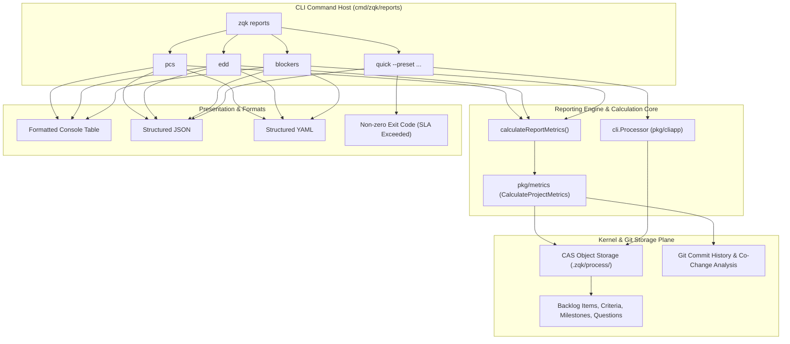

# CLI Reports Subsystem Architectural & Operational Guide

## Executive Summary

The **ZQK CLI Reports Subsystem** (`cmd/zqk/reports`) provides real-time, AI-augmented telemetry, predictive metrics, and lifecycle triage across the persistent Knowledge Kernel. Rather than relying on transient LLM approximations or subjective estimations, the Reports Subsystem computes deterministic and git-correlated telemetry directly against Content Addressable Storage (CAS) objects, relational graph dependencies, and Git version control history.

Key capabilities delivered by the Reports Subsystem include:
- **Project Confidence Score (`pcs`)**: A normalized 0–100 index measuring delivery health, completion rates, and development momentum.
- **Effort Distribution Discrepancy (`edd`)**: A variance metric comparing estimated effort against actual work-item commit distribution.
- **Dependencies & Blockers (`blockers`)**: An automated graph and co-change analyzer identifying critical blockers, architecture co-dependencies, and prioritized action items.
- **Quick Lifecycle Triage (`quick`)**: Fast lifecycle review presets (`questions`, `milestones-overdue`) with strict SLA fail-closed exit options for CI/CD pipelines.

---

## 1. Architectural Taxonomy & Core File Layout

The reports subsystem is located in `cmd/zqk/reports/` and integrates with `pkg/metrics`, `pkg/storage`, `pkg/cliapp`, and `pkg/objects`:

```
cmd/zqk/reports/
├── reports.go                           # Subsystem entrypoint, command builder, and shared metric calculator
├── pcs.go                               # Project Confidence Score command, interpretation, and formatters
├── edd.go                               # Effort Distribution Discrepancy command, variance analysis, and formatters
├── blockers.go                          # Dependencies & Blockers command, table/JSON formatters, and risk items
├── quick.go                             # Fast lifecycle query runner, preset dispatcher, and strict SLA handler
├── quick_constants.go                   # Standardized status, kind, and priority constants
├── quick_test.go                        # Unit and integration test suite for quick lifecycle presets
├── reports_test.go                      # Core metrics integration test suite with synthetic commit data
├── reports_cli_test.go                  # CLI invocation and output format test suite
└── reports_coverage_elevation_test.go   # Bounded unit tests for boundary values, error paths, and flags
```

---

## 2. Subsystem Architecture & Data Flow

The Reports Subsystem connects command-line invocations through the CLI application host to the storage plane and metrics calculator:



---

## 3. Command Taxonomy

The `reports` command group organizes project health reporting into four primary subcommands:

| Subcommand | Description | MCP Permission | Formats Supported |
| :--- | :--- | :--- | :--- |
| `zqk reports pcs` | Computes Project Confidence Score (0–100) | `read:metrics` | Table (default), JSON, YAML |
| `zqk reports edd` | Computes Effort Distribution Discrepancy (%) | `read:metrics` | Table (default), JSON, YAML |
| `zqk reports blockers` | Identifies active blockers, co-changes, and action items | `read:metrics` | Table (default), JSON, YAML |
| `zqk reports quick` | Executes fast lifecycle review presets | `read:objects` | JSON (default), Table |

### Common Flags
All commands under `zqk reports` support:
- `--include-commit-data`: Explicitly forces Git commit history ingestion into metric calculations (auto-detected when git history is present).
- `--format, -f`: Output formatting (`table`, `json`, `yaml`, `jsonl`).
- `--strict`: (Quick reports only) Causes the process to exit with non-zero exit code `1` if critical items (e.g. P0 questions or overdue milestones) violate SLAs.

---

## 4. Algorithmic Definitions & Interpretation Thresholds

### 4.1 Project Confidence Score (PCS)

**Definition:**
The Project Confidence Score measures overall project delivery confidence on a normalized `0.00` to `100.00` scale.

The base score evaluates work item completion weights across active items in `complete`, `in_progress`, `validated`, and `planned` states:
- `complete` items contribute a weight factor of `1.0`.
- `validated` items contribute a weight factor of `0.5`.
- Items in preliminary or unverified states (`exploring`) are excluded from positive weight calculation.

When commit telemetry is enabled, the score is augmented with Git velocity metrics:
- **Commit Frequency & Regularity**: Checks commit consistency across 7-day and 30-day windows.
- **Code Momentum**: Evaluates trend direction (increasing, stable, declining).
- **Recent Activity**: Rewards active progress in current cycles.

**Interpretation Thresholds:**

| Score Range | Status Code | Human Label | Operational Significance |
| :--- | :--- | :--- | :--- |
| **>= 80.00** | `excellent` | Excellent | High delivery confidence; on track for milestone completion. |
| **60.00 – 79.99** | `good` | Good | Healthy delivery momentum; minor concerns or isolated delays. |
| **40.00 – 59.99** | `fair` | Fair | Elevated risks or declining commit momentum; monitor closely. |
| **20.00 – 39.99** | `poor` | Poor | Significant delivery impediments; schedule slip probable. |
| **< 20.00** | `critical` | Critical | Immediate TPM intervention mandated; high failure probability. |

---

### 4.2 Effort Distribution Discrepancy (EDD)

**Definition:**
Effort Distribution Discrepancy indicates the variance percentage between estimated work item effort and observed effort distribution.

$$\text{EDD} = \left(\frac{\text{Actual Effort}}{\text{Estimated Effort}} - 1\right) \times 100\%$$

When commit telemetry is linked, actual effort is evaluated using commit-to-work-item ratios:
- Optimal commit-to-work-item ratio is typically between **2 and 5 commits per backlog item**.
- Ratios below 2 indicate potential under-scoping or sparse commits.
- Ratios above 5 indicate scope expansion, churning refactors, or underestimated complexity.

**Interpretation Thresholds:**

| Discrepancy Range | Status Code | Human Label | Root Cause & Corrective Action |
| :--- | :--- | :--- | :--- |
| **> +20.00%** | `significant_underestimation` | Significant Underestimation | Items consistently require more effort than estimated; re-evaluate estimation baselines. |
| **+5.01% to +20.00%** | `moderate_underestimation` | Moderate Underestimation | Mild under-scoping; monitor backlog item slicing and complexity drift. |
| **-5.00% to +5.00%** | `good_accuracy` | Good Estimation Accuracy | Estimated effort strongly aligns with delivery reality; reliable sizing. |
| **-19.99% to -5.01%** | `moderate_overestimation` | Moderate Overestimation | Work items required less effort than reserved; consider tighter sprint commitments. |
| **<= -20.00%** | `significant_overestimation` | Significant Overestimation | Consistent over-allocation of time/points; capacity underutilized. |

---

### 4.3 Dependencies & Blockers (D&B)

**Definition:**
The Dependencies & Blockers analyzer discovers potential project friction points across multiple analytical dimensions:
1. **Code Co-Change Dependencies**: Analyzes Git commit co-occurrences. Files that frequently change together in the same commits (>= 3 times) suggest tight architectural coupling.
2. **Stale File Blockers**: Detects files associated with active backlog items that have historical commits but zero activity over the last 30 days.
3. **Graph Relational Blockers**: Traverses active `blocked_by` and `blocking_milestone_refs` relations on kernel objects.

**Output Structure:**
- **Summary**: High-level textual synthesis of overall blocker risk.
- **Dependencies**: Categorized by type (`code`, `work_item`, `external`) and severity (`low`, `medium`, `high`, `critical`).
- **Blockers**: Critical impediments categorized by type and severity.
- **Action Items**: Concrete remediation tasks tagged with priority (`P0`, `P1`, `P2`, `high`, `medium`, `low`).

---

## 5. Quick Report Lifecycle Queries & Operational Semantics

The `zqk reports quick` command provides rapid status queries for lifecycle reviews and automated quality gates without requiring complex metrics synthesis.

### 5.1 Preset: `questions`
Lists all unanswered questions in the project:
- Filters out questions in terminal states (`resolved`, `deferred`, `error`).
- Resolves owners via `updated_by` with fallback to `owner_ref`.
- Truncates question text cleanly if exceeding 60 characters (`summary[:57] + "..."`).
- Flags whether any open question has `priority_tier == "P0"`.
- Populates `meta.critical_exceeded: true` if open P0 questions are found.

```bash
zqk reports quick --preset questions
```

### 5.2 Preset: `milestones-overdue`
Lists all milestones whose target completion date is in the past:
- Evaluates `target_date < today (UTC)`.
- Filters out completed, deferred, or archived milestones (`status $nin ["complete", "deferred", "archived"]`).
- Automatically sorts results chronologically ascending (`sort_by: target_date`).
- Sets `meta.critical_exceeded: true` if one or more overdue milestones exist.

```bash
zqk reports quick --preset milestones-overdue
```

### 5.3 Strict SLA Gating (`--strict`)
When the `--strict` flag is supplied:
- If `meta.critical_exceeded` is `true`, the command outputs the report and exits immediately with process exit code `1` (`errExitCode: "critical SLA exceeded"`).
- If no critical items exceed SLA, the command exits with code `0`.

This makes `zqk reports quick --preset ... --strict` ideal for pre-commit hooks, CI/CD pipeline gates, and pull request check valves:

```bash
# Fail CI build if any open P0 questions remain unanswered
zqk reports quick --preset questions --strict || exit 1

# Fail release pipeline if any milestone target date has lapsed
zqk reports quick --preset milestones-overdue --strict || exit 1
```

---

## 6. Execution Examples

### Checking Project Confidence Score
```bash
$ zqk reports pcs

Project Confidence Score (PCS)
=============================

Score: 84.50 / 100.00

Status: Excellent - High confidence in project delivery
```

### Exporting Metrics to JSON for Dashboards
```bash
$ zqk reports edd --format json
{
  "edd": 3.25,
  "status": "good_accuracy"
}
```

### Reviewing Active Blockers and Dependencies
```bash
$ zqk reports blockers

Dependencies & Blockers (D&B)
============================

Summary: 2 active dependencies and 1 critical blocker detected.

Dependencies (2):
-------------------
1. [high] code - co-change detected between pkg/auth/token.go and pkg/storage/cas.go
2. [medium] external - waiting for upstream schema verification

Blockers (1):
-------------
1. [critical] work_item - database migration BLI-402 incomplete

Action Items (1):
----------------
1. [P0] Finalize migration script before promoting release branch
```

---

## 7. Error Handling & Edge Recovery

| Error Condition | Cause | Subsystem Behavior | Resolution |
| :--- | :--- | :--- | :--- |
| `failed to get context` | Command context is nil or CLI registry unregistered | Returns error and halts execution | Initialize command via standard CLI tree |
| `project root not found` | Working directory does not contain `.zqk` and `ZQK_PROJECT_ROOT` is unset | Returns fail-closed error | Run command inside initialized ZQK repo or export `ZQK_PROJECT_ROOT` |
| `failed to initialize storage` | Storage path unreadable, corrupted, or pointing to a regular file | Wraps and returns filesystem/CAS error | Verify directory permissions and disk integrity |
| `unknown preset %q` | Specified `--preset` is not `questions` or `milestones-overdue` | Displays error with allowed presets list | Provide valid preset flag argument |
| `critical SLA exceeded` | `--strict` enabled and open P0 question or overdue milestone detected | Returns structured data and exits non-zero (`code 1`) | Resolve P0 question or adjust milestone target date |
