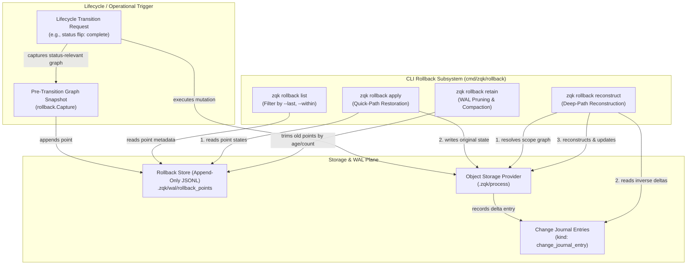
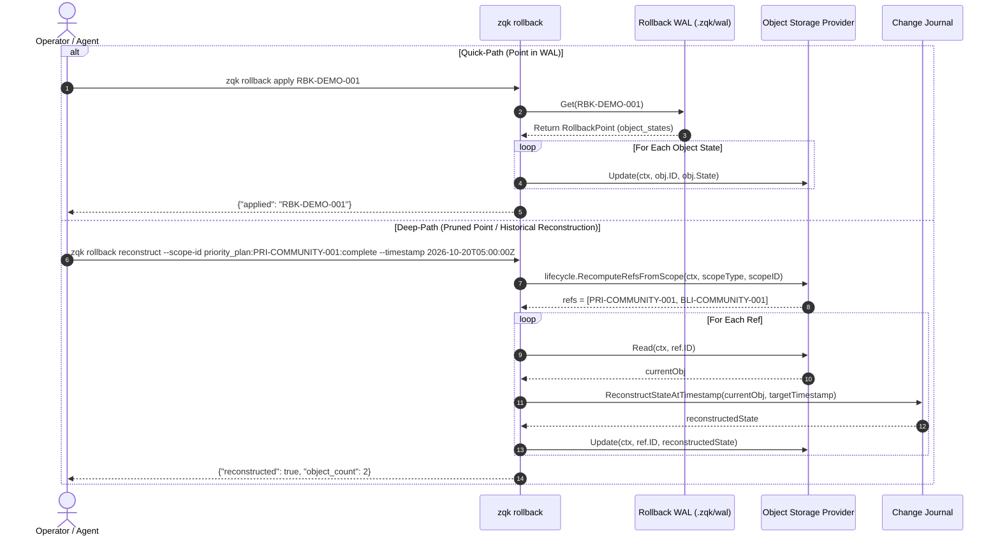
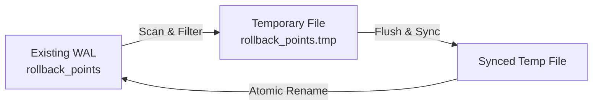

# CLI Rollback Subsystem Architectural Guide

Comprehensive architectural documentation for the **CLI Rollback Subsystem**, snapshot point storage model, quick-path point restoration, deep-path change journal reconstruction, scope reference resolution, and retention pruning mechanics within the **ZQK Knowledge Kernel**.

---

## 1. Architectural Overview & Design Principles

The **ZQK Rollback Subsystem** (`cmd/zqk/rollback` and `pkg/rollback`) provides a dual-tiered, state-recovery and point-in-time restoration framework for the Knowledge Kernel. Complex multi-agent workflows, autonomous sprint transitions, and batch lifecycle operations inevitably face edge failures, network disruptions, or abortive operations. The rollback subsystem ensures repository state integrity by guaranteeing that any mutating lifecycle transition can be reverted safely and deterministically.



### Core Design Principles

1. **Dual-Tiered Recovery (Quick-Path vs. Deep-Path)**:
   - **Quick-Path (`apply`)**: High-speed, $O(1)$ snapshot application. Prior to executing risky lifecycle status transitions, the orchestrator serializes the status-relevant subgraph into an append-only WAL. Restoring an in-retention point is a direct write back into object storage.
   - **Deep-Path (`reconstruct`)**: Beyond-threshold historical reconstruction. If a point has been pruned by retention policies or if arbitrary point-in-time recovery is required, the kernel queries individual `change_journal_entry` deltas and rolls back mutations in reverse chronological order.
2. **Atomic Graph Scoping**: Rollback snapshots never capture arbitrary disjoint subsets; they capture the complete **status-relevant graph** (e.g. a `priority_plan` alongside all child `backlog_item` nodes tied to that plan). Reversion restores relational consistency across the entire execution boundary.
3. **Fail-Safe Observability & Guidance**: If an operator or automated agent attempts to `apply` a point that was pruned from the WAL, the subsystem intercepts the `not found` condition and automatically outputs a canonical CLI suggestion rewriting the request into a deep-path `reconstruct` invocation.
4. **Append-Only WAL & Atomic Compaction**: The rollback store operates as a strict, sync-guaranteed append-only log under `.zqk/wal/rollback_points`. Pruning (`retain`) writes to a temporary file (`.tmp`) before performing an atomic file rename, preventing corrupt states during unexpected power or process termination.

---

## 2. Command Taxonomy & Architecture

The CLI rollback subsystem resides in `cmd/zqk/rollback` and conforms to standard ZQK command builder patterns.

```
cmd/zqk/rollback/
├── rollback.go                                     # Command definitions, flags, and runner bindings
├── rollback_test.go                                # Base command hierarchy verification
├── rollback_extended_test.go                       # Project initialization and baseline integration tests
└── rollback_coverage_elevation_cycle103_test.go   # Comprehensive 100% statement verification suite
```

### 2.1 Subcommand Matrix

| Command | Arguments | Flags | Description |
| :--- | :--- | :--- | :--- |
| `zqk rollback` | None | `--format <json\|yaml\|table>` | Root command group and help dispatcher. |
| `zqk rollback list` | None | `--last <int>`, `--within <duration>`, `--format <fmt>` | Lists stored snapshot points with timestamp and scope metadata. |
| `zqk rollback apply` | `<point-id>` | `--format <fmt>` | Reapplies captured object states from a stored snapshot point (quick path). |
| `zqk rollback reconstruct` | None | `--scope-id <kind:id:toStatus>`, `--timestamp <RFC3339>`, `[--scope-type <type>]`, `--format <fmt>` | Reconstructs state at target timestamp using change journal inverse deltas (deep path). |
| `zqk rollback retain` | None | `--format <fmt>` | Trims the rollback WAL based on configured retention count and duration limits. |

### 2.2 Command Construction & Context Binding

Each command is constructed using builder primitives from `pkg/cli/bldr_cli_cmd_v1` with explicit flag validation:

```go
func NewRollbackCmd() *cobra.Command {
    cmd := clipkg.ApplyBuilder(bldr_cli_cmd_v1.NewRollbackCommandBuilder(), &cobra.Command{
        Use:   "rollback",
        Short: "List and apply rollback points (lifecycle/maintenance snapshots)",
        Long:  "List rollback points, apply a stored point (quick path), reconstruct state at a timestamp (beyond-threshold path), or trim the store (retain).",
    })
    cmd.PersistentFlags().String("format", "", "Output format (json, yaml, table)")
    cmd.AddCommand(newListCmd())
    cmd.AddCommand(newApplyCmd())
    cmd.AddCommand(newReconstructCmd())
    cmd.AddCommand(newRetainCmd())
    return cmd
}
```

---

## 3. Snapshot Point Storage Model

Rollback points are stored on disk in the project data directory under `.zqk/wal/rollback_points`.

```
<project_root>/
└── .zqk/
    ├── wal/
    │   └── rollback_points          # Append-only JSONL format
    └── process/                     # Primary CAS object storage
```

### 3.1 Point Structure & Schema

Each entry in `rollback_points` is a single serialized JSON object separated by a newline (`\n`):

```json
{
  "id": "rb-20261020-051103.123456789",
  "timestamp": "2026-10-20T05:11:03.123456789Z",
  "scope_type": "lifecycle",
  "scope_id": "priority_plan:PRI-COMMUNITY-001:complete",
  "object_states": [
    {
      "id": "PRI-COMMUNITY-001",
      "kind": "priority_plan",
      "state": {
        "id": "PRI-COMMUNITY-001",
        "kind": "priority_plan",
        "title": "Cycle 103 Execution",
        "status": "in_progress",
        "created_at": "2026-10-20T04:00:00Z",
        "updated_at": "2026-10-20T05:00:00Z"
      }
    },
    {
      "id": "BLI-COMMUNITY-001",
      "kind": "backlog_item",
      "state": {
        "id": "BLI-COMMUNITY-001",
        "kind": "backlog_item",
        "title": "Elevate rollback test coverage",
        "status": "in_progress",
        "priority_plan_ref": "PRI-COMMUNITY-001"
      }
    }
  ]
}
```

### 3.2 Storage Invariants & Concurrency

- **Line Boundary Limit**: The store enforces `maxRollbackLineSize = 2 MiB` per point to guard against unbounded memory consumption during WAL line scanning.
- **Thread Safety**: Concurrent access to the WAL is mediated by an exclusive read-write lock (`sync.RWMutex`). Append and Retain operations acquire write locks; List and Get acquire read locks. All lock operations record structured trace logging via `logging.GetLockLoggerFromProfile`.
- **Durability (`fsync`)**: Every append operation explicitly invokes `file.Sync()` prior to releasing the lock, ensuring snapshots reach non-volatile media before lifecycle mutations commence.

---

## 4. Recovery Mechanics: Quick-Path vs. Deep-Path



### 4.1 Quick-Path Restoration (`zqk rollback apply`)

When a rollback point exists in the WAL:
1. `resolveRollbackStorageAndContext` validates the current ZQK project root and retrieves the configured `ObjectStorageProvider`.
2. `rollback.Get(projectRoot, pointID)` deserializes the point from the WAL.
3. For each object in `p.ObjectStates`, `provider.Update(ctx, secCtx, obj.ID, obj.State)` replaces the live storage record with the captured state.
4. Returns output indicating success (`{"applied": "<point_id>"}`).

### 4.2 Deep-Path Reconstruction (`zqk rollback reconstruct`)

When a point has been trimmed by retention or when recovering to an explicit historical timestamp:
1. **Scope Parsing & Graph Discovery**: `lifecycle.RecomputeRefsFromScope` parses `--scope-id` (`kind:id:toStatus`). If `kind` is `priority_plan`, it queries all child `backlog_item` objects having `priority_plan_ref == id`.
2. **Current State Retrieval**: For each reference, the provider reads the current state from disk.
3. **Change Journal Inversion**: `storage.ReconstructStateAtTimestamp` queries all `change_journal_entry` records for `kind:id` created *after* the target timestamp, sorted descending by `created_at`. It rolls back each recorded delta in reverse chronological order.
4. **State Persistence**: The reconstructed state is applied to storage via `provider.Update`.
5. **Output**: Renders confirmation with scope details, target timestamp, and count of restored objects (`{"reconstructed": true, "object_count": N}`).

---

## 5. Scope Reference Resolution

Scope strings identify the boundary of state captured during lifecycle operations.

### Scope Format: `kind:id:toStatus`

Examples:
- `backlog_item:BLI-COMMUNITY-001:complete`: Resolves to a single reference (`[backlog_item:BLI-COMMUNITY-001]`).
- `priority_plan:PRI-COMMUNITY-001:complete`: Resolves to a graph containing the priority plan itself plus all child backlog items linked via `priority_plan_ref`.

```go
func RecomputeRefsFromScope(ctx context.Context, scopeType, scopeID string, provider storage.ObjectStorageProvider) []rollback.ObjectRef {
    if provider == nil || scopeType != rollback.ScopeTypeLifecycle || scopeID == "" {
        return nil
    }
    parts := strings.SplitN(scopeID, ":", 3)
    if len(parts) < 3 {
        return nil
    }
    kind, id, toStatus := parts[0], parts[1], parts[2]
    return StatusRelevantRefs(ctx, provider, TransitionRequest{Kind: kind, ID: id, ToStatus: toStatus})
}
```

---

## 6. Retention Pruning Mechanics (`zqk rollback retain`)

To prevent unbounded disk growth, the rollback store supports periodic trimming.

### 6.1 Configuration Parameters

Configured via `rollback.Config` (`pkg/rollback/config.go`):
- `RetainCount`: Maximum number of recent points to keep (default: 50).
- `RetainDuration`: Maximum age of points to keep (default: 168h / 7 days).

### 6.2 Atomic Compaction Procedure



1. Acquires exclusive write lock on `Store.mu`.
2. Scans `rollback_points` line by line.
3. Applies retention filters (keeps the most recent $N$ points within duration cutoff).
4. Streams retained records to `rollback_points.tmp`.
5. Calls `f.Sync()` on the temporary file and closes it.
6. Atomically moves `rollback_points.tmp` over `rollback_points` (`fileutil.Rename`).
7. Releases write lock.

---

## 7. Safety Invariants & Boundary Guards

### The Three-Fold Proof Model

1. **Static Floor Invariant**:
   - The WAL path is strictly bounded under `.zqk/wal/rollback_points`.
   - Line length cannot exceed 2 MiB (`maxRollbackLineSize`).
   - Objects cannot be reconstructed backwards beyond their inception (`created_at` timestamp).
2. **Operational Dynamic Proof**:
   - `apply` operations must be completely idempotent: applying the same point $N$ times leaves the object storage in the exact captured state.
   - `fsync` must succeed before a rollback point ID is returned to the lifecycle caller.
3. **Negative Adversarial Boundary**:
   - Missing arguments or malformed durations (e.g. `--within invalid`) fail-closed immediately without side-effects.
   - Non-existent or pruned point lookups return a helpful canonical recommendation:
     ```
     rollback point not found: RBK-DEMO-001 (if pruned, use: zqk rollback reconstruct --scope-id <kind:id:toStatus> --timestamp <RFC3339>)
     ```
   - Concurrent reads during compaction receive consistent views without partial reads or file truncation errors.

---

## 8. Operational Walkthrough & Concrete Invocations

### 8.1 Listing Available Rollback Points

```bash
# List all rollback points in tabular view
zqk rollback list

# List points formatted as JSON
zqk rollback list --format json

# Filter for the last 5 points created in the past 24 hours
zqk rollback list --last 5 --within 24h
```

### 8.2 Applying a Point (Quick Path)

```bash
# Apply a specific snapshot point
zqk rollback apply rb-20261020-051103.123456789

# Output:
# {"applied": "rb-20261020-051103.123456789"}
```

### 8.3 Reconstructing State from Change Journal (Deep Path)

```bash
# Reconstruct a backlog item's state before a bad transition
zqk rollback reconstruct \
  --scope-type lifecycle \
  --scope-id backlog_item:BLI-COMMUNITY-001:planned \
  --timestamp 2026-10-20T04:30:00Z \
  --format json

# Output:
# {
#   "object_count": 1,
#   "reconstructed": true,
#   "scope_id": "backlog_item:BLI-COMMUNITY-001:planned",
#   "scope_type": "lifecycle",
#   "timestamp": "2026-10-20T04:30:00Z"
# }
```

### 8.4 Pruning Old Points

```bash
# Run store retention compaction
zqk rollback retain --format json

# Output:
# {"retained": true}
```
