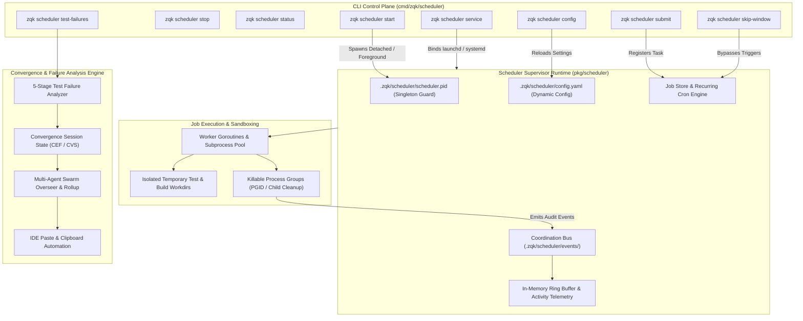

# CLI Scheduler Daemon & Job Execution Engine Guide

## Executive Summary

The ZQK CLI Scheduler subsystem (`zqk scheduler`) coordinates asynchronous background execution, recurrent maintenance routines, convergence prompt dispatching, telemetry aggregation, and automated test failure analysis across the Knowledge Kernel.

- **Supervisor Daemon (`zqk scheduler start | stop | status`)**: Manages long-running daemon execution with cross-process singleton locks, dynamic hot-reload configuration, and optional OS service management (`launchd`/`systemd`).
- **Job Execution Engine (`zqk scheduler submit | list | trigger | kill`)**: Executes one-off and recurrent tasks parameterized by cron schedules, timeouts, concurrency constraints, and sandboxed working directories.
- **Telemetry & Coordination Bus (`zqk scheduler activity | history | dump`)**: Ingests and buffers real-time scheduler events, job state machine transitions, and persistent audit logs.
- **Convergence & Test Failure Pipeline (`zqk scheduler test-failures | convergence`)**: Analyzes persistent test failures, computes CVS convergence matrices, drives rollup actions, and renders structured agent prompts for automated remediation.

---

## 1. System Architecture & Topology



---

## 2. Daemon Lifecycle & Service Operations

### 2.1 Starting and Stopping the Daemon

```bash
# Start scheduler daemon in background (default for workstations)
zqk scheduler start

# Start in foreground with explicit log output (for containers and debugging)
zqk scheduler start --foreground

# Query daemon operational status (PID, uptime, active job counts)
zqk scheduler status --format json

# Gracefully stop the running daemon
zqk scheduler stop

# Forcefully kill the daemon if unresponsive
zqk scheduler stop --force
```

### 2.2 Singleton Protection & Lock Recovery
The supervisor daemon utilizes atomic filesystem singleton locks (`.zqk/scheduler/scheduler.pid` and socket locks) to guarantee that only one scheduler instance executes against any given repository root. 
- Attempting to launch a secondary daemon instance fails closed immediately with `ErrDaemonAlreadyRunning`.
- If a prior process crashes abruptly, stale lock detection verifies PID liveness before purging dead locks automatically (`zqk system check --auto-remedy`).

### 2.3 Host OS Service Integration (`zqk scheduler service`)
For unattended production agents or continuous integration servers, `zqk scheduler` integrates directly with host init systems:
- **macOS**: Generates and manages `launchd` user agents (`~/Library/LaunchAgents/com.zqk.scheduler.<hash>.plist`).
- **Linux**: Manages user or system `systemd` units (`~/.config/systemd/user/zqk-scheduler.service`).

```bash
# Install and register the workspace scheduler as a background OS service
zqk scheduler service install

# Check status of the registered OS service
zqk scheduler service status

# Stop and disable the service
zqk scheduler service stop

# Garbage collect orphaned service registrations across uninstalled repositories
zqk scheduler service gc
```

---

## 3. Job Execution Engine & Task Management

### 3.1 Submitting One-Off & Scheduled Jobs
Jobs can be queued for immediate execution or scheduled using cron syntax:

```bash
# Submit an immediate one-off job
zqk scheduler submit --job-id SCH-001 --command "make test" --timeout 120s

# Submit a recurring cron job running every 15 minutes
zqk scheduler submit \
  --job-id SCH-CRON-SWEEP \
  --cron "*/15 * * * *" \
  --command "zqk system check --auto-fix" \
  --retries 3 \
  --workdir "/tmp/isolated-run"

# Trigger a configured job immediately outside its normal schedule
zqk scheduler trigger SCH-CRON-SWEEP
```

### 3.2 Dynamic Configuration & Skip Windows
Operators can pause recurrent execution without killing the supervisor process:

```bash
# Pause all background job execution dynamically
zqk scheduler config --jobs-paused

# Re-enable job processing
zqk scheduler config --no-jobs-paused

# Set a 45-minute temporary skip window across all jobs (useful during refactoring)
zqk scheduler skip-window set --for 45m --match-all

# Inspect active skip windows
zqk scheduler skip-window get
```

---

## 4. Telemetry, Activity & Observability

### 4.1 Activity Ring Buffer & Real-Time Monitoring
The scheduler maintains an in-memory activity ring buffer and writes structured audit logs to `.zqk/scheduler/events/coordination-bus.jsonl`:

```bash
# Stream live scheduler activity
zqk scheduler activity --format json

# Filter activity to only failed jobs
zqk scheduler activity --failed-only

# View chronological job execution history with duration and outcome metrics
zqk scheduler history --since 2h --limit 50
```

### 4.2 Diagnostic Core Dumps
When debugging deadlock or high latency conditions, the dump command queries the supervisor's diagnostic IPC endpoint:

```bash
zqk scheduler dump --format json > /tmp/scheduler-diagnostic-dump.json
```

---

## 5. Convergence & Test Failures Pipeline

The convergence engine ingests test failure records, groups them into persistent failure clusters, drives multi-agent remediation swarms, and formats actionable prompts for operator chat interfaces:

```bash
# Analyze persistent test failures and identify flaky vs permanent regressions
zqk scheduler test-failures analyze --min-failures 2 --failure-rate 0.5

# Generate automated backlog items for persistent test failures
zqk scheduler test-failures analyze --create-backlog-items

# Run the test failure convergence overseer to orchestrate remediation
zqk scheduler test-failures convergence overseer --session-id CVS-001

# Render an IDE-ready agent prompt summarizing next measured actions
zqk scheduler test-failures convergence agent-prompt --session-id CVS-001 --attention-mode auto
```

---

## 6. Operational Invariants & Guardrails

1. **Process Quarantine & Child Cleanup**: Every worker subprocess is spawned inside a dedicated process group (`Setpgid: true`). On timeout or cancellation, the entire process tree is terminated (`SIGTERM` followed by `SIGKILL`), preventing orphaned child processes.
2. **Deterministic Remediation**: In-flight job states and lock files conform to the Knowledge Kernel schema. Corrupted state files are quarantined and reported via `zqk system check`.
3. **Fail-Closed Gate Checks**: All mutations, submissions, and service bindings strictly validate workspace boundaries and refuse execution outside validated repository roots.
