# CLI Scheduler Daemon & Recurrent Job Execution Guide

Comprehensive guide to Knowledge Kernel scheduler runtime operations (`zqk scheduler`), daemon lifecycle management, recurrent job dispatching, temporary policy skip windows, state machine bucketing, and audit event observability within the **ZQK Knowledge Kernel**.

---

## 1. System Overview & Architecture

The ZQK Scheduler subsystem coordinates asynchronous tasks, recurrent maintenance routines, background convergence prompts, and health checks across the repository.

```mermaid
flowchart TD
    subgraph SchedulerCLI["CLI Control Plane (cmd/zqk/scheduler)"]
        StartCmd["zqk scheduler start"]
        StopCmd["zqk scheduler stop"]
        StatusCmd["zqk scheduler status"]
        ConfigCmd["zqk scheduler config"]
        StateCmd["zqk scheduler state"]
        SkipCmd["zqk scheduler skip-window"]
        DumpCmd["zqk scheduler dump"]
        ServiceCmd["zqk scheduler service"]
        FailuresCmd["zqk scheduler test-failures"]
    end

    subgraph RuntimeEngine["Scheduler Runtime Engine (pkg/scheduler)"]
        Daemon["Scheduler Supervisor Daemon"]
        PIDFile[".zqk/scheduler/scheduler.pid"]
        ConfigFile[".zqk/scheduler/config.yaml"]
        SkipWindowFile[".zqk/scheduler/skip_window.yaml"]
        StateRegistry[".zqk/scheduler/state/ (Bucketed JSON/YAML)"]
        AuditEvents["Audit Events (.zqk/events/audit.jsonl)"]
    end

    subgraph ExecutionPlane["Recurrent Job Execution"]
        ConvergenceJobs["Convergence Agent Prompt Generation"]
        HealthTailJobs["Test Bundle Health & Telemetry"]
        StorageHygieneJobs["Steward Storage & CAS Scavenge"]
    end

    StartCmd -->|Spawns / Manages| Daemon
    StopCmd -->|Signals SIGTERM/SIGINT| Daemon
    ConfigCmd -->|Mutates / Reloads| ConfigFile
    SkipCmd -->|Writes / Queries| SkipWindowFile
    StateCmd -->|Inspects / Migrates| StateRegistry
    DumpCmd -->|Queries Diagnostic IPC| Daemon

    Daemon --> PIDFile
    Daemon --> ConfigFile
    Daemon --> SkipWindowFile
    Daemon --> StateRegistry
    Daemon --> AuditEvents

    Daemon -->|Dispatches| ConvergenceJobs
    Daemon -->|Dispatches| HealthTailJobs
    Daemon -->|Dispatches| StorageHygieneJobs
```



---

## 2. Core CLI Commands & Lifecycle Management

### 2.1 Starting and Stopping the Daemon

```bash
# Start scheduler in background (default for daemon operations)
zqk scheduler start

# Start scheduler in foreground (for containerized environments or debugging)
zqk scheduler start --foreground

# Check current status, running PID, and active jobs
zqk scheduler status --format json

# Stop running daemon gracefully
zqk scheduler stop
```

### 2.2 Dynamic Configuration & Pause Controls

The scheduler daemon watches `.zqk/scheduler/config.yaml` for dynamic configuration updates without requiring a full process restart:

```bash
# Inspect current configuration
zqk scheduler config --format json

# Pause all recurrent job executions dynamically
zqk scheduler config --jobs-paused

# Resume normal recurrent job schedules
zqk scheduler config --no-jobs-paused
```

### 2.3 Temporary Skip Windows (`skip-window`)

During repository refactors, network instability, or CI gate maintenance, operators can configure time-bounded skip windows to bypass job triggers:

```bash
# Skip all jobs for the next 30 minutes
zqk scheduler skip-window set --for 30m --match-all

# Skip specific jobs until a target RFC3339 timestamp
zqk scheduler skip-window set --until 2026-10-15T00:00:00Z --job-type test-bundle

# Inspect active skip window status and filters
zqk scheduler skip-window status

# Clear any active skip window immediately
zqk scheduler skip-window clear
```

### 2.4 State Inspection & Migration (`state`)

The scheduler tracks individual job executions with fine-grained state files:

```bash
# Display summary of all job execution states
zqk scheduler state

# Output state summary as structured JSON
zqk scheduler state --format json

# Migrate legacy flat state files into modern workload-bucketed directories
zqk scheduler state --migrate
```

---

## 3. Host Service Management (`service`)

On supported host platforms (macOS launchd, Linux systemd), `zqk scheduler service` automates system daemon registration:

```bash
# Install as user service unit
zqk scheduler service install

# Inspect registered scheduler service units across known repositories
zqk scheduler service list

# Uninstall service unit
zqk scheduler service uninstall
```

> [!NOTE]
> Service control commands enforce system authentication invariants to protect host process environments.

---

## 4. Audit Event Extraction & Telemetry

Job executions emit structured audit records to `.zqk/events/audit.jsonl`. The `ExtractAuditEventFields` engine parses and categorizes these records:

- **Target Kind**: `scheduler_job`
- **Event Types**:
  - `scheduler_job_started`: Dispatched job has begun execution.
  - `scheduler_job_completed`: Job completed successfully with duration metrics.
  - `scheduler_job_failed`: Job encountered an error, captured with failure diagnostic telemetry.

---

## 5. Fail-Closed Invariants & Operational Verification

1. **Anti-Duplication**: A cross-process lock and PID file check guarantee that only one scheduler daemon runs per workspace. Duplicate start commands fail closed immediately.
2. **Graceful Reload**: Writing reload requests notifies the running daemon within seconds, preventing unnecessary process restarts and preserving in-flight job continuity.
3. **Structured Format Compatibility**: All inspection commands support `--format json`, `--format yaml`, and standard human-readable text modes.
