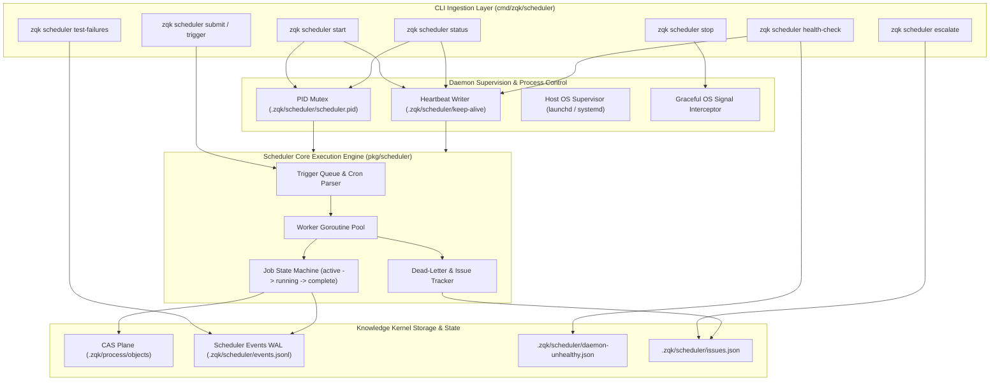

# CLI Scheduler Subsystem Architectural & Operational Guide

## Overview

The **ZQK Scheduler Subsystem** (`cmd/zqk/scheduler`, `pkg/scheduler`) provides an autonomous, resilient background orchestration engine, event-driven cron trigger dispatcher, cross-process daemon supervisor, and dead-letter failure escalation pipeline for the **Zen Quantum Kernel**.

Unlike external cron daemons (such as system cron or Jenkins) that run stateless tasks in detached environments, the ZQK Scheduler operates as a deeply integrated kernel subsystem. It executes scheduled and event-triggered jobs defined within the Content Addressable Storage (CAS) plane, records execution lineage into the Write-Ahead Log (WAL), maintains supervisor heartbeats with automated recovery, and manages lifecycle state machines across autonomous continuous improvement (CAP) loops.

```bash
zqk scheduler <subcommand> [flags]
```

---

## Subsystem Command Taxonomy

The `zqk scheduler` CLI commands provide comprehensive controls across daemon supervision, ad-hoc job triggers, execution telemetry, and operational recovery:

| Command / Invocation | Primary Mode | Description & Operational Behavior |
|---|---|---|
| `zqk scheduler start` | Daemon Control | Starts the scheduler background daemon (`--background`, default) or runs attached in foreground (`--foreground`) with live logging. Performs singleton PID mutual exclusion. |
| `zqk scheduler stop` | Daemon Control | Issues an orderly termination signal to the running scheduler daemon. Supports graceful drain with configurable timeout (`--timeout`) and force kill fallback (`--force`). |
| `zqk scheduler restart` | Daemon Control | Performs a coordinated stop-and-start sequence, ensuring existing background jobs cleanly finish before relaunching the supervisor. |
| `zqk scheduler status` | Diagnostics | Displays current daemon operational state, supervisor PID, uptime, active job worker pools, and keep-alive heartbeat freshness. |
| `zqk scheduler health-check` | Monitoring / Probe | External health check probe designed for monitoring agents and external cron watchdogs. Returns standardized exit codes (`0` healthy, `1` unhealthy, `2` operational failure). |
| `zqk scheduler submit <file\|->` | Job Ingestion | Submits ad-hoc jobs, test bundles, or scheduled job definitions to the scheduler trigger queue with environment overrides and callback specifications. |
| `zqk scheduler trigger <job-id>` | Ad-Hoc Execution | Enqueues an immediate trigger execution event for any registered job, bypassing its configured cron interval. |
| `zqk scheduler list` | Query / Inspection | Lists registered scheduler jobs with status, cron expressions, next execution slots, and last run timestamps (`--format table\|json\|yaml`). |
| `zqk scheduler history` | Telemetry / Audit | Analyzes historical job execution runs, success/failure ratios, and execution duration trends across rolling time windows (`--since`, `--limit`). |
| `zqk scheduler activity` | Live Telemetry | Shows real-time scheduler activity, current busyness, queued triggers, stuck jobs, and missed trigger alerts (`--watch`, `--compact`). |
| `zqk scheduler wait <job-id>` | Synchronization | Blocks until a submitted or triggered job finishes execution, streams status changes via WAL replay, and exits with the job's completion code. |
| `zqk scheduler dump` | Diagnostics | Emits complete runtime diagnostics, daemon environment variables, memory state, and active worker goroutine stack traces. |
| `zqk scheduler escalate` | Alerting / Recovery | Triggers dead-letter failure notifications to configured webhooks (Slack/custom) and writes persistent alert issues into `.zqk/scheduler/issues.json`. |
| `zqk scheduler test-failures` | Quality Engineering | Subsystem for inspecting persistent test failures, managing quarantine lists, debriefing convergence rollups, and auto-scheduling regression reruns. |
| `zqk scheduler service` | Host Integration | Manages host OS supervisor integration (systemd service units on Linux or launchd property lists on macOS) for automated crash-restart persistence. |
| `zqk scheduler skip-window` | Maintenance Windows | Sets temporary execution pause windows (`set`, `clear`, `list`) suppressing scheduled job triggers during maintenance. |
| `zqk scheduler config` | Configuration | Manages runtime scheduler configuration flags, worker concurrency limits, and log level verbosity. |

### Command Flags & Common Options

The scheduler subsystem provides precise flags for background execution, structured data serialization, and duration filtering:

| Command | Flag | Short | Default | Description |
|---|---|---|---|---|
| `start` | `--background` | | `true` | Runs the scheduler daemon detached in the background and returns immediately. |
| `start` | `--foreground` | | `false` | Runs the scheduler daemon attached to standard output for live debugging. |
| `start` | `--minimal` | | `false` | Launches in minimal footprint mode, omitting secondary background maintenance runners. |
| `stop` | `--force` | `-f` | `false` | Sends `SIGKILL` if graceful shutdown does not complete within the timeout period. |
| `stop` | `--timeout` | `-t` | `30s` | Maximum grace period allowed for running workers to finish before forced termination. |
| `status` | `--format` | `-f` | `table` | Output format: `table`, `json`, `yaml`. |
| `list` | `--enabled-only` | | `false` | Filters job output to only currently active, enabled timer jobs. |
| `list` | `--job-type` | | `""` | Filters jobs by specific execution type (e.g. `test-run`, `ambient-wave`, `maintenance`). |
| `history` | `--since` | | `24h` | Filters execution history to runs completed within the specified duration window. |
| `history` | `--job-id` | | `""` | Restricts history report to a specific job identifier. |
| `activity` | `--watch` | `-w` | `0s` | Periodic refresh interval for continuous console monitoring (e.g. `2s`, `5s`). |
| `activity` | `--stuck-stale-after` | | `30m` | Elapsed duration after which an executing job without progress is classified as stuck. |
| `escalate` | `--severity` | `-s` | `warning` | Alert severity level: `info`, `warning`, `critical`. |
| `escalate` | `--dry-run` | `-n` | `false` | Simulates alert payload dispatch without sending actual network requests. |
| `escalate` | `--inbox-only` | | `false` | Writes escalation directly to local operator inbox without external webhooks. |
| `skip-window` | `--for` | | `""` | Duration string for temporary execution suppression (e.g. `2h`, `45m`). |
| `skip-window` | `--until` | | `""` | RFC3339 timestamp after which scheduled executions automatically resume. |

---

## Core Architecture & Execution Topology

The Scheduler Subsystem coordinates background concurrency between user commands, persistent storage, process supervisor loops, and filesystem state.



---

## Detailed Architectural Mechanisms

### 1. Singleton Daemon Supervision & PID Mutual Exclusion
To guarantee that duplicate scheduler processes do not simultaneously poll cron expressions or double-dispatch jobs:
- The scheduler writes its current OS process ID into `.zqk/scheduler/scheduler.pid` upon startup.
- `cmd/zqk/scheduler` verifies process liveness via cross-process signal probing (`os.FindProcess` combined with `signal(0)` semantics).
- If a stale PID file exists from an unclean reboot or killed process, the CLI detects that the PID is no longer running and safely reclaims the lock.
- Cross-process commands (`zqk scheduler status`, `zqk scheduler stop`) query this PID file to communicate with the daemon without needing dedicated TCP sockets.

### 2. Keep-Alive Heartbeat & External Health Checking
The scheduler supervisor maintains continuous proof-of-life:
- Every execution tick, the daemon writes an updated UTC RFC3339 timestamp into `.zqk/scheduler/keep-alive`.
- External monitors execute `zqk scheduler health-check` periodically.
- If the heartbeat age exceeds the allowable threshold (`DefaultKeepAliveTimeout` of 2 minutes) while enabled timer jobs exist in the CAS plane:
  - The health check writes an error report into `.zqk/scheduler/daemon-unhealthy.json`.
  - It records a `scheduler_health_metric` object into CAS.
  - It exits with code `1`, alerting external monitoring tools or automated restarts.
- If the daemon is healthy or cleanly stopped with no active timer jobs, it removes any lingering `daemon-unhealthy.json` and exits with code `0`.

### 3. Trigger Queue & Worker Concurrency
Scheduled tasks follow a decoupled trigger-and-worker pattern:
- **Cron Slot Evaluation**: The scheduler continuously checks enabled `job` objects in CAS whose cron expressions match the current minute slot.
- **Ad-Hoc Enqueuing**: Commands like `zqk scheduler trigger <job-id>` or `zqk scheduler submit` inject execution triggers directly into the FIFO channel.
- **Worker Concurrency Ceiling**: Configurable worker pools consume trigger events up to concurrency limits, isolating task execution from the main scheduling loop.
- **Skip Window Enforcement**: Active maintenance windows configured via `zqk scheduler skip-window` are evaluated prior to dispatch; matching jobs have their triggers skipped and logged rather than queued.

### 4. Write-Ahead Event Logging & State Machine Transitions
Every execution phase is captured in an append-only event stream:
- Execution starts, progress milestones, worker completions, and exit failures are logged to `.zqk/scheduler/events.jsonl` and mirrored to the kernel WAL.
- Job state machines transition predictably: `active` ➔ `running` ➔ `completed` or `failed`.
- Telemetry commands (`zqk scheduler history`, `zqk scheduler activity`) stream and parse these event logs without taking write locks on the CAS object store.

### 5. Dead-Letter Queue & Automated Escalation
When worker jobs encounter unrecoverable errors:
- Failed jobs record failure metadata, error logs, and stack traces.
- The failure count is compared against retry policies; exceeding thresholds marks the job failed and registers an entry in `.zqk/scheduler/issues.json`.
- `zqk scheduler escalate` evaluates open issues and dispatches webhook notifications (with secret URL masking for security) or delivers notifications to operator inboxes.

---

## Operational Scenarios & Recipes

### Scenario A: Starting the Daemon in Foreground Mode for Debugging
```bash
# Start scheduler attached to the current shell with verbose streaming
zqk scheduler start --foreground
```

### Scenario B: Checking Scheduler Health from External Monitoring Scripts
```bash
# External health check probe suitable for cron or Kubernetes liveness probes
zqk scheduler health-check
STATUS=$?
if [ $STATUS -ne 0 ]; then
  echo "Scheduler daemon unhealthy (exit code $STATUS)! Initiating restart..."
  zqk scheduler restart
fi
```

### Scenario C: Submitting an Ad-Hoc Test Bundle and Waiting for Completion
```bash
# Submit a test bundle execution specification and block until complete
zqk scheduler submit ./specs/test-run-bundle.yaml
zqk scheduler wait SCH-test-run-bundle --timeout 5m
```

### Scenario D: Managing Maintenance Windows
```bash
# Suppress all scheduled timer jobs for a 2-hour infrastructure upgrade
zqk scheduler skip-window set --for 2h --match-all

# Inspect active skip windows
zqk scheduler skip-window list

# Resume normal scheduling immediately after maintenance concludes
zqk scheduler skip-window clear
```

---

## Verification & Statement Coverage Invariant

The Scheduler Subsystem enforces strict test coverage and quality invariants across all files in `cmd/zqk/scheduler`:

1. **High Statement Coverage Standard**: Statement coverage across `cmd/zqk/scheduler` must achieve **>= 85.0%**.
2. **Hermetic Test Isolation**: Tests creating temporary project workspaces must register `cli.UnregisterStorageForProjectRoot(tmpDir)` in `t.Cleanup` to eliminate background timer races, lingering goroutines, and directory cleanup flakes.
3. **AST Quality Invariant**: Zero swallowed errors across test fixtures and production code. Error returns must be checked with `require.NoError`, `assert.NoError`, or explicit conditional handling rather than blank assignments (`_ = ...`).
4. **Modular Function Length**: Test and implementation functions must remain modular (under 100 lines per function), breaking complex test scenarios into structured sub-helpers.
5. **Fast Test Execution**: Targeted test runs against `./cmd/zqk/scheduler` must execute hermetically within a strict 60-second timeout ceiling (`-timeout 60s`), avoiding broad unbounded package scans.

To verify the test suite and coverage locally:
```bash
ZQK_ALLOW_FOREGROUND_GO_TEST=1 go test -v -timeout 60s -cover ./cmd/zqk/scheduler
```
