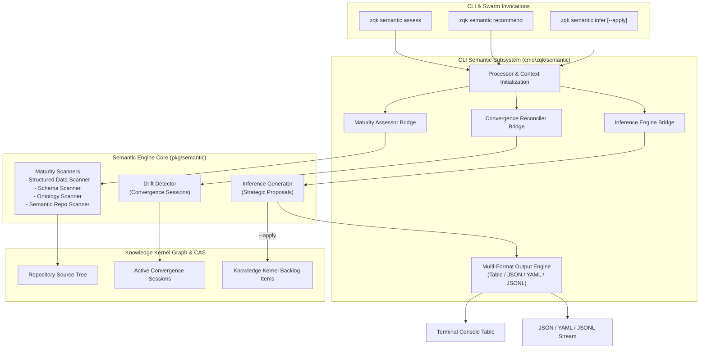

# CLI Semantic Subsystem Architectural Guide (`zqk semantic`)

## 1. Executive Summary & Architectural Mission

The `zqk semantic` subsystem provides an automated maturity assessment, inference, and recommendation engine for semantic assets across repositories managed by the ZQK Knowledge Kernel.

Modern software systems accumulate structured data, schemas, taxonomies, and ontologies across diverse files and formats. However, these assets often lack formal verification, relational coherence, and proactive drift detection. The `semantic` subsystem establishes a structured framework to evaluate, guide, and enhance an organization's semantic maturity level:

1. **Progressive Maturity Assessment**: Analyzes repository artifacts to classify maturity across five formal tiers (Level 0: Naive to Level 4: Expert), providing transparency into data rigor and ontological structure.
2. **Actionable Next-Step Recommendations**: Produces prioritized, effort-weighted guidance tailored to the repository's current maturity stage.
3. **Strategic Inferences & Drift Remediation**: Connects semantic maturity with runtime convergence sessions, detecting when execution trends away from defined goals and automatically inferring remediation backlog items.
4. **Multi-Format Serialization**: Seamlessly renders human-readable diagnostic tables or machine-consumable JSON, YAML, and JSONL streams for autonomous agent swarms and CI/CD pipelines.



---

## 2. Architectural Taxonomy & Package Layout

The Semantic subsystem is implemented under `cmd/zqk/semantic` and orchestrates core analytical services provided by `pkg/semantic`:

```
cmd/zqk/semantic/
├── semantic.go                                        # Root semantic command group definition
├── assess.go                                          # Maturity assessment command and table renderer
├── recommend.go                                       # Focused recommendation command
├── infer.go                                           # Convergence drift check and inference generator
├── helpers.go                                         # Maturity scanner wiring and project root resolver
├── semantic_test.go                                   # Baseline functional integration test suite
└── semantic_coverage_elevation_cycle109_test.go       # Comprehensive test matrix and boundary invariants
```

### Delegation & Layering
- **`semantic.go`**: Configures the root `semantic` Cobra command via `bldr_cli_cmd_v1.NewSemanticCommandBuilder()` and mounts the three primary subcommands.
- **`assess.go`**: Executes the full scan pipeline across structured data, JSON schemas, RDF/OWL ontologies, and semantic endpoints, rendering comprehensive indicators and maturity scores.
- **`recommend.go`**: An adaptive, focused interface over the assessment pipeline that isolates the current maturity level and outputs prioritized next steps.
- **`infer.go`**: Bridges repository scanning with Knowledge Kernel storage, detecting convergence drift across active sessions and proposing or applying new backlog items.
- **`helpers.go`**: Encapsulates default scanner construction (`defaultMaturityAssessor`), project root resolution, and error wrapping invariants.

---

## 3. Command Taxonomy & Operational Modes

| Command | Primary Function | Input Constraints | Primary Flags |
| :--- | :--- | :--- | :--- |
| `zqk semantic assess` | Evaluates semantic maturity across 4 indicator classes | Zero arguments (`cobra.NoArgs`) | `--format` (`table`, `json`, `yaml`, `jsonl`) |
| `zqk semantic recommend` | Focuses on next recommended actions for current maturity | Zero arguments (`cobra.NoArgs`) | `--format` (`table`, `json`, `yaml`, `jsonl`) |
| `zqk semantic infer` | Detects convergence drift and proposes strategic backlog items | Zero arguments (`cobra.NoArgs`) | `--apply`, `--session-id`, `--format` |

### 3.1 `zqk semantic assess`

Evaluates the target repository across four key indicator dimensions:
1. **Structured Data**: Scans for structured configuration files (YAML, JSON, TOML).
2. **Formal Schemas**: Identifies formal contracts (JSON Schema, XSD, Protocol Buffers).
3. **Ontologies**: Detects semantic definitions (RDF, OWL, Turtle, SHACL).
4. **Semantic Repositories**: Inspects configurations for SPARQL endpoints, triplestores, or graph databases.

```bash
# Human-readable diagnostic table
zqk semantic assess

# Machine-readable JSON output for automated ingestion
zqk semantic assess -f json

# Machine-readable YAML output
zqk semantic assess -f yaml
```

#### Maturity Level Scale
- **Level 0 (Naive)**: No structured data or taxonomies detected.
- **Level 1 (Aware)**: Structured data present; basic configuration taxonomies.
- **Level 2 (Practicing)**: Formal schemas validated; structured databases present.
- **Level 3 (Advanced)**: Ontologies (RDF/OWL) detected; SPARQL endpoints configured.
- **Level 4 (Expert)**: Multi-ontology integration; automated semantic reasoning and inference active.

### 3.2 `zqk semantic recommend`

Provides an adaptive, high-signal summary of next architectural improvements tailored to the repository's assessed level:

```bash
# Standard table output
zqk semantic recommend

# JSON format
zqk semantic recommend -f json
```

Example output:
```text
Semantic Maturity Recommendations
==================================
Level: 1 (Aware)

Next recommended actions:
  1. Introduce JSON schemas for configs
     Priority: high | Effort: medium | Benefit: Validation and consistency
```

### 3.3 `zqk semantic infer`

Identifies strategic gaps by correlating the static maturity assessment with dynamic runtime data in the Knowledge Kernel:
- Evaluates active convergence sessions to detect "trending away" conditions.
- Formulates discrete, actionable backlog items with priority tiers and rationale.
- When invoked with `--apply`, writes the proposed backlog items directly into Kernel storage.

```bash
# Dry run: view proposed backlog items
zqk semantic infer

# Filter by a specific convergence session ID
zqk semantic infer --session-id CVS-DRIFT-001

# Apply proposed inferences directly to Kernel backlog storage
zqk semantic infer --apply
```

---

## 4. Algorithmic Foundations

### 4.1 Multi-Scanner Maturity Assessment Pipeline

The assessment engine executes four independent scanner implementations in sequence:
- `StructuredDataScanner`: Inspects file extensions and directory layouts for YAML, JSON, and TOML.
- `SchemaScanner`: Verifies schema meta-properties (`$schema`, `xs:schema`) to differentiate loose data from formal contracts.
- `OntologyScanner`: Parses RDF, OWL, and Turtle documents to detect ontological classes, properties, and relationships.
- `SemanticRepositoryScanner`: Checks environment variables and configuration files for SPARQL endpoint URLs and triplestore connection definitions.

Each scanner returns an `Indicator` struct containing:
- `Type`: Domain indicator classification.
- `Found`: Boolean presence indicator.
- `Examples`: Discovered representative artifact paths.
- `Sophistication`: Qualitative rating (`none`, `basic`, `intermediate`, `advanced`).

### 4.2 Convergence Drift Detection & Reconciler

The `SemanticReconciler` inspects active `convergence_session` objects in Kernel storage:
1. Queries storage for `Kind: convergence_session` with `status: active`.
2. Inspects the `delta_assessment` field of each session.
3. Flags sessions marked as `trending_away` as experiencing convergence drift.
4. Passes drifted sessions to the `InferenceEngine` to generate corrective backlog items.

### 4.3 Graph Traversal & Ontology Token Extraction

The semantic engine interfaces with repository-level and graph-level models:
- **Ontology Token Extraction**: Extracts URIs, namespace prefixes, and entity labels from RDF/OWL triples.
- **Graph Traversal**: Explores parent-child and predicate relationships across kernel objects to map conceptual coverage.
- **Embedding Similarity Alignment**: Compares natural language definitions of backlog items against ontology node descriptions to propose semantic linkages.

---

## 5. Output Formatting & Serialization

The subsystem supports four standard output formats via the `--format` (`-f`) flag:

### 5.1 Table Format (Default)
Optimized for human operators with colorized status icons (`✅ Found`, `❌ Not found`) and structured sections for indicators and recommendations.

### 5.2 JSON Format (`-f json`)
Emits a structured JSON payload suitable for automated processing:
```json
{
  "level": 2,
  "level_name": "Practicing",
  "indicators": [
    {
      "type": "structured_data",
      "found": true,
      "examples": ["sample.yaml", "config.json"],
      "sophistication": "intermediate"
    }
  ],
  "recommendations": [
    {
      "recommendation": "Adopt formal schemas",
      "priority": "high",
      "effort": "low",
      "benefit": "high"
    }
  ]
}
```

### 5.3 YAML Format (`-f yaml`)
Renders valid YAML conforming to the assessment schema for declarative configuration and CI/CD pipelines.

### 5.4 JSONL Format (`-f jsonl`)
Streams single-line JSON records designed for high-throughput log analysis and streaming agent ingest.

---

## 6. Verification & Statement Coverage Invariant

To ensure reliability for autonomous agent execution and system health checks, the `cmd/zqk/semantic` package enforces a strict statement coverage gate:

- **Target Coverage Floor**: Statement coverage must meet or exceed **85.0%** (target) and **90.0%** (elevation threshold).
- **Current Verified Coverage**: **97.7%** of statements covered under unit and integration suites.
- **AST Quality Invariant**: Zero swallowed errors. All errors returned by internal operations must be checked explicitly or wrapped via `errfmt` without exception.
- **Negative Boundary Resilience**: Validates behavior under canceled contexts, missing command contexts, empty project roots, simulated storage write failures, and unknown CLI flags.

### Running Subsystem Tests
To execute tests against the semantic subsystem with timeout boundaries and coverage reporting:

```bash
go test -v -timeout 30s -cover ./cmd/zqk/semantic
```
