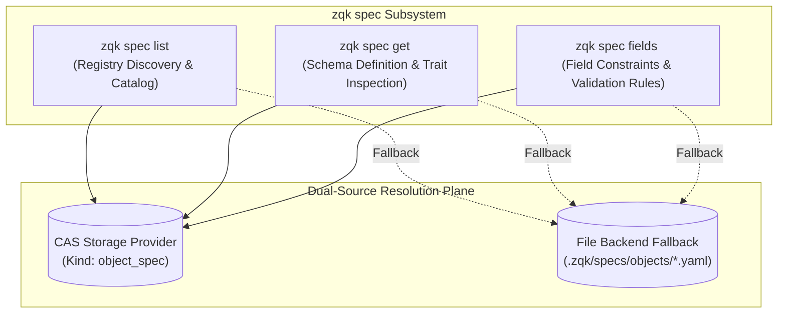

# CLI Spec Subsystem and Schema Registry Guide

## 1. Overview and Relational Architecture

The `zqk spec` command family provides programmatic introspection, validation inspection, and reflection across all object specifications registered within the ZQK Knowledge Kernel.

Within the ZQK architecture, object schemas are not static hardcoded structures; they are dynamic, composable, and versioned entities governed by the Knowledge Kernel Schema Registry. Specifications define:
- **Ontology and Semantics:** Canonical naming (`kind`), hierarchical derivation (`extends`), and composite mixins (`composes`).
- **Field Invariants:** Field types, permissions (`rwx`, `ro`, `wo`), semantic classifications, and operational purposes.
- **Validation Rules:** Static constraints (regex, format, length, enum membership) and dynamic relational constraints.



---

## 2. Command Family Taxonomy

| Subcommand | Scope & Purpose | Primary Operations |
| :--- | :--- | :--- |
| `zqk spec list` | Specification Discovery | Query and enumerate all registered object specifications from CAS storage or local filesystem fallback (`.zqk/specs/objects`). |
| `zqk spec get <kind>` (alias `show`) | Specification Inspector | Retrieve detailed specification metadata including ontology, schema version, inheritance hierarchy, traits, visibility, and required fields. |
| `zqk spec fields <kind>` | Field Validation Inspector | Inspect field-level attributes including data types, read/write permissions, semantic classifications, checklists, and validation constraints. |

---

## 3. Operational Guides and Invariants

### 3.1 Specification Catalog (`zqk spec list`)
Lists all available object specifications known to the active project context.

- **Standard Table Output:**
  ```bash
  zqk spec list
  ```
  Aliases: `zqk spec ls`.

- **Structured JSON Stream:**
  ```bash
  zqk spec list --format json
  ```
  Returns a serialized catalog containing `objects` array and `meta` summary with total specification counts.

- **Dual-Source Fallback Invariant:**
  When executing against a file-based storage backend where `object_spec` entities are not yet stored in SQLite CAS, `zqk spec list` gracefully falls back to scanning `.zqk/specs/objects/*.yaml` to guarantee high-availability schema reflection.

---

### 3.2 Specification Details (`zqk spec get`)
Inspects the comprehensive schema definition for a specified object kind.

- **Inspect Canonical Spec:**
  ```bash
  zqk spec get backlog_item
  ```
  Aliases: `zqk spec show backlog_item`.

- **Normalized Kind Resolution:**
  The `<kind>` argument is case-insensitive and automatically normalizes canonical prefixes (e.g. `zqk spec get SPEC-widget` and `zqk spec get WIDGET` resolve to `widget`).

- **Raw vs. Resolved Traits (`--raw`):**
  - By default, `zqk spec get` resolves traits dynamically through the inheritance tree (`spec.ResolvedTraits`).
  - Specifying `--raw` bypasses dynamic trait composition and displays the local uncomposed declaration (`spec.Traits`).

- **Structured Output:**
  ```bash
  zqk spec get requirement --format yaml
  zqk spec get requirement --format json
  ```
  Emits complete specification attributes: `schema_version`, `ontology`, `extends`, `composes`, `visibility`, `storage_profile`, `id_prefixes`, `required_fields`, and `fields`.

---

### 3.3 Field-Level Inspection (`zqk spec fields`)
Introspects field definitions, data types, permissions, and validation rules for an object kind.

- **Inspect All Fields (Table View):**
  ```bash
  zqk spec fields backlog_item
  ```
  Displays an aligned table showing:
  - `FIELD`: Property name.
  - `TYPE`: Primitive or structured data type.
  - `REQ`: Required boolean indicator.
  - `SEMANTIC`: Semantic type classification.
  - `PERM`: Access permissions (e.g., `rwx`, `ro`).
  - `PURPOSE`: Checklist purpose description.

- **Filter to Required Fields Only (`--required-only`):**
  ```bash
  zqk spec fields backlog_item --required-only
  ```
  Isolates mandatory schema fields required for object origination and promotion.

- **Structured Machine Output:**
  ```bash
  zqk spec fields goal --format json
  ```
  Emits a structured payload containing `ontology`, `total_count`, and sorted `fields` list (required fields sorted first, followed by alphabetical order).

---

## 4. Verification and Done-Gates

Verification for the spec subsystem is codified in `TST-1792081516722975001-0952f45e` and fulfills the Three-Fold Proof:

1. **Static Floor Invariant (`CRIT-1792081516722975000-0bc7e96d`):** Statement test coverage in `cmd/zqk/spec` elevates to $\ge 90.0\%$ with all subcommands (`list`, `get`, `fields`, `NewSpecCmd`) exercising in-process execution paths across table, JSON, and YAML formats.
2. **Operational Dynamic Proof (`CRIT-1792081516722976000-499ea52d`):** In-process test suites execute commands against isolated temporary projects, validating dual-source fallback, prefix normalization, raw vs. resolved traits, and deterministic error handling for non-existent kinds.
3. **Negative Boundary & Architectural Conformance (`CRIT-1792081516722977000-a3ea1c87`):** Authoritative CLI guide `docs/guides/CLI_SPEC_SUBSYSTEM_AND_SCHEMA_REGISTRY_GUIDE.md` authored, cataloging command taxonomy, operational examples, and relational schema registry invariants.
