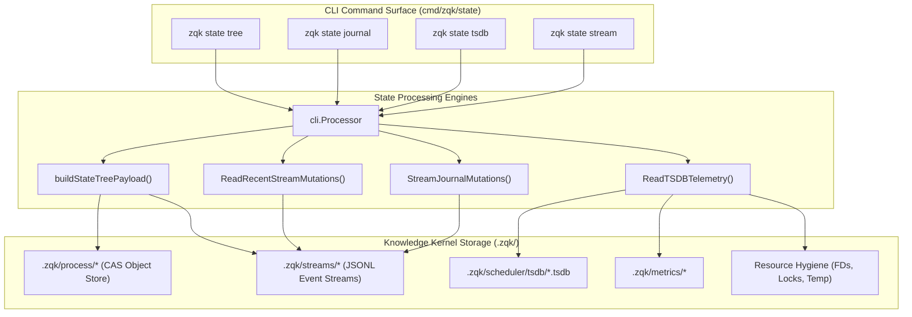
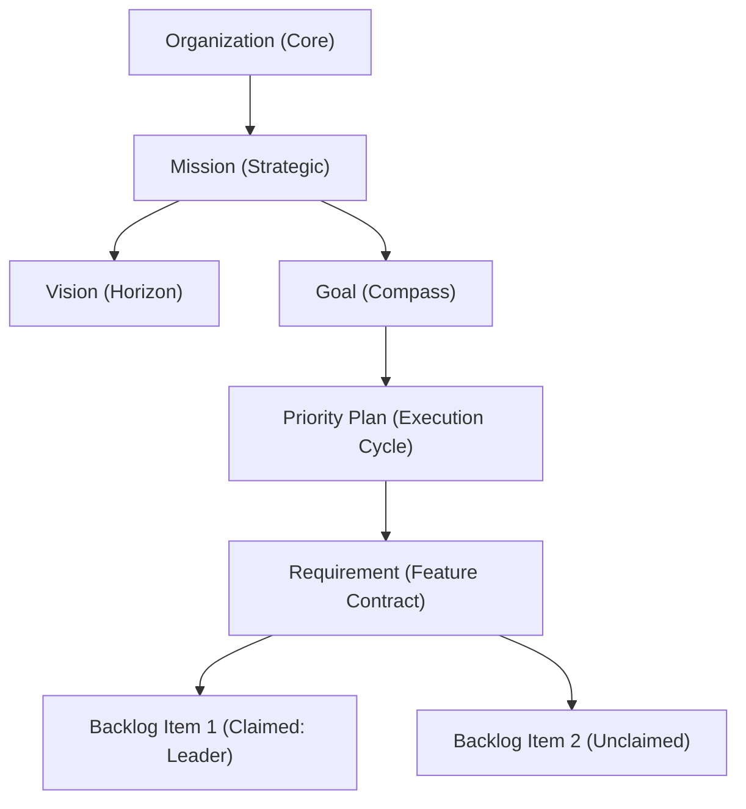
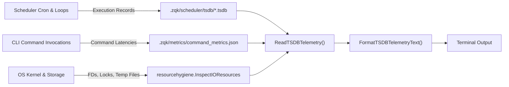

# CLI State Subsystem Architectural Guide

## Overview

The **ZQK CLI State Subsystem** (`cmd/zqk/state`) provides real-time state inspection, hierarchical ontological tree projection, immutable change journal auditing, time-series telemetry querying, and live state seismograph monitoring across the Zen Quantum Kernel (ZQK).

In transient prompt-promiscuous harnesses, program state, execution progress, and task dependencies exist solely as ephemeral context tokens that degrade as context windows churn. In contrast, ZQK anchors strategic intent, execution cycles, verification criteria, and change mutations into an immutable, content-addressable **Knowledge Kernel**. The CLI State subsystem acts as the high-fidelity observability and inspection plane, enabling human operators and autonomous swarms to inspect current system realities, trace changes, monitor system vitals, and observe live kernel events.

The State subsystem delivers four core capabilities:
1. **Hierarchical State Tree Projection (`zqk state tree`)**: Renders the five-layer ontological cascade—from Strategic Vision and Compass Goals down to Active Priority Plans, Requirement Contracts, Backlog Items, and Leased Agent Seats.
2. **Immutable Change Journal Auditing (`zqk state journal`)**: Inspects the append-only change journal log to audit entity lifecycle transitions, field-level mutations, and cryptographic diff summaries.
3. **Time-Series Telemetry & Vitals (`zqk state tsdb`)**: Analyzes scheduler job execution performance, command invocation velocity, content-addressable storage (CAS) volume distribution, and operating system resource hygiene.
4. **Live Kernel State Seismograph (`zqk state stream`)**: Delivers an interactive ANSI console seismograph and live event stream monitoring file-system stream ingestion in real time with debounced batching and CPCP compliance badges.

---

## Subsystem Architecture & File Layout

The State subsystem is partitioned into modular CLI command builders, storage readers, text formatters, and stream visualizers within `cmd/zqk/state/`:

```
cmd/zqk/state/
├── state.go                                       # Root 'zqk state' command group registration
├── tree.go                                        # 'zqk state tree': Ontological tree projection & journal aggregation
├── journal.go                                     # 'zqk state journal': Recent change journal reader & table formatting
├── tsdb.go                                        # 'zqk state tsdb': Time-series query command & ASCII telemetry dashboard
├── tsdb_reader.go                                 # TSDB storage reader, hygiene inspector & metric aggregators
├── stream.go                                      # 'zqk state stream': Inotify/fsnotify seismograph & live dashboard
├── tree_test.go                                   # Tree formatting and structural verification
├── tsdb_test.go                                   # TSDB flag and execution tests
├── stream_test.go                                 # Stream command tests
├── state_extended_test.go                         # Extended integration tests across all commands
└── state_coverage_elevation_cycle110_test.go       # Cycle 110 comprehensive test suite (>= 85.0% coverage)
```

---

## Command Taxonomy & Ergonomics

The state command group is invoked via `zqk state <subcommand>`:

| Command | Aliases | Description | Primary Flags |
| :--- | :--- | :--- | :--- |
| `zqk state tree` | — | Renders hierarchical ontological cascade and active work | `--format=text\|json` |
| `zqk state journal` | `log`, `history` | Audits append-only change journal mutations | `--limit=<int>`, `--format=text\|json` |
| `zqk state tsdb` | — | Queries time-series metrics, scheduler jobs, and vitals | `--since=<dur>`, `--job-id=<str>`, `--limit=<int>`, `--format=text\|json` |
| `zqk state stream` | `monitor`, `watch` | Streams real-time kernel seismograph events | `--follow[=bool]`, `--dashboard[=bool]`, `--limit=<int>` |

---

## Subsystem Interaction Topology

The following diagram illustrates how the CLI State commands project data from the Knowledge Kernel, content-addressable storage, metric chunks, and stream files:



---

## Core Architecture & Invariants

### 1. Hierarchical State Tree Projection (`zqk state tree`)

The State Tree command synthesizes an integrated perspective across the Knowledge Kernel's timeless and time-bounded domains:



#### Key Projection Behaviors:
- **Ontological Cascade**: Pre-fetches Organization, Mission, Vision, and Goal contracts from storage to provide anchoring context.
- **Active Plans & Requirements**: Scans for active priority plans (`status != completed && status != archived`), resolves associated workstreams, and correlates backlog items to their parent requirement contracts.
- **Lease Tracking**: Displays agent identity (`claimed_by`) on in-progress backlog items to maintain multi-agent swarm transparency.
- **Recent Journal Stream Summary**: Appends the latest 8 stream mutations directly beneath the tree for instant situational awareness.

---

### 2. Change Journal Lifecycle & Stream Aggregation (`zqk state journal`)

The Kernel tracks state transformations using append-only, line-delimited JSON stream records stored in `.zqk/streams/`:

```json
{"id":"MUT-JOURNAL-001","change_type":"update","object_ref":"backlog_item:BLI-DEMO-001","diff_summary":"status: planned -> in_progress","created_at":1700000000,"created_by":"AGENT-LEADER"}
```

#### Tracked Stream Categories:
1. `change_journal_entry`: Fine-grained object mutations, attribute updates, and state transitions.
2. `audit_event`: Security validations, gate check evaluations, and policy enforcement events.
3. `agent_instruction`: Swarm dispatch signals, agent directives, and task claim assignments.
4. `process_lifecycle`: Priority plan promotions, phase transitions, and milestone completions.

#### Caching and Performance:
- **Stamp-Based In-Memory Cache**: `ReadRecentStreamMutations` tracks file modification timestamps (`stampmemo.Stamp`). Clean files bypass disk I/O and JSON unmarshaling on repeated queries.
- **Automatic Fallback Resolution**: When stream records omit explicit diff summaries, the reader automatically falls back to operation descriptions, titles, instructions, or change types.
- **Chronological Sorting**: Records are collated across all tracked stream directories, sorted descending by timestamp (with ID fallback tie-breaking), and truncated to the requested limit.

---

### 3. Time-Series Telemetry & Vitals Engine (`zqk state tsdb`)

The TSDB subsystem monitors kernel operations, execution performance, and system health by aggregating time-series data:



#### Telemetry Dimensions:
- **Scheduler Job Performance**: Aggregates job executions, success rates, latency distributions (min, max, average), and generates ASCII sparklines representing execution trends over time.
- **Command Velocity**: Tracks invocation counts, average durations, and error rates for top CLI commands.
- **CAS Object Volumes**: Analyzes the distribution and volume of active objects across entity kinds (`backlog_item`, `priority_plan`, `requirement`, `criteria`, `test_case`, etc.).
- **Resource Hygiene**: Inspects open file descriptor utilization, active file locks, orphaned temporary files, and uncommitted draft objects, classifying system health into `HEALTHY`, `ATTENTION`, or `CRITICAL`.

---

### 4. Live Kernel State Seismograph & CPCP Membrane (`zqk state stream`)

The Seismograph command provides continuous monitoring of kernel state transitions. When executed with `--follow`, the command establishes file-system notifications via `fsnotify`:

#### CPCP Fail-Closed Membrane Invariant:
All kernel mutations surfaced through the State Seismograph pass through the Continuous Provenance & Conformance Protocol (CPCP) membrane. Each event display renders a verification badge:
- `[CPCP: PASS]`: Verified immutable mutation conforming to schema, provenance, and transition invariants.
- Fail-Closed Protection: Mutations that violate AST or schema invariants are rejected before persistence, guaranteeing that stream consumers only observe structurally valid state transitions.

#### Seismograph Streaming Features:
- **Event Debouncing**: Filesystem write bursts are debounced (50ms window) to prevent terminal flicker during high-velocity swarm writes.
- **Dynamic File Discovery**: Automatically watches tracked stream directories and attaches watchers to newly created JSON stream files.
- **Dual Visual Modes**:
  - **Terminal Scroll Mode (`--dashboard=false`)**: Appends formatted, ANSI-badged event lines as mutations occur.
  - **Full-Screen Seismograph Dashboard (`--dashboard=true`)**: Renders a live-updating ANSI dashboard displaying active actors, affected object types, event volume sparklines, and CPCP compliance status.
- **Graceful Shutdown**: Listens to context cancellation signals (`cmd.Context().Done()`) to cleanly flush output and close file watchers.

---

## Output Format Options

The CLI State subsystem supports structured and machine-readable output formatting across all commands:

| Command | Text / Table Output | JSON Output (`--format json`) | Stream Output (`--follow`) |
| :--- | :--- | :--- | :--- |
| `zqk state tree` | Human-readable ASCII tree hierarchy | Structured JSON tree with full entity nodes | — |
| `zqk state journal` | Formatted Unicode table with ID, type, ref, diff, time | JSON payload containing mutation count and records | — |
| `zqk state tsdb` | Formatted ASCII dashboard with metrics and sparklines | Structured JSON payload containing TSDB measurements | — |
| `zqk state stream` | Static or live ANSI event log / dashboard | JSON array of historical mutations (`--follow=false`) | Live event stream or ANSI full-screen dashboard |

---

## Verification & Statement Coverage Invariant

To ensure system reliability, the ZQK project enforces strict architectural and coverage invariants on the CLI State subsystem:

1. **Statement Coverage Floor (>= 85.0%)**:
   - The package `cmd/zqk/state` must maintain a minimum statement coverage of 85.0%.
   - In Cycle 110, statement test coverage was elevated from 83.3% to **95.0%** via `state_coverage_elevation_cycle110_test.go`.
   - Covered surfaces include:
     - `buildStateTreePayload`: 100.0% coverage covering the full ontological cascade and requirement mapping.
     - `ReadRecentStreamMutations`: 97.5% coverage covering multi-category stream aggregation, fallback attribute extraction, and stamp-based caching.
     - `StreamJournalMutations`: 93.1% coverage covering live filesystem watching, event debouncing, and dashboard rendering.
     - `RunStateTSDB` & `FormatTSDBTelemetryText`: 100.0% coverage covering telemetry durations, job filtering, and vitals formatting.
2. **Operational Dynamic Proof**:
   - Every subcommand (`tree`, `journal`, `tsdb`, `stream`) is exercised through isolated test environments with both valid and boundary error conditions.
3. **AST Complexity Limit (< 100 lines)**:
   - All production functions and unit test helpers must remain strictly under 100 lines (target < 60 lines), ensuring high maintainability and modular test design.
4. **Zero Swallowed Errors Invariant**:
   - No error return values may be discarded using blank identifiers (`_ = ...`). All error instances must be explicitly handled, asserted, or logged.
